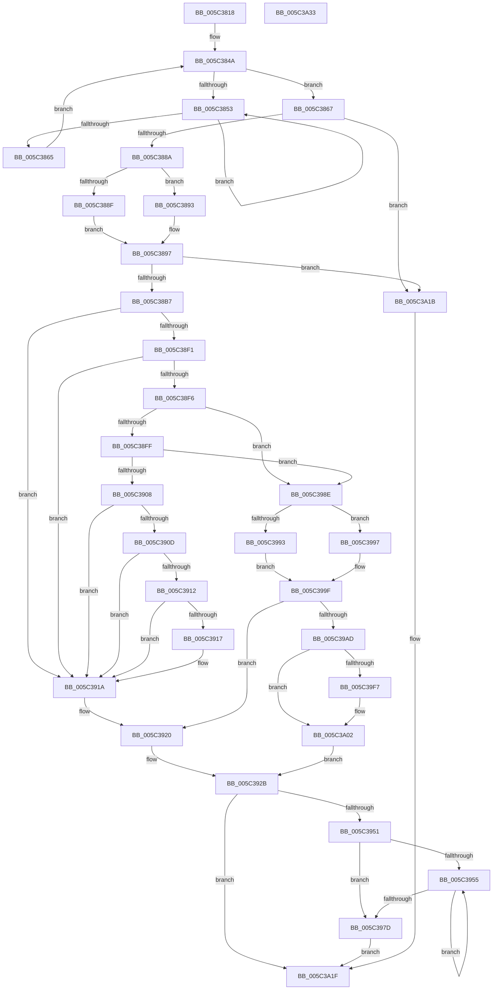

# KiAdjustCoreIsolationReasonThread

- RVA: `0x005C3818`–`0x005C3A34` (길이 `540` bytes)
- VA: `0x00000001405C3818`
- 실행 섹션: `.text`
- PDB 이름 있음: `예`; PDB Function 태그: `아니요`
- unwind 정보 RVA: `0x000C4704`
- 디코드: `163`개 명령, `540/540` bytes 표시
- 미해석 바이트: `0` (있으면 어셈블리에 `.byte`로 보존)

> 이 문서는 커널 이미지의 기계어와 PDB 기호를 분석해 생성했습니다. 4번과 5번은 함수 원형과 자료형을 바이너리 사용 방식에서 추정한 C 해석이며 원본 소스 복구 결과는 아닙니다.

## 1. Dependencies

- 직접 호출 지점: **12**; 고유 호출 대상: **11**
- 직접 호출자로 확인된 함수: **1**
- RIP 상대 이미지 참조: **0**

### Outgoing calls
- `0x005C3857` → [KeYieldProcessorEx](../3F/KeYieldProcessorEx_function_003FBD00.md) (function, `0x003FBD00`)
- `0x005C38D6` → [KiAcquireThreadStateLockForWrite](../30/KiAcquireThreadStateLockForWrite_function_0030E8C0.md) (function, `0x0030E8C0`)
- `0x005C3926` → [KiSetThreadIsolationWidthUnsafe](KiSetThreadIsolationWidthUnsafe_function_005C45DC.md) (function, `0x005C45DC`)
- `0x005C393F` → [KiReleaseThreadStateLock](../21/KiReleaseThreadStateLock_function_00217910.md) (function, `0x00217910`)
- `0x005C396F` → [KiCompleteRescheduleContextEntry](../35/KiCompleteRescheduleContextEntry_function_00356330.md) (function, `0x00356330`)
- `0x005C3984` → [KiFlushSoftwareInterruptBatch](../25/KiFlushSoftwareInterruptBatch_function_00252200.md) (function, `0x00252200`)
- `0x005C39BF` → [memset](../6C/memset_function_006C6C40.md) (function, `0x006C6C40`)
- `0x005C39CE` → [KiStartRescheduleContext](../30/KiStartRescheduleContext_function_0030C6B0.md) (function, `0x0030C6B0`)
- `0x005C39D9` → [KiSetThreadIsolationWidthUnsafe](KiSetThreadIsolationWidthUnsafe_function_005C45DC.md) (function, `0x005C45DC`)
- `0x005C39EA` → [KiAdjustRescheduleContextForIsolationWidthChange](KiAdjustRescheduleContextForIsolationWidthChange_function_005C9030.md) (function, `0x005C9030`)
- `0x005C39FD` → [KiSearchForNewThreadsForRescheduleContext](../25/KiSearchForNewThreadsForRescheduleContext_function_00258620.md) (function, `0x00258620`)
- `0x005C3A0E` → [KiCommitRescheduleContext](../30/KiCommitRescheduleContext_function_0030CF20.md) (function, `0x0030CF20`)

### Direct callers
- [KeEnableCoreIsolationMitigationPolicyThread](KeEnableCoreIsolationMitigationPolicyThread_function_005C35B4.md) at `0x005C35F9`

### Static image references
- 디코드된 RIP-relative 메모리 참조가 없습니다.

## 2. Other-region calls and transfers

- 다른 실행 섹션으로 향하는 call: **0**
- 별도 외부 분기/꼬리 이동을 확인하지 못했습니다.

## 3. Assembly (complete function range)

```asm
005C3818  4C 89 4C 24 20                  mov qword ptr [rsp + 0x20], r9
005C381D  55                              push rbp
005C381E  53                              push rbx
005C381F  56                              push rsi
005C3820  57                              push rdi
005C3821  41 54                           push r12
005C3823  41 55                           push r13
005C3825  41 56                           push r14
005C3827  41 57                           push r15
005C3829  48 8B EC                        mov rbp, rsp
005C382C  48 83 EC 58                     sub rsp, 0x58
005C3830  33 DB                           xor ebx, ebx
005C3832  41 8A F0                        mov sil, r8b
005C3835  48 89 5D D8                     mov qword ptr [rbp - 0x28], rbx
005C3839  44 8B F2                        mov r14d, edx
005C383C  48 89 5D E0                     mov qword ptr [rbp - 0x20], rbx
005C3840  48 8B F9                        mov rdi, rcx
005C3843  48 89 5D 48                     mov qword ptr [rbp + 0x48], rbx
005C3847  89 5D 50                        mov dword ptr [rbp + 0x50], ebx
005C384A  F0 48 0F BA 6F 40 00            lock bts qword ptr [rdi + 0x40], 0
005C3851  73 14                           jae 0x1405c3867
005C3853  48 8D 4D 50                     lea rcx, [rbp + 0x50]
005C3857  E8 A4 84 E3 FF                  call 0x1403fbd00
005C385C  48 8B 47 40                     mov rax, qword ptr [rdi + 0x40]
005C3860  48 85 C0                        test rax, rax
005C3863  75 EE                           jne 0x1405c3853
005C3865  EB E3                           jmp 0x1405c384a
005C3867  8A 97 61 04 00 00               mov dl, byte ptr [rdi + 0x461]
005C386D  41 8B CE                        mov ecx, r14d
005C3870  B8 01 00 00 00                  mov eax, 1
005C3875  D2 E0                           shl al, cl
005C3877  84 D0                           test al, dl
005C3879  41 0F 95 C7                     setne r15b
005C387D  44 88 7D 58                     mov byte ptr [rbp + 0x58], r15b
005C3881  44 3A FE                        cmp r15b, sil
005C3884  0F 84 91 01 00 00               je 0x1405c3a1b
005C388A  40 84 F6                        test sil, sil
005C388D  74 04                           je 0x1405c3893
005C388F  0A D0                           or dl, al
005C3891  EB 04                           jmp 0x1405c3897
005C3893  F6 D0                           not al
005C3895  22 D0                           and dl, al
005C3897  84 D2                           test dl, dl
005C3899  88 97 61 04 00 00               mov byte ptr [rdi + 0x461], dl
005C389F  8B 47 78                        mov eax, dword ptr [rdi + 0x78]
005C38A2  44 8B FB                        mov r15d, ebx
005C38A5  41 0F 95 C7                     setne r15b
005C38A9  D1 E8                           shr eax, 1
005C38AB  83 E0 01                        and eax, 1
005C38AE  44 3B F8                        cmp r15d, eax
005C38B1  0F 84 64 01 00 00               je 0x1405c3a1b
005C38B7  0F 57 C0                        xorps xmm0, xmm0
005C38BA  48 8D 45 E8                     lea rax, [rbp - 0x18]
005C38BE  4C 8D 4D E0                     lea r9, [rbp - 0x20]
005C38C2  48 89 44 24 20                  mov qword ptr [rsp + 0x20], rax
005C38C7  4C 8D 45 48                     lea r8, [rbp + 0x48]
005C38CB  48 8B CF                        mov rcx, rdi
005C38CE  48 8D 55 D8                     lea rdx, [rbp - 0x28]
005C38D2  0F 11 45 E8                     movups xmmword ptr [rbp - 0x18], xmm0
005C38D6  E8 E5 AF D4 FF                  call 0x14030e8c0
005C38DB  65 4C 8B 2C 25 20 00 00 00      mov r13, qword ptr gs:[0x20]
005C38E4  4C 8B 65 D8                     mov r12, qword ptr [rbp - 0x28]
005C38E8  0F B6 D0                        movzx edx, al
005C38EB  8B CA                           mov ecx, edx
005C38ED  84 C0                           test al, al
005C38EF  74 29                           je 0x1405c391a
005C38F1  83 E9 01                        sub ecx, 1
005C38F4  74 24                           je 0x1405c391a
005C38F6  83 E9 01                        sub ecx, 1
005C38F9  0F 84 8F 00 00 00               je 0x1405c398e
005C38FF  83 E9 01                        sub ecx, 1
005C3902  0F 84 86 00 00 00               je 0x1405c398e
005C3908  83 E9 01                        sub ecx, 1
005C390B  74 0D                           je 0x1405c391a
005C390D  83 E9 01                        sub ecx, 1
005C3910  74 08                           je 0x1405c391a
005C3912  83 E9 01                        sub ecx, 1
005C3915  74 03                           je 0x1405c391a
005C3917  83 E9 01                        sub ecx, 1
005C391A  48 8B F3                        mov rsi, rbx
005C391D  44 8A F3                        mov r14b, bl
005C3920  41 8B D7                        mov edx, r15d
005C3923  48 8B CF                        mov rcx, rdi
005C3926  E8 B1 0C 00 00                  call 0x1405c45dc
005C392B  4C 8B 4D E0                     mov r9, qword ptr [rbp - 0x20]
005C392F  48 8D 45 E8                     lea rax, [rbp - 0x18]
005C3933  4C 8D 45 48                     lea r8, [rbp + 0x48]
005C3937  48 89 44 24 20                  mov qword ptr [rsp + 0x20], rax
005C393C  49 8B D4                        mov rdx, r12
005C393F  E8 CC 3F C5 FF                  call 0x140217910
005C3944  48 89 5F 40                     mov qword ptr [rdi + 0x40], rbx
005C3948  45 84 F6                        test r14b, r14b
005C394B  0F 84 CE 00 00 00               je 0x1405c3a1f
005C3951  38 1E                           cmp byte ptr [rsi], bl
005C3953  76 28                           jbe 0x1405c397d
005C3955  8B C3                           mov eax, ebx
005C3957  45 33 C9                        xor r9d, r9d
005C395A  45 33 C0                        xor r8d, r8d
005C395D  49 8B D5                        mov rdx, r13
005C3960  48 8D 0C 85 02 00 00 00         lea rcx, [rax*4 + 2]
005C3968  48 03 C8                        add rcx, rax
005C396B  48 8D 0C CE                     lea rcx, [rsi + rcx*8]
005C396F  E8 BC 29 D9 FF                  call 0x140356330
005C3974  0F B6 06                        movzx eax, byte ptr [rsi]
005C3977  FF C3                           inc ebx
005C3979  3B D8                           cmp ebx, eax
005C397B  72 D8                           jb 0x1405c3955
005C397D  49 8D 8D D8 35 00 00            lea rcx, [r13 + 0x35d8]
005C3984  E8 77 E8 C8 FF                  call 0x140252200
005C3989  E9 91 00 00 00                  jmp 0x1405c3a1f
005C398E  83 FA 03                        cmp edx, 3
005C3991  75 04                           jne 0x1405c3997
005C3993  B0 01                           mov al, 1
005C3995  EB 08                           jmp 0x1405c399f
005C3997  49 39 5C 24 10                  cmp qword ptr [r12 + 0x10], rbx
005C399C  0F 94 C0                        sete al
005C399F  44 8A F3                        mov r14b, bl
005C39A2  48 8B F3                        mov rsi, rbx
005C39A5  84 C0                           test al, al
005C39A7  0F 84 73 FF FF FF               je 0x1405c3920
005C39AD  49 8B B5 E8 37 00 00            mov rsi, qword ptr [r13 + 0x37e8]
005C39B4  33 D2                           xor edx, edx
005C39B6  48 8B CE                        mov rcx, rsi
005C39B9  41 B8 F0 00 00 00               mov r8d, 0xf0
005C39BF  E8 7C 32 10 00                  call 0x1406c6c40
005C39C4  4C 8B C7                        mov r8, rdi
005C39C7  48 8D 55 48                     lea rdx, [rbp + 0x48]
005C39CB  48 8B CE                        mov rcx, rsi
005C39CE  E8 DD 8C D4 FF                  call 0x14030c6b0
005C39D3  41 8B D7                        mov edx, r15d
005C39D6  48 8B CF                        mov rcx, rdi
005C39D9  E8 FE 0B 00 00                  call 0x1405c45dc
005C39DE  45 8B CF                        mov r9d, r15d
005C39E1  4C 8B C7                        mov r8, rdi
005C39E4  49 8B D4                        mov rdx, r12
005C39E7  48 8B CE                        mov rcx, rsi
005C39EA  E8 41 56 00 00                  call 0x1405c9030
005C39EF  4C 8B 75 60                     mov r14, qword ptr [rbp + 0x60]
005C39F3  84 C0                           test al, al
005C39F5  74 0B                           je 0x1405c3a02
005C39F7  49 8B D6                        mov rdx, r14
005C39FA  48 8B CE                        mov rcx, rsi
005C39FD  E8 1E 4C C9 FF                  call 0x140258620
005C3A02  4D 8B CE                        mov r9, r14
005C3A05  45 33 C0                        xor r8d, r8d
005C3A08  49 8B D5                        mov rdx, r13
005C3A0B  48 8B CE                        mov rcx, rsi
005C3A0E  E8 0D 95 D4 FF                  call 0x14030cf20
005C3A13  44 8A F0                        mov r14b, al
005C3A16  E9 10 FF FF FF                  jmp 0x1405c392b
005C3A1B  48 89 5F 40                     mov qword ptr [rdi + 0x40], rbx
005C3A1F  8A 45 58                        mov al, byte ptr [rbp + 0x58]
005C3A22  48 83 C4 58                     add rsp, 0x58
005C3A26  41 5F                           pop r15
005C3A28  41 5E                           pop r14
005C3A2A  41 5D                           pop r13
005C3A2C  41 5C                           pop r12
005C3A2E  5F                              pop rdi
005C3A2F  5E                              pop rsi
005C3A30  5B                              pop rbx
005C3A31  5D                              pop rbp
005C3A32  C3                              ret
005C3A33  CC                              int3
```

## 4. C-style interpretation (structured pseudocode)

```c
__int64 __fastcall KiAdjustCoreIsolationReasonThread(__int64 a1, int a2, unsigned __int8 a3, __int64 a4)
{
    __int64 result;
    __int64 v_r15;
    __int64 v_rbx;
    __int64 v_rsp;
    unsigned __int64 v_stack_m58;
    unsigned __int64 v_stack_m60;
    unsigned __int64 v_stack_m68;
    unsigned __int64 v_stack_m78;
    unsigned int v_stack_p10;
    unsigned __int8 v_stack_p18;
    unsigned __int64 v_stack_p20;
    unsigned __int64 v_stack_p8;

    v_stack_p20 = a4;
    v_rsp = (v_rsp) - (88);
    v_rbx = 0;
    v_stack_m68 = 0;
    v_stack_m60 = 0;
    v_stack_p8 = 0;
    v_stack_p10 = 0;
loc_005C384A:
    if (condition_is_above_or_equal) goto loc_005C3867;
loc_005C3853:
    result = KeYieldProcessorEx(v_stack_p10, a2, a3, a4);
    if (*(unsigned __int64 *)(a1 + 64) != 0) goto loc_005C3853;
    goto loc_005C384A;
loc_005C3867:
    result = (unsigned __int8)((1) << ((unsigned __int8)((unsigned int)((unsigned int)((unsigned int)(a2))))));
    v_r15 = ((((unsigned __int8)(result)) & ((unsigned __int8)(*(unsigned __int8 *)(a1 + 1121)))) != 0) ? 1 : 0;
    v_stack_p18 = (unsigned __int8)(v_r15);
    if (((unsigned __int8)(v_r15)) == a3) goto loc_005C3A1B;
    if (a3 == 0) goto loc_005C3893;
    a2 = (unsigned __int8)((*(unsigned __int8 *)(a1 + 1121)) | ((unsigned __int8)(result)));
    goto loc_005C3897;
loc_005C3893:
    result = (unsigned __int8)(~(result));
    a2 = (unsigned __int8)((a2) & ((unsigned __int8)(result)));
loc_005C3897:
    *(unsigned __int8 *)(a1 + 1121) = (unsigned __int8)(a2);
    v_r15 = ((unsigned __int8)(a2) != 0) ? 1 : 0;
    result = (unsigned int)(((unsigned int)(*(unsigned int *)(a1 + 120))) >> (1));
    result = (unsigned int)((result) & (1));
    if (((unsigned int)(v_r15)) == ((unsigned int)(result))) goto loc_005C3A1B;
    v_stack_m78 = v_stack_m58;
    v_stack_m58 = v_xmm0;
    result = KiAcquireThreadStateLockForWrite(a1, v_stack_m68, v_stack_p8, v_stack_m60);
    if ((unsigned __int8)(result) == 0) goto loc_005C391A;
    a1 = (unsigned int)(((unsigned int)((unsigned int)((unsigned __int8)(result)))) - (1));
    if (condition_is_equal) goto loc_005C391A;
    a1 = (unsigned int)((a1) - (1));
    if (condition_is_equal) goto loc_005C398E;
    a1 = (unsigned int)((a1) - (1));
    if (condition_is_equal) goto loc_005C398E;
    a1 = (unsigned int)((a1) - (1));
    if (condition_is_equal) goto loc_005C391A;
    a1 = (unsigned int)((a1) - (1));
    if (condition_is_equal) goto loc_005C391A;
    a1 = (unsigned int)((a1) - (1));
    if (!(condition_is_equal)) {
        a1 = (unsigned int)((a1) - (1));
    }
loc_005C3920:
    result = KiSetThreadIsolationWidthUnsafe(a1, (unsigned int)((unsigned int)(v_r15)), v_stack_p8, v_stack_m60);
loc_005C392B:
    v_stack_m78 = v_stack_m58;
    result = KiReleaseThreadStateLock(a1, v_stack_m68, v_stack_p8, v_stack_m60);
    *(unsigned __int64 *)(a1 + 64) = 0;
    if (0 == 0) goto loc_005C3A1F;
    if ((*(unsigned __int8 *)(0)) <= 0) goto loc_005C397D;
loc_005C3955:
    a4 = 0;
    a3 = 0;
    a1 = (0 * 4 + 2) + (0);
    result = KiCompleteRescheduleContextEntry(0 + a1 * 8, *(unsigned __int64 *)(gs_base + (0 + 32)), a3, a4);
    v_rbx = (unsigned int)((v_rbx) + 1);
    if (((unsigned int)(v_rbx)) < ((unsigned int)(*(unsigned __int8 *)(0)))) goto loc_005C3955;
loc_005C397D:
    result = KiFlushSoftwareInterruptBatch(*(unsigned __int64 *)(gs_base + (0 + 32)) + 13784, *(unsigned __int64 *)(gs_base + (0 + 32)), a3, a4);
    goto loc_005C3A1F;
loc_005C398E:
    if (((unsigned int)(*(unsigned __int64 *)(gs_base + (0 + 32)))) != 3) goto loc_005C3997;
    goto loc_005C399F;
loc_005C3997:
    result = ((*(unsigned __int64 *)(v_stack_m68 + 16)) == v_rbx) ? 1 : 0;
loc_005C399F:
    if ((unsigned __int8)(result) == 0) goto loc_005C3920;
    a2 = 0;
    result = memset(*(unsigned __int64 *)(*(unsigned __int64 *)(gs_base + (0 + 32)) + 14312), a2, 240, a4);
    result = KiStartRescheduleContext(*(unsigned __int64 *)(*(unsigned __int64 *)(gs_base + (0 + 32)) + 14312), v_stack_p8, a1, a4);
    result = KiSetThreadIsolationWidthUnsafe(a1, (unsigned int)((unsigned int)(v_r15)), a1, a4);
    result = KiAdjustRescheduleContextForIsolationWidthChange(*(unsigned __int64 *)(*(unsigned __int64 *)(gs_base + (0 + 32)) + 14312), v_stack_m68, a1, (unsigned int)((unsigned int)(v_r15)));
    if ((unsigned __int8)(result) != 0) {
        a2 = v_stack_p20;
        a1 = *(unsigned __int64 *)(*(unsigned __int64 *)(gs_base + (0 + 32)) + 14312);
        result = KiSearchForNewThreadsForRescheduleContext(a1, a2, a1, (unsigned int)((unsigned int)(v_r15)));
    }
    a3 = 0;
    result = KiCommitRescheduleContext(*(unsigned __int64 *)(*(unsigned __int64 *)(gs_base + (0 + 32)) + 14312), *(unsigned __int64 *)(gs_base + (0 + 32)), a3, v_stack_p20);
    goto loc_005C392B;
loc_005C3A1B:
    *(unsigned __int64 *)(a1 + 64) = v_rbx;
loc_005C3A1F:
    v_rsp = (v_rsp) + (88);
    return v_stack_p18;
}
```

## 5. (Beta) C Style

```c
int64_t KiAdjustCoreIsolationReasonThread(void *Arg1, int32_t Arg2, uint8_t Arg3, int64_t Arg4)
{
    uint8_t *arg1 = (uint8_t *)Arg1;

    int64_t result;
    int64_t local_r15;
    int64_t local_rbx;
    int64_t local_rsp;
    uint64_t v_stack_m58;
    uint64_t v_stack_m60;
    uint64_t v_stack_m68;
    uint64_t v_stack_m78;
    uint32_t v_stack_p10;
    uint8_t v_stack_p18;
    uint64_t v_stack_p20;
    uint64_t v_stack_p8;

    v_stack_p20 = Arg4;
    local_rsp = (local_rsp) - (88);
    local_rbx = 0;
    v_stack_m68 = 0;
    v_stack_m60 = 0;
    v_stack_p8 = 0;
    v_stack_p10 = 0;
loc_005C384A:
    if (condition_is_above_or_equal) goto loc_005C3867;
loc_005C3853:
    result = KeYieldProcessorEx(v_stack_p10, Arg2, Arg3, Arg4);
    if (*(uint64_t *)(arg1 + 0x40) != 0) goto loc_005C3853;
    goto loc_005C384A;
loc_005C3867:
    result = (uint8_t)((1) << ((uint8_t)((uint32_t)((uint32_t)((uint32_t)(Arg2))))));
    local_r15 = ((((uint8_t)(result)) & ((uint8_t)(*(uint8_t *)(arg1 + 0x461)))) != 0) ? 1 : 0;
    v_stack_p18 = (uint8_t)(local_r15);
    if (((uint8_t)(local_r15)) == Arg3) goto loc_005C3A1B;
    if (Arg3 == 0) goto loc_005C3893;
    Arg2 = (uint8_t)((*(uint8_t *)(arg1 + 0x461)) | ((uint8_t)(result)));
    goto loc_005C3897;
loc_005C3893:
    result = (uint8_t)(~(result));
    Arg2 = (uint8_t)((Arg2) & ((uint8_t)(result)));
loc_005C3897:
    *(uint8_t *)(arg1 + 0x461) = (uint8_t)(Arg2);
    local_r15 = ((uint8_t)(Arg2) != 0) ? 1 : 0;
    result = (uint32_t)(((uint32_t)(*(uint32_t *)(arg1 + 0x78))) >> (1));
    result = (uint32_t)((result) & (1));
    if (((uint32_t)(local_r15)) == ((uint32_t)(result))) goto loc_005C3A1B;
    v_stack_m78 = v_stack_m58;
    v_stack_m58 = v_xmm0;
    result = KiAcquireThreadStateLockForWrite(Arg1, v_stack_m68, v_stack_p8, v_stack_m60);
    if ((uint8_t)(result) == 0) goto loc_005C391A;
    Arg1 = (uint32_t)(((uint32_t)((uint32_t)((uint8_t)(result)))) - (1));
    if (condition_is_equal) goto loc_005C391A;
    Arg1 = (uint32_t)((Arg1) - (1));
    if (condition_is_equal) goto loc_005C398E;
    Arg1 = (uint32_t)((Arg1) - (1));
    if (condition_is_equal) goto loc_005C398E;
    Arg1 = (uint32_t)((Arg1) - (1));
    if (condition_is_equal) goto loc_005C391A;
    Arg1 = (uint32_t)((Arg1) - (1));
    if (condition_is_equal) goto loc_005C391A;
    Arg1 = (uint32_t)((Arg1) - (1));
    if (!(condition_is_equal)) {
        Arg1 = (uint32_t)((Arg1) - (1));
    }
loc_005C3920:
    result = KiSetThreadIsolationWidthUnsafe(Arg1, (uint32_t)((uint32_t)(local_r15)), v_stack_p8, v_stack_m60);
loc_005C392B:
    v_stack_m78 = v_stack_m58;
    result = KiReleaseThreadStateLock(Arg1, v_stack_m68, v_stack_p8, v_stack_m60);
    *(uint64_t *)(arg1 + 0x40) = 0;
    if (0 == 0) goto loc_005C3A1F;
    if ((*(uint8_t *)(0)) <= 0) goto loc_005C397D;
loc_005C3955:
    Arg4 = 0;
    Arg3 = 0;
    Arg1 = (0 * 4 + 2) + (0);
    result = KiCompleteRescheduleContextEntry(0 + Arg1 * 8, *(uint64_t *)(gs_base + (0 + 0x20)), Arg3, Arg4);
    local_rbx = (uint32_t)((local_rbx) + 1);
    if (((uint32_t)(local_rbx)) < ((uint32_t)(*(uint8_t *)(0)))) goto loc_005C3955;
loc_005C397D:
    result = KiFlushSoftwareInterruptBatch(*(uint64_t *)(gs_base + (0 + 0x20)) + 13784, *(uint64_t *)(gs_base + (0 + 0x20)), Arg3, Arg4);
    goto loc_005C3A1F;
loc_005C398E:
    if (((uint32_t)(*(uint64_t *)(gs_base + (0 + 0x20)))) != 3) goto loc_005C3997;
    goto loc_005C399F;
loc_005C3997:
    result = ((*(uint64_t *)(v_stack_m68 + 0x10)) == local_rbx) ? 1 : 0;
loc_005C399F:
    if ((uint8_t)(result) == 0) goto loc_005C3920;
    Arg2 = 0;
    result = memset(*(uint64_t *)(*(uint64_t *)(gs_base + (0 + 0x20)) + 0x37E8), Arg2, 240, Arg4);
    result = KiStartRescheduleContext(*(uint64_t *)(*(uint64_t *)(gs_base + (0 + 0x20)) + 0x37E8), v_stack_p8, Arg1, Arg4);
    result = KiSetThreadIsolationWidthUnsafe(Arg1, (uint32_t)((uint32_t)(local_r15)), Arg1, Arg4);
    result = KiAdjustRescheduleContextForIsolationWidthChange(*(uint64_t *)(*(uint64_t *)(gs_base + (0 + 0x20)) + 0x37E8), v_stack_m68, Arg1, (uint32_t)((uint32_t)(local_r15)));
    if ((uint8_t)(result) != 0) {
        Arg2 = v_stack_p20;
        Arg1 = *(uint64_t *)(*(uint64_t *)(gs_base + (0 + 0x20)) + 0x37E8);
        result = KiSearchForNewThreadsForRescheduleContext(Arg1, Arg2, Arg1, (uint32_t)((uint32_t)(local_r15)));
    }
    Arg3 = 0;
    result = KiCommitRescheduleContext(*(uint64_t *)(*(uint64_t *)(gs_base + (0 + 0x20)) + 0x37E8), *(uint64_t *)(gs_base + (0 + 0x20)), Arg3, v_stack_p20);
    goto loc_005C392B;
loc_005C3A1B:
    *(uint64_t *)(arg1 + 0x40) = local_rbx;
loc_005C3A1F:
    local_rsp = (local_rsp) + (88);
    return v_stack_p18;
}
```

### 관측된 메모리 오프셋

구조체 형식이 확인되지 않은 접근은 인자 기준의 오프셋으로만 기록했습니다.

| 기준 인자 | 오프셋 표현 | 폭 (bit) | 접근 |
|---|---:|---:|---|
| `Arg1` | `+ 0x40` | `64` | `R` |
| `Arg1` | `+ 0x40` | `64` | `R/W` |
| `Arg1` | `+ 0x40` | `64` | `W` |
| `Arg1` | `+ 0x78` | `32` | `R` |
| `Arg1` | `+ 0x461` | `8` | `R` |
| `Arg1` | `+ 0x461` | `8` | `W` |

## 6. Execution-region graph

[열기: 2D/3D 그래프와 함수 탐색 컨트롤 패널](../../../control-panel.html?section=text&rva=0x005C3818&view=graph)

- 2D 그래프는 위에서 아래로 흐르고, 3D 그래프는 빈 공간을 드래그해 회전합니다. Shift+드래그는 이동, 휠은 확대·축소, 함수 노드 선택은 대상 보고서 이동입니다.

### Static fallback


