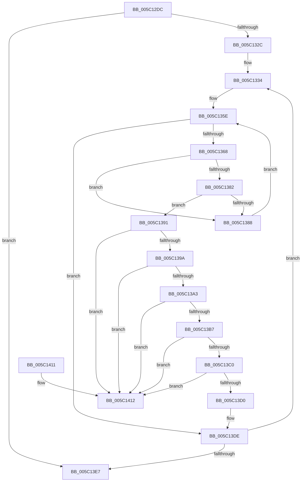

# KiAdjustProcessCpuSetsAfterCpuPartitionChange

- RVA: `0x005C12DC`–`0x005C1419` (길이 `317` bytes)
- VA: `0x00000001405C12DC`
- 실행 섹션: `.text`
- PDB 이름 있음: `예`; PDB Function 태그: `아니요`
- unwind 정보 RVA: `0x000CA694`
- 디코드: `95`개 명령, `317/317` bytes 표시
- 미해석 바이트: `0` (있으면 어셈블리에 `.byte`로 보존)

> 이 문서는 커널 이미지의 기계어와 PDB 기호를 분석해 생성했습니다. 4번과 5번은 함수 원형과 자료형을 바이너리 사용 방식에서 추정한 C 해석이며 원본 소스 복구 결과는 아닙니다.

## 1. Dependencies

- 직접 호출 지점: **3**; 고유 호출 대상: **3**
- 직접 호출자로 확인된 함수: **2**
- RIP 상대 이미지 참조: **0**

### Outgoing calls
- `0x005C1313` → [memset](../6C/memset_function_006C6C40.md) (function, `0x006C6C40`)
- `0x005C1352` → [KeQueryCpuPartitionAffinity](KeQueryCpuPartitionAffinity_function_005C0EF8.md) (function, `0x005C0EF8`)
- `0x005C13F7` → [KeSetCpuSetsProcess](KeSetCpuSetsProcess_function_005C10D4.md) (function, `0x005C10D4`)

### Direct callers
- [KeAssignCpuPartitionsToProcess](KeAssignCpuPartitionsToProcess_function_005C08D0.md) at `0x005C0A72`
- [KeCpuPartitionMoveCpus](KeCpuPartitionMoveCpus_function_005C0B70.md) at `0x005C0CF5`
- [KeCpuPartitionMoveCpus](KeCpuPartitionMoveCpus_function_005C0B70.md) at `0x005C0D42`

### Static image references
- 디코드된 RIP-relative 메모리 참조가 없습니다.

## 2. Other-region calls and transfers

- 다른 실행 섹션으로 향하는 call: **0**
- 별도 외부 분기/꼬리 이동을 확인하지 못했습니다.

## 3. Assembly (complete function range)

```asm
005C12DC  4C 8B DC                        mov r11, rsp
005C12DF  49 89 5B 08                     mov qword ptr [r11 + 8], rbx
005C12E3  49 89 53 10                     mov qword ptr [r11 + 0x10], rdx
005C12E7  55                              push rbp
005C12E8  56                              push rsi
005C12E9  57                              push rdi
005C12EA  41 54                           push r12
005C12EC  41 55                           push r13
005C12EE  41 56                           push r14
005C12F0  41 57                           push r15
005C12F2  48 83 EC 30                     sub rsp, 0x30
005C12F6  49 8B F0                        mov rsi, r8
005C12F9  41 0F B7 E9                     movzx ebp, r9w
005C12FD  4C 8B E1                        mov r12, rcx
005C1300  33 C0                           xor eax, eax
005C1302  44 8B C5                        mov r8d, ebp
005C1305  66 41 89 43 20                  mov word ptr [r11 + 0x20], ax
005C130A  49 C1 E0 03                     shl r8, 3
005C130E  33 D2                           xor edx, edx
005C1310  48 8B CE                        mov rcx, rsi
005C1313  E8 28 59 10 00                  call 0x1406c6c40
005C1318  4D 8D BC 24 B0 01 00 00         lea r15, [r12 + 0x1b0]
005C1320  4D 8B 37                        mov r14, qword ptr [r15]
005C1323  4D 3B F7                        cmp r14, r15
005C1326  0F 84 BB 00 00 00               je 0x1405c13e7
005C132C  48 8B BC 24 90 00 00 00         mov rdi, qword ptr [rsp + 0x90]
005C1334  48 8B 54 24 78                  mov rdx, qword ptr [rsp + 0x78]
005C1339  4C 8D 8C 24 88 00 00 00         lea r9, [rsp + 0x88]
005C1341  4D 8B EE                        mov r13, r14
005C1344  49 8B DE                        mov rbx, r14
005C1347  4D 8B 36                        mov r14, qword ptr [r14]
005C134A  44 0F B7 C5                     movzx r8d, bp
005C134E  49 8B 4D E8                     mov rcx, qword ptr [r13 - 0x18]
005C1352  E8 A1 FB FF FF                  call 0x1405c0ef8
005C1357  45 33 C9                        xor r9d, r9d
005C135A  41 0F B7 D1                     movzx edx, r9w
005C135E  66 3B 94 24 88 00 00 00         cmp dx, word ptr [rsp + 0x88]
005C1366  73 76                           jae 0x1405c13de
005C1368  4C 8B 44 24 78                  mov r8, qword ptr [rsp + 0x78]
005C136D  0F B7 CA                        movzx ecx, dx
005C1370  48 03 C9                        add rcx, rcx
005C1373  41 0F B7 44 C8 08               movzx eax, word ptr [r8 + rcx*8 + 8]
005C1379  4D 8B 04 C8                     mov r8, qword ptr [r8 + rcx*8]
005C137D  48 85 FF                        test rdi, rdi
005C1380  74 06                           je 0x1405c1388
005C1382  4C 85 04 C6                     test qword ptr [rsi + rax*8], r8
005C1386  75 09                           jne 0x1405c1391
005C1388  4C 09 04 C6                     or qword ptr [rsi + rax*8], r8
005C138C  66 FF C2                        inc dx
005C138F  EB CD                           jmp 0x1405c135e
005C1391  48 8B 0B                        mov rcx, qword ptr [rbx]
005C1394  48 39 59 08                     cmp qword ptr [rcx + 8], rbx
005C1398  75 78                           jne 0x1405c1412
005C139A  48 8B 43 08                     mov rax, qword ptr [rbx + 8]
005C139E  48 39 18                        cmp qword ptr [rax], rbx
005C13A1  75 6F                           jne 0x1405c1412
005C13A3  48 89 08                        mov qword ptr [rax], rcx
005C13A6  48 89 41 08                     mov qword ptr [rcx + 8], rax
005C13AA  49 8D 45 F0                     lea rax, [r13 - 0x10]
005C13AE  48 8B 10                        mov rdx, qword ptr [rax]
005C13B1  48 39 42 08                     cmp qword ptr [rdx + 8], rax
005C13B5  75 5B                           jne 0x1405c1412
005C13B7  48 8B 48 08                     mov rcx, qword ptr [rax + 8]
005C13BB  48 39 01                        cmp qword ptr [rcx], rax
005C13BE  75 52                           jne 0x1405c1412
005C13C0  48 89 11                        mov qword ptr [rcx], rdx
005C13C3  48 89 4A 08                     mov qword ptr [rdx + 8], rcx
005C13C7  48 8B 4F 08                     mov rcx, qword ptr [rdi + 8]
005C13CB  48 39 39                        cmp qword ptr [rcx], rdi
005C13CE  75 42                           jne 0x1405c1412
005C13D0  48 89 38                        mov qword ptr [rax], rdi
005C13D3  48 89 48 08                     mov qword ptr [rax + 8], rcx
005C13D7  48 89 01                        mov qword ptr [rcx], rax
005C13DA  48 89 47 08                     mov qword ptr [rdi + 8], rax
005C13DE  4D 3B F7                        cmp r14, r15
005C13E1  0F 85 4D FF FF FF               jne 0x1405c1334
005C13E7  8B D5                           mov edx, ebp
005C13E9  C6 44 24 20 01                  mov byte ptr [rsp + 0x20], 1
005C13EE  41 B1 01                        mov r9b, 1
005C13F1  4C 8B C6                        mov r8, rsi
005C13F4  49 8B CC                        mov rcx, r12
005C13F7  E8 D8 FC FF FF                  call 0x1405c10d4
005C13FC  48 8B 5C 24 70                  mov rbx, qword ptr [rsp + 0x70]
005C1401  48 83 C4 30                     add rsp, 0x30
005C1405  41 5F                           pop r15
005C1407  41 5E                           pop r14
005C1409  41 5D                           pop r13
005C140B  41 5C                           pop r12
005C140D  5F                              pop rdi
005C140E  5E                              pop rsi
005C140F  5D                              pop rbp
005C1410  C3                              ret
005C1411  CC                              int3
005C1412  B9 03 00 00 00                  mov ecx, 3
005C1417  CD 29                           int 0x29
```

## 4. C-style interpretation (structured pseudocode)

```c
__int64 __fastcall KiAdjustProcessCpuSetsAfterCpuPartitionChange(__int64 a1, __int64 a2, __int64 a3, unsigned __int16 a4, __int64 a5)
{
    __int64 result;
    __int64 v_rsp;
    unsigned __int8 v_stack_m48;
    unsigned __int64 v_stack_p10;
    unsigned __int64 v_stack_p20;
    unsigned __int64 v_stack_p8;

    *(unsigned __int64 *)(v_rsp + 8) = v_rbx;
    *(unsigned __int64 *)(v_rsp + 16) = a2;
    v_rsp = (v_rsp) - (48);
    result = 0;
    *(unsigned __int16 *)(v_rsp + 32) = 0;
    a3 = ((unsigned int)(a4)) << (3);
    a2 = 0;
    result = memset(a3, a2, a3, a4);
    if ((*(unsigned __int64 *)(a1 + 432)) == (a1 + 432)) goto loc_005C13E7;
loc_005C1334:
    result = KeQueryCpuPartitionAffinity(*(unsigned __int64 *)(*(unsigned __int64 *)(a1 + 432) - 24), v_stack_p10, a4, v_stack_p20);
    a4 = 0;
loc_005C135E:
    if (0 >= v_stack_p20) goto loc_005C13DE;
    a1 = (0) + (0);
    if (a5 == 0) goto loc_005C1388;
    if (((*(unsigned __int64 *)(a3 + *(unsigned __int16 *)(v_stack_p10 + a1 * 8 + 8) * 8)) & (*(unsigned __int64 *)(v_stack_p10 + a1 * 8))) != 0) goto loc_005C1391;
loc_005C1388:
    a2 = (unsigned __int16)((0) + 1);
    goto loc_005C135E;
loc_005C1391:
    if ((*(unsigned __int64 *)(*(unsigned __int64 *)(*(unsigned __int64 *)(a1 + 432)) + 8)) != (*(unsigned __int64 *)(a1 + 432))) goto loc_005C1412;
    if ((*(unsigned __int64 *)(*(unsigned __int64 *)(*(unsigned __int64 *)(a1 + 432) + 8))) != (*(unsigned __int64 *)(a1 + 432))) goto loc_005C1412;
    *(unsigned __int64 *)(*(unsigned __int64 *)(*(unsigned __int64 *)(a1 + 432) + 8)) = *(unsigned __int64 *)(*(unsigned __int64 *)(a1 + 432));
    *(unsigned __int64 *)(*(unsigned __int64 *)(*(unsigned __int64 *)(a1 + 432)) + 8) = *(unsigned __int64 *)(*(unsigned __int64 *)(a1 + 432) + 8);
    if ((*(unsigned __int64 *)(*(unsigned __int64 *)(*(unsigned __int64 *)(a1 + 432) - 16) + 8)) != (*(unsigned __int64 *)(a1 + 432) - 16)) goto loc_005C1412;
    if ((*(unsigned __int64 *)(*(unsigned __int64 *)(*(unsigned __int64 *)(a1 + 432) - 16 + 8))) != (*(unsigned __int64 *)(a1 + 432) - 16)) goto loc_005C1412;
    *(unsigned __int64 *)(*(unsigned __int64 *)(*(unsigned __int64 *)(a1 + 432) - 16 + 8)) = *(unsigned __int64 *)(*(unsigned __int64 *)(a1 + 432) - 16);
    *(unsigned __int64 *)(*(unsigned __int64 *)(*(unsigned __int64 *)(a1 + 432) - 16) + 8) = *(unsigned __int64 *)(*(unsigned __int64 *)(a1 + 432) - 16 + 8);
    if ((*(unsigned __int64 *)(*(unsigned __int64 *)(a5 + 8))) != a5) goto loc_005C1412;
    *(unsigned __int64 *)(*(unsigned __int64 *)(a1 + 432) - 16) = a5;
    *(unsigned __int64 *)(*(unsigned __int64 *)(a1 + 432) - 16 + 8) = *(unsigned __int64 *)(a5 + 8);
    *(unsigned __int64 *)(*(unsigned __int64 *)(a5 + 8)) = *(unsigned __int64 *)(a1 + 432) - 16;
    *(unsigned __int64 *)(a5 + 8) = *(unsigned __int64 *)(a1 + 432) - 16;
loc_005C13DE:
    if ((*(unsigned __int64 *)(*(unsigned __int64 *)(a1 + 432))) != (a1 + 432)) goto loc_005C1334;
loc_005C13E7:
    v_stack_m48 = 1;
    result = KeSetCpuSetsProcess(a1, 0, a3, 1);
    v_rsp = (v_rsp) + (48);
    return result;
loc_005C1412:
    return result;
}
```

## 5. (Beta) C Style

```c
int64_t KiAdjustProcessCpuSetsAfterCpuPartitionChange(void *Arg1, int64_t Arg2, void *Arg3, uint16_t Arg4, int64_t Arg5)
{
    uint8_t *arg1 = (uint8_t *)Arg1;
    uint8_t *arg3 = (uint8_t *)Arg3;

    int64_t result;
    int64_t local_rsp;
    uint8_t v_stack_m48;
    uint64_t v_stack_p10;
    uint64_t v_stack_p20;
    uint64_t v_stack_p8;

    *(uint64_t *)(local_rsp + 0x8) = local_rbx;
    *(uint64_t *)(local_rsp + 0x10) = Arg2;
    local_rsp = (local_rsp) - (48);
    result = 0;
    *(uint16_t *)(local_rsp + 0x20) = 0;
    Arg3 = ((uint32_t)(Arg4)) << (3);
    Arg2 = 0;
    result = memset(Arg3, Arg2, Arg3, Arg4);
    if ((*(uint64_t *)(arg1 + 0x1B0)) == (Arg1 + 432)) goto loc_005C13E7;
loc_005C1334:
    result = KeQueryCpuPartitionAffinity(*(uint64_t *)(*(uint64_t *)(arg1 + 0x1B0) - 0x18), v_stack_p10, Arg4, v_stack_p20);
    Arg4 = 0;
loc_005C135E:
    if (0 >= v_stack_p20) goto loc_005C13DE;
    Arg1 = (0) + (0);
    if (Arg5 == 0) goto loc_005C1388;
    if (((*(uint64_t *)(arg3 + *(uint16_t *)(v_stack_p10 + arg1 * 8 + 0x8) * 8)) & (*(uint64_t *)(v_stack_p10 + arg1 * 8))) != 0) goto loc_005C1391;
loc_005C1388:
    Arg2 = (uint16_t)((0) + 1);
    goto loc_005C135E;
loc_005C1391:
    if ((*(uint64_t *)(*(uint64_t *)(*(uint64_t *)(arg1 + 0x1B0)) + 0x8)) != (*(uint64_t *)(arg1 + 0x1B0))) goto loc_005C1412;
    if ((*(uint64_t *)(*(uint64_t *)(*(uint64_t *)(arg1 + 0x1B0) + 0x8))) != (*(uint64_t *)(arg1 + 0x1B0))) goto loc_005C1412;
    *(uint64_t *)(*(uint64_t *)(*(uint64_t *)(arg1 + 0x1B0) + 0x8)) = *(uint64_t *)(*(uint64_t *)(arg1 + 0x1B0));
    *(uint64_t *)(*(uint64_t *)(*(uint64_t *)(arg1 + 0x1B0)) + 0x8) = *(uint64_t *)(*(uint64_t *)(arg1 + 0x1B0) + 0x8);
    if ((*(uint64_t *)(*(uint64_t *)(*(uint64_t *)(arg1 + 0x1B0) - 0x10) + 0x8)) != (*(uint64_t *)(arg1 + 0x1B0) - 16)) goto loc_005C1412;
    if ((*(uint64_t *)(*(uint64_t *)(*(uint64_t *)(arg1 + 0x1B0) - 0x10 + 0x8))) != (*(uint64_t *)(arg1 + 0x1B0) - 16)) goto loc_005C1412;
    *(uint64_t *)(*(uint64_t *)(*(uint64_t *)(arg1 + 0x1B0) - 0x10 + 0x8)) = *(uint64_t *)(*(uint64_t *)(arg1 + 0x1B0) - 0x10);
    *(uint64_t *)(*(uint64_t *)(*(uint64_t *)(arg1 + 0x1B0) - 0x10) + 0x8) = *(uint64_t *)(*(uint64_t *)(arg1 + 0x1B0) - 0x10 + 0x8);
    if ((*(uint64_t *)(*(uint64_t *)(Arg5 + 0x8))) != Arg5) goto loc_005C1412;
    *(uint64_t *)(*(uint64_t *)(arg1 + 0x1B0) - 0x10) = Arg5;
    *(uint64_t *)(*(uint64_t *)(arg1 + 0x1B0) - 0x10 + 0x8) = *(uint64_t *)(Arg5 + 0x8);
    *(uint64_t *)(*(uint64_t *)(Arg5 + 0x8)) = *(uint64_t *)(arg1 + 0x1B0) - 16;
    *(uint64_t *)(Arg5 + 0x8) = *(uint64_t *)(arg1 + 0x1B0) - 16;
loc_005C13DE:
    if ((*(uint64_t *)(*(uint64_t *)(arg1 + 0x1B0))) != (Arg1 + 432)) goto loc_005C1334;
loc_005C13E7:
    v_stack_m48 = 1;
    result = KeSetCpuSetsProcess(Arg1, 0, Arg3, 1);
    local_rsp = (local_rsp) + (48);
    return result;
loc_005C1412:
    return result;
}
```

### 관측된 메모리 오프셋

구조체 형식이 확인되지 않은 접근은 인자 기준의 오프셋으로만 기록했습니다.

| 기준 인자 | 오프셋 표현 | 폭 (bit) | 접근 |
|---|---:|---:|---|
| `Arg1` | `+ 0x0` | `64` | `R` |
| `Arg1` | `+ 0x1B0` | `64` | `R` |
| `Arg3` | `+ 0x0 + rax*8` | `64` | `R` |
| `Arg3` | `+ 0x0 + rax*8` | `64` | `R/W` |

## 6. Execution-region graph

[열기: 2D/3D 그래프와 함수 탐색 컨트롤 패널](../../../control-panel.html?section=text&rva=0x005C12DC&view=graph)

- 2D 그래프는 위에서 아래로 흐르고, 3D 그래프는 빈 공간을 드래그해 회전합니다. Shift+드래그는 이동, 휠은 확대·축소, 함수 노드 선택은 대상 보고서 이동입니다.

### Static fallback


