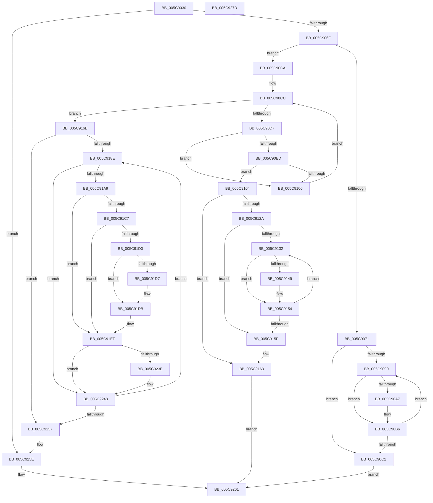

# KiAdjustRescheduleContextForIsolationWidthChange

- RVA: `0x005C9030`–`0x005C927E` (길이 `590` bytes)
- VA: `0x00000001405C9030`
- 실행 섹션: `.text`
- PDB 이름 있음: `예`; PDB Function 태그: `아니요`
- unwind 정보 RVA: `0x00084C9C`
- 디코드: `171`개 명령, `590/590` bytes 표시
- 미해석 바이트: `0` (있으면 어셈블리에 `.byte`로 보존)

> 이 문서는 커널 이미지의 기계어와 PDB 기호를 분석해 생성했습니다. 4번과 5번은 함수 원형과 자료형을 바이너리 사용 방식에서 추정한 C 해석이며 원본 소스 복구 결과는 아닙니다.

## 1. Dependencies

- 직접 호출 지점: **9**; 고유 호출 대상: **5**
- 직접 호출자로 확인된 함수: **1**
- RIP 상대 이미지 참조: **0**

### Outgoing calls
- `0x005C9054` → [KiFindRescheduleContextEntryForPrcb](../35/KiFindRescheduleContextEntryForPrcb_function_00353060.md) (function, `0x00353060`)
- `0x005C90AD` → [KiAdjustRescheduleContextEntryForThreadRemoval](../35/KiAdjustRescheduleContextEntryForThreadRemoval_function_00352340.md) (function, `0x00352340`)
- `0x005C90F7` → [KiDoesThreadDominateRescheduleContextEntry](../25/KiDoesThreadDominateRescheduleContextEntry_function_002581D0.md) (function, `0x002581D0`)
- `0x005C910A` → [KiFindRescheduleContextEntryForPrcb](../35/KiFindRescheduleContextEntryForPrcb_function_00353060.md) (function, `0x00353060`)
- `0x005C911F` → [KiAdjustRescheduleContextEntryForThreadRemoval](../35/KiAdjustRescheduleContextEntryForThreadRemoval_function_00352340.md) (function, `0x00352340`)
- `0x005C914F` → [KiAdjustRescheduleContextEntryForThreadRemoval](../35/KiAdjustRescheduleContextEntryForThreadRemoval_function_00352340.md) (function, `0x00352340`)
- `0x005C91C7` → [KiIsPrcbThread](../35/KiIsPrcbThread_function_00353230.md) (function, `0x00353230`)
- `0x005C91EA` → [KiInsertDeferredReadyList](../20/KiInsertDeferredReadyList_function_00201310.md) (function, `0x00201310`)
- `0x005C9235` → [KiIsPrcbThread](../35/KiIsPrcbThread_function_00353230.md) (function, `0x00353230`)

### Direct callers
- [KiAdjustCoreIsolationReasonThread](KiAdjustCoreIsolationReasonThread_function_005C3818.md) at `0x005C39EA`

### Static image references
- 디코드된 RIP-relative 메모리 참조가 없습니다.

## 2. Other-region calls and transfers

- 다른 실행 섹션으로 향하는 call: **0**
- 별도 외부 분기/꼬리 이동을 확인하지 못했습니다.

## 3. Assembly (complete function range)

```asm
005C9030  48 89 5C 24 08                  mov qword ptr [rsp + 8], rbx
005C9035  48 89 6C 24 10                  mov qword ptr [rsp + 0x10], rbp
005C903A  48 89 74 24 18                  mov qword ptr [rsp + 0x18], rsi
005C903F  57                              push rdi
005C9040  41 56                           push r14
005C9042  41 57                           push r15
005C9044  48 83 EC 30                     sub rsp, 0x30
005C9048  41 8B D9                        mov ebx, r9d
005C904B  4D 8B F8                        mov r15, r8
005C904E  4C 8B F2                        mov r14, rdx
005C9051  48 8B F9                        mov rdi, rcx
005C9054  E8 07 A0 D8 FF                  call 0x140353060
005C9059  48 8B F0                        mov rsi, rax
005C905C  0F B6 48 20                     movzx ecx, byte ptr [rax + 0x20]
005C9060  8B C1                           mov eax, ecx
005C9062  D1 E8                           shr eax, 1
005C9064  83 E0 01                        and eax, 1
005C9067  3B C3                           cmp eax, ebx
005C9069  0F 84 EF 01 00 00               je 0x1405c925e
005C906F  7E 59                           jle 0x1405c90ca
005C9071  02 DB                           add bl, bl
005C9073  48 C7 46 18 FE FF FF FF         mov qword ptr [rsi + 0x18], 0xfffffffffffffffe
005C907B  32 D9                           xor bl, cl
005C907D  45 32 D2                        xor r10b, r10b
005C9080  80 E3 02                        and bl, 2
005C9083  45 33 DB                        xor r11d, r11d
005C9086  32 D9                           xor bl, cl
005C9088  88 5E 20                        mov byte ptr [rsi + 0x20], bl
005C908B  44 38 17                        cmp byte ptr [rdi], r10b
005C908E  76 31                           jbe 0x1405c90c1
005C9090  41 8B C3                        mov eax, r11d
005C9093  4A 8D 0C 9D 02 00 00 00         lea rcx, [r11*4 + 2]
005C909B  48 03 C8                        add rcx, rax
005C909E  48 8D 0C CF                     lea rcx, [rdi + rcx*8]
005C90A2  48 3B CE                        cmp rcx, rsi
005C90A5  74 0F                           je 0x1405c90b6
005C90A7  41 B1 01                        mov r9b, 1
005C90AA  45 33 C0                        xor r8d, r8d
005C90AD  E8 8E 92 D8 FF                  call 0x140352340
005C90B2  41 80 CA 01                     or r10b, 1
005C90B6  0F B6 07                        movzx eax, byte ptr [rdi]
005C90B9  41 FF C3                        inc r11d
005C90BC  44 3B D8                        cmp r11d, eax
005C90BF  72 CF                           jb 0x1405c9090
005C90C1  83 67 04 00                     and dword ptr [rdi + 4], 0
005C90C5  E9 97 01 00 00                  jmp 0x1405c9261
005C90CA  33 ED                           xor ebp, ebp
005C90CC  0F B6 07                        movzx eax, byte ptr [rdi]
005C90CF  3B E8                           cmp ebp, eax
005C90D1  0F 83 94 00 00 00               jae 0x1405c916b
005C90D7  8B C5                           mov eax, ebp
005C90D9  48 8D 0C AD 02 00 00 00         lea rcx, [rbp*4 + 2]
005C90E1  48 03 C8                        add rcx, rax
005C90E4  48 8D 0C CF                     lea rcx, [rdi + rcx*8]
005C90E8  48 3B CE                        cmp rcx, rsi
005C90EB  74 13                           je 0x1405c9100
005C90ED  45 33 C9                        xor r9d, r9d
005C90F0  49 8B D7                        mov rdx, r15
005C90F3  45 8D 41 02                     lea r8d, [r9 + 2]
005C90F7  E8 D4 F0 C8 FF                  call 0x1402581d0
005C90FC  84 C0                           test al, al
005C90FE  74 04                           je 0x1405c9104
005C9100  FF C5                           inc ebp
005C9102  EB C8                           jmp 0x1405c90cc
005C9104  49 8B D6                        mov rdx, r14
005C9107  48 8B CF                        mov rcx, rdi
005C910A  E8 51 9F D8 FF                  call 0x140353060
005C910F  41 B1 01                        mov r9b, 1
005C9112  45 33 C0                        xor r8d, r8d
005C9115  48 8B C8                        mov rcx, rax
005C9118  4C 8B D8                        mov r11, rax
005C911B  44 8A 50 20                     mov r10b, byte ptr [rax + 0x20]
005C911F  E8 1C 92 D8 FF                  call 0x140352340
005C9124  41 F6 C2 02                     test r10b, 2
005C9128  74 39                           je 0x1405c9163
005C912A  45 33 D2                        xor r10d, r10d
005C912D  44 38 07                        cmp byte ptr [rdi], r8b
005C9130  76 2D                           jbe 0x1405c915f
005C9132  41 8B C2                        mov eax, r10d
005C9135  4A 8D 0C 95 02 00 00 00         lea rcx, [r10*4 + 2]
005C913D  48 03 C8                        add rcx, rax
005C9140  48 8D 0C CF                     lea rcx, [rdi + rcx*8]
005C9144  49 3B CB                        cmp rcx, r11
005C9147  74 0B                           je 0x1405c9154
005C9149  41 B1 01                        mov r9b, 1
005C914C  45 33 C0                        xor r8d, r8d
005C914F  E8 EC 91 D8 FF                  call 0x140352340
005C9154  0F B6 07                        movzx eax, byte ptr [rdi]
005C9157  41 FF C2                        inc r10d
005C915A  44 3B D0                        cmp r10d, eax
005C915D  72 D3                           jb 0x1405c9132
005C915F  83 67 04 00                     and dword ptr [rdi + 4], 0
005C9163  41 B2 01                        mov r10b, 1
005C9166  E9 F6 00 00 00                  jmp 0x1405c9261
005C916B  8A 46 20                        mov al, byte ptr [rsi + 0x20]
005C916E  02 DB                           add bl, bl
005C9170  32 D8                           xor bl, al
005C9172  48 C7 46 18 FE FF FF FF         mov qword ptr [rsi + 0x18], 0xfffffffffffffffe
005C917A  80 E3 02                        and bl, 2
005C917D  45 33 D2                        xor r10d, r10d
005C9180  32 D8                           xor bl, al
005C9182  88 5E 20                        mov byte ptr [rsi + 0x20], bl
005C9185  44 38 17                        cmp byte ptr [rdi], r10b
005C9188  0F 86 C9 00 00 00               jbe 0x1405c9257
005C918E  41 8B C2                        mov eax, r10d
005C9191  4E 8D 0C 95 02 00 00 00         lea r9, [r10*4 + 2]
005C9199  4C 03 C8                        add r9, rax
005C919C  4E 8D 0C CF                     lea r9, [rdi + r9*8]
005C91A0  4C 3B CE                        cmp r9, rsi
005C91A3  0F 84 9F 00 00 00               je 0x1405c9248
005C91A9  49 8B 49 18                     mov rcx, qword ptr [r9 + 0x18]
005C91AD  4D 8B 19                        mov r11, qword ptr [r9]
005C91B0  48 83 64 24 20 00               and qword ptr [rsp + 0x20], 0
005C91B6  48 8D 41 FF                     lea rax, [rcx - 1]
005C91BA  49 8B 9B 80 8E 00 00            mov rbx, qword ptr [r11 + 0x8e80]
005C91C1  48 83 F8 FC                     cmp rax, -4
005C91C5  77 28                           ja 0x1405c91ef
005C91C7  E8 64 A0 D8 FF                  call 0x140353230
005C91CC  84 C0                           test al, al
005C91CE  75 1F                           jne 0x1405c91ef
005C91D0  41 F6 41 21 01                  test byte ptr [r9 + 0x21], 1
005C91D5  74 04                           je 0x1405c91db
005C91D7  83 49 74 02                     or dword ptr [rcx + 0x74], 2
005C91DB  C6 81 35 02 00 00 01            mov byte ptr [rcx + 0x235], 1
005C91E2  48 8B D1                        mov rdx, rcx
005C91E5  48 8D 4C 24 20                  lea rcx, [rsp + 0x20]
005C91EA  E8 21 81 C3 FF                  call 0x140201310
005C91EF  41 8A 41 20                     mov al, byte ptr [r9 + 0x20]
005C91F3  24 FE                           and al, 0xfe
005C91F5  4D 89 79 10                     mov qword ptr [r9 + 0x10], r15
005C91F9  41 88 41 20                     mov byte ptr [r9 + 0x20], al
005C91FD  24 FD                           and al, 0xfd
005C91FF  41 8B 4F 78                     mov ecx, dword ptr [r15 + 0x78]
005C9203  D1 E9                           shr ecx, 1
005C9205  80 E1 01                        and cl, 1
005C9208  02 C9                           add cl, cl
005C920A  32 C8                           xor cl, al
005C920C  80 E1 E7                        and cl, 0xe7
005C920F  80 C9 04                        or cl, 4
005C9212  8A C1                           mov al, cl
005C9214  80 C9 20                        or cl, 0x20
005C9217  24 DF                           and al, 0xdf
005C9219  0F B6 C9                        movzx ecx, cl
005C921C  0F B6 C0                        movzx eax, al
005C921F  4C 3B FB                        cmp r15, rbx
005C9222  0F 44 C8                        cmove ecx, eax
005C9225  41 88 49 20                     mov byte ptr [r9 + 0x20], cl
005C9229  48 8B CB                        mov rcx, rbx
005C922C  41 80 61 21 FE                  and byte ptr [r9 + 0x21], 0xfe
005C9231  49 89 59 18                     mov qword ptr [r9 + 0x18], rbx
005C9235  E8 F6 9F D8 FF                  call 0x140353230
005C923A  84 C0                           test al, al
005C923C  75 0A                           jne 0x1405c9248
005C923E  41 8B 43 24                     mov eax, dword ptr [r11 + 0x24]
005C9242  89 83 18 02 00 00               mov dword ptr [rbx + 0x218], eax
005C9248  0F B6 07                        movzx eax, byte ptr [rdi]
005C924B  41 FF C2                        inc r10d
005C924E  44 3B D0                        cmp r10d, eax
005C9251  0F 82 37 FF FF FF               jb 0x1405c918e
005C9257  C7 47 04 01 00 00 00            mov dword ptr [rdi + 4], 1
005C925E  45 32 D2                        xor r10b, r10b
005C9261  48 8B 5C 24 50                  mov rbx, qword ptr [rsp + 0x50]
005C9266  41 8A C2                        mov al, r10b
005C9269  48 8B 6C 24 58                  mov rbp, qword ptr [rsp + 0x58]
005C926E  48 8B 74 24 60                  mov rsi, qword ptr [rsp + 0x60]
005C9273  48 83 C4 30                     add rsp, 0x30
005C9277  41 5F                           pop r15
005C9279  41 5E                           pop r14
005C927B  5F                              pop rdi
005C927C  C3                              ret
005C927D  CC                              int3
```

## 4. C-style interpretation (structured pseudocode)

```c
__int64 __fastcall KiAdjustRescheduleContextForIsolationWidthChange(__int64 a1, __int64 a2, __int64 a3, int a4)
{
    __int64 result;
    __int64 v_r10;
    __int64 v_r11;
    __int64 v_rbp;
    __int64 v_rbx;
    __int64 v_rsp;
    unsigned __int64 v_stack_m28;
    unsigned __int64 v_stack_p10;
    unsigned __int64 v_stack_p18;
    unsigned __int64 v_stack_p8;

    v_stack_p8 = v_rbx;
    v_stack_p10 = v_rbp;
    v_stack_p18 = v_rsi;
    v_rsp = (v_rsp) - (48);
    result = KiFindRescheduleContextEntryForPrcb(a1, a2, a3, a4);
    result = (unsigned int)(((unsigned int)((unsigned int)(*(unsigned __int8 *)(result + 32)))) >> (1));
    result = (unsigned int)((result) & (1));
    if (((unsigned int)(result)) == ((unsigned int)((unsigned int)(a4)))) goto loc_005C925E;
    if (((unsigned int)(result)) <= ((unsigned int)((unsigned int)(a4)))) goto loc_005C90CA;
    v_rbx = (unsigned __int8)(((unsigned int)(a4)) + ((unsigned __int8)((unsigned int)(a4))));
    *(unsigned __int64 *)(result + 24) = -2;
    v_rbx = (unsigned __int8)((v_rbx) ^ ((unsigned __int8)(*(unsigned __int8 *)(result + 32))));
    v_r10 = 0;
    v_rbx = (unsigned __int8)((v_rbx) & (2));
    v_r11 = 0;
    v_rbx = (unsigned __int8)((v_rbx) ^ ((unsigned __int8)(*(unsigned __int8 *)(result + 32))));
    *(unsigned __int8 *)(result + 32) = (unsigned __int8)(v_rbx);
    if ((*(unsigned __int8 *)(a1)) <= 0) goto loc_005C90C1;
loc_005C9090:
    a1 = (v_r11 * 4 + 2) + (0);
    result = 0;
    if ((a1 + a1 * 8) != result) {
        a4 = 1;
        a3 = 0;
        result = KiAdjustRescheduleContextEntryForThreadRemoval(a1 + a1 * 8, a2, a3, a4);
        v_r10 = (unsigned __int8)((v_r10) | (1));
    }
    v_r11 = (unsigned int)((v_r11) + 1);
    if (((unsigned int)(v_r11)) < ((unsigned int)(*(unsigned __int8 *)(a1)))) goto loc_005C9090;
loc_005C90C1:
    goto loc_005C9261;
loc_005C90CA:
    v_rbp = 0;
loc_005C90CC:
    if (0 >= ((unsigned int)(*(unsigned __int8 *)(a1)))) goto loc_005C916B;
    a1 = (v_rbp * 4 + 2) + (0);
    if ((a1 + a1 * 8) == result) goto loc_005C9100;
    a4 = 0;
    result = KiDoesThreadDominateRescheduleContextEntry(a1 + a1 * 8, 0, a4 + 2, a4);
    if ((unsigned __int8)(result) == 0) goto loc_005C9104;
loc_005C9100:
    v_rbp = (unsigned int)((v_rbp) + 1);
    goto loc_005C90CC;
loc_005C9104:
    result = KiFindRescheduleContextEntryForPrcb(a1, a2, a4 + 2, a4);
    a3 = 0;
    result = KiAdjustRescheduleContextEntryForThreadRemoval(result, a2, a3, 1);
    if ((((unsigned __int8)(*(unsigned __int8 *)(result + 32))) & (2)) == 0) goto loc_005C9163;
    v_r10 = 0;
    if ((*(unsigned __int8 *)(a1)) <= 0) goto loc_005C915F;
loc_005C9132:
    a1 = (v_r10 * 4 + 2) + (0);
    result = 0;
    if ((a1 + a1 * 8) != result) {
        a4 = 1;
        a3 = 0;
        result = KiAdjustRescheduleContextEntryForThreadRemoval(a1 + a1 * 8, a2, a3, a4);
    }
    v_r10 = (unsigned int)((v_r10) + 1);
    if (((unsigned int)(v_r10)) < ((unsigned int)(*(unsigned __int8 *)(a1)))) goto loc_005C9132;
loc_005C915F:
loc_005C9163:
    goto loc_005C9261;
loc_005C916B:
    v_rbx = (unsigned __int8)((v_rbx) + ((unsigned __int8)(v_rbx)));
    v_rbx = (unsigned __int8)((v_rbx) ^ ((unsigned __int8)(*(unsigned __int8 *)(result + 32))));
    *(unsigned __int64 *)(result + 24) = -2;
    v_rbx = (unsigned __int8)((v_rbx) & (2));
    v_r10 = 0;
    v_rbx = (unsigned __int8)((v_rbx) ^ ((unsigned __int8)(*(unsigned __int8 *)(result + 32))));
    *(unsigned __int8 *)(result + 32) = (unsigned __int8)(v_rbx);
    if ((*(unsigned __int8 *)(a1)) <= 0) goto loc_005C9257;
loc_005C918E:
    a4 = (v_r10 * 4 + 2) + (0);
    if ((a1 + a4 * 8) == result) goto loc_005C9248;
    if ((*(unsigned __int64 *)(a1 + a4 * 8 + 24) - 1) > -4) goto loc_005C91EF;
    result = KiIsPrcbThread(*(unsigned __int64 *)(a1 + a4 * 8 + 24), a2, a3, a1 + a4 * 8);
    if ((unsigned __int8)(result) != 0) goto loc_005C91EF;
    if (((*(unsigned __int8 *)(a1 + a4 * 8 + 33)) & (1)) != 0) {
    }
    *(unsigned __int8 *)(*(unsigned __int64 *)(a1 + a4 * 8 + 24) + 565) = 1;
    result = KiInsertDeferredReadyList(v_stack_m28, *(unsigned __int64 *)(a1 + a4 * 8 + 24), a3, a1 + a4 * 8);
loc_005C91EF:
    result = (unsigned __int8)((*(unsigned __int8 *)(a1 + a4 * 8 + 32)) & (254));
    *(unsigned __int64 *)(a1 + a4 * 8 + 16) = 0;
    *(unsigned __int8 *)(a1 + a4 * 8 + 32) = (unsigned __int8)(result);
    result = (unsigned __int8)((result) & (253));
    a1 = (unsigned int)(((unsigned int)(*(unsigned int *)(a3 + 120))) >> (1));
    a1 = (unsigned __int8)((a1) & (1));
    a1 = (unsigned __int8)((a1) + ((unsigned __int8)(a1)));
    a1 = (unsigned __int8)((a1) ^ ((unsigned __int8)(result)));
    a1 = (unsigned __int8)((a1) & (231));
    a1 = (unsigned __int8)((a1) | (4));
    a1 = (unsigned __int8)((a1) | (32));
    result = (unsigned __int8)(((unsigned __int8)(a1)) & (223));
    a1 = (unsigned __int8)(a1);
    if (0 == (*(unsigned __int64 *)(*(unsigned __int64 *)(a1 + a4 * 8) + 36480))) { a1 = (unsigned int)((unsigned __int8)(result)); }
    *(unsigned __int8 *)(a1 + a4 * 8 + 32) = (unsigned __int8)(a1);
    *(unsigned __int64 *)(a1 + a4 * 8 + 24) = *(unsigned __int64 *)(*(unsigned __int64 *)(a1 + a4 * 8) + 36480);
    result = KiIsPrcbThread(*(unsigned __int64 *)(*(unsigned __int64 *)(a1 + a4 * 8) + 36480), *(unsigned __int64 *)(a1 + a4 * 8 + 24), a3, a1 + a4 * 8);
    if ((unsigned __int8)(result) == 0) {
        result = *(unsigned int *)(*(unsigned __int64 *)(a1 + a4 * 8) + 36);
        *(unsigned int *)(*(unsigned __int64 *)(*(unsigned __int64 *)(a1 + a4 * 8) + 36480) + 536) = (unsigned int)(result);
    }
    v_r10 = (unsigned int)((v_r10) + 1);
    if (((unsigned int)(v_r10)) < ((unsigned int)(*(unsigned __int8 *)(a1)))) goto loc_005C918E;
loc_005C9257:
    *(unsigned int *)(a1 + 4) = 1;
loc_005C925E:
    v_r10 = 0;
loc_005C9261:
    v_rsp = (v_rsp) + (48);
    return 0;
}
```

## 5. (Beta) C Style

```c
int64_t KiAdjustRescheduleContextForIsolationWidthChange(void *Arg1, int64_t Arg2, int64_t Arg3, int32_t Arg4)
{
    uint8_t *arg1 = (uint8_t *)Arg1;

    int64_t result;
    int64_t local_r10;
    int64_t local_r11;
    int64_t local_rbp;
    int64_t local_rbx;
    int64_t local_rsp;
    uint64_t v_stack_m28;
    uint64_t v_stack_p10;
    uint64_t v_stack_p18;
    uint64_t v_stack_p8;

    v_stack_p8 = local_rbx;
    v_stack_p10 = local_rbp;
    v_stack_p18 = local_rsi;
    local_rsp = (local_rsp) - (48);
    result = KiFindRescheduleContextEntryForPrcb(Arg1, Arg2, Arg3, Arg4);
    result = (uint32_t)(((uint32_t)((uint32_t)(*(uint8_t *)(result + 0x20)))) >> (1));
    result = (uint32_t)((result) & (1));
    if (((uint32_t)(result)) == ((uint32_t)((uint32_t)(Arg4)))) goto loc_005C925E;
    if (((uint32_t)(result)) <= ((uint32_t)((uint32_t)(Arg4)))) goto loc_005C90CA;
    local_rbx = (uint8_t)(((uint32_t)(Arg4)) + ((uint8_t)((uint32_t)(Arg4))));
    *(uint64_t *)(result + 0x18) = -2;
    local_rbx = (uint8_t)((local_rbx) ^ ((uint8_t)(*(uint8_t *)(result + 0x20))));
    local_r10 = 0;
    local_rbx = (uint8_t)((local_rbx) & (2));
    local_r11 = 0;
    local_rbx = (uint8_t)((local_rbx) ^ ((uint8_t)(*(uint8_t *)(result + 0x20))));
    *(uint8_t *)(result + 0x20) = (uint8_t)(local_rbx);
    if ((*(uint8_t *)(arg1)) <= 0) goto loc_005C90C1;
loc_005C9090:
    Arg1 = (local_r11 * 4 + 2) + (0);
    result = 0;
    if ((Arg1 + Arg1 * 8) != result) {
        Arg4 = 1;
        Arg3 = 0;
        result = KiAdjustRescheduleContextEntryForThreadRemoval(Arg1 + Arg1 * 8, Arg2, Arg3, Arg4);
        local_r10 = (uint8_t)((local_r10) | (1));
    }
    local_r11 = (uint32_t)((local_r11) + 1);
    if (((uint32_t)(local_r11)) < ((uint32_t)(*(uint8_t *)(arg1)))) goto loc_005C9090;
loc_005C90C1:
    goto loc_005C9261;
loc_005C90CA:
    local_rbp = 0;
loc_005C90CC:
    if (0 >= ((uint32_t)(*(uint8_t *)(arg1)))) goto loc_005C916B;
    Arg1 = (local_rbp * 4 + 2) + (0);
    if ((Arg1 + Arg1 * 8) == result) goto loc_005C9100;
    Arg4 = 0;
    result = KiDoesThreadDominateRescheduleContextEntry(Arg1 + Arg1 * 8, 0, Arg4 + 2, Arg4);
    if ((uint8_t)(result) == 0) goto loc_005C9104;
loc_005C9100:
    local_rbp = (uint32_t)((local_rbp) + 1);
    goto loc_005C90CC;
loc_005C9104:
    result = KiFindRescheduleContextEntryForPrcb(Arg1, Arg2, Arg4 + 2, Arg4);
    Arg3 = 0;
    result = KiAdjustRescheduleContextEntryForThreadRemoval(result, Arg2, Arg3, 1);
    if ((((uint8_t)(*(uint8_t *)(result + 0x20))) & (2)) == 0) goto loc_005C9163;
    local_r10 = 0;
    if ((*(uint8_t *)(arg1)) <= 0) goto loc_005C915F;
loc_005C9132:
    Arg1 = (local_r10 * 4 + 2) + (0);
    result = 0;
    if ((Arg1 + Arg1 * 8) != result) {
        Arg4 = 1;
        Arg3 = 0;
        result = KiAdjustRescheduleContextEntryForThreadRemoval(Arg1 + Arg1 * 8, Arg2, Arg3, Arg4);
    }
    local_r10 = (uint32_t)((local_r10) + 1);
    if (((uint32_t)(local_r10)) < ((uint32_t)(*(uint8_t *)(arg1)))) goto loc_005C9132;
loc_005C915F:
loc_005C9163:
    goto loc_005C9261;
loc_005C916B:
    local_rbx = (uint8_t)((local_rbx) + ((uint8_t)(local_rbx)));
    local_rbx = (uint8_t)((local_rbx) ^ ((uint8_t)(*(uint8_t *)(result + 0x20))));
    *(uint64_t *)(result + 0x18) = -2;
    local_rbx = (uint8_t)((local_rbx) & (2));
    local_r10 = 0;
    local_rbx = (uint8_t)((local_rbx) ^ ((uint8_t)(*(uint8_t *)(result + 0x20))));
    *(uint8_t *)(result + 0x20) = (uint8_t)(local_rbx);
    if ((*(uint8_t *)(arg1)) <= 0) goto loc_005C9257;
loc_005C918E:
    Arg4 = (local_r10 * 4 + 2) + (0);
    if ((Arg1 + Arg4 * 8) == result) goto loc_005C9248;
    if ((*(uint64_t *)(arg1 + Arg4 * 8 + 0x18) - 1) > -4) goto loc_005C91EF;
    result = KiIsPrcbThread(*(uint64_t *)(arg1 + Arg4 * 8 + 0x18), Arg2, Arg3, Arg1 + Arg4 * 8);
    if ((uint8_t)(result) != 0) goto loc_005C91EF;
    if (((*(uint8_t *)(arg1 + Arg4 * 8 + 0x21)) & (1)) != 0) {
    }
    *(uint8_t *)(*(uint64_t *)(arg1 + Arg4 * 8 + 0x18) + 0x235) = 1;
    result = KiInsertDeferredReadyList(v_stack_m28, *(uint64_t *)(arg1 + Arg4 * 8 + 0x18), Arg3, Arg1 + Arg4 * 8);
loc_005C91EF:
    result = (uint8_t)((*(uint8_t *)(arg1 + Arg4 * 8 + 0x20)) & (254));
    *(uint64_t *)(arg1 + Arg4 * 8 + 0x10) = 0;
    *(uint8_t *)(arg1 + Arg4 * 8 + 0x20) = (uint8_t)(result);
    result = (uint8_t)((result) & (253));
    Arg1 = (uint32_t)(((uint32_t)(*(uint32_t *)(Arg3 + 0x78))) >> (1));
    Arg1 = (uint8_t)((Arg1) & (1));
    Arg1 = (uint8_t)((Arg1) + ((uint8_t)(Arg1)));
    Arg1 = (uint8_t)((Arg1) ^ ((uint8_t)(result)));
    Arg1 = (uint8_t)((Arg1) & (231));
    Arg1 = (uint8_t)((Arg1) | (4));
    Arg1 = (uint8_t)((Arg1) | (32));
    result = (uint8_t)(((uint8_t)(Arg1)) & (223));
    Arg1 = (uint8_t)(Arg1);
    if (0 == (*(uint64_t *)(*(uint64_t *)(arg1 + Arg4 * 8) + 0x8E80))) { Arg1 = (uint32_t)((uint8_t)(result)); }
    *(uint8_t *)(arg1 + Arg4 * 8 + 0x20) = (uint8_t)(Arg1);
    *(uint64_t *)(arg1 + Arg4 * 8 + 0x18) = *(uint64_t *)(*(uint64_t *)(arg1 + Arg4 * 8) + 0x8E80);
    result = KiIsPrcbThread(*(uint64_t *)(*(uint64_t *)(arg1 + Arg4 * 8) + 0x8E80), *(uint64_t *)(arg1 + Arg4 * 8 + 0x18), Arg3, Arg1 + Arg4 * 8);
    if ((uint8_t)(result) == 0) {
        result = *(uint32_t *)(*(uint64_t *)(arg1 + Arg4 * 8) + 0x24);
        *(uint32_t *)(*(uint64_t *)(*(uint64_t *)(arg1 + Arg4 * 8) + 0x8E80) + 0x218) = (uint32_t)(result);
    }
    local_r10 = (uint32_t)((local_r10) + 1);
    if (((uint32_t)(local_r10)) < ((uint32_t)(*(uint8_t *)(arg1)))) goto loc_005C918E;
loc_005C9257:
    *(uint32_t *)(arg1 + 0x4) = 1;
loc_005C925E:
    local_r10 = 0;
loc_005C9261:
    local_rsp = (local_rsp) + (48);
    return 0;
}
```

### 관측된 메모리 오프셋

구조체 형식이 확인되지 않은 접근은 인자 기준의 오프셋으로만 기록했습니다.

| 기준 인자 | 오프셋 표현 | 폭 (bit) | 접근 |
|---|---:|---:|---|
| `Arg1` | `+ 0x0` | `8` | `R` |
| `Arg1` | `+ 0x0 + r9*8` | `64` | `R` |
| `Arg1` | `+ 0x0 + rcx*8` | `64` | `R` |
| `Arg1` | `+ 0x4` | `32` | `R/W` |
| `Arg1` | `+ 0x4` | `32` | `W` |

## 6. Execution-region graph

[열기: 2D/3D 그래프와 함수 탐색 컨트롤 패널](../../../control-panel.html?section=text&rva=0x005C9030&view=graph)

- 2D 그래프는 위에서 아래로 흐르고, 3D 그래프는 빈 공간을 드래그해 회전합니다. Shift+드래그는 이동, 휠은 확대·축소, 함수 노드 선택은 대상 보고서 이동입니다.

### Static fallback


