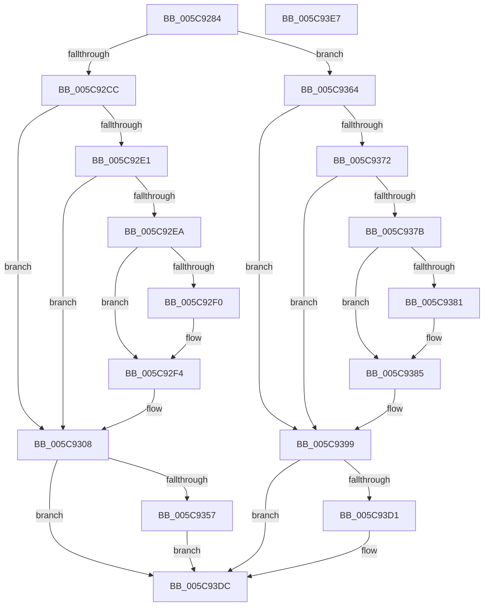

# KiAdjustRescheduleContextForProcessorAddition

- RVA: `0x005C9284`–`0x005C93E8` (길이 `356` bytes)
- VA: `0x00000001405C9284`
- 실행 섹션: `.text`
- PDB 이름 있음: `예`; PDB Function 태그: `아니요`
- unwind 정보 RVA: `0x00084918`
- 디코드: `102`개 명령, `356/356` bytes 표시
- 미해석 바이트: `0` (있으면 어셈블리에 `.byte`로 보존)

> 이 문서는 커널 이미지의 기계어와 PDB 기호를 분석해 생성했습니다. 4번과 5번은 함수 원형과 자료형을 바이너리 사용 방식에서 추정한 C 해석이며 원본 소스 복구 결과는 아닙니다.

## 1. Dependencies

- 직접 호출 지점: **7**; 고유 호출 대상: **3**
- 직접 호출자로 확인된 함수: **1**
- RIP 상대 이미지 참조: **0**

### Outgoing calls
- `0x005C92AF` → [KiStartRescheduleContextEntry](../30/KiStartRescheduleContextEntry_function_00305ED0.md) (function, `0x00305ED0`)
- `0x005C92E1` → [KiIsPrcbThread](../35/KiIsPrcbThread_function_00353230.md) (function, `0x00353230`)
- `0x005C9303` → [KiInsertDeferredReadyList](../20/KiInsertDeferredReadyList_function_00201310.md) (function, `0x00201310`)
- `0x005C934A` → [KiIsPrcbThread](../35/KiIsPrcbThread_function_00353230.md) (function, `0x00353230`)
- `0x005C9372` → [KiIsPrcbThread](../35/KiIsPrcbThread_function_00353230.md) (function, `0x00353230`)
- `0x005C9394` → [KiInsertDeferredReadyList](../20/KiInsertDeferredReadyList_function_00201310.md) (function, `0x00201310`)
- `0x005C93C8` → [KiIsPrcbThread](../35/KiIsPrcbThread_function_00353230.md) (function, `0x00353230`)

### Direct callers
- [KiFinalizeCoreControlBlockAssignment](../5B/KiFinalizeCoreControlBlockAssignment_function_005B7D0C.md) at `0x005B7DF7`

### Static image references
- 디코드된 RIP-relative 메모리 참조가 없습니다.

## 2. Other-region calls and transfers

- 다른 실행 섹션으로 향하는 call: **0**
- 별도 외부 분기/꼬리 이동을 확인하지 못했습니다.

## 3. Assembly (complete function range)

```asm
005C9284  48 89 5C 24 08                  mov qword ptr [rsp + 8], rbx
005C9289  4C 89 44 24 18                  mov qword ptr [rsp + 0x18], r8
005C928E  57                              push rdi
005C928F  48 83 EC 20                     sub rsp, 0x20
005C9293  44 0F B6 01                     movzx r8d, byte ptr [rcx]
005C9297  48 8B F9                        mov rdi, rcx
005C929A  45 33 C9                        xor r9d, r9d
005C929D  4B 8D 04 80                     lea rax, [r8 + r8*4]
005C92A1  41 FE C0                        inc r8b
005C92A4  48 8D 1C C1                     lea rbx, [rcx + rax*8]
005C92A8  44 88 01                        mov byte ptr [rcx], r8b
005C92AB  48 8D 4B 10                     lea rcx, [rbx + 0x10]
005C92AF  E8 1C CC D3 FF                  call 0x140305ed0
005C92B4  48 8B 4B 28                     mov rcx, qword ptr [rbx + 0x28]
005C92B8  48 83 64 24 40 00               and qword ptr [rsp + 0x40], 0
005C92BE  83 7F 04 00                     cmp dword ptr [rdi + 4], 0
005C92C2  48 8D 41 FF                     lea rax, [rcx - 1]
005C92C6  0F 84 98 00 00 00               je 0x1405c9364
005C92CC  4C 8B 4B 10                     mov r9, qword ptr [rbx + 0x10]
005C92D0  4C 8B 5F 20                     mov r11, qword ptr [rdi + 0x20]
005C92D4  4D 8B 91 80 8E 00 00            mov r10, qword ptr [r9 + 0x8e80]
005C92DB  48 83 F8 FC                     cmp rax, -4
005C92DF  77 27                           ja 0x1405c9308
005C92E1  E8 4A 9F D8 FF                  call 0x140353230
005C92E6  84 C0                           test al, al
005C92E8  75 1E                           jne 0x1405c9308
005C92EA  F6 43 31 01                     test byte ptr [rbx + 0x31], 1
005C92EE  74 04                           je 0x1405c92f4
005C92F0  83 49 74 02                     or dword ptr [rcx + 0x74], 2
005C92F4  C6 81 35 02 00 00 01            mov byte ptr [rcx + 0x235], 1
005C92FB  48 8B D1                        mov rdx, rcx
005C92FE  48 8D 4C 24 40                  lea rcx, [rsp + 0x40]
005C9303  E8 08 80 C3 FF                  call 0x140201310
005C9308  8A 43 30                        mov al, byte ptr [rbx + 0x30]
005C930B  24 FE                           and al, 0xfe
005C930D  4C 89 5B 20                     mov qword ptr [rbx + 0x20], r11
005C9311  88 43 30                        mov byte ptr [rbx + 0x30], al
005C9314  24 FD                           and al, 0xfd
005C9316  41 8B 4B 78                     mov ecx, dword ptr [r11 + 0x78]
005C931A  D1 E9                           shr ecx, 1
005C931C  80 E1 01                        and cl, 1
005C931F  02 C9                           add cl, cl
005C9321  32 C8                           xor cl, al
005C9323  80 E1 E7                        and cl, 0xe7
005C9326  80 C9 04                        or cl, 4
005C9329  8A C1                           mov al, cl
005C932B  80 C9 20                        or cl, 0x20
005C932E  24 DF                           and al, 0xdf
005C9330  0F B6 C9                        movzx ecx, cl
005C9333  0F B6 C0                        movzx eax, al
005C9336  4D 3B DA                        cmp r11, r10
005C9339  0F 44 C8                        cmove ecx, eax
005C933C  88 4B 30                        mov byte ptr [rbx + 0x30], cl
005C933F  49 8B CA                        mov rcx, r10
005C9342  80 63 31 FE                     and byte ptr [rbx + 0x31], 0xfe
005C9346  4C 89 53 28                     mov qword ptr [rbx + 0x28], r10
005C934A  E8 E1 9E D8 FF                  call 0x140353230
005C934F  84 C0                           test al, al
005C9351  0F 85 85 00 00 00               jne 0x1405c93dc
005C9357  41 8B 41 24                     mov eax, dword ptr [r9 + 0x24]
005C935B  41 89 82 18 02 00 00            mov dword ptr [r10 + 0x218], eax
005C9362  EB 78                           jmp 0x1405c93dc
005C9364  4C 8B 53 10                     mov r10, qword ptr [rbx + 0x10]
005C9368  4D 8B 4A 18                     mov r9, qword ptr [r10 + 0x18]
005C936C  48 83 F8 FC                     cmp rax, -4
005C9370  77 27                           ja 0x1405c9399
005C9372  E8 B9 9E D8 FF                  call 0x140353230
005C9377  84 C0                           test al, al
005C9379  75 1E                           jne 0x1405c9399
005C937B  F6 43 31 01                     test byte ptr [rbx + 0x31], 1
005C937F  74 04                           je 0x1405c9385
005C9381  83 49 74 02                     or dword ptr [rcx + 0x74], 2
005C9385  C6 81 35 02 00 00 01            mov byte ptr [rcx + 0x235], 1
005C938C  48 8B D1                        mov rdx, rcx
005C938F  48 8D 4C 24 40                  lea rcx, [rsp + 0x40]
005C9394  E8 77 7F C3 FF                  call 0x140201310
005C9399  8A 43 30                        mov al, byte ptr [rbx + 0x30]
005C939C  0C 01                           or al, 1
005C939E  4C 89 4B 20                     mov qword ptr [rbx + 0x20], r9
005C93A2  88 43 30                        mov byte ptr [rbx + 0x30], al
005C93A5  24 FD                           and al, 0xfd
005C93A7  41 8B 49 78                     mov ecx, dword ptr [r9 + 0x78]
005C93AB  80 63 31 FE                     and byte ptr [rbx + 0x31], 0xfe
005C93AF  D1 E9                           shr ecx, 1
005C93B1  80 E1 01                        and cl, 1
005C93B4  4C 89 4B 28                     mov qword ptr [rbx + 0x28], r9
005C93B8  02 C9                           add cl, cl
005C93BA  32 C8                           xor cl, al
005C93BC  80 E1 C7                        and cl, 0xc7
005C93BF  80 C9 04                        or cl, 4
005C93C2  88 4B 30                        mov byte ptr [rbx + 0x30], cl
005C93C5  49 8B C9                        mov rcx, r9
005C93C8  E8 63 9E D8 FF                  call 0x140353230
005C93CD  84 C0                           test al, al
005C93CF  75 0B                           jne 0x1405c93dc
005C93D1  41 8B 42 24                     mov eax, dword ptr [r10 + 0x24]
005C93D5  41 89 81 18 02 00 00            mov dword ptr [r9 + 0x218], eax
005C93DC  48 8B 5C 24 30                  mov rbx, qword ptr [rsp + 0x30]
005C93E1  48 83 C4 20                     add rsp, 0x20
005C93E5  5F                              pop rdi
005C93E6  C3                              ret
005C93E7  CC                              int3
```

## 4. C-style interpretation (structured pseudocode)

```c
__int64 __fastcall KiAdjustRescheduleContextForProcessorAddition(__int64 a1, __int64 a2, __int64 a3, int a4)
{
    __int64 result;
    __int64 v_rsp;
    unsigned __int64 v_stack_p18;
    unsigned __int64 v_stack_p8;

    v_stack_p8 = v_rbx;
    v_stack_p18 = a3;
    v_rsp = (v_rsp) - (32);
    a4 = 0;
    a3 = (unsigned __int8)((*(unsigned __int8 *)(a1)) + 1);
    *(unsigned __int8 *)(a1) = (unsigned __int8)(a3);
    result = KiStartRescheduleContextEntry(a1 + *(unsigned __int8 *)(a1) + *(unsigned __int8 *)(a1) * 4 * 8 + 16, a2, a3, a4);
    if ((*(unsigned int *)(a1 + 4)) == 0) goto loc_005C9364;
    if ((*(unsigned __int64 *)(a1 + *(unsigned __int8 *)(a1) + *(unsigned __int8 *)(a1) * 4 * 8 + 40) - 1) > -4) goto loc_005C9308;
    result = KiIsPrcbThread(*(unsigned __int64 *)(a1 + *(unsigned __int8 *)(a1) + *(unsigned __int8 *)(a1) * 4 * 8 + 40), a2, a3, *(unsigned __int64 *)(a1 + *(unsigned __int8 *)(a1) + *(unsigned __int8 *)(a1) * 4 * 8 + 16));
    if ((unsigned __int8)(result) != 0) goto loc_005C9308;
    if (((*(unsigned __int8 *)(a1 + *(unsigned __int8 *)(a1) + *(unsigned __int8 *)(a1) * 4 * 8 + 49)) & (1)) != 0) {
    }
    *(unsigned __int8 *)(*(unsigned __int64 *)(a1 + *(unsigned __int8 *)(a1) + *(unsigned __int8 *)(a1) * 4 * 8 + 40) + 565) = 1;
    result = KiInsertDeferredReadyList(v_stack_p18, *(unsigned __int64 *)(a1 + *(unsigned __int8 *)(a1) + *(unsigned __int8 *)(a1) * 4 * 8 + 40), a3, *(unsigned __int64 *)(a1 + *(unsigned __int8 *)(a1) + *(unsigned __int8 *)(a1) * 4 * 8 + 16));
loc_005C9308:
    result = (unsigned __int8)((*(unsigned __int8 *)(a1 + *(unsigned __int8 *)(a1) + *(unsigned __int8 *)(a1) * 4 * 8 + 48)) & (254));
    *(unsigned __int64 *)(a1 + *(unsigned __int8 *)(a1) + *(unsigned __int8 *)(a1) * 4 * 8 + 32) = *(unsigned __int64 *)(a1 + 32);
    *(unsigned __int8 *)(a1 + *(unsigned __int8 *)(a1) + *(unsigned __int8 *)(a1) * 4 * 8 + 48) = (unsigned __int8)(result);
    result = (unsigned __int8)((result) & (253));
    a1 = (unsigned int)(((unsigned int)(*(unsigned int *)(*(unsigned __int64 *)(a1 + 32) + 120))) >> (1));
    a1 = (unsigned __int8)((a1) & (1));
    a1 = (unsigned __int8)((a1) + ((unsigned __int8)(a1)));
    a1 = (unsigned __int8)((a1) ^ ((unsigned __int8)(result)));
    a1 = (unsigned __int8)((a1) & (231));
    a1 = (unsigned __int8)((a1) | (4));
    a1 = (unsigned __int8)((a1) | (32));
    result = (unsigned __int8)(((unsigned __int8)(a1)) & (223));
    a1 = (unsigned __int8)(a1);
    if ((*(unsigned __int64 *)(a1 + 32)) == (*(unsigned __int64 *)(*(unsigned __int64 *)(a1 + *(unsigned __int8 *)(a1) + *(unsigned __int8 *)(a1) * 4 * 8 + 16) + 36480))) { a1 = (unsigned int)((unsigned __int8)(result)); }
    *(unsigned __int8 *)(a1 + *(unsigned __int8 *)(a1) + *(unsigned __int8 *)(a1) * 4 * 8 + 48) = (unsigned __int8)(a1);
    *(unsigned __int64 *)(a1 + *(unsigned __int8 *)(a1) + *(unsigned __int8 *)(a1) * 4 * 8 + 40) = *(unsigned __int64 *)(*(unsigned __int64 *)(a1 + *(unsigned __int8 *)(a1) + *(unsigned __int8 *)(a1) * 4 * 8 + 16) + 36480);
    result = KiIsPrcbThread(*(unsigned __int64 *)(*(unsigned __int64 *)(a1 + *(unsigned __int8 *)(a1) + *(unsigned __int8 *)(a1) * 4 * 8 + 16) + 36480), *(unsigned __int64 *)(a1 + *(unsigned __int8 *)(a1) + *(unsigned __int8 *)(a1) * 4 * 8 + 40), a3, *(unsigned __int64 *)(a1 + *(unsigned __int8 *)(a1) + *(unsigned __int8 *)(a1) * 4 * 8 + 16));
    if ((unsigned __int8)(result) != 0) goto loc_005C93DC;
    *(unsigned int *)(*(unsigned __int64 *)(*(unsigned __int64 *)(a1 + *(unsigned __int8 *)(a1) + *(unsigned __int8 *)(a1) * 4 * 8 + 16) + 36480) + 536) = (unsigned int)((unsigned int)(*(unsigned int *)(*(unsigned __int64 *)(a1 + *(unsigned __int8 *)(a1) + *(unsigned __int8 *)(a1) * 4 * 8 + 16) + 36)));
    goto loc_005C93DC;
loc_005C9364:
    if (((unsigned int)(*(unsigned int *)(*(unsigned __int64 *)(a1 + *(unsigned __int8 *)(a1) + *(unsigned __int8 *)(a1) * 4 * 8 + 16) + 36))) > -4) goto loc_005C9399;
    result = KiIsPrcbThread(*(unsigned __int64 *)(*(unsigned __int64 *)(a1 + *(unsigned __int8 *)(a1) + *(unsigned __int8 *)(a1) * 4 * 8 + 16) + 36480), *(unsigned __int64 *)(a1 + *(unsigned __int8 *)(a1) + *(unsigned __int8 *)(a1) * 4 * 8 + 40), a3, *(unsigned __int64 *)(*(unsigned __int64 *)(a1 + *(unsigned __int8 *)(a1) + *(unsigned __int8 *)(a1) * 4 * 8 + 16) + 24));
    if ((unsigned __int8)(result) != 0) goto loc_005C9399;
    if (((*(unsigned __int8 *)(a1 + *(unsigned __int8 *)(a1) + *(unsigned __int8 *)(a1) * 4 * 8 + 49)) & (1)) != 0) {
    }
    *(unsigned __int8 *)(*(unsigned __int64 *)(*(unsigned __int64 *)(a1 + *(unsigned __int8 *)(a1) + *(unsigned __int8 *)(a1) * 4 * 8 + 16) + 36480) + 565) = 1;
    result = KiInsertDeferredReadyList(v_stack_p18, *(unsigned __int64 *)(*(unsigned __int64 *)(a1 + *(unsigned __int8 *)(a1) + *(unsigned __int8 *)(a1) * 4 * 8 + 16) + 36480), a3, *(unsigned __int64 *)(*(unsigned __int64 *)(a1 + *(unsigned __int8 *)(a1) + *(unsigned __int8 *)(a1) * 4 * 8 + 16) + 24));
loc_005C9399:
    result = (unsigned __int8)((*(unsigned __int8 *)(a1 + *(unsigned __int8 *)(a1) + *(unsigned __int8 *)(a1) * 4 * 8 + 48)) | (1));
    *(unsigned __int64 *)(a1 + *(unsigned __int8 *)(a1) + *(unsigned __int8 *)(a1) * 4 * 8 + 32) = *(unsigned __int64 *)(*(unsigned __int64 *)(a1 + *(unsigned __int8 *)(a1) + *(unsigned __int8 *)(a1) * 4 * 8 + 16) + 24);
    *(unsigned __int8 *)(a1 + *(unsigned __int8 *)(a1) + *(unsigned __int8 *)(a1) * 4 * 8 + 48) = (unsigned __int8)(result);
    result = (unsigned __int8)((result) & (253));
    a1 = (unsigned int)(((unsigned int)(*(unsigned int *)(*(unsigned __int64 *)(*(unsigned __int64 *)(a1 + *(unsigned __int8 *)(a1) + *(unsigned __int8 *)(a1) * 4 * 8 + 16) + 24) + 120))) >> (1));
    a1 = (unsigned __int8)((a1) & (1));
    *(unsigned __int64 *)(a1 + *(unsigned __int8 *)(a1) + *(unsigned __int8 *)(a1) * 4 * 8 + 40) = *(unsigned __int64 *)(*(unsigned __int64 *)(a1 + *(unsigned __int8 *)(a1) + *(unsigned __int8 *)(a1) * 4 * 8 + 16) + 24);
    a1 = (unsigned __int8)((a1) + ((unsigned __int8)(a1)));
    a1 = (unsigned __int8)((a1) ^ ((unsigned __int8)(result)));
    a1 = (unsigned __int8)((a1) & (199));
    a1 = (unsigned __int8)((a1) | (4));
    *(unsigned __int8 *)(a1 + *(unsigned __int8 *)(a1) + *(unsigned __int8 *)(a1) * 4 * 8 + 48) = (unsigned __int8)(a1);
    result = KiIsPrcbThread(*(unsigned __int64 *)(*(unsigned __int64 *)(a1 + *(unsigned __int8 *)(a1) + *(unsigned __int8 *)(a1) * 4 * 8 + 16) + 24), *(unsigned __int64 *)(*(unsigned __int64 *)(a1 + *(unsigned __int8 *)(a1) + *(unsigned __int8 *)(a1) * 4 * 8 + 16) + 36480), a3, *(unsigned __int64 *)(*(unsigned __int64 *)(a1 + *(unsigned __int8 *)(a1) + *(unsigned __int8 *)(a1) * 4 * 8 + 16) + 24));
    if ((unsigned __int8)(result) == 0) {
        result = *(unsigned int *)(*(unsigned __int64 *)(a1 + *(unsigned __int8 *)(a1) + *(unsigned __int8 *)(a1) * 4 * 8 + 16) + 36);
        *(unsigned int *)(*(unsigned __int64 *)(*(unsigned __int64 *)(a1 + *(unsigned __int8 *)(a1) + *(unsigned __int8 *)(a1) * 4 * 8 + 16) + 24) + 536) = (unsigned int)(result);
    }
    v_rsp = (v_rsp) + (32);
    return result;
}
```

## 5. (Beta) C Style

```c
int64_t KiAdjustRescheduleContextForProcessorAddition(void *Arg1, int64_t Arg2, int64_t Arg3, int32_t Arg4)
{
    uint8_t *arg1 = (uint8_t *)Arg1;

    int64_t result;
    int64_t local_rsp;
    uint64_t v_stack_p18;
    uint64_t v_stack_p8;

    v_stack_p8 = local_rbx;
    v_stack_p18 = Arg3;
    local_rsp = (local_rsp) - (32);
    Arg4 = 0;
    Arg3 = (uint8_t)((*(uint8_t *)(arg1)) + 1);
    *(uint8_t *)(arg1) = (uint8_t)(Arg3);
    result = KiStartRescheduleContextEntry(Arg1 + *(uint8_t *)(arg1) + *(uint8_t *)(arg1) * 4 * 8 + 16, Arg2, Arg3, Arg4);
    if ((*(uint32_t *)(arg1 + 0x4)) == 0) goto loc_005C9364;
    if ((*(uint64_t *)(arg1 + *(uint8_t *)(arg1) + *(uint8_t *)(arg1) * 4 * 8 + 0x28) - 1) > -4) goto loc_005C9308;
    result = KiIsPrcbThread(*(uint64_t *)(arg1 + *(uint8_t *)(arg1) + *(uint8_t *)(arg1) * 4 * 8 + 0x28), Arg2, Arg3, *(uint64_t *)(arg1 + *(uint8_t *)(arg1) + *(uint8_t *)(arg1) * 4 * 8 + 0x10));
    if ((uint8_t)(result) != 0) goto loc_005C9308;
    if (((*(uint8_t *)(arg1 + *(uint8_t *)(arg1) + *(uint8_t *)(arg1) * 4 * 8 + 0x31)) & (1)) != 0) {
    }
    *(uint8_t *)(*(uint64_t *)(arg1 + *(uint8_t *)(arg1) + *(uint8_t *)(arg1) * 4 * 8 + 0x28) + 0x235) = 1;
    result = KiInsertDeferredReadyList(v_stack_p18, *(uint64_t *)(arg1 + *(uint8_t *)(arg1) + *(uint8_t *)(arg1) * 4 * 8 + 0x28), Arg3, *(uint64_t *)(arg1 + *(uint8_t *)(arg1) + *(uint8_t *)(arg1) * 4 * 8 + 0x10));
loc_005C9308:
    result = (uint8_t)((*(uint8_t *)(arg1 + *(uint8_t *)(arg1) + *(uint8_t *)(arg1) * 4 * 8 + 0x30)) & (254));
    *(uint64_t *)(arg1 + *(uint8_t *)(arg1) + *(uint8_t *)(arg1) * 4 * 8 + 0x20) = *(uint64_t *)(arg1 + 0x20);
    *(uint8_t *)(arg1 + *(uint8_t *)(arg1) + *(uint8_t *)(arg1) * 4 * 8 + 0x30) = (uint8_t)(result);
    result = (uint8_t)((result) & (253));
    Arg1 = (uint32_t)(((uint32_t)(*(uint32_t *)(*(uint64_t *)(arg1 + 0x20) + 0x78))) >> (1));
    Arg1 = (uint8_t)((Arg1) & (1));
    Arg1 = (uint8_t)((Arg1) + ((uint8_t)(Arg1)));
    Arg1 = (uint8_t)((Arg1) ^ ((uint8_t)(result)));
    Arg1 = (uint8_t)((Arg1) & (231));
    Arg1 = (uint8_t)((Arg1) | (4));
    Arg1 = (uint8_t)((Arg1) | (32));
    result = (uint8_t)(((uint8_t)(Arg1)) & (223));
    Arg1 = (uint8_t)(Arg1);
    if ((*(uint64_t *)(arg1 + 0x20)) == (*(uint64_t *)(*(uint64_t *)(arg1 + *(uint8_t *)(arg1) + *(uint8_t *)(arg1) * 4 * 8 + 0x10) + 0x8E80))) { Arg1 = (uint32_t)((uint8_t)(result)); }
    *(uint8_t *)(arg1 + *(uint8_t *)(arg1) + *(uint8_t *)(arg1) * 4 * 8 + 0x30) = (uint8_t)(Arg1);
    *(uint64_t *)(arg1 + *(uint8_t *)(arg1) + *(uint8_t *)(arg1) * 4 * 8 + 0x28) = *(uint64_t *)(*(uint64_t *)(arg1 + *(uint8_t *)(arg1) + *(uint8_t *)(arg1) * 4 * 8 + 0x10) + 0x8E80);
    result = KiIsPrcbThread(*(uint64_t *)(*(uint64_t *)(arg1 + *(uint8_t *)(arg1) + *(uint8_t *)(arg1) * 4 * 8 + 0x10) + 0x8E80), *(uint64_t *)(arg1 + *(uint8_t *)(arg1) + *(uint8_t *)(arg1) * 4 * 8 + 0x28), Arg3, *(uint64_t *)(arg1 + *(uint8_t *)(arg1) + *(uint8_t *)(arg1) * 4 * 8 + 0x10));
    if ((uint8_t)(result) != 0) goto loc_005C93DC;
    *(uint32_t *)(*(uint64_t *)(*(uint64_t *)(arg1 + *(uint8_t *)(arg1) + *(uint8_t *)(arg1) * 4 * 8 + 0x10) + 0x8E80) + 0x218) = (uint32_t)((uint32_t)(*(uint32_t *)(*(uint64_t *)(arg1 + *(uint8_t *)(arg1) + *(uint8_t *)(arg1) * 4 * 8 + 0x10) + 0x24)));
    goto loc_005C93DC;
loc_005C9364:
    if (((uint32_t)(*(uint32_t *)(*(uint64_t *)(arg1 + *(uint8_t *)(arg1) + *(uint8_t *)(arg1) * 4 * 8 + 0x10) + 0x24))) > -4) goto loc_005C9399;
    result = KiIsPrcbThread(*(uint64_t *)(*(uint64_t *)(arg1 + *(uint8_t *)(arg1) + *(uint8_t *)(arg1) * 4 * 8 + 0x10) + 0x8E80), *(uint64_t *)(arg1 + *(uint8_t *)(arg1) + *(uint8_t *)(arg1) * 4 * 8 + 0x28), Arg3, *(uint64_t *)(*(uint64_t *)(arg1 + *(uint8_t *)(arg1) + *(uint8_t *)(arg1) * 4 * 8 + 0x10) + 0x18));
    if ((uint8_t)(result) != 0) goto loc_005C9399;
    if (((*(uint8_t *)(arg1 + *(uint8_t *)(arg1) + *(uint8_t *)(arg1) * 4 * 8 + 0x31)) & (1)) != 0) {
    }
    *(uint8_t *)(*(uint64_t *)(*(uint64_t *)(arg1 + *(uint8_t *)(arg1) + *(uint8_t *)(arg1) * 4 * 8 + 0x10) + 0x8E80) + 0x235) = 1;
    result = KiInsertDeferredReadyList(v_stack_p18, *(uint64_t *)(*(uint64_t *)(arg1 + *(uint8_t *)(arg1) + *(uint8_t *)(arg1) * 4 * 8 + 0x10) + 0x8E80), Arg3, *(uint64_t *)(*(uint64_t *)(arg1 + *(uint8_t *)(arg1) + *(uint8_t *)(arg1) * 4 * 8 + 0x10) + 0x18));
loc_005C9399:
    result = (uint8_t)((*(uint8_t *)(arg1 + *(uint8_t *)(arg1) + *(uint8_t *)(arg1) * 4 * 8 + 0x30)) | (1));
    *(uint64_t *)(arg1 + *(uint8_t *)(arg1) + *(uint8_t *)(arg1) * 4 * 8 + 0x20) = *(uint64_t *)(*(uint64_t *)(arg1 + *(uint8_t *)(arg1) + *(uint8_t *)(arg1) * 4 * 8 + 0x10) + 0x18);
    *(uint8_t *)(arg1 + *(uint8_t *)(arg1) + *(uint8_t *)(arg1) * 4 * 8 + 0x30) = (uint8_t)(result);
    result = (uint8_t)((result) & (253));
    Arg1 = (uint32_t)(((uint32_t)(*(uint32_t *)(*(uint64_t *)(*(uint64_t *)(arg1 + *(uint8_t *)(arg1) + *(uint8_t *)(arg1) * 4 * 8 + 0x10) + 0x18) + 0x78))) >> (1));
    Arg1 = (uint8_t)((Arg1) & (1));
    *(uint64_t *)(arg1 + *(uint8_t *)(arg1) + *(uint8_t *)(arg1) * 4 * 8 + 0x28) = *(uint64_t *)(*(uint64_t *)(arg1 + *(uint8_t *)(arg1) + *(uint8_t *)(arg1) * 4 * 8 + 0x10) + 0x18);
    Arg1 = (uint8_t)((Arg1) + ((uint8_t)(Arg1)));
    Arg1 = (uint8_t)((Arg1) ^ ((uint8_t)(result)));
    Arg1 = (uint8_t)((Arg1) & (199));
    Arg1 = (uint8_t)((Arg1) | (4));
    *(uint8_t *)(arg1 + *(uint8_t *)(arg1) + *(uint8_t *)(arg1) * 4 * 8 + 0x30) = (uint8_t)(Arg1);
    result = KiIsPrcbThread(*(uint64_t *)(*(uint64_t *)(arg1 + *(uint8_t *)(arg1) + *(uint8_t *)(arg1) * 4 * 8 + 0x10) + 0x18), *(uint64_t *)(*(uint64_t *)(arg1 + *(uint8_t *)(arg1) + *(uint8_t *)(arg1) * 4 * 8 + 0x10) + 0x8E80), Arg3, *(uint64_t *)(*(uint64_t *)(arg1 + *(uint8_t *)(arg1) + *(uint8_t *)(arg1) * 4 * 8 + 0x10) + 0x18));
    if ((uint8_t)(result) == 0) {
        result = *(uint32_t *)(*(uint64_t *)(arg1 + *(uint8_t *)(arg1) + *(uint8_t *)(arg1) * 4 * 8 + 0x10) + 0x24);
        *(uint32_t *)(*(uint64_t *)(*(uint64_t *)(arg1 + *(uint8_t *)(arg1) + *(uint8_t *)(arg1) * 4 * 8 + 0x10) + 0x18) + 0x218) = (uint32_t)(result);
    }
    local_rsp = (local_rsp) + (32);
    return result;
}
```

### 관측된 메모리 오프셋

구조체 형식이 확인되지 않은 접근은 인자 기준의 오프셋으로만 기록했습니다.

| 기준 인자 | 오프셋 표현 | 폭 (bit) | 접근 |
|---|---:|---:|---|
| `Arg1` | `+ 0x0` | `8` | `R` |
| `Arg1` | `+ 0x0` | `8` | `W` |
| `Arg1` | `+ 0x0 + rax*8` | `64` | `R` |
| `Arg1` | `+ 0x4` | `32` | `R` |
| `Arg1` | `+ 0x10` | `64` | `R` |
| `Arg1` | `+ 0x20` | `64` | `R` |
| `Arg1` | `+ 0x20` | `64` | `W` |
| `Arg1` | `+ 0x28` | `64` | `R` |
| `Arg1` | `+ 0x28` | `64` | `W` |
| `Arg1` | `+ 0x30` | `8` | `R` |
| `Arg1` | `+ 0x30` | `8` | `W` |
| `Arg1` | `+ 0x31` | `8` | `R` |
| `Arg1` | `+ 0x31` | `8` | `R/W` |

## 6. Execution-region graph

[열기: 2D/3D 그래프와 함수 탐색 컨트롤 패널](../../../control-panel.html?section=text&rva=0x005C9284&view=graph)

- 2D 그래프는 위에서 아래로 흐르고, 3D 그래프는 빈 공간을 드래그해 회전합니다. Shift+드래그는 이동, 휠은 확대·축소, 함수 노드 선택은 대상 보고서 이동입니다.

### Static fallback


