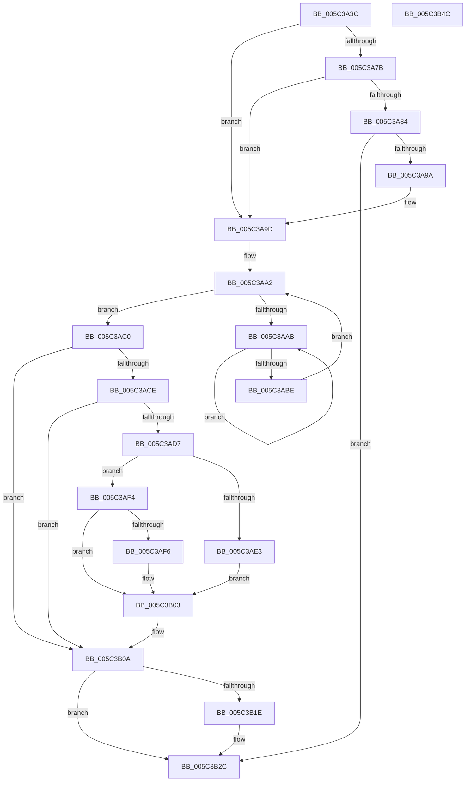

# KiAdjustThreadTimer

- RVA: `0x005C3A3C`–`0x005C3B4D` (길이 `273` bytes)
- VA: `0x00000001405C3A3C`
- 실행 섹션: `.text`
- PDB 이름 있음: `예`; PDB Function 태그: `아니요`
- unwind 정보 RVA: `0x0006B074`
- 디코드: `75`개 명령, `273/273` bytes 표시
- 미해석 바이트: `0` (있으면 어셈블리에 `.byte`로 보존)

> 이 문서는 커널 이미지의 기계어와 PDB 기호를 분석해 생성했습니다. 4번과 5번은 함수 원형과 자료형을 바이너리 사용 방식에서 추정한 C 해석이며 원본 소스 복구 결과는 아닙니다.

## 1. Dependencies

- 직접 호출 지점: **4**; 고유 호출 대상: **4**
- 직접 호출자로 확인된 함수: **1**
- RIP 상대 이미지 참조: **0**

### Outgoing calls
- `0x005C3A6D` → [KiAcquireKobjectLockSafe](../25/KiAcquireKobjectLockSafe_function_00251C90.md) (function, `0x00251C90`)
- `0x005C3A8D` → [KiSuspendThread](../46/KiSuspendThread_function_0046B964.md) (function, `0x0046B964`)
- `0x005C3AB0` → [KeYieldProcessorEx](../3F/KeYieldProcessorEx_function_003FBD00.md) (function, `0x003FBD00`)
- `0x005C3B27` → [KiResumeThread](../20/KiResumeThread_function_00203644.md) (function, `0x00203644`)

### Direct callers
- [KeAdjustTimerDelayProcess](../5B/KeAdjustTimerDelayProcess_function_005B9658.md) at `0x005B96A8`

### Static image references
- 디코드된 RIP-relative 메모리 참조가 없습니다.

## 2. Other-region calls and transfers

- 다른 실행 섹션으로 향하는 call: **0**
- 별도 외부 분기/꼬리 이동을 확인하지 못했습니다.

## 3. Assembly (complete function range)

```asm
005C3A3C  48 89 5C 24 10                  mov qword ptr [rsp + 0x10], rbx
005C3A41  48 89 6C 24 18                  mov qword ptr [rsp + 0x18], rbp
005C3A46  48 89 74 24 20                  mov qword ptr [rsp + 0x20], rsi
005C3A4B  57                              push rdi
005C3A4C  41 56                           push r14
005C3A4E  41 57                           push r15
005C3A50  48 83 EC 20                     sub rsp, 0x20
005C3A54  48 8D B9 E0 02 00 00            lea rdi, [rcx + 0x2e0]
005C3A5B  48 8B D9                        mov rbx, rcx
005C3A5E  48 8B CF                        mov rcx, rdi
005C3A61  45 8B F9                        mov r15d, r9d
005C3A64  49 8B F0                        mov rsi, r8
005C3A67  4C 8B F2                        mov r14, rdx
005C3A6A  40 32 ED                        xor bpl, bpl
005C3A6D  E8 1E E2 C8 FF                  call 0x140251c90
005C3A72  80 BB 84 02 00 00 01            cmp byte ptr [rbx + 0x284], 1
005C3A79  7D 22                           jge 0x1405c3a9d
005C3A7B  F7 43 78 00 40 00 00            test dword ptr [rbx + 0x78], 0x4000
005C3A82  75 19                           jne 0x1405c3a9d
005C3A84  45 33 C0                        xor r8d, r8d
005C3A87  49 8B D6                        mov rdx, r14
005C3A8A  48 8B CB                        mov rcx, rbx
005C3A8D  E8 D2 7E EA FF                  call 0x14046b964
005C3A92  84 C0                           test al, al
005C3A94  0F 84 92 00 00 00               je 0x1405c3b2c
005C3A9A  40 B5 01                        mov bpl, 1
005C3A9D  83 64 24 40 00                  and dword ptr [rsp + 0x40], 0
005C3AA2  F0 48 0F BA 6B 40 00            lock bts qword ptr [rbx + 0x40], 0
005C3AA9  73 15                           jae 0x1405c3ac0
005C3AAB  48 8D 4C 24 40                  lea rcx, [rsp + 0x40]
005C3AB0  E8 4B 82 E3 FF                  call 0x1403fbd00
005C3AB5  48 8B 43 40                     mov rax, qword ptr [rbx + 0x40]
005C3AB9  48 85 C0                        test rax, rax
005C3ABC  75 ED                           jne 0x1405c3aab
005C3ABE  EB E2                           jmp 0x1405c3aa2
005C3AC0  8B 43 74                        mov eax, dword ptr [rbx + 0x74]
005C3AC3  B9 00 00 06 00                  mov ecx, 0x60000
005C3AC8  23 C1                           and eax, ecx
005C3ACA  3B C1                           cmp eax, ecx
005C3ACC  75 3C                           jne 0x1405c3b0a
005C3ACE  F6 83 01 01 00 00 01            test byte ptr [rbx + 0x101], 1
005C3AD5  75 33                           jne 0x1405c3b0a
005C3AD7  48 8B 8B 18 01 00 00            mov rcx, qword ptr [rbx + 0x118]
005C3ADE  48 85 F6                        test rsi, rsi
005C3AE1  79 11                           jns 0x1405c3af4
005C3AE3  48 2B CE                        sub rcx, rsi
005C3AE6  48 8B C1                        mov rax, rcx
005C3AE9  33 C9                           xor ecx, ecx
005C3AEB  48 85 C0                        test rax, rax
005C3AEE  48 0F 4E C8                     cmovle rcx, rax
005C3AF2  EB 0F                           jmp 0x1405c3b03
005C3AF4  7E 0D                           jle 0x1405c3b03
005C3AF6  48 8B C1                        mov rax, rcx
005C3AF9  48 2B C6                        sub rax, rsi
005C3AFC  48 3B C1                        cmp rax, rcx
005C3AFF  48 0F 4C C8                     cmovl rcx, rax
005C3B03  48 89 8B 18 01 00 00            mov qword ptr [rbx + 0x118], rcx
005C3B0A  44 89 BB B8 03 00 00            mov dword ptr [rbx + 0x3b8], r15d
005C3B11  48 C7 43 40 00 00 00 00         mov qword ptr [rbx + 0x40], 0
005C3B19  40 84 ED                        test bpl, bpl
005C3B1C  74 0E                           je 0x1405c3b2c
005C3B1E  45 33 C0                        xor r8d, r8d
005C3B21  49 8B D6                        mov rdx, r14
005C3B24  48 8B CB                        mov rcx, rbx
005C3B27  E8 18 FB C3 FF                  call 0x140203644
005C3B2C  F0 81 27 7F FF FF FF            lock and dword ptr [rdi], 0xffffff7f
005C3B33  48 8B 5C 24 48                  mov rbx, qword ptr [rsp + 0x48]
005C3B38  48 8B 6C 24 50                  mov rbp, qword ptr [rsp + 0x50]
005C3B3D  48 8B 74 24 58                  mov rsi, qword ptr [rsp + 0x58]
005C3B42  48 83 C4 20                     add rsp, 0x20
005C3B46  41 5F                           pop r15
005C3B48  41 5E                           pop r14
005C3B4A  5F                              pop rdi
005C3B4B  C3                              ret
005C3B4C  CC                              int3
```

## 4. C-style interpretation (structured pseudocode)

```c
__int64 __fastcall KiAdjustThreadTimer(__int64 a1, __int64 a2, __int64 a3, int a4)
{
    __int64 result;
    __int64 v_rbp;
    __int64 v_rsp;
    unsigned __int64 v_stack_p10;
    unsigned __int64 v_stack_p18;
    unsigned __int64 v_stack_p20;
    unsigned int v_stack_p8;

    v_stack_p10 = v_rbx;
    v_stack_p18 = v_rbp;
    v_stack_p20 = v_rsi;
    v_rsp = (v_rsp) - (32);
    v_rbp = 0;
    result = KiAcquireKobjectLockSafe(a1 + 736, a2, a3, a4);
    if ((*(unsigned __int8 *)(a1 + 644)) >= 1) goto loc_005C3A9D;
    if (((*(unsigned int *)(a1 + 120)) & (0x4000ULL)) != 0) goto loc_005C3A9D;
    a3 = 0;
    result = KiSuspendThread(a1, a2, a3, a4);
    if ((unsigned __int8)(result) == 0) goto loc_005C3B2C;
loc_005C3A9D:
loc_005C3AA2:
    if (condition_is_above_or_equal) goto loc_005C3AC0;
loc_005C3AAB:
    result = KeYieldProcessorEx(v_stack_p8, a2, a3, a4);
    if (*(unsigned __int64 *)(a1 + 64) != 0) goto loc_005C3AAB;
    goto loc_005C3AA2;
loc_005C3AC0:
    result = (unsigned int)(((unsigned int)(*(unsigned int *)(a1 + 116))) & ((unsigned int)((unsigned int)(0x60000ULL))));
    if (((unsigned int)(result)) != ((unsigned int)((unsigned int)(0x60000ULL)))) goto loc_005C3B0A;
    if (((*(unsigned __int8 *)(a1 + 257)) & (1)) != 0) goto loc_005C3B0A;
    if (!sign_flag) goto loc_005C3AF4;
    a1 = (*(unsigned __int64 *)(a1 + 280)) - (0);
    a1 = 0;
    if (condition_is_less_or_equal) { a1 = 0; }
    goto loc_005C3B03;
loc_005C3AF4:
    result = a1;
    if (!(condition_is_less_or_equal)) {
        result = a1;
        result = (result) - (0);
        if (result < a1) { a1 = result; }
    }
    *(unsigned __int64 *)(a1 + 280) = a1;
loc_005C3B0A:
    *(unsigned int *)(a1 + 952) = (unsigned int)((unsigned int)(a4));
    *(unsigned __int64 *)(a1 + 64) = 0;
    if (1 != 0) {
        a3 = 0;
        a2 = a2;
        a1 = a1;
        result = KiResumeThread(a1, a2, a3, a4);
    }
    v_rsp = (v_rsp) + (32);
    return result;
}
```

## 5. (Beta) C Style

```c
int64_t KiAdjustThreadTimer(void *Arg1, int64_t Arg2, int64_t Arg3, int32_t Arg4)
{
    uint8_t *arg1 = (uint8_t *)Arg1;

    int64_t result;
    int64_t local_rbp;
    int64_t local_rsp;
    uint64_t v_stack_p10;
    uint64_t v_stack_p18;
    uint64_t v_stack_p20;
    uint32_t v_stack_p8;

    v_stack_p10 = local_rbx;
    v_stack_p18 = local_rbp;
    v_stack_p20 = local_rsi;
    local_rsp = (local_rsp) - (32);
    local_rbp = 0;
    result = KiAcquireKobjectLockSafe(Arg1 + 736, Arg2, Arg3, Arg4);
    if ((*(uint8_t *)(arg1 + 0x284)) >= 1) goto loc_005C3A9D;
    if (((*(uint32_t *)(arg1 + 0x78)) & (0x4000ULL)) != 0) goto loc_005C3A9D;
    Arg3 = 0;
    result = KiSuspendThread(Arg1, Arg2, Arg3, Arg4);
    if ((uint8_t)(result) == 0) goto loc_005C3B2C;
loc_005C3A9D:
loc_005C3AA2:
    if (condition_is_above_or_equal) goto loc_005C3AC0;
loc_005C3AAB:
    result = KeYieldProcessorEx(v_stack_p8, Arg2, Arg3, Arg4);
    if (*(uint64_t *)(arg1 + 0x40) != 0) goto loc_005C3AAB;
    goto loc_005C3AA2;
loc_005C3AC0:
    result = (uint32_t)(((uint32_t)(*(uint32_t *)(arg1 + 0x74))) & ((uint32_t)((uint32_t)(0x60000ULL))));
    if (((uint32_t)(result)) != ((uint32_t)((uint32_t)(0x60000ULL)))) goto loc_005C3B0A;
    if (((*(uint8_t *)(arg1 + 0x101)) & (1)) != 0) goto loc_005C3B0A;
    if (!sign_flag) goto loc_005C3AF4;
    Arg1 = (*(uint64_t *)(arg1 + 0x118)) - (0);
    Arg1 = 0;
    if (condition_is_less_or_equal) { Arg1 = 0; }
    goto loc_005C3B03;
loc_005C3AF4:
    result = Arg1;
    if (!(condition_is_less_or_equal)) {
        result = Arg1;
        result = (result) - (0);
        if (result < Arg1) { Arg1 = result; }
    }
    *(void **)(arg1 + 0x118) = Arg1;
loc_005C3B0A:
    *(uint32_t *)(arg1 + 0x3B8) = (uint32_t)((uint32_t)(Arg4));
    *(uint64_t *)(arg1 + 0x40) = 0;
    if (1 != 0) {
        Arg3 = 0;
        Arg2 = Arg2;
        Arg1 = Arg1;
        result = KiResumeThread(Arg1, Arg2, Arg3, Arg4);
    }
    local_rsp = (local_rsp) + (32);
    return result;
}
```

### 관측된 메모리 오프셋

구조체 형식이 확인되지 않은 접근은 인자 기준의 오프셋으로만 기록했습니다.

| 기준 인자 | 오프셋 표현 | 폭 (bit) | 접근 |
|---|---:|---:|---|
| `Arg1` | `+ 0x0` | `32` | `R/W` |
| `Arg1` | `+ 0x40` | `64` | `R` |
| `Arg1` | `+ 0x40` | `64` | `R/W` |
| `Arg1` | `+ 0x40` | `64` | `W` |
| `Arg1` | `+ 0x74` | `32` | `R` |
| `Arg1` | `+ 0x78` | `32` | `R` |
| `Arg1` | `+ 0x101` | `8` | `R` |
| `Arg1` | `+ 0x118` | `64` | `R` |
| `Arg1` | `+ 0x118` | `64` | `W` |
| `Arg1` | `+ 0x284` | `8` | `R` |
| `Arg1` | `+ 0x2E0` | `64` | `R` |
| `Arg1` | `+ 0x3B8` | `32` | `W` |

## 6. Execution-region graph

[열기: 2D/3D 그래프와 함수 탐색 컨트롤 패널](../../../control-panel.html?section=text&rva=0x005C3A3C&view=graph)

- 2D 그래프는 위에서 아래로 흐르고, 3D 그래프는 빈 공간을 드래그해 회전합니다. Shift+드래그는 이동, 휠은 확대·축소, 함수 노드 선택은 대상 보고서 이동입니다.

### Static fallback


