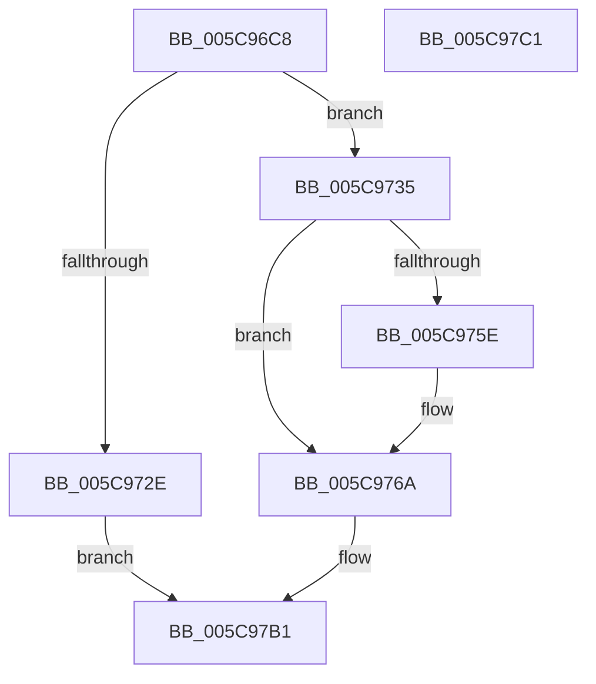

# KiAllocateForceParkingData

- RVA: `0x005C96C8`–`0x005C97C2` (길이 `250` bytes)
- VA: `0x00000001405C96C8`
- 실행 섹션: `.text`
- PDB 이름 있음: `예`; PDB Function 태그: `아니요`
- unwind 정보 RVA: `0x000718AC`
- 디코드: `60`개 명령, `250/250` bytes 표시
- 미해석 바이트: `0` (있으면 어셈블리에 `.byte`로 보존)

> 이 문서는 커널 이미지의 기계어와 PDB 기호를 분석해 생성했습니다. 4번과 5번은 함수 원형과 자료형을 바이너리 사용 방식에서 추정한 C 해석이며 원본 소스 복구 결과는 아닙니다.

## 1. Dependencies

- 직접 호출 지점: **3**; 고유 호출 대상: **2**
- 직접 호출자로 확인된 함수: **3**
- RIP 상대 이미지 참조: **3**

### Outgoing calls
- `0x005C971F` → [ExAllocatePool3](../../poolcode/B8/ExAllocatePool3_function_00B84270.md) (function, `0x00B84270`)
- `0x005C9786` → [KiInitializeTimer2](../3A/KiInitializeTimer2_function_003A3288.md) (function, `0x003A3288`)
- `0x005C97A3` → [KiInitializeTimer2](../3A/KiInitializeTimer2_function_003A3288.md) (function, `0x003A3288`)

### Direct callers
- [KiCompleteBootProcessorContextInitialization](../5B/KiCompleteBootProcessorContextInitialization_function_005B7634.md) at `0x005B7741`
- [KiStartDynamicProcessor](../../page/74/KiStartDynamicProcessor_function_007456C8.md) at `0x007459EF`
- [KeStartAllProcessors](../../init/C3/KeStartAllProcessors_function_00C36F78.md) at `0x00C3731D`

### Static image references
- `0x005C973B` → RVA `0x005C97D0` (`KiForceParkDutyCycleDpcCallback`; read)
- `0x005C977F` → RVA `0x005C99F0` (`KiStartForceParkSingleDutyCycleTimerCallback`; read)
- `0x005C979C` → RVA `0x005C9A70` (`KiStopForceParkSingleDutyCycleTimerCallback`; read)

## 2. Other-region calls and transfers

- 다른 실행 섹션으로 향하는 call: **1**
  - `0x005C971F` → [ExAllocatePool3](../../poolcode/B8/ExAllocatePool3_function_00B84270.md) (`.text` → `POOLCODE`)
- 별도 외부 분기/꼬리 이동을 확인하지 못했습니다.

## 3. Assembly (complete function range)

```asm
005C96C8  48 8B C4                        mov rax, rsp
005C96CB  48 89 58 08                     mov qword ptr [rax + 8], rbx
005C96CF  48 89 70 10                     mov qword ptr [rax + 0x10], rsi
005C96D3  57                              push rdi
005C96D4  48 83 EC 40                     sub rsp, 0x40
005C96D8  0F 57 C0                        xorps xmm0, xmm0
005C96DB  C7 44 24 20 01 00 00 00         mov dword ptr [rsp + 0x20], 1
005C96E3  0F 11 40 E8                     movups xmmword ptr [rax - 0x18], xmm0
005C96E7  C6 40 E8 03                     mov byte ptr [rax - 0x18], 3
005C96EB  4C 8D 4C 24 30                  lea r9, [rsp + 0x30]
005C96F0  48 0F BA 68 E8 08               bts qword ptr [rax - 0x18], 8
005C96F6  48 8B F9                        mov rdi, rcx
005C96F9  48 8B 81 C0 00 00 00            mov rax, qword ptr [rcx + 0xc0]
005C9700  41 B8 4B 69 46 50               mov r8d, 0x5046694b
005C9706  B9 40 00 00 00                  mov ecx, 0x40
005C970B  0F B7 90 8A 00 00 00            movzx edx, word ptr [rax + 0x8a]
005C9712  0F BA EA 1F                     bts edx, 0x1f
005C9716  89 54 24 38                     mov dword ptr [rsp + 0x38], edx
005C971A  BA 58 01 00 00                  mov edx, 0x158
005C971F  E8 4C AB 5B 00                  call 0x140b84270
005C9724  33 F6                           xor esi, esi
005C9726  48 8B D8                        mov rbx, rax
005C9729  48 85 C0                        test rax, rax
005C972C  75 07                           jne 0x1405c9735
005C972E  B8 9A 00 00 C0                  mov eax, 0xc000009a
005C9733  EB 7C                           jmp 0x1405c97b1
005C9735  C7 00 13 01 00 00               mov dword ptr [rax], 0x113
005C973B  48 8D 05 8E 00 00 00            lea rax, [rip + 0x8e]
005C9742  48 89 43 18                     mov qword ptr [rbx + 0x18], rax
005C9746  48 89 7B 20                     mov qword ptr [rbx + 0x20], rdi
005C974A  48 89 73 38                     mov qword ptr [rbx + 0x38], rsi
005C974E  48 89 73 10                     mov qword ptr [rbx + 0x10], rsi
005C9752  48 8B 43 38                     mov rax, qword ptr [rbx + 0x38]
005C9756  8B 4F 24                        mov ecx, dword ptr [rdi + 0x24]
005C9759  48 85 C0                        test rax, rax
005C975C  75 0C                           jne 0x1405c976a
005C975E  B8 00 08 00 00                  mov eax, 0x800
005C9763  66 03 C8                        add cx, ax
005C9766  66 89 4B 02                     mov word ptr [rbx + 2], cx
005C976A  48 8D 4B 40                     lea rcx, [rbx + 0x40]
005C976E  48 89 B3 50 01 00 00            mov qword ptr [rbx + 0x150], rsi
005C9775  45 33 C9                        xor r9d, r9d
005C9778  66 89 71 02                     mov word ptr [rcx + 2], si
005C977C  4C 8B C7                        mov r8, rdi
005C977F  48 8D 15 6A 02 00 00            lea rdx, [rip + 0x26a]
005C9786  E8 FD 9A DD FF                  call 0x1403a3288
005C978B  48 8D 8B C8 00 00 00            lea rcx, [rbx + 0xc8]
005C9792  45 33 C9                        xor r9d, r9d
005C9795  4C 8B C7                        mov r8, rdi
005C9798  66 89 71 02                     mov word ptr [rcx + 2], si
005C979C  48 8D 15 CD 02 00 00            lea rdx, [rip + 0x2cd]
005C97A3  E8 E0 9A DD FF                  call 0x1403a3288
005C97A8  33 C0                           xor eax, eax
005C97AA  48 89 9F F0 86 00 00            mov qword ptr [rdi + 0x86f0], rbx
005C97B1  48 8B 5C 24 50                  mov rbx, qword ptr [rsp + 0x50]
005C97B6  48 8B 74 24 58                  mov rsi, qword ptr [rsp + 0x58]
005C97BB  48 83 C4 40                     add rsp, 0x40
005C97BF  5F                              pop rdi
005C97C0  C3                              ret
005C97C1  CC                              int3
```

## 4. C-style interpretation (structured pseudocode)

```c
__int64 __fastcall KiAllocateForceParkingData(__int64 a1)
{
    __int64 result;
    __int64 v_rsi;
    __int64 v_rsp;
    unsigned int v_stack_m10;
    unsigned __int64 v_stack_m18;
    unsigned int v_stack_m28;
    unsigned __int64 v_stack_p10;
    unsigned __int64 v_stack_p8;

    *(unsigned __int64 *)(v_rsp + 8) = v_rbx;
    *(unsigned __int64 *)(v_rsp + 16) = v_rsi;
    v_rsp = (v_rsp) - (64);
    v_stack_m28 = 1;
    *(unsigned __int64 *)(v_rsp - 24) = v_xmm0;
    *(unsigned __int8 *)(v_rsp - 24) = 3;
    v_stack_m10 = (unsigned int)(*(unsigned __int16 *)(*(unsigned __int64 *)(a1 + 192) + 138));
    result = ExAllocatePool3(64, 344, (unsigned int)(0x5046694BULL), v_stack_m18);
    v_rsi = 0;
    if (result != 0) goto loc_005C9735;
    goto loc_005C97B1;
loc_005C9735:
    *(unsigned int *)((unsigned int)(0xC000009AULL)) = 275;
    *(unsigned __int64 *)(result + 24) = v_rip + 142;
    *(unsigned __int64 *)(result + 32) = a1;
    *(unsigned __int64 *)(result + 56) = 0;
    *(unsigned __int64 *)(result + 16) = 0;
    result = *(unsigned __int64 *)(result + 56);
    if (*(unsigned __int64 *)(result + 56) == 0) {
        result = 0x800ULL;
        a1 = (unsigned __int16)(((unsigned int)(*(unsigned int *)(a1 + 36))) + ((unsigned __int16)(result)));
        *(unsigned __int16 *)(result + 2) = (unsigned __int16)(a1);
    }
    *(unsigned __int64 *)(result + 336) = 0;
    a4 = 0;
    *(unsigned __int16 *)(result + 64 + 2) = 0;
    result = KiInitializeTimer2(result + 64, v_rip + 618, a1, a4);
    a4 = 0;
    *(unsigned __int16 *)(result + 200 + 2) = 0;
    result = KiInitializeTimer2(result + 200, v_rip + 717, a1, a4);
    result = 0;
    *(unsigned __int64 *)(a1 + 34544) = 0;
loc_005C97B1:
    v_rsp = (v_rsp) + (64);
    return result;
}
```

## 5. (Beta) C Style

```c
int64_t KiAllocateForceParkingData(void *Arg1)
{
    uint8_t *arg1 = (uint8_t *)Arg1;

    int64_t result;
    int64_t local_rsi;
    int64_t local_rsp;
    uint32_t v_stack_m10;
    uint64_t v_stack_m18;
    uint32_t v_stack_m28;
    uint64_t v_stack_p10;
    uint64_t v_stack_p8;

    *(uint64_t *)(local_rsp + 0x8) = local_rbx;
    *(uint64_t *)(local_rsp + 0x10) = local_rsi;
    local_rsp = (local_rsp) - (64);
    v_stack_m28 = 1;
    *(uint64_t *)(local_rsp - 0x18) = v_xmm0;
    *(uint8_t *)(local_rsp - 0x18) = 3;
    v_stack_m10 = (uint32_t)(*(uint16_t *)(*(uint64_t *)(arg1 + 0xC0) + 0x8A));
    result = ExAllocatePool3(64, 344, (uint32_t)(0x5046694BULL), v_stack_m18);
    local_rsi = 0;
    if (result != 0) goto loc_005C9735;
    goto loc_005C97B1;
loc_005C9735:
    *(uint32_t *)((uint32_t)(0xC000009AULL)) = 275;
    *(uint64_t *)(result + 0x18) = v_rip + 142;
    *(void **)(result + 0x20) = Arg1;
    *(uint64_t *)(result + 0x38) = 0;
    *(uint64_t *)(result + 0x10) = 0;
    result = *(uint64_t *)(result + 0x38);
    if (*(uint64_t *)(result + 0x38) == 0) {
        result = 0x800ULL;
        Arg1 = (uint16_t)(((uint32_t)(*(uint32_t *)(arg1 + 0x24))) + ((uint16_t)(result)));
        *(uint16_t *)(result + 0x2) = (uint16_t)(Arg1);
    }
    *(uint64_t *)(result + 0x150) = 0;
    a4 = 0;
    *(uint16_t *)(result + 0x40 + 0x2) = 0;
    result = KiInitializeTimer2(result + 64, v_rip + 618, Arg1, a4);
    a4 = 0;
    *(uint16_t *)(result + 0xC8 + 0x2) = 0;
    result = KiInitializeTimer2(result + 200, v_rip + 717, Arg1, a4);
    result = 0;
    *(uint64_t *)(arg1 + 0x86F0) = 0;
loc_005C97B1:
    local_rsp = (local_rsp) + (64);
    return result;
}
```

### 관측된 메모리 오프셋

구조체 형식이 확인되지 않은 접근은 인자 기준의 오프셋으로만 기록했습니다.

| 기준 인자 | 오프셋 표현 | 폭 (bit) | 접근 |
|---|---:|---:|---|
| `Arg1` | `+ 0x24` | `32` | `R` |
| `Arg1` | `+ 0xC0` | `64` | `R` |
| `Arg1` | `+ 0x86F0` | `64` | `W` |

## 6. Execution-region graph

[열기: 2D/3D 그래프와 함수 탐색 컨트롤 패널](../../../control-panel.html?section=text&rva=0x005C96C8&view=graph)

- 2D 그래프는 위에서 아래로 흐르고, 3D 그래프는 빈 공간을 드래그해 회전합니다. Shift+드래그는 이동, 휠은 확대·축소, 함수 노드 선택은 대상 보고서 이동입니다.

### Static fallback


