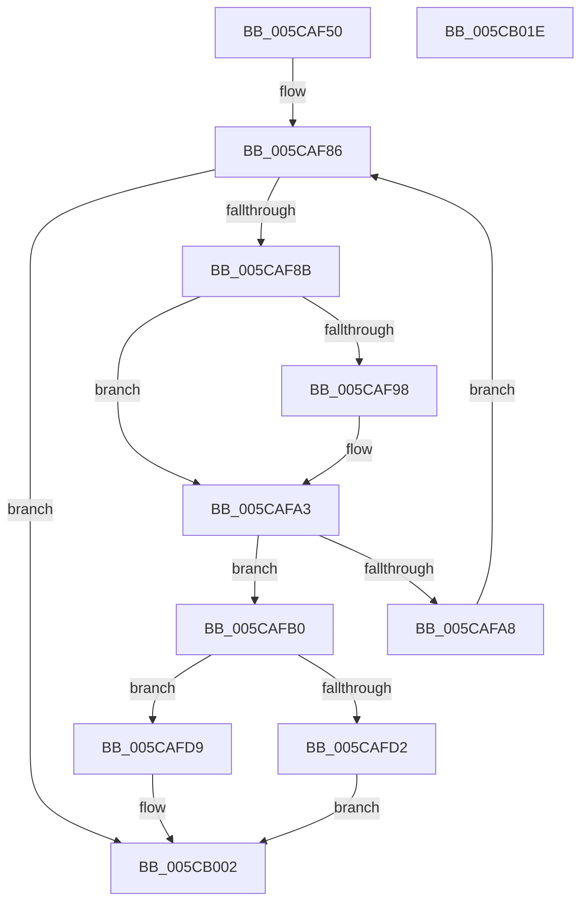

# KiAltContextProcessMcheckAltReturn

- RVA: `0x005CAF50`–`0x005CB01F` (길이 `207` bytes)
- VA: `0x00000001405CAF50`
- 실행 섹션: `.text`
- PDB 이름 있음: `예`; PDB Function 태그: `아니요`
- unwind 정보 RVA: `0x00066400`
- 디코드: `56`개 명령, `207/207` bytes 표시
- 미해석 바이트: `0` (있으면 어셈블리에 `.byte`로 보존)

> 이 문서는 커널 이미지의 기계어와 PDB 기호를 분석해 생성했습니다. 4번과 5번은 함수 원형과 자료형을 바이너리 사용 방식에서 추정한 C 해석이며 원본 소스 복구 결과는 아닙니다.

## 1. Dependencies

- 직접 호출 지점: **3**; 고유 호출 대상: **3**
- 직접 호출자로 확인된 함수: **0**
- RIP 상대 이미지 참조: **2**

### Outgoing calls
- `0x005CAFC5` → [ExAllocatePool2](../../poolcode/B8/ExAllocatePool2_function_00B820F0.md) (function, `0x00B820F0`)
- `0x005CAFEE` → [WheaAttemptPhysicalPageOffline](../../page/7D/WheaAttemptPhysicalPageOffline_function_007D7380.md) (function, `0x007D7380`)
- `0x005CAFFD` → [ExFreePoolWithTag](../../poolcode/B8/ExFreePoolWithTag_function_00B82870.md) (function, `0x00B82870`)

### Direct callers
- 이 함수 시작 RVA로 연결되는 직접 call은 확인되지 않았습니다. 간접 호출은 완전히 역산할 수 없습니다.

### Static image references
- `0x005CAF8F` → RVA `0x00024DA8` (`.rdata`; read)
- `0x005CAF9C` → RVA `0x00024DB0` (`.rdata`; read)

## 2. Other-region calls and transfers

- 다른 실행 섹션으로 향하는 call: **3**
  - `0x005CAFC5` → [ExAllocatePool2](../../poolcode/B8/ExAllocatePool2_function_00B820F0.md) (`.text` → `POOLCODE`)
  - `0x005CAFEE` → [WheaAttemptPhysicalPageOffline](../../page/7D/WheaAttemptPhysicalPageOffline_function_007D7380.md) (`.text` → `PAGE`)
  - `0x005CAFFD` → [ExFreePoolWithTag](../../poolcode/B8/ExFreePoolWithTag_function_00B82870.md) (`.text` → `POOLCODE`)
- 별도 외부 분기/꼬리 이동을 확인하지 못했습니다.

## 3. Assembly (complete function range)

```asm
005CAF50  48 89 5C 24 08                  mov qword ptr [rsp + 8], rbx
005CAF55  48 89 6C 24 10                  mov qword ptr [rsp + 0x10], rbp
005CAF5A  48 89 74 24 18                  mov qword ptr [rsp + 0x18], rsi
005CAF5F  57                              push rdi
005CAF60  48 83 EC 30                     sub rsp, 0x30
005CAF64  4C 8B 42 20                     mov r8, qword ptr [rdx + 0x20]
005CAF68  48 8B DA                        mov rbx, rdx
005CAF6B  40 8A 6A 18                     mov bpl, byte ptr [rdx + 0x18]
005CAF6F  BF 01 00 00 C0                  mov edi, 0xc0000001
005CAF74  40 80 E5 10                     and bpl, 0x10
005CAF78  33 D2                           xor edx, edx
005CAF7A  45 0F B7 48 0A                  movzx r9d, word ptr [r8 + 0xa]
005CAF7F  49 8D 88 80 00 00 00            lea rcx, [r8 + 0x80]
005CAF86  41 3B D1                        cmp edx, r9d
005CAF89  73 77                           jae 0x1405cb002
005CAF8B  48 8B 41 10                     mov rax, qword ptr [rcx + 0x10]
005CAF8F  48 2B 05 12 9E A5 FF            sub rax, qword ptr [rip - 0x5a61ee]
005CAF96  75 0B                           jne 0x1405cafa3
005CAF98  48 8B 41 18                     mov rax, qword ptr [rcx + 0x18]
005CAF9C  48 2B 05 0D 9E A5 FF            sub rax, qword ptr [rip - 0x5a61f3]
005CAFA3  48 85 C0                        test rax, rax
005CAFA6  74 08                           je 0x1405cafb0
005CAFA8  48 83 C1 48                     add rcx, 0x48
005CAFAC  FF C2                           inc edx
005CAFAE  EB D6                           jmp 0x1405caf86
005CAFB0  8B 39                           mov edi, dword ptr [rcx]
005CAFB2  BA 28 18 00 00                  mov edx, 0x1828
005CAFB7  49 03 F8                        add rdi, r8
005CAFBA  B9 00 01 00 00                  mov ecx, 0x100
005CAFBF  41 B8 57 68 65 61               mov r8d, 0x61656857
005CAFC5  E8 26 71 5B 00                  call 0x140b820f0
005CAFCA  48 8B F0                        mov rsi, rax
005CAFCD  48 85 C0                        test rax, rax
005CAFD0  75 07                           jne 0x1405cafd9
005CAFD2  BF 9A 00 00 C0                  mov edi, 0xc000009a
005CAFD7  EB 29                           jmp 0x1405cb002
005CAFD9  48 8B 4F 30                     mov rcx, qword ptr [rdi + 0x30]
005CAFDD  44 8A CD                        mov r9b, bpl
005CAFE0  48 C1 E9 0C                     shr rcx, 0xc
005CAFE4  41 B0 01                        mov r8b, 1
005CAFE7  33 D2                           xor edx, edx
005CAFE9  48 89 74 24 20                  mov qword ptr [rsp + 0x20], rsi
005CAFEE  E8 8D C3 20 00                  call 0x1407d7380
005CAFF3  8B F8                           mov edi, eax
005CAFF5  BA 57 68 65 61                  mov edx, 0x61656857
005CAFFA  48 8B CE                        mov rcx, rsi
005CAFFD  E8 6E 78 5B 00                  call 0x140b82870
005CB002  48 8B 6C 24 48                  mov rbp, qword ptr [rsp + 0x48]
005CB007  48 8B 74 24 50                  mov rsi, qword ptr [rsp + 0x50]
005CB00C  89 7B 28                        mov dword ptr [rbx + 0x28], edi
005CB00F  F0 FF 4B 10                     lock dec dword ptr [rbx + 0x10]
005CB013  48 8B 5C 24 40                  mov rbx, qword ptr [rsp + 0x40]
005CB018  48 83 C4 30                     add rsp, 0x30
005CB01C  5F                              pop rdi
005CB01D  C3                              ret
005CB01E  CC                              int3
```

## 4. C-style interpretation (structured pseudocode)

```c
__int64 __fastcall KiAltContextProcessMcheckAltReturn(__int64 a1, __int64 a2)
{
    __int64 result;
    __int64 v_rbp;
    __int64 v_rdi;
    __int64 v_rsp;
    unsigned __int64 v_stack_m18;
    unsigned __int64 v_stack_p10;
    unsigned __int64 v_stack_p18;
    unsigned __int64 v_stack_p8;

    v_stack_p8 = v_rbx;
    v_stack_p10 = v_rbp;
    v_stack_p18 = v_rsi;
    v_rsp = (v_rsp) - (48);
    v_rbp = (unsigned __int8)((*(unsigned __int8 *)(a2 + 24)) & (16));
    a2 = 0;
loc_005CAF86:
    if (0 >= ((unsigned int)(*(unsigned __int16 *)(*(unsigned __int64 *)(a2 + 32) + 10)))) goto loc_005CB002;
    result = (*(unsigned __int64 *)(*(unsigned __int64 *)(a2 + 32) + 128 + 16)) - (*(unsigned __int64 *)(v_rip - 5923310));
    if (!(condition_is_not_equal)) {
        result = *(unsigned __int64 *)(*(unsigned __int64 *)(a2 + 32) + 128 + 24);
        result = (result) - (*(unsigned __int64 *)(v_rip - 5923315));
    }
    if (result == 0) goto loc_005CAFB0;
    a1 = (*(unsigned __int64 *)(a2 + 32) + 128) + (72);
    a2 = (unsigned int)((a2) + 1);
    goto loc_005CAF86;
loc_005CAFB0:
    v_rdi = ((unsigned int)(*(unsigned int *)(a1))) + (*(unsigned __int64 *)(a2 + 32));
    result = ExAllocatePool2(256, (unsigned int)(0x1828ULL), (unsigned int)(0x61656857ULL), *(unsigned __int16 *)(*(unsigned __int64 *)(a2 + 32) + 10));
    if (result != 0) goto loc_005CAFD9;
    goto loc_005CB002;
loc_005CAFD9:
    a1 = (*(unsigned __int64 *)((unsigned int)(0xC000009AULL) + 48)) >> (12);
    a2 = 0;
    v_stack_m18 = result;
    result = WheaAttemptPhysicalPageOffline(a1, a2, 1, (unsigned __int8)(v_rbp));
    result = ExFreePoolWithTag(result, (unsigned int)(0x61656857ULL), 1, (unsigned __int8)(v_rbp));
loc_005CB002:
    *(unsigned int *)(a2 + 40) = (unsigned int)((unsigned int)((unsigned int)(result)));
    v_rsp = (v_rsp) + (48);
    return result;
}
```

## 5. (Beta) C Style

```c
int64_t KiAltContextProcessMcheckAltReturn(int64_t Arg1, void *Arg2)
{
    uint8_t *arg2 = (uint8_t *)Arg2;

    int64_t result;
    int64_t local_rbp;
    int64_t local_rdi;
    int64_t local_rsp;
    uint64_t v_stack_m18;
    uint64_t v_stack_p10;
    uint64_t v_stack_p18;
    uint64_t v_stack_p8;

    v_stack_p8 = local_rbx;
    v_stack_p10 = local_rbp;
    v_stack_p18 = local_rsi;
    local_rsp = (local_rsp) - (48);
    local_rbp = (uint8_t)((*(uint8_t *)(arg2 + 0x18)) & (16));
    Arg2 = 0;
loc_005CAF86:
    if (0 >= ((uint32_t)(*(uint16_t *)(*(uint64_t *)(arg2 + 0x20) + 0xA)))) goto loc_005CB002;
    result = (*(uint64_t *)(*(uint64_t *)(arg2 + 0x20) + 0x80 + 0x10)) - (*(uint64_t *)(v_rip - 0x5A61EE));
    if (!(condition_is_not_equal)) {
        result = *(uint64_t *)(*(uint64_t *)(arg2 + 0x20) + 0x80 + 0x18);
        result = (result) - (*(uint64_t *)(v_rip - 0x5A61F3));
    }
    if (result == 0) goto loc_005CAFB0;
    Arg1 = (*(uint64_t *)(arg2 + 0x20) + 128) + (72);
    Arg2 = (uint32_t)((Arg2) + 1);
    goto loc_005CAF86;
loc_005CAFB0:
    local_rdi = ((uint32_t)(*(uint32_t *)(Arg1))) + (*(uint64_t *)(arg2 + 0x20));
    result = ExAllocatePool2(256, (uint32_t)(0x1828ULL), (uint32_t)(0x61656857ULL), *(uint16_t *)(*(uint64_t *)(arg2 + 0x20) + 0xA));
    if (result != 0) goto loc_005CAFD9;
    goto loc_005CB002;
loc_005CAFD9:
    Arg1 = (*(uint64_t *)((uint32_t)(0xC000009AULL) + 0x30)) >> (12);
    Arg2 = 0;
    v_stack_m18 = result;
    result = WheaAttemptPhysicalPageOffline(Arg1, Arg2, 1, (uint8_t)(local_rbp));
    result = ExFreePoolWithTag(result, (uint32_t)(0x61656857ULL), 1, (uint8_t)(local_rbp));
loc_005CB002:
    *(uint32_t *)(arg2 + 0x28) = (uint32_t)((uint32_t)((uint32_t)(result)));
    local_rsp = (local_rsp) + (48);
    return result;
}
```

### 관측된 메모리 오프셋

구조체 형식이 확인되지 않은 접근은 인자 기준의 오프셋으로만 기록했습니다.

| 기준 인자 | 오프셋 표현 | 폭 (bit) | 접근 |
|---|---:|---:|---|
| `Arg2` | `+ 0x10` | `32` | `R/W` |
| `Arg2` | `+ 0x18` | `8` | `R` |
| `Arg2` | `+ 0x20` | `64` | `R` |
| `Arg2` | `+ 0x28` | `32` | `W` |

## 6. Execution-region graph

[열기: 2D/3D 그래프와 함수 탐색 컨트롤 패널](../../../control-panel.html?section=text&rva=0x005CAF50&view=graph)

- 2D 그래프는 위에서 아래로 흐르고, 3D 그래프는 빈 공간을 드래그해 회전합니다. Shift+드래그는 이동, 휠은 확대·축소, 함수 노드 선택은 대상 보고서 이동입니다.

### Static fallback


