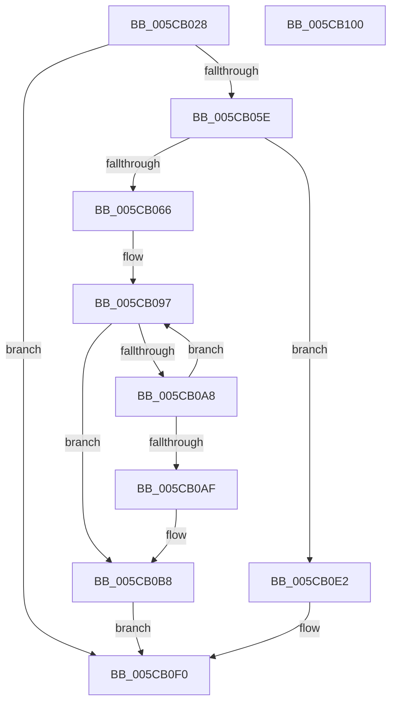

# KiAltContextWorkQueueAddItem

- RVA: `0x005CB028`–`0x005CB101` (길이 `217` bytes)
- VA: `0x00000001405CB028`
- 실행 섹션: `.text`
- PDB 이름 있음: `예`; PDB Function 태그: `아니요`
- unwind 정보 RVA: `0x000CB358`
- 디코드: `55`개 명령, `217/217` bytes 표시
- 미해석 바이트: `0` (있으면 어셈블리에 `.byte`로 보존)

> 이 문서는 커널 이미지의 기계어와 PDB 기호를 분석해 생성했습니다. 4번과 5번은 함수 원형과 자료형을 바이너리 사용 방식에서 추정한 C 해석이며 원본 소스 복구 결과는 아닙니다.

## 1. Dependencies

- 직접 호출 지점: **7**; 고유 호출 대상: **7**
- 직접 호출자로 확인된 함수: **1**
- RIP 상대 이미지 참조: **7**

### Outgoing calls
- `0x005CB050` → [ExInterlockedInsertTailList](../38/ExInterlockedInsertTailList_function_00386700.md) (function, `0x00386700`)
- `0x005CB074` → [KeGetCurrentProcessorNumberEx](../40/KeGetCurrentProcessorNumberEx_function_00401690.md) (function, `0x00401690`)
- `0x005CB09F` → [KeEnumerateNextProcessor](../41/KeEnumerateNextProcessor_function_00415480.md) (function, `0x00415480`)
- `0x005CB0B3` → [KeGetProcessorNumberFromIndex](../2D/KeGetProcessorNumberFromIndex_function_002DD320.md) (function, `0x002DD320`)
- `0x005CB0C3` → [KeSetTargetProcessorDpcEx](../2D/KeSetTargetProcessorDpcEx_function_002DD280.md) (function, `0x002DD280`)
- `0x005CB0DB` → [KeInsertQueueDpc](../20/KeInsertQueueDpc_function_00207C50.md) (function, `0x00207C50`)
- `0x005CB0EB` → [ExQueueWorkItem](../2F/ExQueueWorkItem_function_002F9520.md) (function, `0x002F9520`)

### Direct callers
- [KiMcheckAlternateReturn](KiMcheckAlternateReturn_function_005CB180.md) at `0x005CB420`

### Static image references
- `0x005CB03D` → RVA `0x00F106B0` (`.data`; read)
- `0x005CB046` → RVA `0x00F106A0` (`.data`; read)
- `0x005CB079` → RVA `0x00FC7128` (`ALMOSTRO`; read)
- `0x005CB088` → RVA `0x00FC7120` (`ALMOSTRO`; read)
- `0x005CB0BC` → RVA `0x00F106B8` (`.data`; read)
- `0x005CB0CB` → RVA `0x00F106B9` (`.data`; write)
- `0x005CB0E4` → RVA `0x00F106F8` (`.data`; read)

## 2. Other-region calls and transfers

- 다른 실행 섹션으로 향하는 call: **0**
- 별도 외부 분기/꼬리 이동을 확인하지 못했습니다.

## 3. Assembly (complete function range)

```asm
005CB028  48 89 5C 24 08                  mov qword ptr [rsp + 8], rbx
005CB02D  48 89 7C 24 20                  mov qword ptr [rsp + 0x20], rdi
005CB032  55                              push rbp
005CB033  48 8B EC                        mov rbp, rsp
005CB036  48 83 EC 40                     sub rsp, 0x40
005CB03A  48 8B D1                        mov rdx, rcx
005CB03D  4C 8D 05 6C 56 94 00            lea r8, [rip + 0x94566c]
005CB044  33 FF                           xor edi, edi
005CB046  48 8D 0D 53 56 94 00            lea rcx, [rip + 0x945653]
005CB04D  89 7D 18                        mov dword ptr [rbp + 0x18], edi
005CB050  E8 AB B6 DB FF                  call 0x140386700
005CB055  48 85 C0                        test rax, rax
005CB058  0F 85 92 00 00 00               jne 0x1405cb0f0
005CB05E  44 0F 20 C0                     mov rax, cr8
005CB062  3C 02                           cmp al, 2
005CB064  72 7C                           jb 0x1405cb0e2
005CB066  48 8D 4D 18                     lea rcx, [rbp + 0x18]
005CB06A  89 7D F2                        mov dword ptr [rbp - 0xe], edi
005CB06D  66 89 7D F6                     mov word ptr [rbp - 0xa], di
005CB071  89 7D 20                        mov dword ptr [rbp + 0x20], edi
005CB074  E8 17 66 E3 FF                  call 0x140401690
005CB079  48 8B 05 A8 C0 9F 00            mov rax, qword ptr [rip + 0x9fc0a8]
005CB080  0F B6 5D 1A                     movzx ebx, byte ptr [rbp + 0x1a]
005CB084  48 89 45 E8                     mov qword ptr [rbp - 0x18], rax
005CB088  48 8D 05 91 C0 9F 00            lea rax, [rip + 0x9fc091]
005CB08F  48 89 45 E0                     mov qword ptr [rbp - 0x20], rax
005CB093  66 89 7D F0                     mov word ptr [rbp - 0x10], di
005CB097  48 8D 55 E0                     lea rdx, [rbp - 0x20]
005CB09B  48 8D 4D 20                     lea rcx, [rbp + 0x20]
005CB09F  E8 DC A3 E4 FF                  call 0x140415480
005CB0A4  85 C0                           test eax, eax
005CB0A6  75 10                           jne 0x1405cb0b8
005CB0A8  8B 4D 20                        mov ecx, dword ptr [rbp + 0x20]
005CB0AB  3B CB                           cmp ecx, ebx
005CB0AD  74 E8                           je 0x1405cb097
005CB0AF  48 8D 55 18                     lea rdx, [rbp + 0x18]
005CB0B3  E8 68 22 D1 FF                  call 0x1402dd320
005CB0B8  48 8D 55 18                     lea rdx, [rbp + 0x18]
005CB0BC  48 8D 0D F5 55 94 00            lea rcx, [rip + 0x9455f5]
005CB0C3  E8 B8 21 D1 FF                  call 0x1402dd280
005CB0C8  45 33 C0                        xor r8d, r8d
005CB0CB  C6 05 E7 55 94 00 02            mov byte ptr [rip + 0x9455e7], 2
005CB0D2  33 D2                           xor edx, edx
005CB0D4  48 8D 0D DD 55 94 00            lea rcx, [rip + 0x9455dd]
005CB0DB  E8 70 CB C3 FF                  call 0x140207c50
005CB0E0  EB 0E                           jmp 0x1405cb0f0
005CB0E2  33 D2                           xor edx, edx
005CB0E4  48 8D 0D 0D 56 94 00            lea rcx, [rip + 0x94560d]
005CB0EB  E8 30 E4 D2 FF                  call 0x1402f9520
005CB0F0  48 8B 5C 24 50                  mov rbx, qword ptr [rsp + 0x50]
005CB0F5  48 8B 7C 24 68                  mov rdi, qword ptr [rsp + 0x68]
005CB0FA  48 83 C4 40                     add rsp, 0x40
005CB0FE  5D                              pop rbp
005CB0FF  C3                              ret
005CB100  CC                              int3
```

## 4. C-style interpretation (structured pseudocode)

```c
__int64 __fastcall KiAltContextWorkQueueAddItem(__int64 a1)
{
    __int64 result;
    __int64 v_rdi;
    __int64 v_rsp;
    unsigned __int16 v_stack_m12;
    unsigned int v_stack_m16;
    unsigned __int16 v_stack_m18;
    unsigned __int64 v_stack_m20;
    unsigned __int64 v_stack_m28;
    unsigned int v_stack_p10;
    unsigned __int8 v_stack_p12;
    unsigned int v_stack_p18;
    unsigned __int64 v_stack_p20;
    unsigned __int64 v_stack_p8;

    v_stack_p8 = v_rbx;
    v_stack_p20 = v_rdi;
    v_rsp = (v_rsp) - (64);
    v_rdi = 0;
    v_stack_p10 = 0;
    result = ExInterlockedInsertTailList(v_rip + 9721427, a1, v_rip + 9721452, a4);
    if (result != 0) goto loc_005CB0F0;
    if (((unsigned __int8)(v_cr8)) < 2) goto loc_005CB0E2;
    v_stack_m16 = 0;
    v_stack_m12 = 0;
    v_stack_p18 = 0;
    result = KeGetCurrentProcessorNumberEx(v_stack_p10, a1, v_rip + 9721452, a4);
    v_stack_m20 = *(unsigned __int64 *)(v_rip + 10469544);
    v_stack_m28 = v_rip + 10469521;
    v_stack_m18 = 0;
loc_005CB097:
    result = KeEnumerateNextProcessor(v_stack_p18, v_stack_m28, v_rip + 9721452, a4);
    if ((unsigned int)(result) != 0) goto loc_005CB0B8;
    if (((unsigned int)((unsigned int)(v_stack_p18))) == ((unsigned int)(v_stack_p12))) goto loc_005CB097;
    result = KeGetProcessorNumberFromIndex((unsigned int)(v_stack_p18), v_stack_p10, v_rip + 9721452, a4);
loc_005CB0B8:
    result = KeSetTargetProcessorDpcEx(v_rip + 9721333, v_stack_p10, v_rip + 9721452, a4);
    a3 = 0;
    *(unsigned __int8 *)(v_rip + 9721319) = 2;
    a2 = 0;
    result = KeInsertQueueDpc(v_rip + 9721309, a2, a3, a4);
    goto loc_005CB0F0;
loc_005CB0E2:
    a2 = 0;
    result = ExQueueWorkItem(v_rip + 9721357, a2, a3, a4);
loc_005CB0F0:
    v_rsp = (v_rsp) + (64);
    return result;
}
```

## 5. (Beta) C Style

```c
int64_t KiAltContextWorkQueueAddItem(int64_t Arg1)
{
    int64_t result;
    int64_t local_rdi;
    int64_t local_rsp;
    uint16_t v_stack_m12;
    uint32_t v_stack_m16;
    uint16_t v_stack_m18;
    uint64_t v_stack_m20;
    uint64_t v_stack_m28;
    uint32_t v_stack_p10;
    uint8_t v_stack_p12;
    uint32_t v_stack_p18;
    uint64_t v_stack_p20;
    uint64_t v_stack_p8;

    v_stack_p8 = local_rbx;
    v_stack_p20 = local_rdi;
    local_rsp = (local_rsp) - (64);
    local_rdi = 0;
    v_stack_p10 = 0;
    result = ExInterlockedInsertTailList(v_rip + 9721427, Arg1, v_rip + 9721452, a4);
    if (result != 0) goto loc_005CB0F0;
    if (((uint8_t)(v_cr8)) < 2) goto loc_005CB0E2;
    v_stack_m16 = 0;
    v_stack_m12 = 0;
    v_stack_p18 = 0;
    result = KeGetCurrentProcessorNumberEx(v_stack_p10, Arg1, v_rip + 9721452, a4);
    v_stack_m20 = *(uint64_t *)(v_rip + 0x9FC0A8);
    v_stack_m28 = v_rip + 10469521;
    v_stack_m18 = 0;
loc_005CB097:
    result = KeEnumerateNextProcessor(v_stack_p18, v_stack_m28, v_rip + 9721452, a4);
    if ((uint32_t)(result) != 0) goto loc_005CB0B8;
    if (((uint32_t)((uint32_t)(v_stack_p18))) == ((uint32_t)(v_stack_p12))) goto loc_005CB097;
    result = KeGetProcessorNumberFromIndex((uint32_t)(v_stack_p18), v_stack_p10, v_rip + 9721452, a4);
loc_005CB0B8:
    result = KeSetTargetProcessorDpcEx(v_rip + 9721333, v_stack_p10, v_rip + 9721452, a4);
    a3 = 0;
    *(uint8_t *)(v_rip + 0x9455E7) = 2;
    a2 = 0;
    result = KeInsertQueueDpc(v_rip + 9721309, a2, a3, a4);
    goto loc_005CB0F0;
loc_005CB0E2:
    a2 = 0;
    result = ExQueueWorkItem(v_rip + 9721357, a2, a3, a4);
loc_005CB0F0:
    local_rsp = (local_rsp) + (64);
    return result;
}
```

## 6. Execution-region graph

[열기: 2D/3D 그래프와 함수 탐색 컨트롤 패널](../../../control-panel.html?section=text&rva=0x005CB028&view=graph)

- 2D 그래프는 위에서 아래로 흐르고, 3D 그래프는 빈 공간을 드래그해 회전합니다. Shift+드래그는 이동, 휠은 확대·축소, 함수 노드 선택은 대상 보고서 이동입니다.

### Static fallback


