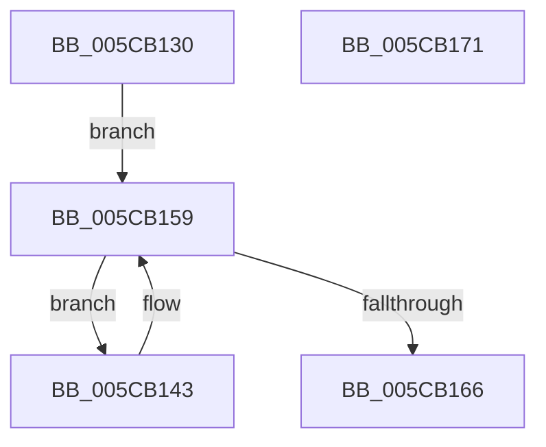

# KiAltReturnWorkerRoutine

- RVA: `0x005CB130`–`0x005CB172` (길이 `66` bytes)
- VA: `0x00000001405CB130`
- 실행 섹션: `.text`
- PDB 이름 있음: `예`; PDB Function 태그: `아니요`
- unwind 정보 RVA: `0x0005CAAC`
- 디코드: `21`개 명령, `66/66` bytes 표시
- 미해석 바이트: `0` (있으면 어셈블리에 `.byte`로 보존)

> 이 문서는 커널 이미지의 기계어와 PDB 기호를 분석해 생성했습니다. 4번과 5번은 함수 원형과 자료형을 바이너리 사용 방식에서 추정한 C 해석이며 원본 소스 복구 결과는 아닙니다.

## 1. Dependencies

- 직접 호출 지점: **2**; 고유 호출 대상: **2**
- 직접 호출자로 확인된 함수: **0**
- RIP 상대 이미지 참조: **0**

### Outgoing calls
- `0x005CB14D` → [guard_dispatch_icall](../6B/guard_dispatch_icall_function_006BAAD0.md) (function, `0x006BAAD0`)
- `0x005CB159` → [ExInterlockedRemoveHeadList](../38/ExInterlockedRemoveHeadList_function_003867B0.md) (function, `0x003867B0`)

### Direct callers
- 이 함수 시작 RVA로 연결되는 직접 call은 확인되지 않았습니다. 간접 호출은 완전히 역산할 수 없습니다.

### Static image references
- 디코드된 RIP-relative 메모리 참조가 없습니다.

## 2. Other-region calls and transfers

- 다른 실행 섹션으로 향하는 call: **0**
- 별도 외부 분기/꼬리 이동을 확인하지 못했습니다.

## 3. Assembly (complete function range)

```asm
005CB130  48 89 5C 24 08                  mov qword ptr [rsp + 8], rbx
005CB135  57                              push rdi
005CB136  48 83 EC 20                     sub rsp, 0x20
005CB13A  48 8B D9                        mov rbx, rcx
005CB13D  48 8D 51 10                     lea rdx, [rcx + 0x10]
005CB141  EB 16                           jmp 0x1405cb159
005CB143  48 8B 43 78                     mov rax, qword ptr [rbx + 0x78]
005CB147  48 8B D1                        mov rdx, rcx
005CB14A  48 8B CB                        mov rcx, rbx
005CB14D  E8 7E F9 0E 00                  call 0x1406baad0
005CB152  48 8D 53 10                     lea rdx, [rbx + 0x10]
005CB156  48 8B CB                        mov rcx, rbx
005CB159  E8 52 B6 DB FF                  call 0x1403867b0
005CB15E  48 8B C8                        mov rcx, rax
005CB161  48 85 C0                        test rax, rax
005CB164  75 DD                           jne 0x1405cb143
005CB166  48 8B 5C 24 30                  mov rbx, qword ptr [rsp + 0x30]
005CB16B  48 83 C4 20                     add rsp, 0x20
005CB16F  5F                              pop rdi
005CB170  C3                              ret
005CB171  CC                              int3
```

## 4. C-style interpretation (structured pseudocode)

```c
__int64 __fastcall KiAltReturnWorkerRoutine(__int64 a1)
{
    __int64 result;
    __int64 v_rsp;
    unsigned __int64 v_stack_p8;

    v_stack_p8 = v_rbx;
    v_rsp = (v_rsp) - (32);
    goto loc_005CB159;
loc_005CB143:
    result = guard_dispatch_icall(a1, a1, a3, a4);
loc_005CB159:
    result = ExInterlockedRemoveHeadList(a1, a1 + 16, a3, a4);
    if (result != 0) goto loc_005CB143;
    v_rsp = (v_rsp) + (32);
    return result;
}
```

## 5. (Beta) C Style

```c
int64_t KiAltReturnWorkerRoutine(void *Arg1)
{
    uint8_t *arg1 = (uint8_t *)Arg1;

    int64_t result;
    int64_t local_rsp;
    uint64_t v_stack_p8;

    v_stack_p8 = local_rbx;
    local_rsp = (local_rsp) - (32);
    goto loc_005CB159;
loc_005CB143:
    result = guard_dispatch_icall(Arg1, Arg1, a3, a4);
loc_005CB159:
    result = ExInterlockedRemoveHeadList(Arg1, Arg1 + 16, a3, a4);
    if (result != 0) goto loc_005CB143;
    local_rsp = (local_rsp) + (32);
    return result;
}
```

### 관측된 메모리 오프셋

구조체 형식이 확인되지 않은 접근은 인자 기준의 오프셋으로만 기록했습니다.

| 기준 인자 | 오프셋 표현 | 폭 (bit) | 접근 |
|---|---:|---:|---|
| `Arg1` | `+ 0x10` | `64` | `R` |
| `Arg1` | `+ 0x78` | `64` | `R` |

## 6. Execution-region graph

[열기: 2D/3D 그래프와 함수 탐색 컨트롤 패널](../../../control-panel.html?section=text&rva=0x005CB130&view=graph)

- 2D 그래프는 위에서 아래로 흐르고, 3D 그래프는 빈 공간을 드래그해 회전합니다. Shift+드래그는 이동, 휠은 확대·축소, 함수 노드 선택은 대상 보고서 이동입니다.

### Static fallback


