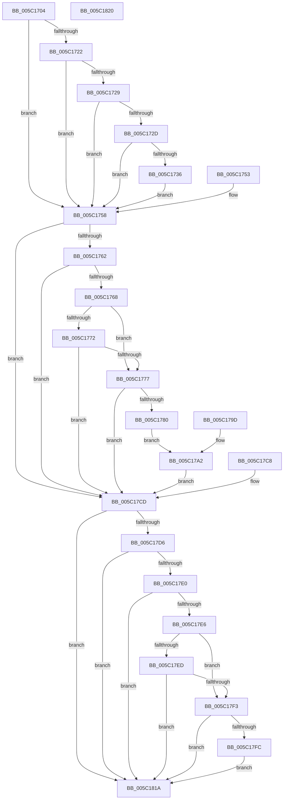

# KiApplyProcessorErrata

- RVA: `0x005C1704`–`0x005C1821` (길이 `285` bytes)
- VA: `0x00000001405C1704`
- 실행 섹션: `.text`
- PDB 이름 있음: `예`; PDB Function 태그: `아니요`
- unwind 정보 RVA: `0x000CA770`
- 디코드: `91`개 명령, `285/285` bytes 표시
- 미해석 바이트: `0` (있으면 어셈블리에 `.byte`로 보존)

> 이 문서는 커널 이미지의 기계어와 PDB 기호를 분석해 생성했습니다. 4번과 5번은 함수 원형과 자료형을 바이너리 사용 방식에서 추정한 C 해석이며 원본 소스 복구 결과는 아닙니다.

## 1. Dependencies

- 직접 호출 지점: **4**; 고유 호출 대상: **2**
- 직접 호출자로 확인된 함수: **2**
- RIP 상대 이미지 참조: **0**

### Outgoing calls
- `0x005C172D` → [HviIsAnyHypervisorPresent](../4A/HviIsAnyHypervisorPresent_function_004ADC50.md) (function, `0x004ADC50`)
- `0x005C1777` → [HviIsAnyHypervisorPresent](../4A/HviIsAnyHypervisorPresent_function_004ADC50.md) (function, `0x004ADC50`)
- `0x005C17CD` → [Feature_2875967801__private_IsEnabledNoReportingNoInline](Feature_2875967801__private_IsEnabledNoReportingNoInline_function_005C16CC.md) (function, `0x005C16CC`)
- `0x005C17F3` → [HviIsAnyHypervisorPresent](../4A/HviIsAnyHypervisorPresent_function_004ADC50.md) (function, `0x004ADC50`)

### Direct callers
- [KiRestoreFeatureBits](../4D/KiRestoreFeatureBits_function_004D4D18.md) at `0x004D4DF3`
- [KiSetFeatureBits](../../pagelk/B6/KiSetFeatureBits_function_00B6A03C.md) at `0x00B6A89F`

### Static image references
- 디코드된 RIP-relative 메모리 참조가 없습니다.

## 2. Other-region calls and transfers

- 다른 실행 섹션으로 향하는 call: **0**
- 별도 외부 분기/꼬리 이동을 확인하지 못했습니다.

## 3. Assembly (complete function range)

```asm
005C1704  48 89 4C 24 08                  mov qword ptr [rsp + 8], rcx
005C1709  53                              push rbx
005C170A  48 83 EC 20                     sub rsp, 0x20
005C170E  48 8B D9                        mov rbx, rcx
005C1711  48 8D 81 8D 00 00 00            lea rax, [rcx + 0x8d]
005C1718  48 89 44 24 38                  mov qword ptr [rsp + 0x38], rax
005C171D  80 38 01                        cmp byte ptr [rax], 1
005C1720  75 36                           jne 0x1405c1758
005C1722  8A 41 40                        mov al, byte ptr [rcx + 0x40]
005C1725  3C 0F                           cmp al, 0xf
005C1727  7E 2F                           jle 0x1405c1758
005C1729  3C 11                           cmp al, 0x11
005C172B  74 2B                           je 0x1405c1758
005C172D  E8 1E C5 EE FF                  call 0x1404adc50
005C1732  84 C0                           test al, al
005C1734  75 22                           jne 0x1405c1758
005C1736  B9 29 10 01 C0                  mov ecx, 0xc0011029
005C173B  0F 32                           rdmsr
005C173D  48 C1 E2 20                     shl rdx, 0x20
005C1741  48 0B C2                        or rax, rdx
005C1744  48 83 C8 02                     or rax, 2
005C1748  48 8B D0                        mov rdx, rax
005C174B  48 C1 EA 20                     shr rdx, 0x20
005C174F  0F 30                           wrmsr
005C1751  EB 05                           jmp 0x1405c1758
005C1753  48 8B 5C 24 30                  mov rbx, qword ptr [rsp + 0x30]
005C1758  48 8B 44 24 38                  mov rax, qword ptr [rsp + 0x38]
005C175D  80 38 01                        cmp byte ptr [rax], 1
005C1760  75 6B                           jne 0x1405c17cd
005C1762  80 7B 40 17                     cmp byte ptr [rbx + 0x40], 0x17
005C1766  75 65                           jne 0x1405c17cd
005C1768  8A 4B 43                        mov cl, byte ptr [rbx + 0x43]
005C176B  8D 41 D0                        lea eax, [rcx - 0x30]
005C176E  3C 1F                           cmp al, 0x1f
005C1770  76 05                           jbe 0x1405c1777
005C1772  80 F9 60                        cmp cl, 0x60
005C1775  72 56                           jb 0x1405c17cd
005C1777  E8 D4 C4 EE FF                  call 0x1404adc50
005C177C  84 C0                           test al, al
005C177E  75 4D                           jne 0x1405c17cd
005C1780  B9 E3 10 01 C0                  mov ecx, 0xc00110e3
005C1785  0F 32                           rdmsr
005C1787  48 C1 E2 20                     shl rdx, 0x20
005C178B  48 0B C2                        or rax, rdx
005C178E  48 83 C8 02                     or rax, 2
005C1792  48 8B D0                        mov rdx, rax
005C1795  48 C1 EA 20                     shr rdx, 0x20
005C1799  0F 30                           wrmsr
005C179B  EB 05                           jmp 0x1405c17a2
005C179D  48 8B 5C 24 30                  mov rbx, qword ptr [rsp + 0x30]
005C17A2  B9 2E 10 01 C0                  mov ecx, 0xc001102e
005C17A7  0F 32                           rdmsr
005C17A9  48 C1 E2 20                     shl rdx, 0x20
005C17AD  48 0B C2                        or rax, rdx
005C17B0  48 BA 00 00 00 00 02 00 00 00   movabs rdx, 0x200000000
005C17BA  48 0B C2                        or rax, rdx
005C17BD  48 8B D0                        mov rdx, rax
005C17C0  48 C1 EA 20                     shr rdx, 0x20
005C17C4  0F 30                           wrmsr
005C17C6  EB 05                           jmp 0x1405c17cd
005C17C8  48 8B 5C 24 30                  mov rbx, qword ptr [rsp + 0x30]
005C17CD  E8 FA FE FF FF                  call 0x1405c16cc
005C17D2  85 C0                           test eax, eax
005C17D4  74 44                           je 0x1405c181a
005C17D6  48 8B 44 24 38                  mov rax, qword ptr [rsp + 0x38]
005C17DB  80 38 01                        cmp byte ptr [rax], 1
005C17DE  75 3A                           jne 0x1405c181a
005C17E0  80 7B 40 17                     cmp byte ptr [rbx + 0x40], 0x17
005C17E4  75 34                           jne 0x1405c181a
005C17E6  8A 43 43                        mov al, byte ptr [rbx + 0x43]
005C17E9  3C 2F                           cmp al, 0x2f
005C17EB  76 06                           jbe 0x1405c17f3
005C17ED  2C 50                           sub al, 0x50
005C17EF  3C 0F                           cmp al, 0xf
005C17F1  77 27                           ja 0x1405c181a
005C17F3  E8 58 C4 EE FF                  call 0x1404adc50
005C17F8  84 C0                           test al, al
005C17FA  75 1E                           jne 0x1405c181a
005C17FC  B9 28 10 01 C0                  mov ecx, 0xc0011028
005C1801  0F 32                           rdmsr
005C1803  48 C1 E2 20                     shl rdx, 0x20
005C1807  48 0B C2                        or rax, rdx
005C180A  48 0F BA E8 09                  bts rax, 9
005C180F  48 8B D0                        mov rdx, rax
005C1812  48 C1 EA 20                     shr rdx, 0x20
005C1816  0F 30                           wrmsr
005C1818  EB 00                           jmp 0x1405c181a
005C181A  48 83 C4 20                     add rsp, 0x20
005C181E  5B                              pop rbx
005C181F  C3                              ret
005C1820  CC                              int3
```

## 4. C-style interpretation (structured pseudocode)

```c
__int64 __fastcall KiApplyProcessorErrata(__int64 a1, __int64 a2)
{
    __int64 result;
    __int64 v_rsp;
    unsigned __int64 v_stack_p10;
    unsigned __int64 v_stack_p8;

    v_stack_p8 = a1;
    v_rsp = (v_rsp) - (32);
    v_stack_p10 = a1 + 141;
    if ((*(unsigned __int8 *)(a1 + 141)) != 1) goto loc_005C1758;
    if (((unsigned __int8)(*(unsigned __int8 *)(a1 + 64))) <= 15) goto loc_005C1758;
    if (((unsigned __int8)(*(unsigned __int8 *)(a1 + 64))) == 17) goto loc_005C1758;
    result = HviIsAnyHypervisorPresent(a1, a2, a3, a4);
    if ((unsigned __int8)(result) != 0) goto loc_005C1758;
    a2 = (a2) << (32);
    result = (result) | (a2);
    result = (result) | (2);
    a2 = (result) >> (32);
    goto loc_005C1758;
loc_005C1758:
    if ((*(unsigned __int8 *)(v_stack_p10)) != 1) goto loc_005C17CD;
    if ((*(unsigned __int8 *)(a1 + 64)) != 23) goto loc_005C17CD;
    if (((unsigned __int8)(*(unsigned __int8 *)(a1 + 67) - 48)) <= 31) goto loc_005C1777;
    if (((unsigned __int8)(*(unsigned __int8 *)(a1 + 67))) < 96) goto loc_005C17CD;
loc_005C1777:
    result = HviIsAnyHypervisorPresent(*(unsigned __int8 *)(a1 + 67), a2, a3, a4);
    if ((unsigned __int8)(result) != 0) goto loc_005C17CD;
    a2 = (a2) << (32);
    result = (result) | (a2);
    result = (result) | (2);
    a2 = (result) >> (32);
    goto loc_005C17A2;
loc_005C17A2:
    a2 = (a2) << (32);
    result = (result) | (a2);
    result = (result) | (a2);
    a2 = (result) >> (32);
    goto loc_005C17CD;
loc_005C17CD:
    result = Feature_2875967801__private_IsEnabledNoReportingNoInline((unsigned int)(0xC001102EULL), a2, a3, a4);
    if ((unsigned int)(result) == 0) goto loc_005C181A;
    if ((*(unsigned __int8 *)(v_stack_p10)) != 1) goto loc_005C181A;
    if ((*(unsigned __int8 *)(a1 + 64)) != 23) goto loc_005C181A;
    if (((unsigned __int8)(*(unsigned __int8 *)(a1 + 67))) <= 47) goto loc_005C17F3;
    result = (unsigned __int8)((*(unsigned __int8 *)(a1 + 67)) - (80));
    if (((unsigned __int8)(result)) > 15) goto loc_005C181A;
loc_005C17F3:
    result = HviIsAnyHypervisorPresent((unsigned int)(0xC001102EULL), a2, a3, a4);
    if ((unsigned __int8)(result) != 0) goto loc_005C181A;
    a2 = (a2) << (32);
    result = (result) | (a2);
    a2 = (result) >> (32);
    goto loc_005C181A;
loc_005C181A:
    v_rsp = (v_rsp) + (32);
    return result;
}
```

## 5. (Beta) C Style

```c
int64_t KiApplyProcessorErrata(void *Arg1, int64_t Arg2)
{
    uint8_t *arg1 = (uint8_t *)Arg1;

    int64_t result;
    int64_t local_rsp;
    uint64_t v_stack_p10;
    uint64_t v_stack_p8;

    v_stack_p8 = Arg1;
    local_rsp = (local_rsp) - (32);
    v_stack_p10 = Arg1 + 141;
    if ((*(uint8_t *)(arg1 + 0x8D)) != 1) goto loc_005C1758;
    if (((uint8_t)(*(uint8_t *)(arg1 + 0x40))) <= 15) goto loc_005C1758;
    if (((uint8_t)(*(uint8_t *)(arg1 + 0x40))) == 17) goto loc_005C1758;
    result = HviIsAnyHypervisorPresent(Arg1, Arg2, a3, a4);
    if ((uint8_t)(result) != 0) goto loc_005C1758;
    Arg2 = (Arg2) << (32);
    result = (result) | (Arg2);
    result = (result) | (2);
    Arg2 = (result) >> (32);
    goto loc_005C1758;
loc_005C1758:
    if ((*(uint8_t *)(v_stack_p10)) != 1) goto loc_005C17CD;
    if ((*(uint8_t *)(arg1 + 0x40)) != 23) goto loc_005C17CD;
    if (((uint8_t)(*(uint8_t *)(arg1 + 0x43) - 48)) <= 31) goto loc_005C1777;
    if (((uint8_t)(*(uint8_t *)(arg1 + 0x43))) < 96) goto loc_005C17CD;
loc_005C1777:
    result = HviIsAnyHypervisorPresent(*(uint8_t *)(arg1 + 0x43), Arg2, a3, a4);
    if ((uint8_t)(result) != 0) goto loc_005C17CD;
    Arg2 = (Arg2) << (32);
    result = (result) | (Arg2);
    result = (result) | (2);
    Arg2 = (result) >> (32);
    goto loc_005C17A2;
loc_005C17A2:
    Arg2 = (Arg2) << (32);
    result = (result) | (Arg2);
    result = (result) | (Arg2);
    Arg2 = (result) >> (32);
    goto loc_005C17CD;
loc_005C17CD:
    result = Feature_2875967801__private_IsEnabledNoReportingNoInline((uint32_t)(0xC001102EULL), Arg2, a3, a4);
    if ((uint32_t)(result) == 0) goto loc_005C181A;
    if ((*(uint8_t *)(v_stack_p10)) != 1) goto loc_005C181A;
    if ((*(uint8_t *)(arg1 + 0x40)) != 23) goto loc_005C181A;
    if (((uint8_t)(*(uint8_t *)(arg1 + 0x43))) <= 47) goto loc_005C17F3;
    result = (uint8_t)((*(uint8_t *)(arg1 + 0x43)) - (80));
    if (((uint8_t)(result)) > 15) goto loc_005C181A;
loc_005C17F3:
    result = HviIsAnyHypervisorPresent((uint32_t)(0xC001102EULL), Arg2, a3, a4);
    if ((uint8_t)(result) != 0) goto loc_005C181A;
    Arg2 = (Arg2) << (32);
    result = (result) | (Arg2);
    Arg2 = (result) >> (32);
    goto loc_005C181A;
loc_005C181A:
    local_rsp = (local_rsp) + (32);
    return result;
}
```

### 관측된 메모리 오프셋

구조체 형식이 확인되지 않은 접근은 인자 기준의 오프셋으로만 기록했습니다.

| 기준 인자 | 오프셋 표현 | 폭 (bit) | 접근 |
|---|---:|---:|---|
| `Arg1` | `+ 0x0` | `8` | `R` |
| `Arg1` | `+ 0x40` | `8` | `R` |
| `Arg1` | `+ 0x43` | `8` | `R` |
| `Arg1` | `+ 0x8D` | `64` | `R` |

## 6. Execution-region graph

[열기: 2D/3D 그래프와 함수 탐색 컨트롤 패널](../../../control-panel.html?section=text&rva=0x005C1704&view=graph)

- 2D 그래프는 위에서 아래로 흐르고, 3D 그래프는 빈 공간을 드래그해 회전합니다. Shift+드래그는 이동, 휠은 확대·축소, 함수 노드 선택은 대상 보고서 이동입니다.

### Static fallback


