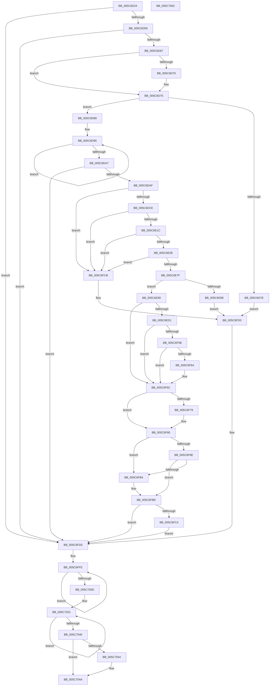

# KiAttemptBugcheckRecovery

- RVA: `0x005C6D24`–`0x005C7063` (길이 `831` bytes)
- VA: `0x00000001405C6D24`
- 실행 섹션: `.text`
- PDB 이름 있음: `예`; PDB Function 태그: `아니요`
- unwind 정보 RVA: `0x000BE8A0`
- 디코드: `189`개 명령, `831/831` bytes 표시
- 미해석 바이트: `0` (있으면 어셈블리에 `.byte`로 보존)

> 이 문서는 커널 이미지의 기계어와 PDB 기호를 분석해 생성했습니다. 4번과 5번은 함수 원형과 자료형을 바이너리 사용 방식에서 추정한 C 해석이며 원본 소스 복구 결과는 아닙니다.

## 1. Dependencies

- 직접 호출 지점: **24**; 고유 호출 대상: **15**
- 직접 호출자로 확인된 함수: **1**
- RIP 상대 이미지 참조: **26**

### Outgoing calls
- `0x005C6D75` → [KiIsRecoveryPossibleOnCurrentStack](KiIsRecoveryPossibleOnCurrentStack_function_005C79F4.md) (function, `0x005C79F4`)
- `0x005C6DB7` → [KiInvokeBugCheckEntryCallbacks](../5B/KiInvokeBugCheckEntryCallbacks_function_005B51A0.md) (function, `0x005B51A0`)
- `0x005C6DC1` → [KiSetBugCheckRecoveryProgressFlag](KiSetBugCheckRecoveryProgressFlag_function_005C7C48.md) (function, `0x005C7C48`)
- `0x005C6DD5` → [KiGetRecoveryInformation](KiGetRecoveryInformation_function_005C7794.md) (function, `0x005C7794`)
- `0x005C6DFB` → [IoSaveBugCheckRecoveryStatus](../59/IoSaveBugCheckRecoveryStatus_function_00592EEC.md) (function, `0x00592EEC`)
- `0x005C6E0F` → [KiUpdateBugcheckRecoveryProgress](KiUpdateBugcheckRecoveryProgress_function_005C7E1C.md) (function, `0x005C7E1C`)
- `0x005C6E21` → [KiSaveBugcheckRecoveryProgress](KiSaveBugcheckRecoveryProgress_function_005C7AF0.md) (function, `0x005C7AF0`)
- `0x005C6E40` → [KiInvokeBugCheckEntryCallbacks](../5B/KiInvokeBugCheckEntryCallbacks_function_005B51A0.md) (function, `0x005B51A0`)
- `0x005C6E68` → [IoSaveBugCheckRecoveryStatus](../59/IoSaveBugCheckRecoveryStatus_function_00592EEC.md) (function, `0x00592EEC`)
- `0x005C6E72` → [KiSaveBugcheckRecoveryProgress](KiSaveBugcheckRecoveryProgress_function_005C7AF0.md) (function, `0x005C7AF0`)
- `0x005C6EC4` → [KiBugCheckShouldEnterPostBugCheckDebugger](../5B/KiBugCheckShouldEnterPostBugCheckDebugger_function_005B40A0.md) (function, `0x005B40A0`)
- `0x005C6EDF` → [DbgPrintEx](../35/DbgPrintEx_function_00359290.md) (function, `0x00359290`)
- `0x005C6EEF` → [DbgPrintEx](../35/DbgPrintEx_function_00359290.md) (function, `0x00359290`)
- `0x005C6F36` → [DbgPrintEx](../35/DbgPrintEx_function_00359290.md) (function, `0x00359290`)
- `0x005C6F4D` → [DbgPrintEx](../35/DbgPrintEx_function_00359290.md) (function, `0x00359290`)
- `0x005C6F67` → [KiBugCheckDebugBreak](../5B/KiBugCheckDebugBreak_function_005B3DC0.md) (function, `0x005B3DC0`)
- `0x005C6F70` → [KiCaptureDumpPreRecovery](KiCaptureDumpPreRecovery_function_005C74D0.md) (function, `0x005C74D0`)
- `0x005C6F85` → [KiSaveBugcheckRecoveryProgress](KiSaveBugcheckRecoveryProgress_function_005C7AF0.md) (function, `0x005C7AF0`)
- `0x005C6F99` → [KiScheduleBugcheckRecovery](KiScheduleBugcheckRecovery_function_005C7B20.md) (function, `0x005C7B20`)
- `0x005C6FAB` → [KiSaveBugcheckRecoveryProgress](KiSaveBugcheckRecoveryProgress_function_005C7AF0.md) (function, `0x005C7AF0`)
- `0x005C6FB9` → [KiRecordRecoveryFailure](KiRecordRecoveryFailure_function_005C7AB8.md) (function, `0x005C7AB8`)
- `0x005C6FC4` → [IoRevertFromDemotedDumpType](../59/IoRevertFromDemotedDumpType_function_00592DE4.md) (function, `0x00592DE4`)
- `0x005C6FD0` → [KiRecordRecoveryFailure](KiRecordRecoveryFailure_function_005C7AB8.md) (function, `0x005C7AB8`)
- `0x005C7044` → [KiYieldWaitForDebugger](../5B/KiYieldWaitForDebugger_function_005B56DC.md) (function, `0x005B56DC`)

### Direct callers
- [KeBugCheck2](../5B/KeBugCheck2_function_005B27D0.md) at `0x005B316F`

### Static image references
- `0x005C6D3C` → RVA `0x00F109F0` (`.data`; read)
- `0x005C6D59` → RVA `0x00F1090C` (`.data`; read)
- `0x005C6D67` → RVA `0x00F47548` (`.data`; read)
- `0x005C6DCE` → RVA `0x00F109A0` (`.data`; read)
- `0x005C6DDE` → RVA `0x00F109C8` (`.data`; read)
- `0x005C6DE7` → RVA `0x00F109C4` (`.data`; read)
- `0x005C6E4F` → RVA `0x00F109A7` (`.data`; read)
- `0x005C6E58` → RVA `0x00F109E8` (`.data`; read)
- `0x005C6E90` → RVA `0x00E01096` (`.data`; read/write)
- `0x005C6E98` → RVA `0x00F109F0` (`.data`; read/write)
- `0x005C6EA3` → RVA `0x00F109B5` (`.data`; read)
- `0x005C6EBE` → RVA `0x00F10894` (`.data`; write)
- `0x005C6ED3` → RVA `0x00028D80` (`.rdata`; read)
- `0x005C6EE4` → RVA `0x00028E50` (`.rdata`; read)
- `0x005C6EF4` → RVA `0x00F109E0` (`.data`; read)
- `0x005C6EFB` → RVA `0x00028C70` (`.rdata`; read)
- `0x005C6F12` → RVA `0x00F109D8` (`.data`; read)
- `0x005C6F1E` → RVA `0x00F109D0` (`.data`; read)
- `0x005C6F44` → RVA `0x00028D00` (`.rdata`; read)
- `0x005C6F52` → RVA `0x00F475F8` (`.data`; read)
- `0x005C6F5B` → RVA `0x00F475DC` (`.data`; read)
- `0x005C6F79` → RVA `0x00F10894` (`.data`; read/write)
- `0x005C6FD5` → RVA `0x00F23490` (`.data`; read)
- `0x005C6FDC` → RVA `0x00E65EE8` (`.data`; write)
- `0x005C6FE3` → RVA `0x00F23498` (`.data`; write)
- `0x005C6FEA` → RVA `0x00F23490` (`.data`; write)

## 2. Other-region calls and transfers

- 다른 실행 섹션으로 향하는 call: **0**
- 별도 외부 분기/꼬리 이동을 확인하지 못했습니다.

## 3. Assembly (complete function range)

```asm
005C6D24  48 89 5C 24 18                  mov qword ptr [rsp + 0x18], rbx
005C6D29  48 89 74 24 20                  mov qword ptr [rsp + 0x20], rsi
005C6D2E  55                              push rbp
005C6D2F  57                              push rdi
005C6D30  41 56                           push r14
005C6D32  48 8B EC                        mov rbp, rsp
005C6D35  48 81 EC 80 00 00 00            sub rsp, 0x80
005C6D3C  8B 05 AE 9C 94 00               mov eax, dword ptr [rip + 0x949cae]
005C6D42  33 F6                           xor esi, esi
005C6D44  40 88 75 28                     mov byte ptr [rbp + 0x28], sil
005C6D48  40 88 75 20                     mov byte ptr [rbp + 0x20], sil
005C6D4C  44 8D 76 02                     lea r14d, [rsi + 2]
005C6D50  41 84 C6                        test r14b, al
005C6D53  0F 85 7C 02 00 00               jne 0x1405c6fd5
005C6D59  8B 05 AD 9B 94 00               mov eax, dword ptr [rip + 0x949bad]
005C6D5F  85 C0                           test eax, eax
005C6D61  0F 8E 6E 02 00 00               jle 0x1405c6fd5
005C6D67  40 38 35 DA 07 98 00            cmp byte ptr [rip + 0x9807da], sil
005C6D6E  74 05                           je 0x1405c6d75
005C6D70  8D 4E 05                        lea ecx, [rsi + 5]
005C6D73  CD 29                           int 0x29
005C6D75  E8 7A 0C 00 00                  call 0x1405c79f4
005C6D7A  84 C0                           test al, al
005C6D7C  75 0A                           jne 0x1405c6d88
005C6D7E  B9 01 00 00 00                  mov ecx, 1
005C6D83  E9 48 02 00 00                  jmp 0x1405c6fd0
005C6D88  0F 0D 0D 61 9C 94 00            prefetchw byte ptr [rip + 0x949c61]
005C6D8F  8B 05 5B 9C 94 00               mov eax, dword ptr [rip + 0x949c5b]
005C6D95  8B C8                           mov ecx, eax
005C6D97  81 C9 01 00 01 00               or ecx, 0x10001
005C6D9D  F0 0F B1 0D 4B 9C 94 00         lock cmpxchg dword ptr [rip + 0x949c4b], ecx
005C6DA5  75 EE                           jne 0x1405c6d95
005C6DA7  A8 10                           test al, 0x10
005C6DA9  0F 85 26 02 00 00               jne 0x1405c6fd5
005C6DAF  33 D2                           xor edx, edx
005C6DB1  45 33 C0                        xor r8d, r8d
005C6DB4  8D 4A 08                        lea ecx, [rdx + 8]
005C6DB7  E8 E4 E3 FE FF                  call 0x1405b51a0
005C6DBC  B9 00 80 00 00                  mov ecx, 0x8000
005C6DC1  E8 82 0E 00 00                  call 0x1405c7c48
005C6DC6  85 C0                           test eax, eax
005C6DC8  0F 88 FD 01 00 00               js 0x1405c6fcb
005C6DCE  48 8D 0D CB 9B 94 00            lea rcx, [rip + 0x949bcb]
005C6DD5  E8 BA 09 00 00                  call 0x1405c7794
005C6DDA  44 0F 20 C0                     mov rax, cr8
005C6DDE  48 8B 3D E3 9B 94 00            mov rdi, qword ptr [rip + 0x949be3]
005C6DE5  33 C9                           xor ecx, ecx
005C6DE7  8B 1D D7 9B 94 00               mov ebx, dword ptr [rip + 0x949bd7]
005C6DED  48 89 4D D0                     mov qword ptr [rbp - 0x30], rcx
005C6DF1  89 4D D8                        mov dword ptr [rbp - 0x28], ecx
005C6DF4  48 8D 4D D0                     lea rcx, [rbp - 0x30]
005C6DF8  88 45 D4                        mov byte ptr [rbp - 0x2c], al
005C6DFB  E8 EC C0 FC FF                  call 0x140592eec
005C6E00  48 8D 4D E0                     lea rcx, [rbp - 0x20]
005C6E04  48 89 75 E0                     mov qword ptr [rbp - 0x20], rsi
005C6E08  89 5D F0                        mov dword ptr [rbp - 0x10], ebx
005C6E0B  48 89 7D E8                     mov qword ptr [rbp - 0x18], rdi
005C6E0F  E8 08 10 00 00                  call 0x1405c7e1c
005C6E14  85 C0                           test eax, eax
005C6E16  0F 88 AF 01 00 00               js 0x1405c6fcb
005C6E1C  B9 C0 00 00 00                  mov ecx, 0xc0
005C6E21  E8 CA 0C 00 00                  call 0x1405c7af0
005C6E26  85 C0                           test eax, eax
005C6E28  0F 88 9D 01 00 00               js 0x1405c6fcb
005C6E2E  41 B8 4C 00 00 00               mov r8d, 0x4c
005C6E34  48 8D 15 65 9B 94 00            lea rdx, [rip + 0x949b65]
005C6E3B  B9 FF 03 00 00                  mov ecx, 0x3ff
005C6E40  E8 5B E3 FE FF                  call 0x1405b51a0
005C6E45  33 C0                           xor eax, eax
005C6E47  48 8D 4D C0                     lea rcx, [rbp - 0x40]
005C6E4B  48 89 45 C0                     mov qword ptr [rbp - 0x40], rax
005C6E4F  8A 05 52 9B 94 00               mov al, byte ptr [rip + 0x949b52]
005C6E55  88 45 C4                        mov byte ptr [rbp - 0x3c], al
005C6E58  8B 05 8A 9B 94 00               mov eax, dword ptr [rip + 0x949b8a]
005C6E5E  89 45 C8                        mov dword ptr [rbp - 0x38], eax
005C6E61  C7 45 C0 01 00 00 00            mov dword ptr [rbp - 0x40], 1
005C6E68  E8 7F C0 FC FF                  call 0x140592eec
005C6E6D  B9 C1 00 00 00                  mov ecx, 0xc1
005C6E72  E8 79 0C 00 00                  call 0x1405c7af0
005C6E77  85 C0                           test eax, eax
005C6E79  0F 88 4C 01 00 00               js 0x1405c6fcb
005C6E7F  40 38 35 21 9B 94 00            cmp byte ptr [rip + 0x949b21], sil
005C6E86  75 08                           jne 0x1405c6e90
005C6E88  41 8B CE                        mov ecx, r14d
005C6E8B  E9 40 01 00 00                  jmp 0x1405c6fd0
005C6E90  66 44 09 35 FE A1 83 00         or word ptr [rip + 0x83a1fe], r14w
005C6E98  F0 81 0D 4D 9B 94 00 02 00 02 00  lock or dword ptr [rip + 0x949b4d], 0x20002
005C6EA3  40 38 35 0B 9B 94 00            cmp byte ptr [rip + 0x949b0b], sil
005C6EAA  48 8D 55 28                     lea rdx, [rbp + 0x28]
005C6EAE  8B 05 34 9B 94 00               mov eax, dword ptr [rip + 0x949b34]
005C6EB4  8B 0D 0A 9B 94 00               mov ecx, dword ptr [rip + 0x949b0a]
005C6EBA  48 0F 44 D6                     cmove rdx, rsi
005C6EBE  89 05 D0 99 94 00               mov dword ptr [rip + 0x9499d0], eax
005C6EC4  E8 D7 D1 FE FF                  call 0x1405b40a0
005C6EC9  84 C0                           test al, al
005C6ECB  0F 84 9B 00 00 00               je 0x1405c6f6c
005C6ED1  33 D2                           xor edx, edx
005C6ED3  4C 8D 05 A6 1E A6 FF            lea r8, [rip - 0x59e15a]
005C6EDA  8D 5A 65                        lea ebx, [rdx + 0x65]
005C6EDD  8B CB                           mov ecx, ebx
005C6EDF  E8 AC 23 D9 FF                  call 0x140359290
005C6EE4  4C 8D 05 65 1F A6 FF            lea r8, [rip - 0x59e09b]
005C6EEB  33 D2                           xor edx, edx
005C6EED  8B CB                           mov ecx, ebx
005C6EEF  E8 9C 23 D9 FF                  call 0x140359290
005C6EF4  48 8B 05 E5 9A 94 00            mov rax, qword ptr [rip + 0x949ae5]
005C6EFB  4C 8D 05 6E 1D A6 FF            lea r8, [rip - 0x59e292]
005C6F02  44 8B 0D BB 9A 94 00            mov r9d, dword ptr [rip + 0x949abb]
005C6F09  33 D2                           xor edx, edx
005C6F0B  48 89 44 24 38                  mov qword ptr [rsp + 0x38], rax
005C6F10  8B CB                           mov ecx, ebx
005C6F12  48 8B 05 BF 9A 94 00            mov rax, qword ptr [rip + 0x949abf]
005C6F19  48 89 44 24 30                  mov qword ptr [rsp + 0x30], rax
005C6F1E  48 8B 05 AB 9A 94 00            mov rax, qword ptr [rip + 0x949aab]
005C6F25  48 89 44 24 28                  mov qword ptr [rsp + 0x28], rax
005C6F2A  48 8B 05 97 9A 94 00            mov rax, qword ptr [rip + 0x949a97]
005C6F31  48 89 44 24 20                  mov qword ptr [rsp + 0x20], rax
005C6F36  E8 55 23 D9 FF                  call 0x140359290
005C6F3B  4C 8D 0D 5E 9A 94 00            lea r9, [rip + 0x949a5e]
005C6F42  33 D2                           xor edx, edx
005C6F44  4C 8D 05 B5 1D A6 FF            lea r8, [rip - 0x59e24b]
005C6F4B  8B CB                           mov ecx, ebx
005C6F4D  E8 3E 23 D9 FF                  call 0x140359290
005C6F52  40 38 35 9F 06 98 00            cmp byte ptr [rip + 0x98069f], sil
005C6F59  74 11                           je 0x1405c6f6c
005C6F5B  40 38 35 7A 06 98 00            cmp byte ptr [rip + 0x98067a], sil
005C6F62  75 08                           jne 0x1405c6f6c
005C6F64  8D 4B 9E                        lea ecx, [rbx - 0x62]
005C6F67  E8 54 CE FE FF                  call 0x1405b3dc0
005C6F6C  48 8D 55 20                     lea rdx, [rbp + 0x20]
005C6F70  E8 5B 05 00 00                  call 0x1405c74d0
005C6F75  85 C0                           test eax, eax
005C6F77  79 07                           jns 0x1405c6f80
005C6F79  83 0D 14 99 94 00 10            or dword ptr [rip + 0x949914], 0x10
005C6F80  B9 C2 00 00 00                  mov ecx, 0xc2
005C6F85  E8 66 0B 00 00                  call 0x1405c7af0
005C6F8A  85 C0                           test eax, eax
005C6F8C  78 26                           js 0x1405c6fb4
005C6F8E  F0 81 0D 57 9A 94 00 04 00 04 00  lock or dword ptr [rip + 0x949a57], 0x40004
005C6F99  E8 82 0B 00 00                  call 0x1405c7b20
005C6F9E  F0 83 25 4A 9A 94 00 FB         lock and dword ptr [rip + 0x949a4a], 0xfffffffb
005C6FA6  B9 C3 00 00 00                  mov ecx, 0xc3
005C6FAB  E8 40 0B 00 00                  call 0x1405c7af0
005C6FB0  85 C0                           test eax, eax
005C6FB2  79 0A                           jns 0x1405c6fbe
005C6FB4  B9 05 00 00 00                  mov ecx, 5
005C6FB9  E8 FA 0A 00 00                  call 0x1405c7ab8
005C6FBE  40 38 75 20                     cmp byte ptr [rbp + 0x20], sil
005C6FC2  74 11                           je 0x1405c6fd5
005C6FC4  E8 1B BE FC FF                  call 0x140592de4
005C6FC9  EB 0A                           jmp 0x1405c6fd5
005C6FCB  B9 05 00 00 00                  mov ecx, 5
005C6FD0  E8 E3 0A 00 00                  call 0x1405c7ab8
005C6FD5  48 8D 05 B4 C4 95 00            lea rax, [rip + 0x95c4b4]
005C6FDC  48 89 35 05 EF 89 00            mov qword ptr [rip + 0x89ef05], rsi
005C6FE3  48 89 05 AE C4 95 00            mov qword ptr [rip + 0x95c4ae], rax
005C6FEA  48 89 05 9F C4 95 00            mov qword ptr [rip + 0x95c49f], rax
005C6FF1  0F 0D 0D F8 99 94 00            prefetchw byte ptr [rip + 0x9499f8]
005C6FF8  8B 05 F2 99 94 00               mov eax, dword ptr [rip + 0x9499f2]
005C6FFE  8B C8                           mov ecx, eax
005C7000  83 E1 FC                        and ecx, 0xfffffffc
005C7003  F0 0F B1 0D E5 99 94 00         lock cmpxchg dword ptr [rip + 0x9499e5], ecx
005C700B  75 F1                           jne 0x1405c6ffe
005C700D  41 22 C6                        and al, r14b
005C7010  F6 D8                           neg al
005C7012  B8 00 00 08 00                  mov eax, 0x80000
005C7017  1B C9                           sbb ecx, ecx
005C7019  23 C8                           and ecx, eax
005C701B  03 C8                           add ecx, eax
005C701D  F0 09 0D CC 99 94 00            lock or dword ptr [rip + 0x9499cc], ecx
005C7024  0F 0D 0D C5 99 94 00            prefetchw byte ptr [rip + 0x9499c5]
005C702B  8B 05 BF 99 94 00               mov eax, dword ptr [rip + 0x9499bf]
005C7031  8B C8                           mov ecx, eax
005C7033  83 C9 08                        or ecx, 8
005C7036  F0 0F B1 0D B2 99 94 00         lock cmpxchg dword ptr [rip + 0x9499b2], ecx
005C703E  75 F1                           jne 0x1405c7031
005C7040  A8 08                           test al, 8
005C7042  74 06                           je 0x1405c704a
005C7044  E8 93 E6 FE FF                  call 0x1405b56dc
005C7049  CC                              int3
005C704A  4C 8D 9C 24 80 00 00 00         lea r11, [rsp + 0x80]
005C7052  49 8B 5B 30                     mov rbx, qword ptr [r11 + 0x30]
005C7056  49 8B 73 38                     mov rsi, qword ptr [r11 + 0x38]
005C705A  49 8B E3                        mov rsp, r11
005C705D  41 5E                           pop r14
005C705F  5F                              pop rdi
005C7060  5D                              pop rbp
005C7061  C3                              ret
005C7062  CC                              int3
```

## 4. C-style interpretation (structured pseudocode)

```c
__int64 __fastcall KiAttemptBugcheckRecovery(__int64 a1, int a2, int a3)
{
    __int64 result;
    __int64 v_rsi;
    __int64 v_rsp;
    unsigned __int64 v_stack_m18;
    unsigned int v_stack_m28;
    unsigned __int64 v_stack_m30;
    unsigned __int64 v_stack_m38;
    unsigned int v_stack_m40;
    unsigned __int8 v_stack_m44;
    unsigned __int64 v_stack_m48;
    unsigned int v_stack_m50;
    unsigned __int8 v_stack_m54;
    unsigned __int64 v_stack_m58;
    unsigned __int64 v_stack_m60;
    unsigned __int64 v_stack_m68;
    unsigned __int64 v_stack_m70;
    unsigned __int64 v_stack_m78;
    unsigned __int8 v_stack_p10;
    unsigned __int64 v_stack_p18;
    unsigned __int64 v_stack_p20;
    unsigned __int8 v_stack_p8;

    v_stack_p18 = v_rbx;
    v_stack_p20 = v_rsi;
    v_rsp = (v_rsp) - (128);
    v_rsi = 0;
    v_stack_p10 = 0;
    v_stack_p8 = 0;
    if ((((unsigned __int8)(v_rsi + 2)) & ((unsigned __int8)((unsigned int)(*(unsigned int *)(v_rip + 9739438))))) != 0) goto loc_005C6FD5;
    if (condition_is_less_or_equal) goto loc_005C6FD5;
    if ((*(unsigned __int8 *)(v_rip + 9963482)) != 0) {
        a1 = v_rsi + 5;
    }
    result = KiIsRecoveryPossibleOnCurrentStack(a1, a2, a3, a4);
    if ((unsigned __int8)(result) != 0) goto loc_005C6D88;
    goto loc_005C6FD0;
loc_005C6D88:
loc_005C6D95:
    a1 = (unsigned int)(((unsigned int)((unsigned int)((unsigned int)(*(unsigned int *)(v_rip + 9739355))))) | (0x10001ULL));
    if (condition_is_not_equal) goto loc_005C6D95;
    if ((((unsigned __int8)((unsigned int)(*(unsigned int *)(v_rip + 9739355)))) & (16)) != 0) goto loc_005C6FD5;
    a2 = 0;
    a3 = 0;
    result = KiInvokeBugCheckEntryCallbacks(a2 + 8, a2, a3, a4);
    result = KiSetBugCheckRecoveryProgressFlag((unsigned int)(0x8000ULL), a2, a3, a4);
    if (sign_flag) goto loc_005C6FCB;
    result = KiGetRecoveryInformation(v_rip + 9739211, a2, a3, a4);
    a1 = 0;
    v_stack_m48 = 0;
    v_stack_m40 = 0;
    v_stack_m44 = (unsigned __int8)(v_cr8);
    result = IoSaveBugCheckRecoveryStatus(v_stack_m48, a2, a3, a4);
    v_stack_m38 = 0;
    v_stack_m28 = (unsigned int)((unsigned int)(*(unsigned int *)(v_rip + 9739223)));
    v_stack_m30 = *(unsigned __int64 *)(v_rip + 9739235);
    result = KiUpdateBugcheckRecoveryProgress(v_stack_m38, a2, a3, a4);
    if (sign_flag) goto loc_005C6FCB;
    result = KiSaveBugcheckRecoveryProgress(192, a2, a3, a4);
    if (sign_flag) goto loc_005C6FCB;
    result = KiInvokeBugCheckEntryCallbacks((unsigned int)(0x3FFULL), v_rip + 9739109, 76, a4);
    result = 0;
    v_stack_m58 = 0;
    v_stack_m54 = (unsigned __int8)(*(unsigned __int8 *)(v_rip + 9739090));
    v_stack_m50 = (unsigned int)((unsigned int)(*(unsigned int *)(v_rip + 9739146)));
    v_stack_m58 = 1;
    result = IoSaveBugCheckRecoveryStatus(v_stack_m58, v_rip + 9739109, 76, a4);
    result = KiSaveBugcheckRecoveryProgress(193, v_rip + 9739109, 76, a4);
    if (sign_flag) goto loc_005C6FCB;
    if ((*(unsigned __int8 *)(v_rip + 9739041)) != 0) goto loc_005C6E90;
    goto loc_005C6FD0;
loc_005C6E90:
    a2 = v_stack_p10;
    if ((*(unsigned __int8 *)(v_rip + 9739019)) == 0) { a2 = 0; }
    *(unsigned int *)(v_rip + 9738704) = (unsigned int)((unsigned int)(*(unsigned int *)(v_rip + 9739060)));
    result = KiBugCheckShouldEnterPostBugCheckDebugger((unsigned int)(*(unsigned int *)(v_rip + 9739018)), a2, 76, a4);
    if ((unsigned __int8)(result) == 0) goto loc_005C6F6C;
    a2 = 0;
    result = DbgPrintEx((unsigned int)((unsigned int)(a2 + 101)), a2, v_rip - 5890394, a4);
    a2 = 0;
    result = DbgPrintEx((unsigned int)((unsigned int)(a2 + 101)), a2, v_rip - 5890203, a4);
    a2 = 0;
    v_stack_m60 = *(unsigned __int64 *)(v_rip + 9738981);
    v_stack_m68 = *(unsigned __int64 *)(v_rip + 9738943);
    v_stack_m70 = *(unsigned __int64 *)(v_rip + 9738923);
    v_stack_m78 = *(unsigned __int64 *)(v_rip + 9738903);
    result = DbgPrintEx((unsigned int)((unsigned int)(a2 + 101)), a2, v_rip - 5890706, (unsigned int)(*(unsigned int *)(v_rip + 9738939)));
    a2 = 0;
    result = DbgPrintEx((unsigned int)((unsigned int)(a2 + 101)), a2, v_rip - 5890635, v_rip + 9738846);
    if ((*(unsigned __int8 *)(v_rip + 9963167)) == 0) goto loc_005C6F6C;
    if ((*(unsigned __int8 *)(v_rip + 9963130)) == 0) {
        a1 = a2 + 101 - 98;
        result = KiBugCheckDebugBreak(a1, a2, v_rip - 5890635, v_rip + 9738846);
    }
    result = KiCaptureDumpPreRecovery(a1, v_stack_p8, v_rip - 5890635, v_rip + 9738846);
    if (sign_flag) {
    }
    result = KiSaveBugcheckRecoveryProgress(194, v_stack_p8, v_rip - 5890635, v_rip + 9738846);
    if (sign_flag) goto loc_005C6FB4;
    result = KiScheduleBugcheckRecovery(194, v_stack_p8, v_rip - 5890635, v_rip + 9738846);
    result = KiSaveBugcheckRecoveryProgress(195, v_stack_p8, v_rip - 5890635, v_rip + 9738846);
    if (sign_flag) {
        a1 = 5;
        result = KiRecordRecoveryFailure(a1, v_stack_p8, v_rip - 5890635, v_rip + 9738846);
    }
    if (v_stack_p8 == 0) goto loc_005C6FD5;
    result = IoRevertFromDemotedDumpType(a1, v_stack_p8, v_rip - 5890635, v_rip + 9738846);
    goto loc_005C6FD5;
loc_005C6FCB:
loc_005C6FD0:
    result = KiRecordRecoveryFailure(5, v_stack_p8, v_rip - 5890635, v_rip + 9738846);
loc_005C6FD5:
    *(unsigned __int64 *)(v_rip + 9039621) = 0;
    *(unsigned __int64 *)(v_rip + 9815214) = v_rip + 9815220;
    *(unsigned __int64 *)(v_rip + 9815199) = v_rip + 9815220;
loc_005C6FFE:
    a1 = (unsigned int)(((unsigned int)((unsigned int)((unsigned int)(*(unsigned int *)(v_rip + 9738738))))) & (0xFFFFFFFCULL));
    if (condition_is_not_equal) goto loc_005C6FFE;
    result = (unsigned __int8)(((unsigned int)(*(unsigned int *)(v_rip + 9738738))) & ((unsigned __int8)(v_rsi + 2)));
    result = (unsigned __int8)(-(result));
    a1 = (unsigned int)((a1) & ((unsigned int)((unsigned int)(0x80000ULL))));
    a1 = (unsigned int)((a1) + ((unsigned int)((unsigned int)(0x80000ULL))));
loc_005C7031:
    a1 = (unsigned int)(((unsigned int)((unsigned int)((unsigned int)(*(unsigned int *)(v_rip + 9738687))))) | (8));
    if (condition_is_not_equal) goto loc_005C7031;
    result = (unsigned int)(*(unsigned int *)(v_rip + 9738687));
    if ((((unsigned __int8)((unsigned int)(*(unsigned int *)(v_rip + 9738687)))) & (8)) != 0) {
        result = KiYieldWaitForDebugger(a1, v_stack_p8, v_rip - 5890635, v_rip + 9738846);
    }
    return result;
}
```

## 5. (Beta) C Style

```c
int64_t KiAttemptBugcheckRecovery(int64_t Arg1, int32_t Arg2, int32_t Arg3)
{
    int64_t result;
    int64_t local_rsi;
    int64_t local_rsp;
    uint64_t v_stack_m18;
    uint32_t v_stack_m28;
    uint64_t v_stack_m30;
    uint64_t v_stack_m38;
    uint32_t v_stack_m40;
    uint8_t v_stack_m44;
    uint64_t v_stack_m48;
    uint32_t v_stack_m50;
    uint8_t v_stack_m54;
    uint64_t v_stack_m58;
    uint64_t v_stack_m60;
    uint64_t v_stack_m68;
    uint64_t v_stack_m70;
    uint64_t v_stack_m78;
    uint8_t v_stack_p10;
    uint64_t v_stack_p18;
    uint64_t v_stack_p20;
    uint8_t v_stack_p8;

    v_stack_p18 = local_rbx;
    v_stack_p20 = local_rsi;
    local_rsp = (local_rsp) - (128);
    local_rsi = 0;
    v_stack_p10 = 0;
    v_stack_p8 = 0;
    if ((((uint8_t)(local_rsi + 2)) & ((uint8_t)((uint32_t)(*(uint32_t *)(v_rip + 0x949CAE))))) != 0) goto loc_005C6FD5;
    if (condition_is_less_or_equal) goto loc_005C6FD5;
    if ((*(uint8_t *)(v_rip + 0x9807DA)) != 0) {
        Arg1 = local_rsi + 5;
    }
    result = KiIsRecoveryPossibleOnCurrentStack(Arg1, Arg2, Arg3, a4);
    if ((uint8_t)(result) != 0) goto loc_005C6D88;
    goto loc_005C6FD0;
loc_005C6D88:
loc_005C6D95:
    Arg1 = (uint32_t)(((uint32_t)((uint32_t)((uint32_t)(*(uint32_t *)(v_rip + 0x949C5B))))) | (0x10001ULL));
    if (condition_is_not_equal) goto loc_005C6D95;
    if ((((uint8_t)((uint32_t)(*(uint32_t *)(v_rip + 0x949C5B)))) & (16)) != 0) goto loc_005C6FD5;
    Arg2 = 0;
    Arg3 = 0;
    result = KiInvokeBugCheckEntryCallbacks(Arg2 + 8, Arg2, Arg3, a4);
    result = KiSetBugCheckRecoveryProgressFlag((uint32_t)(0x8000ULL), Arg2, Arg3, a4);
    if (sign_flag) goto loc_005C6FCB;
    result = KiGetRecoveryInformation(v_rip + 9739211, Arg2, Arg3, a4);
    Arg1 = 0;
    v_stack_m48 = 0;
    v_stack_m40 = 0;
    v_stack_m44 = (uint8_t)(v_cr8);
    result = IoSaveBugCheckRecoveryStatus(v_stack_m48, Arg2, Arg3, a4);
    v_stack_m38 = 0;
    v_stack_m28 = (uint32_t)((uint32_t)(*(uint32_t *)(v_rip + 0x949BD7)));
    v_stack_m30 = *(uint64_t *)(v_rip + 0x949BE3);
    result = KiUpdateBugcheckRecoveryProgress(v_stack_m38, Arg2, Arg3, a4);
    if (sign_flag) goto loc_005C6FCB;
    result = KiSaveBugcheckRecoveryProgress(192, Arg2, Arg3, a4);
    if (sign_flag) goto loc_005C6FCB;
    result = KiInvokeBugCheckEntryCallbacks((uint32_t)(0x3FFULL), v_rip + 9739109, 76, a4);
    result = 0;
    v_stack_m58 = 0;
    v_stack_m54 = (uint8_t)(*(uint8_t *)(v_rip + 0x949B52));
    v_stack_m50 = (uint32_t)((uint32_t)(*(uint32_t *)(v_rip + 0x949B8A)));
    v_stack_m58 = 1;
    result = IoSaveBugCheckRecoveryStatus(v_stack_m58, v_rip + 9739109, 76, a4);
    result = KiSaveBugcheckRecoveryProgress(193, v_rip + 9739109, 76, a4);
    if (sign_flag) goto loc_005C6FCB;
    if ((*(uint8_t *)(v_rip + 0x949B21)) != 0) goto loc_005C6E90;
    goto loc_005C6FD0;
loc_005C6E90:
    Arg2 = v_stack_p10;
    if ((*(uint8_t *)(v_rip + 0x949B0B)) == 0) { Arg2 = 0; }
    *(uint32_t *)(v_rip + 0x9499D0) = (uint32_t)((uint32_t)(*(uint32_t *)(v_rip + 0x949B34)));
    result = KiBugCheckShouldEnterPostBugCheckDebugger((uint32_t)(*(uint32_t *)(v_rip + 0x949B0A)), Arg2, 76, a4);
    if ((uint8_t)(result) == 0) goto loc_005C6F6C;
    Arg2 = 0;
    result = DbgPrintEx((uint32_t)((uint32_t)(Arg2 + 101)), Arg2, v_rip - 5890394, a4);
    Arg2 = 0;
    result = DbgPrintEx((uint32_t)((uint32_t)(Arg2 + 101)), Arg2, v_rip - 5890203, a4);
    Arg2 = 0;
    v_stack_m60 = *(uint64_t *)(v_rip + 0x949AE5);
    v_stack_m68 = *(uint64_t *)(v_rip + 0x949ABF);
    v_stack_m70 = *(uint64_t *)(v_rip + 0x949AAB);
    v_stack_m78 = *(uint64_t *)(v_rip + 0x949A97);
    result = DbgPrintEx((uint32_t)((uint32_t)(Arg2 + 101)), Arg2, v_rip - 5890706, (uint32_t)(*(uint32_t *)(v_rip + 0x949ABB)));
    Arg2 = 0;
    result = DbgPrintEx((uint32_t)((uint32_t)(Arg2 + 101)), Arg2, v_rip - 5890635, v_rip + 9738846);
    if ((*(uint8_t *)(v_rip + 0x98069F)) == 0) goto loc_005C6F6C;
    if ((*(uint8_t *)(v_rip + 0x98067A)) == 0) {
        Arg1 = Arg2 + 101 - 98;
        result = KiBugCheckDebugBreak(Arg1, Arg2, v_rip - 5890635, v_rip + 9738846);
    }
    result = KiCaptureDumpPreRecovery(Arg1, v_stack_p8, v_rip - 5890635, v_rip + 9738846);
    if (sign_flag) {
    }
    result = KiSaveBugcheckRecoveryProgress(194, v_stack_p8, v_rip - 5890635, v_rip + 9738846);
    if (sign_flag) goto loc_005C6FB4;
    result = KiScheduleBugcheckRecovery(194, v_stack_p8, v_rip - 5890635, v_rip + 9738846);
    result = KiSaveBugcheckRecoveryProgress(195, v_stack_p8, v_rip - 5890635, v_rip + 9738846);
    if (sign_flag) {
        Arg1 = 5;
        result = KiRecordRecoveryFailure(Arg1, v_stack_p8, v_rip - 5890635, v_rip + 9738846);
    }
    if (v_stack_p8 == 0) goto loc_005C6FD5;
    result = IoRevertFromDemotedDumpType(Arg1, v_stack_p8, v_rip - 5890635, v_rip + 9738846);
    goto loc_005C6FD5;
loc_005C6FCB:
loc_005C6FD0:
    result = KiRecordRecoveryFailure(5, v_stack_p8, v_rip - 5890635, v_rip + 9738846);
loc_005C6FD5:
    *(uint64_t *)(v_rip + 0x89EF05) = 0;
    *(uint64_t *)(v_rip + 0x95C4AE) = v_rip + 9815220;
    *(uint64_t *)(v_rip + 0x95C49F) = v_rip + 9815220;
loc_005C6FFE:
    Arg1 = (uint32_t)(((uint32_t)((uint32_t)((uint32_t)(*(uint32_t *)(v_rip + 0x9499F2))))) & (0xFFFFFFFCULL));
    if (condition_is_not_equal) goto loc_005C6FFE;
    result = (uint8_t)(((uint32_t)(*(uint32_t *)(v_rip + 0x9499F2))) & ((uint8_t)(local_rsi + 2)));
    result = (uint8_t)(-(result));
    Arg1 = (uint32_t)((Arg1) & ((uint32_t)((uint32_t)(0x80000ULL))));
    Arg1 = (uint32_t)((Arg1) + ((uint32_t)((uint32_t)(0x80000ULL))));
loc_005C7031:
    Arg1 = (uint32_t)(((uint32_t)((uint32_t)((uint32_t)(*(uint32_t *)(v_rip + 0x9499BF))))) | (8));
    if (condition_is_not_equal) goto loc_005C7031;
    result = (uint32_t)(*(uint32_t *)(v_rip + 0x9499BF));
    if ((((uint8_t)((uint32_t)(*(uint32_t *)(v_rip + 0x9499BF)))) & (8)) != 0) {
        result = KiYieldWaitForDebugger(Arg1, v_stack_p8, v_rip - 5890635, v_rip + 9738846);
    }
    return result;
}
```

## 6. Execution-region graph

[열기: 2D/3D 그래프와 함수 탐색 컨트롤 패널](../../../control-panel.html?section=text&rva=0x005C6D24&view=graph)

- 2D 그래프는 위에서 아래로 흐르고, 3D 그래프는 빈 공간을 드래그해 회전합니다. Shift+드래그는 이동, 휠은 확대·축소, 함수 노드 선택은 대상 보고서 이동입니다.

### Static fallback


