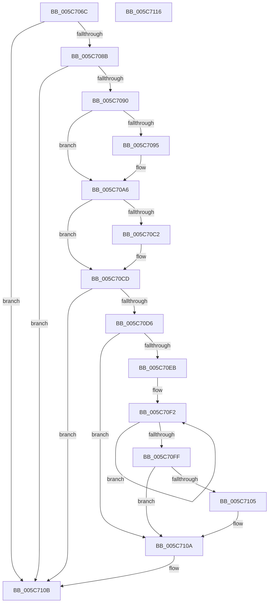

# KiBugCheckRecoveryCleanupFromCrashDump

- RVA: `0x005C706C`–`0x005C7117` (길이 `171` bytes)
- VA: `0x00000001405C706C`
- 실행 섹션: `.text`
- PDB 이름 있음: `예`; PDB Function 태그: `아니요`
- unwind 정보 RVA: `0x0005CAAC`
- 디코드: `47`개 명령, `171/171` bytes 표시
- 미해석 바이트: `0` (있으면 어셈블리에 `.byte`로 보존)

> 이 문서는 커널 이미지의 기계어와 PDB 기호를 분석해 생성했습니다. 4번과 5번은 함수 원형과 자료형을 바이너리 사용 방식에서 추정한 C 해석이며 원본 소스 복구 결과는 아닙니다.

## 1. Dependencies

- 직접 호출 지점: **6**; 고유 호출 대상: **6**
- 직접 호출자로 확인된 함수: **1**
- RIP 상대 이미지 참조: **3**

### Outgoing calls
- `0x005C7097` → [HvlResumeFromRootCrashdump](../58/HvlResumeFromRootCrashdump_function_005893E0.md) (function, `0x005893E0`)
- `0x005C70A1` → [KiSaveBugcheckRecoveryProgress](KiSaveBugcheckRecoveryProgress_function_005C7AF0.md) (function, `0x005C7AF0`)
- `0x005C70A8` → [KiSendThawExecution](../4E/KiSendThawExecution_function_004E2800.md) (function, `0x004E2800`)
- `0x005C70B4` → [guard_dispatch_icall](../6B/guard_dispatch_icall_function_006BAAD0.md) (function, `0x006BAAD0`)
- `0x005C70C8` → [KiLowerIrqlProcessIrqlFlags](../4F/KiLowerIrqlProcessIrqlFlags_function_004F5698.md) (function, `0x004F5698`)
- `0x005C7105` → [KiRemoveSystemWorkPriorityKick](../26/KiRemoveSystemWorkPriorityKick_function_002631D0.md) (function, `0x002631D0`)

### Direct callers
- [KiDeferredBugcheckRecoveryWorker](KiDeferredBugcheckRecoveryWorker_function_005C75A0.md) at `0x005C76DE`

### Static image references
- `0x005C7076` → RVA `0x00F10894` (`.data`; read)
- `0x005C70AD` → RVA `0x00E00B18` (`.data`; read)
- `0x005C70B9` → RVA `0x00FC6D20` (`ALMOSTRO`; read)

## 2. Other-region calls and transfers

- 다른 실행 섹션으로 향하는 call: **0**
- 별도 외부 분기/꼬리 이동을 확인하지 못했습니다.

## 3. Assembly (complete function range)

```asm
005C706C  48 89 5C 24 08                  mov qword ptr [rsp + 8], rbx
005C7071  57                              push rdi
005C7072  48 83 EC 20                     sub rsp, 0x20
005C7076  8B 05 18 98 94 00               mov eax, dword ptr [rip + 0x949818]
005C707C  40 8A FA                        mov dil, dl
005C707F  0F B6 D9                        movzx ebx, cl
005C7082  83 E0 0F                        and eax, 0xf
005C7085  0F 84 80 00 00 00               je 0x1405c710b
005C708B  83 F8 03                        cmp eax, 3
005C708E  73 7B                           jae 0x1405c710b
005C7090  83 F8 02                        cmp eax, 2
005C7093  75 11                           jne 0x1405c70a6
005C7095  B1 01                           mov cl, 1
005C7097  E8 44 23 FC FF                  call 0x1405893e0
005C709C  B9 63 00 00 00                  mov ecx, 0x63
005C70A1  E8 4A 0A 00 00                  call 0x1405c7af0
005C70A6  B1 01                           mov cl, 1
005C70A8  E8 53 B7 F1 FF                  call 0x1404e2800
005C70AD  48 8B 05 64 9A 83 00            mov rax, qword ptr [rip + 0x839a64]
005C70B4  E8 17 3A 0F 00                  call 0x1406baad0
005C70B9  83 3D 60 FC 9F 00 00            cmp dword ptr [rip + 0x9ffc60], 0
005C70C0  74 0B                           je 0x1405c70cd
005C70C2  44 0F 20 C1                     mov rcx, cr8
005C70C6  8A D3                           mov dl, bl
005C70C8  E8 CB E5 F2 FF                  call 0x1404f5698
005C70CD  44 0F 22 C3                     mov cr8, rbx
005C70D1  40 84 FF                        test dil, dil
005C70D4  74 35                           je 0x1405c710b
005C70D6  65 48 8B 0C 25 20 00 00 00      mov rcx, qword ptr gs:[0x20]
005C70DF  4C 8B 81 B8 8E 00 00            mov r8, qword ptr [rcx + 0x8eb8]
005C70E6  4D 85 C0                        test r8, r8
005C70E9  74 1F                           je 0x1405c710a
005C70EB  41 0F 0D 08                     prefetchw byte ptr [r8]
005C70EF  41 8B 00                        mov eax, dword ptr [r8]
005C70F2  8B D0                           mov edx, eax
005C70F4  0F BA F2 15                     btr edx, 0x15
005C70F8  F0 41 0F B1 10                  lock cmpxchg dword ptr [r8], edx
005C70FD  75 F3                           jne 0x1405c70f2
005C70FF  0F BA E0 15                     bt eax, 0x15
005C7103  73 05                           jae 0x1405c710a
005C7105  E8 C6 C0 C9 FF                  call 0x1402631d0
005C710A  FB                              sti
005C710B  48 8B 5C 24 30                  mov rbx, qword ptr [rsp + 0x30]
005C7110  48 83 C4 20                     add rsp, 0x20
005C7114  5F                              pop rdi
005C7115  C3                              ret
005C7116  CC                              int3
```

## 4. C-style interpretation (structured pseudocode)

```c
__int64 __fastcall KiBugCheckRecoveryCleanupFromCrashDump(unsigned __int8 a1, unsigned __int8 a2)
{
    __int64 result;
    __int64 v_rsp;
    unsigned __int64 v_stack_p8;

    v_stack_p8 = v_rbx;
    v_rsp = (v_rsp) - (32);
    result = (unsigned int)(((unsigned int)(*(unsigned int *)(v_rip + 9738264))) & (15));
    if (condition_is_equal) goto loc_005C710B;
    if (((unsigned int)(result)) >= 3) goto loc_005C710B;
    if (((unsigned int)(result)) == 2) {
        a1 = 1;
        result = HvlResumeFromRootCrashdump(a1, a2, a3, a4);
        a1 = 99;
        result = KiSaveBugcheckRecoveryProgress(a1, a2, a3, a4);
    }
    result = KiSendThawExecution(1, a2, a3, a4);
    result = guard_dispatch_icall(1, a2, a3, a4);
    if ((*(unsigned int *)(v_rip + 10484832)) != 0) {
        a1 = v_cr8;
        a2 = a1;
        result = KiLowerIrqlProcessIrqlFlags(a1, a2, a3, a4);
    }
    if (a2 == 0) goto loc_005C710B;
    if (*(unsigned __int64 *)(*(unsigned __int64 *)(gs_base + (0 + 32)) + 36536) == 0) goto loc_005C710A;
loc_005C70F2:
    if (*(unsigned __int64 *)(*(unsigned __int64 *)(gs_base + (0 + 32)) + 36536) != 0) goto loc_005C70F2;
    result = (unsigned int)(*(unsigned int *)(*(unsigned __int64 *)(*(unsigned __int64 *)(gs_base + (0 + 32)) + 36536)));
    if (!(condition_is_above_or_equal)) {
        result = KiRemoveSystemWorkPriorityKick(*(unsigned __int64 *)(gs_base + (0 + 32)), (unsigned int)((unsigned int)((unsigned int)(*(unsigned int *)(*(unsigned __int64 *)(*(unsigned __int64 *)(gs_base + (0 + 32)) + 36536))))), *(unsigned __int64 *)(*(unsigned __int64 *)(gs_base + (0 + 32)) + 36536), a4);
    }
loc_005C710B:
    v_rsp = (v_rsp) + (32);
    return result;
}
```

## 5. (Beta) C Style

```c
int64_t KiBugCheckRecoveryCleanupFromCrashDump(uint8_t Arg1, uint8_t Arg2)
{
    int64_t result;
    int64_t local_rsp;
    uint64_t v_stack_p8;

    v_stack_p8 = local_rbx;
    local_rsp = (local_rsp) - (32);
    result = (uint32_t)(((uint32_t)(*(uint32_t *)(v_rip + 0x949818))) & (15));
    if (condition_is_equal) goto loc_005C710B;
    if (((uint32_t)(result)) >= 3) goto loc_005C710B;
    if (((uint32_t)(result)) == 2) {
        Arg1 = 1;
        result = HvlResumeFromRootCrashdump(Arg1, Arg2, a3, a4);
        Arg1 = 99;
        result = KiSaveBugcheckRecoveryProgress(Arg1, Arg2, a3, a4);
    }
    result = KiSendThawExecution(1, Arg2, a3, a4);
    result = guard_dispatch_icall(1, Arg2, a3, a4);
    if ((*(uint32_t *)(v_rip + 0x9FFC60)) != 0) {
        Arg1 = v_cr8;
        Arg2 = Arg1;
        result = KiLowerIrqlProcessIrqlFlags(Arg1, Arg2, a3, a4);
    }
    if (Arg2 == 0) goto loc_005C710B;
    if (*(uint64_t *)(*(uint64_t *)(gs_base + (0 + 0x20)) + 0x8EB8) == 0) goto loc_005C710A;
loc_005C70F2:
    if (*(uint64_t *)(*(uint64_t *)(gs_base + (0 + 0x20)) + 0x8EB8) != 0) goto loc_005C70F2;
    result = (uint32_t)(*(uint32_t *)(*(uint64_t *)(*(uint64_t *)(gs_base + (0 + 0x20)) + 0x8EB8)));
    if (!(condition_is_above_or_equal)) {
        result = KiRemoveSystemWorkPriorityKick(*(uint64_t *)(gs_base + (0 + 0x20)), (uint32_t)((uint32_t)((uint32_t)(*(uint32_t *)(*(uint64_t *)(*(uint64_t *)(gs_base + (0 + 0x20)) + 0x8EB8))))), *(uint64_t *)(*(uint64_t *)(gs_base + (0 + 0x20)) + 0x8EB8), a4);
    }
loc_005C710B:
    local_rsp = (local_rsp) + (32);
    return result;
}
```

## 6. Execution-region graph

[열기: 2D/3D 그래프와 함수 탐색 컨트롤 패널](../../../control-panel.html?section=text&rva=0x005C706C&view=graph)

- 2D 그래프는 위에서 아래로 흐르고, 3D 그래프는 빈 공간을 드래그해 회전합니다. Shift+드래그는 이동, 휠은 확대·축소, 함수 노드 선택은 대상 보고서 이동입니다.

### Static fallback


