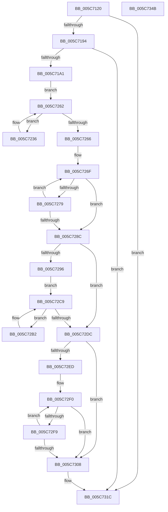

# KiBugCheckRecoveryFreezeOtherProcessors

- RVA: `0x005C7120`–`0x005C734C` (길이 `556` bytes)
- VA: `0x00000001405C7120`
- 실행 섹션: `.text`
- PDB 이름 있음: `예`; PDB Function 태그: `아니요`
- unwind 정보 RVA: `0x000CAB78`
- 디코드: `135`개 명령, `556/556` bytes 표시
- 미해석 바이트: `0` (있으면 어셈블리에 `.byte`로 보존)

> 이 문서는 커널 이미지의 기계어와 PDB 기호를 분석해 생성했습니다. 4번과 5번은 함수 원형과 자료형을 바이너리 사용 방식에서 추정한 C 해석이며 원본 소스 복구 결과는 아닙니다.

## 1. Dependencies

- 직접 호출 지점: **16**; 고유 호출 대상: **11**
- 직접 호출자로 확인된 함수: **2**
- RIP 상대 이미지 참조: **8**

### Outgoing calls
- `0x005C7171` → [memset](../6C/memset_function_006C6C40.md) (function, `0x006C6C40`)
- `0x005C71B3` → [KiSetDebuggerOwner](../4F/KiSetDebuggerOwner_function_004FCE94.md) (function, `0x004FCE94`)
- `0x005C71CB` → [memset](../6C/memset_function_006C6C40.md) (function, `0x006C6C40`)
- `0x005C71E1` → [KiCopyAffinityEx](../2C/KiCopyAffinityEx_function_002CE860.md) (function, `0x002CE860`)
- `0x005C71EE` → [KeRemoveProcessorAffinityEx](../30/KeRemoveProcessorAffinityEx_function_00304E10.md) (function, `0x00304E10`)
- `0x005C7228` → [KeEnumerateNextProcessor](../41/KeEnumerateNextProcessor_function_00415480.md) (function, `0x00415480`)
- `0x005C724B` → [KeInsertQueueDpc](../20/KeInsertQueueDpc_function_00207C50.md) (function, `0x00207C50`)
- `0x005C725D` → [KeEnumerateNextProcessor](../41/KeEnumerateNextProcessor_function_00415480.md) (function, `0x00415480`)
- `0x005C727C` → [KeStallExecutionProcessor](../44/KeStallExecutionProcessor_function_0044F620.md) (function, `0x0044F620`)
- `0x005C72C4` → [KeRemoveQueueDpcEx](../46/KeRemoveQueueDpcEx_function_0046CDC0.md) (function, `0x0046CDC0`)
- `0x005C72D3` → [KeEnumerateNextProcessor](../41/KeEnumerateNextProcessor_function_00415480.md) (function, `0x00415480`)
- `0x005C72E4` → [KiSendFreeze](KiSendFreeze_function_005C3364.md) (function, `0x005C3364`)
- `0x005C72F0` → [KeFrozenProcessorCount](KeFrozenProcessorCount_function_005C2EC4.md) (function, `0x005C2EC4`)
- `0x005C72FC` → [KeStallExecutionProcessor](../44/KeStallExecutionProcessor_function_0044F620.md) (function, `0x0044F620`)
- `0x005C730F` → [KeFrozenProcessorCount](KeFrozenProcessorCount_function_005C2EC4.md) (function, `0x005C2EC4`)
- `0x005C7325` → [_security_check_cookie](../6A/_security_check_cookie_function_006AC640.md) (function, `0x006AC640`)

### Direct callers
- [KiBugCheckRecoveryPrepareForCrashDump](KiBugCheckRecoveryPrepareForCrashDump_function_005C7410.md) at `0x005C7498`
- [KiUpdateBugcheckRecoveryProgress](KiUpdateBugcheckRecoveryProgress_function_005C7E1C.md) at `0x005C7E78`

### Static image references
- `0x005C7144` → RVA `0x00E0A740` (`.data`; read)
- `0x005C7176` → RVA `0x00FC6A80` (`ALMOSTRO`; read)
- `0x005C7194` → RVA `0x00E667E8` (`.data`; read)
- `0x005C71D5` → RVA `0x00FC7120` (`ALMOSTRO`; read)
- `0x005C71F3` → RVA `0x00F10900` (`.data`; write)
- `0x005C71FF` → RVA `0x00F10848` (`.data`; write)
- `0x005C722D` → RVA `0x00FC8C40` (`ALMOSTRO`; read)
- `0x005C726F` → RVA `0x00F10848` (`.data`; read)

## 2. Other-region calls and transfers

- 다른 실행 섹션으로 향하는 call: **0**
- 별도 외부 분기/꼬리 이동을 확인하지 못했습니다.

## 3. Assembly (complete function range)

```asm
005C7120  48 89 5C 24 08                  mov qword ptr [rsp + 8], rbx
005C7125  48 89 74 24 10                  mov qword ptr [rsp + 0x10], rsi
005C712A  48 89 7C 24 18                  mov qword ptr [rsp + 0x18], rdi
005C712F  55                              push rbp
005C7130  41 54                           push r12
005C7132  41 55                           push r13
005C7134  41 56                           push r14
005C7136  41 57                           push r15
005C7138  48 8D 6C 24 A0                  lea rbp, [rsp - 0x60]
005C713D  48 81 EC 60 01 00 00            sub rsp, 0x160
005C7144  48 8B 05 F5 35 84 00            mov rax, qword ptr [rip + 0x8435f5]
005C714B  48 33 C4                        xor rax, rsp
005C714E  48 89 45 50                     mov qword ptr [rbp + 0x50], rax
005C7152  8B F1                           mov esi, ecx
005C7154  45 33 FF                        xor r15d, r15d
005C7157  BF 00 01 00 00                  mov edi, 0x100
005C715C  44 89 7C 24 3A                  mov dword ptr [rsp + 0x3a], r15d
005C7161  44 8B C7                        mov r8d, edi
005C7164  66 44 89 7C 24 3E               mov word ptr [rsp + 0x3e], r15w
005C716A  33 D2                           xor edx, edx
005C716C  48 8D 4C 24 48                  lea rcx, [rsp + 0x48]
005C7171  E8 CA FA 0F 00                  call 0x1406c6c40
005C7176  8B 15 04 F9 9F 00               mov edx, dword ptr [rip + 0x9ff904]
005C717C  45 8D 67 01                     lea r12d, [r15 + 1]
005C7180  8B 05 FA F8 9F 00               mov eax, dword ptr [rip + 0x9ff8fa]
005C7186  44 89 7C 24 20                  mov dword ptr [rsp + 0x20], r15d
005C718B  41 3B C4                        cmp eax, r12d
005C718E  0F 84 88 01 00 00               je 0x1405c731c
005C7194  44 38 3D 4D F6 89 00            cmp byte ptr [rip + 0x89f64d], r15b
005C719B  0F 85 7B 01 00 00               jne 0x1405c731c
005C71A1  65 48 8B 1C 25 20 00 00 00      mov rbx, qword ptr gs:[0x20]
005C71AA  85 F6                           test esi, esi
005C71AC  48 8B CB                        mov rcx, rbx
005C71AF  41 0F 94 C6                     sete r14b
005C71B3  E8 DC 5C F3 FF                  call 0x1404fce94
005C71B8  33 D2                           xor edx, edx
005C71BA  48 C7 44 24 40 01 00 20 00      mov qword ptr [rsp + 0x40], 0x200001
005C71C3  48 8D 4C 24 48                  lea rcx, [rsp + 0x48]
005C71C8  44 8B C7                        mov r8d, edi
005C71CB  E8 70 FA 0F 00                  call 0x1406c6c40
005C71D0  0F B7 54 24 42                  movzx edx, word ptr [rsp + 0x42]
005C71D5  4C 8D 05 44 FF 9F 00            lea r8, [rip + 0x9fff44]
005C71DC  48 8D 4C 24 40                  lea rcx, [rsp + 0x40]
005C71E1  E8 7A 76 D0 FF                  call 0x1402ce860
005C71E6  8B 53 24                        mov edx, dword ptr [rbx + 0x24]
005C71E9  48 8D 4C 24 40                  lea rcx, [rsp + 0x40]
005C71EE  E8 1D DC D3 FF                  call 0x140304e10
005C71F3  44 89 25 06 97 94 00            mov dword ptr [rip + 0x949706], r12d
005C71FA  48 8D 54 24 28                  lea rdx, [rsp + 0x28]
005C71FF  44 89 3D 42 96 94 00            mov dword ptr [rip + 0x949642], r15d
005C7206  48 8D 4C 24 20                  lea rcx, [rsp + 0x20]
005C720B  48 8B 44 24 48                  mov rax, qword ptr [rsp + 0x48]
005C7210  41 8B FF                        mov edi, r15d
005C7213  48 89 44 24 30                  mov qword ptr [rsp + 0x30], rax
005C7218  48 8D 44 24 40                  lea rax, [rsp + 0x40]
005C721D  48 89 44 24 28                  mov qword ptr [rsp + 0x28], rax
005C7222  66 44 89 7C 24 38               mov word ptr [rsp + 0x38], r15w
005C7228  E8 53 E2 E4 FF                  call 0x140415480
005C722D  4C 8D 2D 0C 1A A0 00            lea r13, [rip + 0xa01a0c]
005C7234  EB 2C                           jmp 0x1405c7262
005C7236  8B 44 24 20                     mov eax, dword ptr [rsp + 0x20]
005C723A  45 33 C0                        xor r8d, r8d
005C723D  33 D2                           xor edx, edx
005C723F  49 8B 4C C5 00                  mov rcx, qword ptr [r13 + rax*8]
005C7244  48 81 C1 D0 9E 00 00            add rcx, 0x9ed0
005C724B  E8 00 0A C4 FF                  call 0x140207c50
005C7250  48 8D 54 24 28                  lea rdx, [rsp + 0x28]
005C7255  41 03 FC                        add edi, r12d
005C7258  48 8D 4C 24 20                  lea rcx, [rsp + 0x20]
005C725D  E8 1E E2 E4 FF                  call 0x140415480
005C7262  85 C0                           test eax, eax
005C7264  74 D0                           je 0x1405c7236
005C7266  41 8B DF                        mov ebx, r15d
005C7269  41 BC 32 00 00 00               mov r12d, 0x32
005C726F  8B 05 D3 95 94 00               mov eax, dword ptr [rip + 0x9495d3]
005C7275  3B C7                           cmp eax, edi
005C7277  7D 13                           jge 0x1405c728c
005C7279  41 8B CC                        mov ecx, r12d
005C727C  E8 9F 83 E8 FF                  call 0x14044f620
005C7281  41 03 DC                        add ebx, r12d
005C7284  81 FB 40 42 0F 00               cmp ebx, 0xf4240
005C728A  72 E3                           jb 0x1405c726f
005C728C  8B 05 B6 95 94 00               mov eax, dword ptr [rip + 0x9495b6]
005C7292  3B C7                           cmp eax, edi
005C7294  7D 46                           jge 0x1405c72dc
005C7296  48 8B 44 24 48                  mov rax, qword ptr [rsp + 0x48]
005C729B  48 89 44 24 30                  mov qword ptr [rsp + 0x30], rax
005C72A0  48 8D 44 24 40                  lea rax, [rsp + 0x40]
005C72A5  48 89 44 24 28                  mov qword ptr [rsp + 0x28], rax
005C72AA  66 44 89 7C 24 38               mov word ptr [rsp + 0x38], r15w
005C72B0  EB 17                           jmp 0x1405c72c9
005C72B2  8B 4C 24 20                     mov ecx, dword ptr [rsp + 0x20]
005C72B6  33 D2                           xor edx, edx
005C72B8  49 8B 4C CD 00                  mov rcx, qword ptr [r13 + rcx*8]
005C72BD  48 81 C1 D0 9E 00 00            add rcx, 0x9ed0
005C72C4  E8 F7 5A EA FF                  call 0x14046cdc0
005C72C9  48 8D 54 24 28                  lea rdx, [rsp + 0x28]
005C72CE  48 8D 4C 24 20                  lea rcx, [rsp + 0x20]
005C72D3  E8 A8 E1 E4 FF                  call 0x140415480
005C72D8  85 C0                           test eax, eax
005C72DA  74 D6                           je 0x1405c72b2
005C72DC  41 8A D6                        mov dl, r14b
005C72DF  48 8D 4C 24 40                  lea rcx, [rsp + 0x40]
005C72E4  E8 7B C0 FF FF                  call 0x1405c3364
005C72E9  85 F6                           test esi, esi
005C72EB  74 1B                           je 0x1405c7308
005C72ED  41 8B DF                        mov ebx, r15d
005C72F0  E8 CF BB FF FF                  call 0x1405c2ec4
005C72F5  3B C7                           cmp eax, edi
005C72F7  73 0F                           jae 0x1405c7308
005C72F9  41 8B CC                        mov ecx, r12d
005C72FC  E8 1F 83 E8 FF                  call 0x14044f620
005C7301  41 03 DC                        add ebx, r12d
005C7304  3B DE                           cmp ebx, esi
005C7306  72 E8                           jb 0x1405c72f0
005C7308  44 89 3D F1 95 94 00            mov dword ptr [rip + 0x9495f1], r15d
005C730F  E8 B0 BB FF FF                  call 0x1405c2ec4
005C7314  8B 15 66 F7 9F 00               mov edx, dword ptr [rip + 0x9ff766]
005C731A  2B D0                           sub edx, eax
005C731C  8B C2                           mov eax, edx
005C731E  48 8B 4D 50                     mov rcx, qword ptr [rbp + 0x50]
005C7322  48 33 CC                        xor rcx, rsp
005C7325  E8 16 53 0E 00                  call 0x1406ac640
005C732A  4C 8D 9C 24 60 01 00 00         lea r11, [rsp + 0x160]
005C7332  49 8B 5B 30                     mov rbx, qword ptr [r11 + 0x30]
005C7336  49 8B 73 38                     mov rsi, qword ptr [r11 + 0x38]
005C733A  49 8B 7B 40                     mov rdi, qword ptr [r11 + 0x40]
005C733E  49 8B E3                        mov rsp, r11
005C7341  41 5F                           pop r15
005C7343  41 5E                           pop r14
005C7345  41 5D                           pop r13
005C7347  41 5C                           pop r12
005C7349  5D                              pop rbp
005C734A  C3                              ret
005C734B  CC                              int3
```

## 4. C-style interpretation (structured pseudocode)

```c
__int64 __fastcall KiBugCheckRecoveryFreezeOtherProcessors(int a1, int a2)
{
    __int64 result;
    __int64 v_r14;
    __int64 v_r15;
    __int64 v_rbx;
    __int64 v_rdi;
    __int64 v_rsp;
    unsigned __int64 v_stack_m140;
    unsigned __int16 v_stack_m146;
    unsigned __int64 v_stack_m148;
    unsigned __int16 v_stack_m14A;
    unsigned int v_stack_m14E;
    unsigned __int16 v_stack_m150;
    unsigned __int64 v_stack_m158;
    unsigned __int64 v_stack_m160;
    unsigned int v_stack_m168;
    unsigned __int64 v_stack_m28;
    unsigned __int64 v_stack_m38;
    unsigned __int64 v_stack_m88;
    unsigned __int64 v_stack_p10;
    unsigned __int64 v_stack_p18;
    unsigned __int64 v_stack_p8;

    v_stack_p8 = v_rbx;
    v_stack_p10 = v_rsi;
    v_stack_p18 = v_rdi;
    v_rsp = (v_rsp) - (352);
    result = (*(unsigned __int64 *)(v_rip + 8664565)) ^ (v_rsp);
    v_stack_m38 = result;
    v_r15 = 0;
    v_stack_m14E = 0;
    v_stack_m14A = 0;
    a2 = 0;
    result = memset(v_stack_m140, a2, 256, a4);
    v_stack_m168 = 0;
    if (((unsigned int)((unsigned int)(*(unsigned int *)(v_rip + 10483962)))) == ((unsigned int)(v_r15 + 1))) goto loc_005C731C;
    if ((*(unsigned __int8 *)(v_rip + 9041485)) != 0) goto loc_005C731C;
    v_r14 = ((unsigned int)((unsigned int)(a1)) == 0) ? 1 : 0;
    result = KiSetDebuggerOwner(*(unsigned __int64 *)(gs_base + (0 + 32)), (unsigned int)(*(unsigned int *)(v_rip + 10483972)), 256, a4);
    a2 = 0;
    v_stack_m148 = 0x200001ULL;
    result = memset(v_stack_m140, a2, 256, a4);
    result = KiCopyAffinityEx(v_stack_m148, v_stack_m146, v_rip + 10485572, a4);
    result = KeRemoveProcessorAffinityEx(v_stack_m148, (unsigned int)(*(unsigned int *)(*(unsigned __int64 *)(gs_base + (0 + 32)) + 36)), v_rip + 10485572, a4);
    *(unsigned int *)(v_rip + 9737990) = (unsigned int)(v_r15 + 1);
    *(unsigned int *)(v_rip + 9737794) = 0;
    v_stack_m158 = v_stack_m140;
    v_stack_m160 = v_stack_m148;
    v_stack_m150 = 0;
    result = KeEnumerateNextProcessor(v_stack_m168, v_stack_m160, v_rip + 10485572, a4);
    goto loc_005C7262;
loc_005C7236:
    a3 = 0;
    a2 = 0;
    a1 = (*(unsigned __int64 *)(v_rip + 10492428 + (unsigned int)(v_stack_m168) * 8)) + (0x9ED0ULL);
    result = KeInsertQueueDpc(a1, a2, a3, a4);
    v_rdi = (unsigned int)((0) + ((unsigned int)(v_r15 + 1)));
    result = KeEnumerateNextProcessor(v_stack_m168, v_stack_m160, a3, a4);
loc_005C7262:
    if ((unsigned int)(result) == 0) goto loc_005C7236;
loc_005C726F:
    if (((unsigned int)((unsigned int)(*(unsigned int *)(v_rip + 9737683)))) >= ((unsigned int)(v_rdi))) goto loc_005C728C;
    result = KeStallExecutionProcessor(50, v_stack_m160, a3, a4);
    v_rbx = (unsigned int)((0) + (50));
    if (((unsigned int)(v_rbx)) < 0xF4240ULL) goto loc_005C726F;
loc_005C728C:
    if (((unsigned int)((unsigned int)(*(unsigned int *)(v_rip + 9737654)))) >= ((unsigned int)(v_rdi))) goto loc_005C72DC;
    v_stack_m158 = v_stack_m140;
    v_stack_m160 = v_stack_m148;
    v_stack_m150 = 0;
    goto loc_005C72C9;
loc_005C72B2:
    a2 = 0;
    a1 = (*(unsigned __int64 *)(v_rip + 10492428 + (unsigned int)(v_stack_m168) * 8)) + (0x9ED0ULL);
    result = KeRemoveQueueDpcEx(a1, a2, a3, a4);
loc_005C72C9:
    result = KeEnumerateNextProcessor(v_stack_m168, v_stack_m160, a3, a4);
    if ((unsigned int)(result) == 0) goto loc_005C72B2;
loc_005C72DC:
    result = KiSendFreeze(v_stack_m148, (unsigned __int8)(v_r14), a3, a4);
    if ((unsigned int)((unsigned int)(a1)) == 0) goto loc_005C7308;
loc_005C72F0:
    result = KeFrozenProcessorCount(v_stack_m148, (unsigned __int8)(v_r14), a3, a4);
    if (((unsigned int)(result)) >= ((unsigned int)(v_rdi))) goto loc_005C7308;
    result = KeStallExecutionProcessor(50, (unsigned __int8)(v_r14), a3, a4);
    v_rbx = (unsigned int)((0) + (50));
    if (((unsigned int)(v_rbx)) < ((unsigned int)((unsigned int)(a1)))) goto loc_005C72F0;
loc_005C7308:
    *(unsigned int *)(v_rip + 9737713) = 0;
    result = KeFrozenProcessorCount(50, (unsigned __int8)(v_r14), a3, a4);
    a2 = (unsigned int)(((unsigned int)(*(unsigned int *)(v_rip + 10483558))) - ((unsigned int)(result)));
loc_005C731C:
    a1 = (v_stack_m38) ^ (v_rsp);
    result = _security_check_cookie(a1, a2, a3, a4);
    return result;
}
```

## 5. (Beta) C Style

```c
int64_t KiBugCheckRecoveryFreezeOtherProcessors(int32_t Arg1, int32_t Arg2)
{
    int64_t result;
    int64_t local_r14;
    int64_t local_r15;
    int64_t local_rbx;
    int64_t local_rdi;
    int64_t local_rsp;
    uint64_t v_stack_m140;
    uint16_t v_stack_m146;
    uint64_t v_stack_m148;
    uint16_t v_stack_m14A;
    uint32_t v_stack_m14E;
    uint16_t v_stack_m150;
    uint64_t v_stack_m158;
    uint64_t v_stack_m160;
    uint32_t v_stack_m168;
    uint64_t v_stack_m28;
    uint64_t v_stack_m38;
    uint64_t v_stack_m88;
    uint64_t v_stack_p10;
    uint64_t v_stack_p18;
    uint64_t v_stack_p8;

    v_stack_p8 = local_rbx;
    v_stack_p10 = local_rsi;
    v_stack_p18 = local_rdi;
    local_rsp = (local_rsp) - (352);
    result = (*(uint64_t *)(v_rip + 0x8435F5)) ^ (local_rsp);
    v_stack_m38 = result;
    local_r15 = 0;
    v_stack_m14E = 0;
    v_stack_m14A = 0;
    Arg2 = 0;
    result = memset(v_stack_m140, Arg2, 256, a4);
    v_stack_m168 = 0;
    if (((uint32_t)((uint32_t)(*(uint32_t *)(v_rip + 0x9FF8FA)))) == ((uint32_t)(local_r15 + 1))) goto loc_005C731C;
    if ((*(uint8_t *)(v_rip + 0x89F64D)) != 0) goto loc_005C731C;
    local_r14 = ((uint32_t)((uint32_t)(Arg1)) == 0) ? 1 : 0;
    result = KiSetDebuggerOwner(*(uint64_t *)(gs_base + (0 + 0x20)), (uint32_t)(*(uint32_t *)(v_rip + 0x9FF904)), 256, a4);
    Arg2 = 0;
    v_stack_m148 = 0x200001ULL;
    result = memset(v_stack_m140, Arg2, 256, a4);
    result = KiCopyAffinityEx(v_stack_m148, v_stack_m146, v_rip + 10485572, a4);
    result = KeRemoveProcessorAffinityEx(v_stack_m148, (uint32_t)(*(uint32_t *)(*(uint64_t *)(gs_base + (0 + 0x20)) + 0x24)), v_rip + 10485572, a4);
    *(uint32_t *)(v_rip + 0x949706) = (uint32_t)(local_r15 + 1);
    *(uint32_t *)(v_rip + 0x949642) = 0;
    v_stack_m158 = v_stack_m140;
    v_stack_m160 = v_stack_m148;
    v_stack_m150 = 0;
    result = KeEnumerateNextProcessor(v_stack_m168, v_stack_m160, v_rip + 10485572, a4);
    goto loc_005C7262;
loc_005C7236:
    a3 = 0;
    Arg2 = 0;
    Arg1 = (*(uint64_t *)(v_rip + 0xA01A0C + (uint32_t)(v_stack_m168) * 8)) + (0x9ED0ULL);
    result = KeInsertQueueDpc(Arg1, Arg2, a3, a4);
    local_rdi = (uint32_t)((0) + ((uint32_t)(local_r15 + 1)));
    result = KeEnumerateNextProcessor(v_stack_m168, v_stack_m160, a3, a4);
loc_005C7262:
    if ((uint32_t)(result) == 0) goto loc_005C7236;
loc_005C726F:
    if (((uint32_t)((uint32_t)(*(uint32_t *)(v_rip + 0x9495D3)))) >= ((uint32_t)(local_rdi))) goto loc_005C728C;
    result = KeStallExecutionProcessor(50, v_stack_m160, a3, a4);
    local_rbx = (uint32_t)((0) + (50));
    if (((uint32_t)(local_rbx)) < 0xF4240ULL) goto loc_005C726F;
loc_005C728C:
    if (((uint32_t)((uint32_t)(*(uint32_t *)(v_rip + 0x9495B6)))) >= ((uint32_t)(local_rdi))) goto loc_005C72DC;
    v_stack_m158 = v_stack_m140;
    v_stack_m160 = v_stack_m148;
    v_stack_m150 = 0;
    goto loc_005C72C9;
loc_005C72B2:
    Arg2 = 0;
    Arg1 = (*(uint64_t *)(v_rip + 0xA01A0C + (uint32_t)(v_stack_m168) * 8)) + (0x9ED0ULL);
    result = KeRemoveQueueDpcEx(Arg1, Arg2, a3, a4);
loc_005C72C9:
    result = KeEnumerateNextProcessor(v_stack_m168, v_stack_m160, a3, a4);
    if ((uint32_t)(result) == 0) goto loc_005C72B2;
loc_005C72DC:
    result = KiSendFreeze(v_stack_m148, (uint8_t)(local_r14), a3, a4);
    if ((uint32_t)((uint32_t)(Arg1)) == 0) goto loc_005C7308;
loc_005C72F0:
    result = KeFrozenProcessorCount(v_stack_m148, (uint8_t)(local_r14), a3, a4);
    if (((uint32_t)(result)) >= ((uint32_t)(local_rdi))) goto loc_005C7308;
    result = KeStallExecutionProcessor(50, (uint8_t)(local_r14), a3, a4);
    local_rbx = (uint32_t)((0) + (50));
    if (((uint32_t)(local_rbx)) < ((uint32_t)((uint32_t)(Arg1)))) goto loc_005C72F0;
loc_005C7308:
    *(uint32_t *)(v_rip + 0x9495F1) = 0;
    result = KeFrozenProcessorCount(50, (uint8_t)(local_r14), a3, a4);
    Arg2 = (uint32_t)(((uint32_t)(*(uint32_t *)(v_rip + 0x9FF766))) - ((uint32_t)(result)));
loc_005C731C:
    Arg1 = (v_stack_m38) ^ (local_rsp);
    result = _security_check_cookie(Arg1, Arg2, a3, a4);
    return result;
}
```

## 6. Execution-region graph

[열기: 2D/3D 그래프와 함수 탐색 컨트롤 패널](../../../control-panel.html?section=text&rva=0x005C7120&view=graph)

- 2D 그래프는 위에서 아래로 흐르고, 3D 그래프는 빈 공간을 드래그해 회전합니다. Shift+드래그는 이동, 휠은 확대·축소, 함수 노드 선택은 대상 보고서 이동입니다.

### Static fallback


