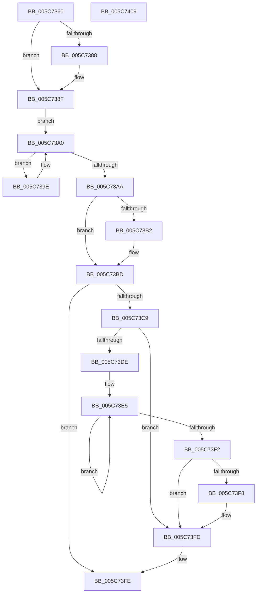

# KiBugCheckRecoveryFreezeProcessorDpc

- RVA: `0x005C7360`–`0x005C740A` (길이 `170` bytes)
- VA: `0x00000001405C7360`
- 실행 섹션: `.text`
- PDB 이름 있음: `예`; PDB Function 태그: `아니요`
- unwind 정보 RVA: `0x0005CAAC`
- 디코드: `47`개 명령, `170/170` bytes 표시
- 미해석 바이트: `0` (있으면 어셈블리에 `.byte`로 보존)

> 이 문서는 커널 이미지의 기계어와 PDB 기호를 분석해 생성했습니다. 4번과 5번은 함수 원형과 자료형을 바이너리 사용 방식에서 추정한 C 해석이며 원본 소스 복구 결과는 아닙니다.

## 1. Dependencies

- 직접 호출 지점: **4**; 고유 호출 대상: **4**
- 직접 호출자로 확인된 함수: **0**
- RIP 상대 이미지 참조: **4**

### Outgoing calls
- `0x005C736A` → [KeDisableInterrupts](../21/KeDisableInterrupts_function_00217BE0.md) (function, `0x00217BE0`)
- `0x005C738A` → [KiRaiseIrqlProcessIrqlFlags](../4F/KiRaiseIrqlProcessIrqlFlags_function_004F56FC.md) (function, `0x004F56FC`)
- `0x005C73B8` → [KiLowerIrqlProcessIrqlFlags](../4F/KiLowerIrqlProcessIrqlFlags_function_004F5698.md) (function, `0x004F5698`)
- `0x005C73F8` → [KiRemoveSystemWorkPriorityKick](../26/KiRemoveSystemWorkPriorityKick_function_002631D0.md) (function, `0x002631D0`)

### Direct callers
- 이 함수 시작 RVA로 연결되는 직접 call은 확인되지 않았습니다. 간접 호출은 완전히 역산할 수 없습니다.

### Static image references
- `0x005C737F` → RVA `0x00FC6D20` (`ALMOSTRO`; read)
- `0x005C738F` → RVA `0x00F10848` (`.data`; read/write)
- `0x005C7396` → RVA `0x00FC6A80` (`ALMOSTRO`; read)
- `0x005C73A0` → RVA `0x00F10900` (`.data`; read)

## 2. Other-region calls and transfers

- 다른 실행 섹션으로 향하는 call: **0**
- 별도 외부 분기/꼬리 이동을 확인하지 못했습니다.

## 3. Assembly (complete function range)

```asm
005C7360  48 89 5C 24 08                  mov qword ptr [rsp + 8], rbx
005C7365  57                              push rdi
005C7366  48 83 EC 20                     sub rsp, 0x20
005C736A  E8 71 08 C5 FF                  call 0x140217be0
005C736F  40 8A F8                        mov dil, al
005C7372  44 0F 20 C3                     mov rbx, cr8
005C7376  BA 0F 00 00 00                  mov edx, 0xf
005C737B  44 0F 22 C2                     mov cr8, rdx
005C737F  83 3D 9A F9 9F 00 00            cmp dword ptr [rip + 0x9ff99a], 0
005C7386  74 07                           je 0x1405c738f
005C7388  8A CB                           mov cl, bl
005C738A  E8 6D E3 F2 FF                  call 0x1404f56fc
005C738F  F0 FF 05 B2 94 94 00            lock inc dword ptr [rip + 0x9494b2]
005C7396  8B 05 E4 F6 9F 00               mov eax, dword ptr [rip + 0x9ff6e4]
005C739C  EB 02                           jmp 0x1405c73a0
005C739E  F3 90                           pause
005C73A0  8B 05 5A 95 94 00               mov eax, dword ptr [rip + 0x94955a]
005C73A6  85 C0                           test eax, eax
005C73A8  75 F4                           jne 0x1405c739e
005C73AA  39 05 70 F9 9F 00               cmp dword ptr [rip + 0x9ff970], eax
005C73B0  74 0B                           je 0x1405c73bd
005C73B2  44 0F 20 C1                     mov rcx, cr8
005C73B6  8A D3                           mov dl, bl
005C73B8  E8 DB E2 F2 FF                  call 0x1404f5698
005C73BD  0F B6 C3                        movzx eax, bl
005C73C0  44 0F 22 C0                     mov cr8, rax
005C73C4  40 84 FF                        test dil, dil
005C73C7  74 35                           je 0x1405c73fe
005C73C9  65 48 8B 0C 25 20 00 00 00      mov rcx, qword ptr gs:[0x20]
005C73D2  4C 8B 81 B8 8E 00 00            mov r8, qword ptr [rcx + 0x8eb8]
005C73D9  4D 85 C0                        test r8, r8
005C73DC  74 1F                           je 0x1405c73fd
005C73DE  41 0F 0D 08                     prefetchw byte ptr [r8]
005C73E2  41 8B 00                        mov eax, dword ptr [r8]
005C73E5  8B D0                           mov edx, eax
005C73E7  0F BA F2 15                     btr edx, 0x15
005C73EB  F0 41 0F B1 10                  lock cmpxchg dword ptr [r8], edx
005C73F0  75 F3                           jne 0x1405c73e5
005C73F2  0F BA E0 15                     bt eax, 0x15
005C73F6  73 05                           jae 0x1405c73fd
005C73F8  E8 D3 BD C9 FF                  call 0x1402631d0
005C73FD  FB                              sti
005C73FE  48 8B 5C 24 30                  mov rbx, qword ptr [rsp + 0x30]
005C7403  48 83 C4 20                     add rsp, 0x20
005C7407  5F                              pop rdi
005C7408  C3                              ret
005C7409  CC                              int3
```

## 4. C-style interpretation (structured pseudocode)

```c
__int64 __fastcall KiBugCheckRecoveryFreezeProcessorDpc(void)
{
    __int64 result;
    __int64 v_rsp;
    unsigned __int64 v_stack_p8;

    v_stack_p8 = v_rbx;
    v_rsp = (v_rsp) - (32);
    result = KeDisableInterrupts(a1, a2, a3, a4);
    if ((*(unsigned int *)(v_rip + 10484122)) != 0) {
        a1 = (unsigned __int8)(v_cr8);
        result = KiRaiseIrqlProcessIrqlFlags(a1, 15, a3, a4);
    }
    goto loc_005C73A0;
loc_005C739E:
loc_005C73A0:
    if ((unsigned int)((unsigned int)(*(unsigned int *)(v_rip + 9737562))) != 0) goto loc_005C739E;
    result = (unsigned int)(*(unsigned int *)(v_rip + 9737562));
    if ((*(unsigned int *)(v_rip + 10484080)) != ((unsigned int)((unsigned int)(*(unsigned int *)(v_rip + 9737562))))) {
        a1 = 15;
        a2 = (unsigned __int8)(v_cr8);
        result = KiLowerIrqlProcessIrqlFlags(a1, a2, a3, a4);
    }
    if ((unsigned __int8)((unsigned __int8)(result)) == 0) goto loc_005C73FE;
    if (*(unsigned __int64 *)(*(unsigned __int64 *)(gs_base + (0 + 32)) + 36536) == 0) goto loc_005C73FD;
loc_005C73E5:
    if (*(unsigned __int64 *)(*(unsigned __int64 *)(gs_base + (0 + 32)) + 36536) != 0) goto loc_005C73E5;
    result = (unsigned int)(*(unsigned int *)(*(unsigned __int64 *)(*(unsigned __int64 *)(gs_base + (0 + 32)) + 36536)));
    if (!(condition_is_above_or_equal)) {
        result = KiRemoveSystemWorkPriorityKick(*(unsigned __int64 *)(gs_base + (0 + 32)), (unsigned int)((unsigned int)((unsigned int)(*(unsigned int *)(*(unsigned __int64 *)(*(unsigned __int64 *)(gs_base + (0 + 32)) + 36536))))), *(unsigned __int64 *)(*(unsigned __int64 *)(gs_base + (0 + 32)) + 36536), a4);
    }
loc_005C73FE:
    v_rsp = (v_rsp) + (32);
    return result;
}
```

## 5. (Beta) C Style

```c
void KiBugCheckRecoveryFreezeProcessorDpc(void)
{
    int64_t result;
    int64_t local_rsp;
    uint64_t v_stack_p8;

    v_stack_p8 = local_rbx;
    local_rsp = (local_rsp) - (32);
    result = KeDisableInterrupts(a1, a2, a3, a4);
    if ((*(uint32_t *)(v_rip + 0x9FF99A)) != 0) {
        a1 = (uint8_t)(v_cr8);
        result = KiRaiseIrqlProcessIrqlFlags(a1, 15, a3, a4);
    }
    goto loc_005C73A0;
loc_005C739E:
loc_005C73A0:
    if ((uint32_t)((uint32_t)(*(uint32_t *)(v_rip + 0x94955A))) != 0) goto loc_005C739E;
    result = (uint32_t)(*(uint32_t *)(v_rip + 0x94955A));
    if ((*(uint32_t *)(v_rip + 0x9FF970)) != ((uint32_t)((uint32_t)(*(uint32_t *)(v_rip + 0x94955A))))) {
        a1 = 15;
        a2 = (uint8_t)(v_cr8);
        result = KiLowerIrqlProcessIrqlFlags(a1, a2, a3, a4);
    }
    if ((uint8_t)((uint8_t)(result)) == 0) goto loc_005C73FE;
    if (*(uint64_t *)(*(uint64_t *)(gs_base + (0 + 0x20)) + 0x8EB8) == 0) goto loc_005C73FD;
loc_005C73E5:
    if (*(uint64_t *)(*(uint64_t *)(gs_base + (0 + 0x20)) + 0x8EB8) != 0) goto loc_005C73E5;
    result = (uint32_t)(*(uint32_t *)(*(uint64_t *)(*(uint64_t *)(gs_base + (0 + 0x20)) + 0x8EB8)));
    if (!(condition_is_above_or_equal)) {
        result = KiRemoveSystemWorkPriorityKick(*(uint64_t *)(gs_base + (0 + 0x20)), (uint32_t)((uint32_t)((uint32_t)(*(uint32_t *)(*(uint64_t *)(*(uint64_t *)(gs_base + (0 + 0x20)) + 0x8EB8))))), *(uint64_t *)(*(uint64_t *)(gs_base + (0 + 0x20)) + 0x8EB8), a4);
    }
loc_005C73FE:
    local_rsp = (local_rsp) + (32);
    return result;
}
```

## 6. Execution-region graph

[열기: 2D/3D 그래프와 함수 탐색 컨트롤 패널](../../../control-panel.html?section=text&rva=0x005C7360&view=graph)

- 2D 그래프는 위에서 아래로 흐르고, 3D 그래프는 빈 공간을 드래그해 회전합니다. Shift+드래그는 이동, 휠은 확대·축소, 함수 노드 선택은 대상 보고서 이동입니다.

### Static fallback


