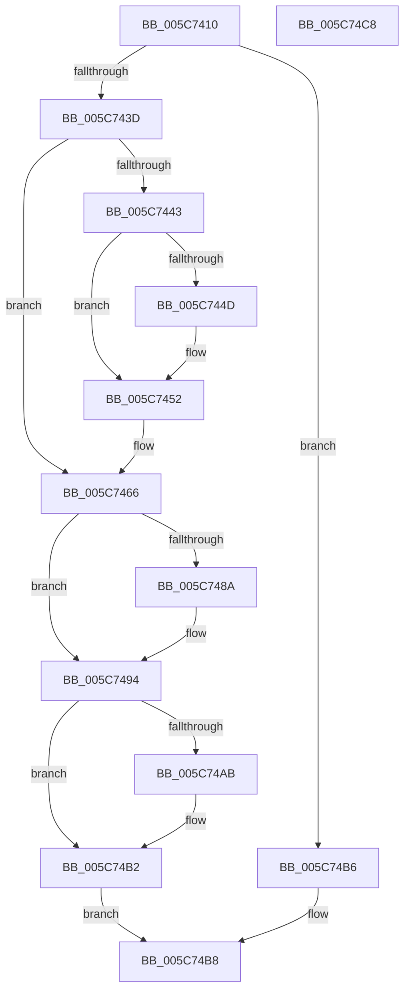

# KiBugCheckRecoveryPrepareForCrashDump

- RVA: `0x005C7410`–`0x005C74C9` (길이 `185` bytes)
- VA: `0x00000001405C7410`
- 실행 섹션: `.text`
- PDB 이름 있음: `예`; PDB Function 태그: `아니요`
- unwind 정보 RVA: `0x00060BC4`
- 디코드: `49`개 명령, `185/185` bytes 표시
- 미해석 바이트: `0` (있으면 어셈블리에 `.byte`로 보존)

> 이 문서는 커널 이미지의 기계어와 PDB 기호를 분석해 생성했습니다. 4번과 5번은 함수 원형과 자료형을 바이너리 사용 방식에서 추정한 C 해석이며 원본 소스 복구 결과는 아닙니다.

## 1. Dependencies

- 직접 호출 지점: **7**; 고유 호출 대상: **7**
- 직접 호출자로 확인된 함수: **1**
- RIP 상대 이미지 참조: **5**

### Outgoing calls
- `0x005C744D` → [IoRevertFromDemotedDumpType](../59/IoRevertFromDemotedDumpType_function_00592DE4.md) (function, `0x00592DE4`)
- `0x005C7461` → [KiSaveBugcheckRecoveryProgress](KiSaveBugcheckRecoveryProgress_function_005C7AF0.md) (function, `0x005C7AF0`)
- `0x005C746D` → [guard_dispatch_icall](../6B/guard_dispatch_icall_function_006BAAD0.md) (function, `0x006BAAD0`)
- `0x005C7472` → [KeDisableInterrupts](../21/KeDisableInterrupts_function_00217BE0.md) (function, `0x00217BE0`)
- `0x005C748F` → [KiRaiseIrqlProcessIrqlFlags](../4F/KiRaiseIrqlProcessIrqlFlags_function_004F56FC.md) (function, `0x004F56FC`)
- `0x005C7498` → [KiBugCheckRecoveryFreezeOtherProcessors](KiBugCheckRecoveryFreezeOtherProcessors_function_005C7120.md) (function, `0x005C7120`)
- `0x005C74AD` → [HvlPrepareForRootCrashdump](../58/HvlPrepareForRootCrashdump_function_00588F84.md) (function, `0x00588F84`)

### Direct callers
- [KiDeferredBugcheckRecoveryWorker](KiDeferredBugcheckRecoveryWorker_function_005C75A0.md) at `0x005C76B4`

### Static image references
- `0x005C741F` → RVA `0x00F10894` (`.data`; read)
- `0x005C7443` → RVA `0x00F10898` (`.data`; read)
- `0x005C7452` → RVA `0x00FC6AB8` (`ALMOSTRO`; read/write)
- `0x005C7466` → RVA `0x00E00B28` (`.data`; read)
- `0x005C7481` → RVA `0x00FC6D20` (`ALMOSTRO`; read)

## 2. Other-region calls and transfers

- 다른 실행 섹션으로 향하는 call: **0**
- 별도 외부 분기/꼬리 이동을 확인하지 못했습니다.

## 3. Assembly (complete function range)

```asm
005C7410  48 89 5C 24 08                  mov qword ptr [rsp + 8], rbx
005C7415  48 89 74 24 10                  mov qword ptr [rsp + 0x10], rsi
005C741A  57                              push rdi
005C741B  48 83 EC 20                     sub rsp, 0x20
005C741F  44 8B 05 6E 94 94 00            mov r8d, dword ptr [rip + 0x94946e]
005C7426  BE 0F 00 00 00                  mov esi, 0xf
005C742B  44 23 C6                        and r8d, esi
005C742E  48 8B DA                        mov rbx, rdx
005C7431  48 8B F9                        mov rdi, rcx
005C7434  41 8D 40 FF                     lea eax, [r8 - 1]
005C7438  83 F8 01                        cmp eax, 1
005C743B  77 79                           ja 0x1405c74b6
005C743D  41 83 F8 02                     cmp r8d, 2
005C7441  75 23                           jne 0x1405c7466
005C7443  48 83 3D 4D 94 94 00 00         cmp qword ptr [rip + 0x94944d], 0
005C744B  75 05                           jne 0x1405c7452
005C744D  E8 92 B9 FC FF                  call 0x140592de4
005C7452  81 25 5C F6 9F 00 00 20 00 00   and dword ptr [rip + 0x9ff65c], 0x2000
005C745C  B9 60 00 00 00                  mov ecx, 0x60
005C7461  E8 8A 06 00 00                  call 0x1405c7af0
005C7466  48 8B 05 BB 96 83 00            mov rax, qword ptr [rip + 0x8396bb]
005C746D  E8 5E 36 0F 00                  call 0x1406baad0
005C7472  E8 69 07 C5 FF                  call 0x140217be0
005C7477  88 03                           mov byte ptr [rbx], al
005C7479  44 0F 20 C3                     mov rbx, cr8
005C747D  44 0F 22 C6                     mov cr8, rsi
005C7481  83 3D 98 F8 9F 00 00            cmp dword ptr [rip + 0x9ff898], 0
005C7488  74 0A                           je 0x1405c7494
005C748A  40 8A D6                        mov dl, sil
005C748D  8A CB                           mov cl, bl
005C748F  E8 68 E2 F2 FF                  call 0x1404f56fc
005C7494  33 C9                           xor ecx, ecx
005C7496  88 1F                           mov byte ptr [rdi], bl
005C7498  E8 83 FC FF FF                  call 0x1405c7120
005C749D  8B 0D F1 93 94 00               mov ecx, dword ptr [rip + 0x9493f1]
005C74A3  40 22 CE                        and cl, sil
005C74A6  80 F9 02                        cmp cl, 2
005C74A9  75 07                           jne 0x1405c74b2
005C74AB  33 C9                           xor ecx, ecx
005C74AD  E8 D2 1A FC FF                  call 0x140588f84
005C74B2  B0 01                           mov al, 1
005C74B4  EB 02                           jmp 0x1405c74b8
005C74B6  32 C0                           xor al, al
005C74B8  48 8B 5C 24 30                  mov rbx, qword ptr [rsp + 0x30]
005C74BD  48 8B 74 24 38                  mov rsi, qword ptr [rsp + 0x38]
005C74C2  48 83 C4 20                     add rsp, 0x20
005C74C6  5F                              pop rdi
005C74C7  C3                              ret
005C74C8  CC                              int3
```

## 4. C-style interpretation (structured pseudocode)

```c
__int64 __fastcall KiBugCheckRecoveryPrepareForCrashDump(__int64 a1, __int64 a2)
{
    __int64 result;
    __int64 v_rsp;
    unsigned __int64 v_stack_p10;
    unsigned __int64 v_stack_p8;

    v_stack_p8 = v_rbx;
    v_stack_p10 = v_rsi;
    v_rsp = (v_rsp) - (32);
    a3 = (unsigned int)(((unsigned int)(*(unsigned int *)(v_rip + 9737326))) & (15));
    if (((unsigned int)(a3 - 1)) > 1) goto loc_005C74B6;
    if (((unsigned int)(a3)) != 2) goto loc_005C7466;
    result = a3 - 1;
    if ((*(unsigned __int64 *)(v_rip + 9737293)) == 0) {
        result = IoRevertFromDemotedDumpType(a1, a2, a3, a4);
    }
    result = KiSaveBugcheckRecoveryProgress(96, a2, a3, a4);
loc_005C7466:
    result = guard_dispatch_icall(96, a2, a3, a4);
    result = KeDisableInterrupts(96, a2, a3, a4);
    *(unsigned __int8 *)(a2) = (unsigned __int8)(result);
    if ((*(unsigned int *)(v_rip + 10483864)) != 0) {
        a2 = 15;
        a1 = (unsigned __int8)(v_cr8);
        result = KiRaiseIrqlProcessIrqlFlags(a1, a2, a3, a4);
    }
    a1 = 0;
    *(unsigned __int8 *)(a1) = (unsigned __int8)(v_cr8);
    result = KiBugCheckRecoveryFreezeOtherProcessors(a1, a2, a3, a4);
    a1 = (unsigned __int8)(((unsigned int)(*(unsigned int *)(v_rip + 9737201))) & (15));
    if (((unsigned __int8)(a1)) == 2) {
        a1 = 0;
        result = HvlPrepareForRootCrashdump(a1, a2, a3, a4);
    }
    goto loc_005C74B8;
loc_005C74B6:
    result = 0;
loc_005C74B8:
    v_rsp = (v_rsp) + (32);
    return result;
}
```

## 5. (Beta) C Style

```c
int64_t KiBugCheckRecoveryPrepareForCrashDump(void *Arg1, void *Arg2)
{
    uint8_t *arg1 = (uint8_t *)Arg1;
    uint8_t *arg2 = (uint8_t *)Arg2;

    int64_t result;
    int64_t local_rsp;
    uint64_t v_stack_p10;
    uint64_t v_stack_p8;

    v_stack_p8 = local_rbx;
    v_stack_p10 = local_rsi;
    local_rsp = (local_rsp) - (32);
    a3 = (uint32_t)(((uint32_t)(*(uint32_t *)(v_rip + 0x94946E))) & (15));
    if (((uint32_t)(a3 - 1)) > 1) goto loc_005C74B6;
    if (((uint32_t)(a3)) != 2) goto loc_005C7466;
    result = a3 - 1;
    if ((*(uint64_t *)(v_rip + 0x94944D)) == 0) {
        result = IoRevertFromDemotedDumpType(Arg1, Arg2, a3, a4);
    }
    result = KiSaveBugcheckRecoveryProgress(96, Arg2, a3, a4);
loc_005C7466:
    result = guard_dispatch_icall(96, Arg2, a3, a4);
    result = KeDisableInterrupts(96, Arg2, a3, a4);
    *(uint8_t *)(arg2) = (uint8_t)(result);
    if ((*(uint32_t *)(v_rip + 0x9FF898)) != 0) {
        Arg2 = 15;
        Arg1 = (uint8_t)(v_cr8);
        result = KiRaiseIrqlProcessIrqlFlags(Arg1, Arg2, a3, a4);
    }
    Arg1 = 0;
    *(uint8_t *)(arg1) = (uint8_t)(v_cr8);
    result = KiBugCheckRecoveryFreezeOtherProcessors(Arg1, Arg2, a3, a4);
    Arg1 = (uint8_t)(((uint32_t)(*(uint32_t *)(v_rip + 0x9493F1))) & (15));
    if (((uint8_t)(Arg1)) == 2) {
        Arg1 = 0;
        result = HvlPrepareForRootCrashdump(Arg1, Arg2, a3, a4);
    }
    goto loc_005C74B8;
loc_005C74B6:
    result = 0;
loc_005C74B8:
    local_rsp = (local_rsp) + (32);
    return result;
}
```

### 관측된 메모리 오프셋

구조체 형식이 확인되지 않은 접근은 인자 기준의 오프셋으로만 기록했습니다.

| 기준 인자 | 오프셋 표현 | 폭 (bit) | 접근 |
|---|---:|---:|---|
| `Arg1` | `+ 0x0` | `8` | `W` |
| `Arg2` | `+ 0x0` | `8` | `W` |

## 6. Execution-region graph

[열기: 2D/3D 그래프와 함수 탐색 컨트롤 패널](../../../control-panel.html?section=text&rva=0x005C7410&view=graph)

- 2D 그래프는 위에서 아래로 흐르고, 3D 그래프는 빈 공간을 드래그해 회전합니다. Shift+드래그는 이동, 휠은 확대·축소, 함수 노드 선택은 대상 보고서 이동입니다.

### Static fallback


