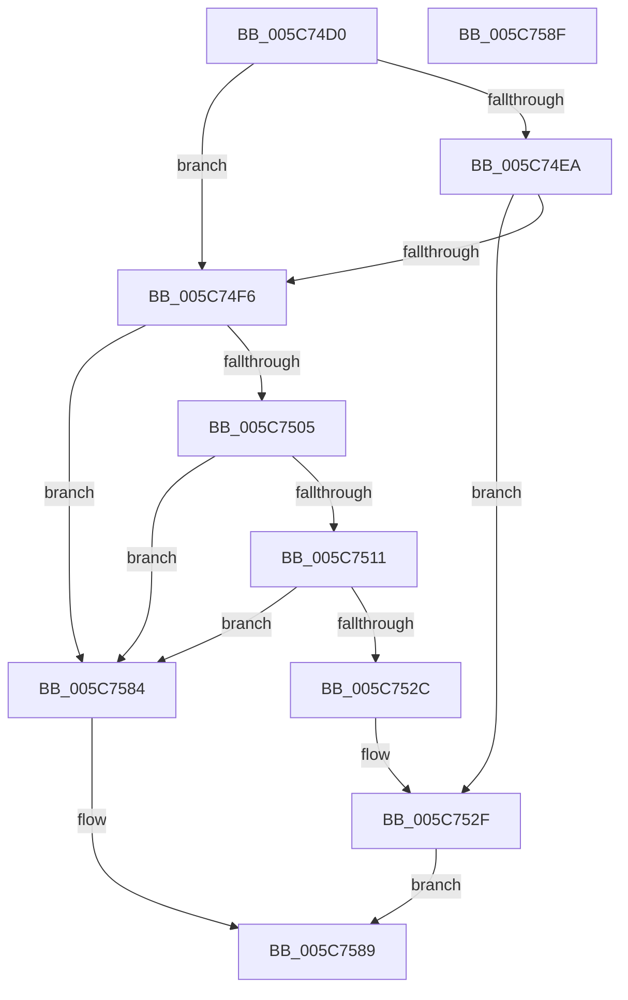

# KiCaptureDumpPreRecovery

- RVA: `0x005C74D0`–`0x005C7590` (길이 `192` bytes)
- VA: `0x00000001405C74D0`
- 실행 섹션: `.text`
- PDB 이름 있음: `예`; PDB Function 태그: `아니요`
- unwind 정보 RVA: `0x000C3CD8`
- 디코드: `44`개 명령, `192/192` bytes 표시
- 미해석 바이트: `0` (있으면 어셈블리에 `.byte`로 보존)

> 이 문서는 커널 이미지의 기계어와 PDB 기호를 분석해 생성했습니다. 4번과 5번은 함수 원형과 자료형을 바이너리 사용 방식에서 추정한 C 해석이며 원본 소스 복구 결과는 아닙니다.

## 1. Dependencies

- 직접 호출 지점: **2**; 고유 호출 대상: **2**
- 직접 호출자로 확인된 함수: **1**
- RIP 상대 이미지 참조: **12**

### Outgoing calls
- `0x005C7520` → [guard_dispatch_icall](../6B/guard_dispatch_icall_function_006BAAD0.md) (function, `0x006BAAD0`)
- `0x005C757D` → [IoCapturePristineTriageDump](../59/IoCapturePristineTriageDump_function_00591AB8.md) (function, `0x00591AB8`)

### Direct callers
- [KiAttemptBugcheckRecovery](KiAttemptBugcheckRecovery_function_005C6D24.md) at `0x005C6F70`

### Static image references
- `0x005C74DA` → RVA `0x00F10898` (`.data`; read)
- `0x005C74EA` → RVA `0x00F10894` (`.data`; read)
- `0x005C74FB` → RVA `0x00E66050` (`.data`; read)
- `0x005C7505` → RVA `0x00E66000` (`.data`; read)
- `0x005C752F` → RVA `0x00F23510` (`.data`; read)
- `0x005C7537` → RVA `0x00F47598` (`.data`; read)
- `0x005C753E` → RVA `0x00F47590` (`.data`; read)
- `0x005C7548` → RVA `0x00F47588` (`.data`; read)
- `0x005C754F` → RVA `0x00F47580` (`.data`; read)
- `0x005C7559` → RVA `0x00F23508` (`.data`; read)
- `0x005C7565` → RVA `0x00F23500` (`.data`; read)
- `0x005C7571` → RVA `0x00F475A0` (`.data`; read)

## 2. Other-region calls and transfers

- 다른 실행 섹션으로 향하는 call: **0**
- 별도 외부 분기/꼬리 이동을 확인하지 못했습니다.

## 3. Assembly (complete function range)

```asm
005C74D0  48 89 4C 24 08                  mov qword ptr [rsp + 8], rcx
005C74D5  53                              push rbx
005C74D6  48 83 EC 50                     sub rsp, 0x50
005C74DA  48 83 3D B6 93 94 00 00         cmp qword ptr [rip + 0x9493b6], 0
005C74E2  48 8B DA                        mov rbx, rdx
005C74E5  C6 02 00                        mov byte ptr [rdx], 0
005C74E8  74 0C                           je 0x1405c74f6
005C74EA  8B 05 A4 93 94 00               mov eax, dword ptr [rip + 0x9493a4]
005C74F0  24 0F                           and al, 0xf
005C74F2  3C 01                           cmp al, 1
005C74F4  75 39                           jne 0x1405c752f
005C74F6  83 64 24 60 00                  and dword ptr [rsp + 0x60], 0
005C74FB  48 83 3D 4D EB 89 00 00         cmp qword ptr [rip + 0x89eb4d], 0
005C7503  74 7F                           je 0x1405c7584
005C7505  48 8B 05 F4 EA 89 00            mov rax, qword ptr [rip + 0x89eaf4]
005C750C  48 85 C0                        test rax, rax
005C750F  74 73                           je 0x1405c7584
005C7511  41 B8 04 00 00 00               mov r8d, 4
005C7517  48 8D 54 24 60                  lea rdx, [rsp + 0x60]
005C751C  41 8D 48 02                     lea ecx, [r8 + 2]
005C7520  E8 AB 35 0F 00                  call 0x1406baad0
005C7525  83 7C 24 60 00                  cmp dword ptr [rsp + 0x60], 0
005C752A  7C 58                           jl 0x1405c7584
005C752C  C6 03 01                        mov byte ptr [rbx], 1
005C752F  48 83 3D D9 BF 95 00 00         cmp qword ptr [rip + 0x95bfd9], 0
005C7537  4C 8B 0D 5A 00 98 00            mov r9, qword ptr [rip + 0x98005a]
005C753E  4C 8B 05 4B 00 98 00            mov r8, qword ptr [rip + 0x98004b]
005C7545  0F 94 C0                        sete al
005C7548  48 8B 15 39 00 98 00            mov rdx, qword ptr [rip + 0x980039]
005C754F  8B 0D 2B 00 98 00               mov ecx, dword ptr [rip + 0x98002b]
005C7555  88 44 24 38                     mov byte ptr [rsp + 0x38], al
005C7559  48 8B 05 A8 BF 95 00            mov rax, qword ptr [rip + 0x95bfa8]
005C7560  48 89 44 24 30                  mov qword ptr [rsp + 0x30], rax
005C7565  48 8B 05 94 BF 95 00            mov rax, qword ptr [rip + 0x95bf94]
005C756C  48 89 44 24 28                  mov qword ptr [rsp + 0x28], rax
005C7571  48 8B 05 28 00 98 00            mov rax, qword ptr [rip + 0x980028]
005C7578  48 89 44 24 20                  mov qword ptr [rsp + 0x20], rax
005C757D  E8 36 A5 FC FF                  call 0x140591ab8
005C7582  EB 05                           jmp 0x1405c7589
005C7584  B8 01 00 00 C0                  mov eax, 0xc0000001
005C7589  48 83 C4 50                     add rsp, 0x50
005C758D  5B                              pop rbx
005C758E  C3                              ret
005C758F  CC                              int3
```

## 4. C-style interpretation (structured pseudocode)

```c
__int64 __fastcall KiCaptureDumpPreRecovery(__int64 a1, __int64 a2)
{
    __int64 result;
    __int64 v_rsp;
    unsigned __int8 v_stack_m20;
    unsigned __int64 v_stack_m28;
    unsigned __int64 v_stack_m30;
    unsigned __int64 v_stack_m38;
    unsigned __int64 v_stack_p8;

    v_stack_p8 = a1;
    v_rsp = (v_rsp) - (80);
    *(unsigned __int8 *)(a2) = 0;
    if ((*(unsigned __int64 *)(v_rip + 9737142)) == 0) goto loc_005C74F6;
    result = (unsigned __int8)(((unsigned int)(*(unsigned int *)(v_rip + 9737124))) & (15));
    if (((unsigned __int8)(result)) != 1) goto loc_005C752F;
loc_005C74F6:
    if ((*(unsigned __int64 *)(v_rip + 9038669)) == 0) goto loc_005C7584;
    if (*(unsigned __int64 *)(v_rip + 9038580) == 0) goto loc_005C7584;
    result = guard_dispatch_icall(4 + 2, v_stack_p8, 4, a4);
    if (v_stack_p8 < 0) goto loc_005C7584;
    *(unsigned __int8 *)(a2) = 1;
loc_005C752F:
    result = ((*(unsigned __int64 *)(v_rip + 9813977)) == 0) ? 1 : 0;
    v_stack_m20 = (unsigned __int8)(result);
    v_stack_m28 = *(unsigned __int64 *)(v_rip + 9813928);
    v_stack_m30 = *(unsigned __int64 *)(v_rip + 9813908);
    v_stack_m38 = *(unsigned __int64 *)(v_rip + 9961512);
    result = IoCapturePristineTriageDump((unsigned int)(*(unsigned int *)(v_rip + 9961515)), *(unsigned __int64 *)(v_rip + 9961529), *(unsigned __int64 *)(v_rip + 9961547), *(unsigned __int64 *)(v_rip + 9961562));
    goto loc_005C7589;
loc_005C7584:
loc_005C7589:
    v_rsp = (v_rsp) + (80);
    return (unsigned int)(0xC0000001ULL);
}
```

## 5. (Beta) C Style

```c
int64_t KiCaptureDumpPreRecovery(int64_t Arg1, void *Arg2)
{
    uint8_t *arg2 = (uint8_t *)Arg2;

    int64_t result;
    int64_t local_rsp;
    uint8_t v_stack_m20;
    uint64_t v_stack_m28;
    uint64_t v_stack_m30;
    uint64_t v_stack_m38;
    uint64_t v_stack_p8;

    v_stack_p8 = Arg1;
    local_rsp = (local_rsp) - (80);
    *(uint8_t *)(arg2) = 0;
    if ((*(uint64_t *)(v_rip + 0x9493B6)) == 0) goto loc_005C74F6;
    result = (uint8_t)(((uint32_t)(*(uint32_t *)(v_rip + 0x9493A4))) & (15));
    if (((uint8_t)(result)) != 1) goto loc_005C752F;
loc_005C74F6:
    if ((*(uint64_t *)(v_rip + 0x89EB4D)) == 0) goto loc_005C7584;
    if (*(uint64_t *)(v_rip + 0x89EAF4) == 0) goto loc_005C7584;
    result = guard_dispatch_icall(4 + 2, v_stack_p8, 4, a4);
    if (v_stack_p8 < 0) goto loc_005C7584;
    *(uint8_t *)(arg2) = 1;
loc_005C752F:
    result = ((*(uint64_t *)(v_rip + 0x95BFD9)) == 0) ? 1 : 0;
    v_stack_m20 = (uint8_t)(result);
    v_stack_m28 = *(uint64_t *)(v_rip + 0x95BFA8);
    v_stack_m30 = *(uint64_t *)(v_rip + 0x95BF94);
    v_stack_m38 = *(uint64_t *)(v_rip + 0x980028);
    result = IoCapturePristineTriageDump((uint32_t)(*(uint32_t *)(v_rip + 0x98002B)), *(uint64_t *)(v_rip + 0x980039), *(uint64_t *)(v_rip + 0x98004B), *(uint64_t *)(v_rip + 0x98005A));
    goto loc_005C7589;
loc_005C7584:
loc_005C7589:
    local_rsp = (local_rsp) + (80);
    return (uint32_t)(0xC0000001ULL);
}
```

### 관측된 메모리 오프셋

구조체 형식이 확인되지 않은 접근은 인자 기준의 오프셋으로만 기록했습니다.

| 기준 인자 | 오프셋 표현 | 폭 (bit) | 접근 |
|---|---:|---:|---|
| `Arg2` | `+ 0x0` | `8` | `W` |

## 6. Execution-region graph

[열기: 2D/3D 그래프와 함수 탐색 컨트롤 패널](../../../control-panel.html?section=text&rva=0x005C74D0&view=graph)

- 2D 그래프는 위에서 아래로 흐르고, 3D 그래프는 빈 공간을 드래그해 회전합니다. Shift+드래그는 이동, 휠은 확대·축소, 함수 노드 선택은 대상 보고서 이동입니다.

### Static fallback


