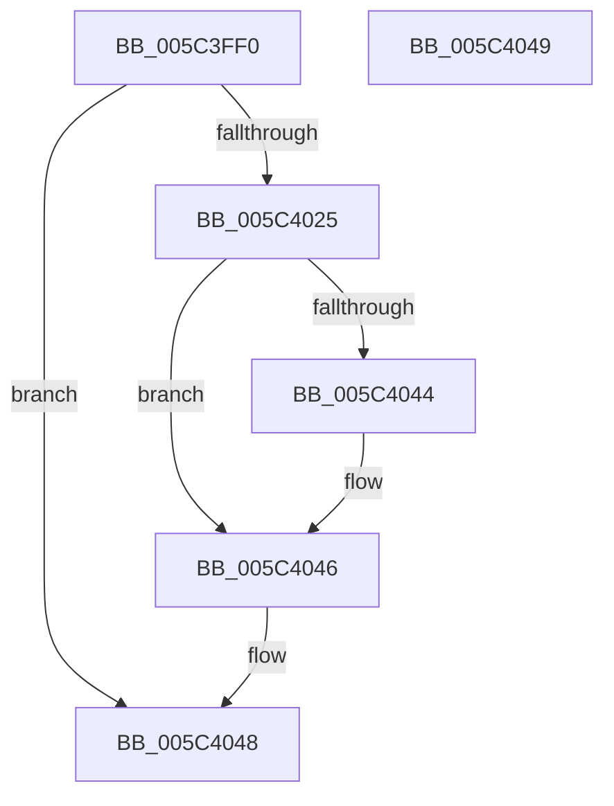

# KiCheckAndApplyCacheIsolation

- RVA: `0x005C3FF0`–`0x005C404A` (길이 `90` bytes)
- VA: `0x00000001405C3FF0`
- 실행 섹션: `.text`
- PDB 이름 있음: `예`; PDB Function 태그: `아니요`
- unwind 정보 RVA: `0x000DB714`
- 디코드: `24`개 명령, `90/90` bytes 표시
- 미해석 바이트: `0` (있으면 어셈블리에 `.byte`로 보존)

> 이 문서는 커널 이미지의 기계어와 PDB 기호를 분석해 생성했습니다. 4번과 5번은 함수 원형과 자료형을 바이너리 사용 방식에서 추정한 C 해석이며 원본 소스 복구 결과는 아닙니다.

## 1. Dependencies

- 직접 호출 지점: **0**; 고유 호출 대상: **0**
- 직접 호출자로 확인된 함수: **1**
- RIP 상대 이미지 참조: **0**

### Outgoing calls
- 직접 디코드된 call 명령이 없습니다.

### Direct callers
- [SwapContext](../6B/SwapContext_function_006B9820.md) at `0x006B988E`

### Static image references
- 디코드된 RIP-relative 메모리 참조가 없습니다.

## 2. Other-region calls and transfers

- 다른 실행 섹션으로 향하는 call: **0**
- 별도 외부 분기/꼬리 이동을 확인하지 못했습니다.

## 3. Assembly (complete function range)

```asm
005C3FF0  48 8B 82 20 02 00 00            mov rax, qword ptr [rdx + 0x220]
005C3FF7  41 B8 00 00 00 00               mov r8d, 0
005C3FFD  44 8B 89 EC 00 00 00            mov r9d, dword ptr [rcx + 0xec]
005C4004  BA 01 00 00 00                  mov edx, 1
005C4009  44 8B 90 88 00 00 00            mov r10d, dword ptr [rax + 0x88]
005C4010  41 8B C1                        mov eax, r9d
005C4013  41 83 E2 40                     and r10d, 0x40
005C4017  41 0F 95 C0                     setne r8b
005C401B  C1 E8 09                        shr eax, 9
005C401E  23 C2                           and eax, edx
005C4020  44 3B C0                        cmp r8d, eax
005C4023  74 23                           je 0x1405c4048
005C4025  41 C1 E0 09                     shl r8d, 9
005C4029  41 0F BA F1 09                  btr r9d, 9
005C402E  45 0B C1                        or r8d, r9d
005C4031  33 C0                           xor eax, eax
005C4033  44 89 81 EC 00 00 00            mov dword ptr [rcx + 0xec], r8d
005C403A  B9 8F 0C 00 00                  mov ecx, 0xc8f
005C403F  45 85 D2                        test r10d, r10d
005C4042  75 02                           jne 0x1405c4046
005C4044  33 D2                           xor edx, edx
005C4046  0F 30                           wrmsr
005C4048  C3                              ret
005C4049  CC                              int3
```

## 4. C-style interpretation (structured pseudocode)

```c
__int64 __fastcall KiCheckAndApplyCacheIsolation(__int64 a1, __int64 a2)
{
    __int64 result;
    __int64 v_r10;

    v_r10 = (unsigned int)(((unsigned int)(*(unsigned int *)(*(unsigned __int64 *)(a2 + 544) + 136))) & (64));
    a3 = (condition_is_not_equal) ? 1 : 0;
    result = (unsigned int)(((unsigned int)((unsigned int)((unsigned int)(*(unsigned int *)(a1 + 236))))) >> (9));
    result = (unsigned int)((result) & (1));
    if (((unsigned int)(a3)) == ((unsigned int)(result))) goto loc_005C4048;
    a3 = (unsigned int)((a3) << (9));
    a3 = (unsigned int)((a3) | ((unsigned int)((unsigned int)(*(unsigned int *)(a1 + 236)))));
    result = 0;
    *(unsigned int *)(a1 + 236) = (unsigned int)(a3);
    if ((unsigned int)(v_r10) == 0) {
        a2 = 0;
    }
loc_005C4048:
    return result;
}
```

## 5. (Beta) C Style

```c
int64_t KiCheckAndApplyCacheIsolation(void *Arg1, void *Arg2)
{
    uint8_t *arg1 = (uint8_t *)Arg1;
    uint8_t *arg2 = (uint8_t *)Arg2;

    int64_t result;
    int64_t local_r10;

    local_r10 = (uint32_t)(((uint32_t)(*(uint32_t *)(*(uint64_t *)(arg2 + 0x220) + 0x88))) & (64));
    a3 = (condition_is_not_equal) ? 1 : 0;
    result = (uint32_t)(((uint32_t)((uint32_t)((uint32_t)(*(uint32_t *)(arg1 + 0xEC))))) >> (9));
    result = (uint32_t)((result) & (1));
    if (((uint32_t)(a3)) == ((uint32_t)(result))) goto loc_005C4048;
    a3 = (uint32_t)((a3) << (9));
    a3 = (uint32_t)((a3) | ((uint32_t)((uint32_t)(*(uint32_t *)(arg1 + 0xEC)))));
    result = 0;
    *(uint32_t *)(arg1 + 0xEC) = (uint32_t)(a3);
    if ((uint32_t)(local_r10) == 0) {
        Arg2 = 0;
    }
loc_005C4048:
    return result;
}
```

### 관측된 메모리 오프셋

구조체 형식이 확인되지 않은 접근은 인자 기준의 오프셋으로만 기록했습니다.

| 기준 인자 | 오프셋 표현 | 폭 (bit) | 접근 |
|---|---:|---:|---|
| `Arg1` | `+ 0xEC` | `32` | `R` |
| `Arg1` | `+ 0xEC` | `32` | `W` |
| `Arg2` | `+ 0x220` | `64` | `R` |

## 6. Execution-region graph

[열기: 2D/3D 그래프와 함수 탐색 컨트롤 패널](../../../control-panel.html?section=text&rva=0x005C3FF0&view=graph)

- 2D 그래프는 위에서 아래로 흐르고, 3D 그래프는 빈 공간을 드래그해 회전합니다. Shift+드래그는 이동, 휠은 확대·축소, 함수 노드 선택은 대상 보고서 이동입니다.

### Static fallback


