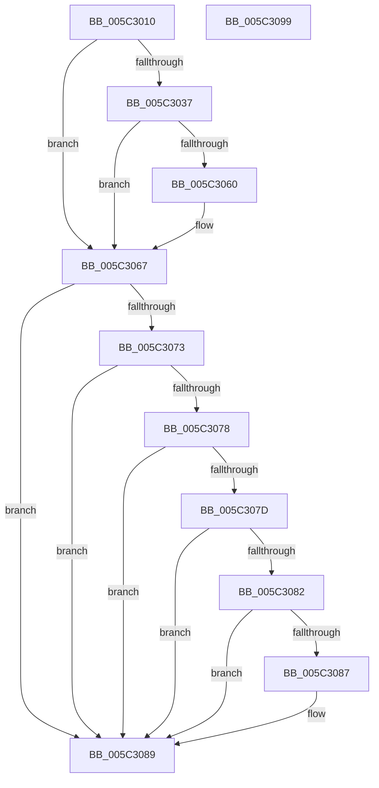

# KiCheckStall

- RVA: `0x005C3010`–`0x005C309A` (길이 `138` bytes)
- VA: `0x00000001405C3010`
- 실행 섹션: `.text`
- PDB 이름 있음: `예`; PDB Function 태그: `아니요`
- unwind 정보 RVA: `0x000A9ACC`
- 디코드: `39`개 명령, `138/138` bytes 표시
- 미해석 바이트: `0` (있으면 어셈블리에 `.byte`로 보존)

> 이 문서는 커널 이미지의 기계어와 PDB 기호를 분석해 생성했습니다. 4번과 5번은 함수 원형과 자료형을 바이너리 사용 방식에서 추정한 C 해석이며 원본 소스 복구 결과는 아닙니다.

## 1. Dependencies

- 직접 호출 지점: **1**; 고유 호출 대상: **1**
- 직접 호출자로 확인된 함수: **3**
- RIP 상대 이미지 참조: **4**

### Outgoing calls
- `0x005C303B` → [KeQueryPerformanceCounter](../37/KeQueryPerformanceCounter_function_0037E7E0.md) (function, `0x0037E7E0`)

### Direct callers
- [KeStallWhileFrozen](KeStallWhileFrozen_function_005C2F20.md) at `0x005C2F2F`
- [KeSwitchFrozenProcessor](KeSwitchFrozenProcessor_function_005C2F40.md) at `0x005C2FE1`
- [KiFreezeTargetExecution](KiFreezeTargetExecution_function_005C30A0.md) at `0x005C322C`

### Static image references
- `0x005C3028` → RVA `0x00F10DF0` (`.data`; read)
- `0x005C3045` → RVA `0x00F10E10` (`.data`; read)
- `0x005C3060` → RVA `0x00F10E10` (`.data`; write)
- `0x005C3067` → RVA `0x00F10E00` (`.data`; read)

## 2. Other-region calls and transfers

- 다른 실행 섹션으로 향하는 call: **0**
- 별도 외부 분기/꼬리 이동을 확인하지 못했습니다.

## 3. Assembly (complete function range)

```asm
005C3010  48 8B C4                        mov rax, rsp
005C3013  48 89 58 10                     mov qword ptr [rax + 0x10], rbx
005C3017  48 89 70 18                     mov qword ptr [rax + 0x18], rsi
005C301B  57                              push rdi
005C301C  48 83 EC 20                     sub rsp, 0x20
005C3020  48 83 60 08 00                  and qword ptr [rax + 8], 0
005C3025  40 8A F2                        mov sil, dl
005C3028  48 8B 3D C1 DD 94 00            mov rdi, qword ptr [rip + 0x94ddc1]
005C302F  48 8B D9                        mov rbx, rcx
005C3032  48 3B CF                        cmp rcx, rdi
005C3035  75 30                           jne 0x1405c3067
005C3037  48 8D 48 08                     lea rcx, [rax + 8]
005C303B  E8 A0 B7 DB FF                  call 0x14037e7e0
005C3040  4C 8B C0                        mov r8, rax
005C3043  33 D2                           xor edx, edx
005C3045  48 2B 05 C4 DD 94 00            sub rax, qword ptr [rip + 0x94ddc4]
005C304C  48 69 C0 E8 03 00 00            imul rax, rax, 0x3e8
005C3053  48 F7 74 24 30                  div qword ptr [rsp + 0x30]
005C3058  48 3D F4 01 00 00               cmp rax, 0x1f4
005C305E  76 07                           jbe 0x1405c3067
005C3060  4C 89 05 A9 DD 94 00            mov qword ptr [rip + 0x94dda9], r8
005C3067  48 8B 05 92 DD 94 00            mov rax, qword ptr [rip + 0x94dd92]
005C306E  40 84 F6                        test sil, sil
005C3071  74 16                           je 0x1405c3089
005C3073  48 85 FF                        test rdi, rdi
005C3076  74 11                           je 0x1405c3089
005C3078  48 3B FB                        cmp rdi, rbx
005C307B  74 0C                           je 0x1405c3089
005C307D  48 85 C0                        test rax, rax
005C3080  74 07                           je 0x1405c3089
005C3082  48 3B C3                        cmp rax, rbx
005C3085  74 02                           je 0x1405c3089
005C3087  F3 90                           pause
005C3089  48 8B 5C 24 38                  mov rbx, qword ptr [rsp + 0x38]
005C308E  48 8B 74 24 40                  mov rsi, qword ptr [rsp + 0x40]
005C3093  48 83 C4 20                     add rsp, 0x20
005C3097  5F                              pop rdi
005C3098  C3                              ret
005C3099  CC                              int3
```

## 4. C-style interpretation (structured pseudocode)

```c
__int64 __fastcall KiCheckStall(__int64 a1, int a2)
{
    __int64 result;
    __int64 v_rsp;
    unsigned __int64 v_stack_p10;
    unsigned __int64 v_stack_p18;
    unsigned __int64 v_stack_p8;

    *(unsigned __int64 *)(v_rsp + 16) = v_rbx;
    *(unsigned __int64 *)(v_rsp + 24) = v_rsi;
    v_rsp = (v_rsp) - (32);
    if (a1 != (*(unsigned __int64 *)(v_rip + 9756097))) goto loc_005C3067;
    result = KeQueryPerformanceCounter(v_rsp + 8, a2, a3, a4);
    a2 = 0;
    result = (result) - (*(unsigned __int64 *)(v_rip + 9756100));
    result = (result) * (result);
    if (result >= = 500) {
        *(unsigned __int64 *)(v_rip + 9756073) = result;
    }
    if ((unsigned __int8)((unsigned __int8)(a2)) == 0) goto loc_005C3089;
    if (*(unsigned __int64 *)(v_rip + 9756097) == 0) goto loc_005C3089;
    if ((*(unsigned __int64 *)(v_rip + 9756097)) == a1) goto loc_005C3089;
    if (*(unsigned __int64 *)(v_rip + 9756050) == 0) goto loc_005C3089;
    if ((*(unsigned __int64 *)(v_rip + 9756050)) != a1) {
    }
    v_rsp = (v_rsp) + (32);
    return *(unsigned __int64 *)(v_rip + 9756050);
}
```

## 5. (Beta) C Style

```c
int64_t KiCheckStall(int64_t Arg1, int32_t Arg2)
{
    int64_t result;
    int64_t local_rsp;
    uint64_t v_stack_p10;
    uint64_t v_stack_p18;
    uint64_t v_stack_p8;

    *(uint64_t *)(local_rsp + 0x10) = local_rbx;
    *(uint64_t *)(local_rsp + 0x18) = local_rsi;
    local_rsp = (local_rsp) - (32);
    if (Arg1 != (*(uint64_t *)(v_rip + 0x94DDC1))) goto loc_005C3067;
    result = KeQueryPerformanceCounter(local_rsp + 8, Arg2, a3, a4);
    Arg2 = 0;
    result = (result) - (*(uint64_t *)(v_rip + 0x94DDC4));
    result = (result) * (result);
    if (result >= = 500) {
        *(uint64_t *)(v_rip + 0x94DDA9) = result;
    }
    if ((uint8_t)((uint8_t)(Arg2)) == 0) goto loc_005C3089;
    if (*(uint64_t *)(v_rip + 0x94DDC1) == 0) goto loc_005C3089;
    if ((*(uint64_t *)(v_rip + 0x94DDC1)) == Arg1) goto loc_005C3089;
    if (*(uint64_t *)(v_rip + 0x94DD92) == 0) goto loc_005C3089;
    if ((*(uint64_t *)(v_rip + 0x94DD92)) != Arg1) {
    }
    local_rsp = (local_rsp) + (32);
    return *(uint64_t *)(v_rip + 0x94DD92);
}
```

## 6. Execution-region graph

[열기: 2D/3D 그래프와 함수 탐색 컨트롤 패널](../../../control-panel.html?section=text&rva=0x005C3010&view=graph)

- 2D 그래프는 위에서 아래로 흐르고, 3D 그래프는 빈 공간을 드래그해 회전합니다. Shift+드래그는 이동, 휠은 확대·축소, 함수 노드 선택은 대상 보고서 이동입니다.

### Static fallback


