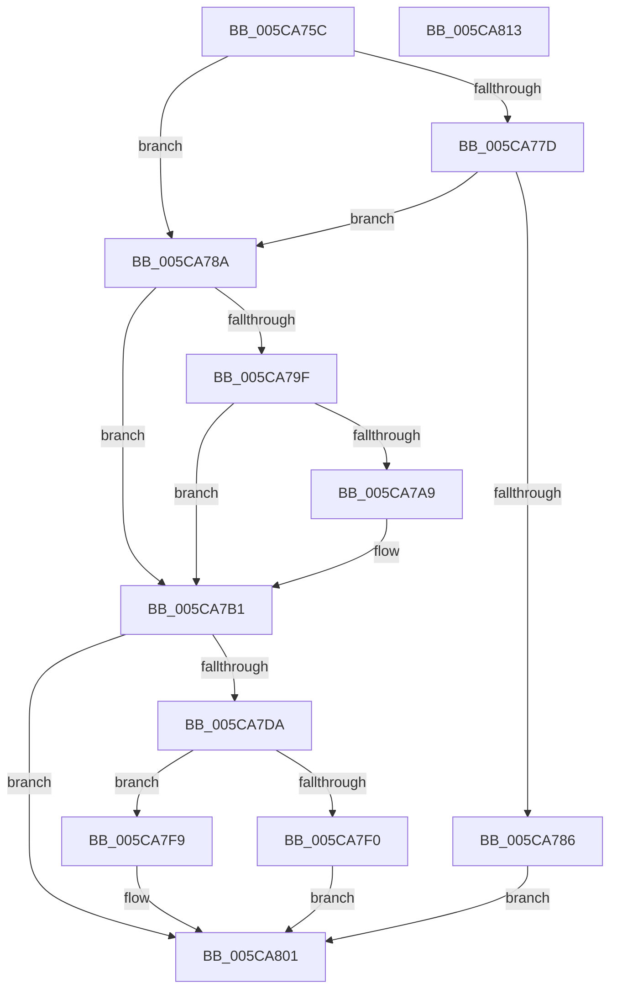

# KiComputeNewPriorityNonStacking

- RVA: `0x005CA75C`–`0x005CA814` (길이 `184` bytes)
- VA: `0x00000001405CA75C`
- 실행 섹션: `.text`
- PDB 이름 있음: `예`; PDB Function 태그: `아니요`
- unwind 정보 RVA: `0x00060BC4`
- 디코드: `51`개 명령, `184/184` bytes 표시
- 미해석 바이트: `0` (있으면 어셈블리에 `.byte`로 보존)

> 이 문서는 커널 이미지의 기계어와 PDB 기호를 분석해 생성했습니다. 4번과 5번은 함수 원형과 자료형을 바이너리 사용 방식에서 추정한 C 해석이며 원본 소스 복구 결과는 아닙니다.

## 1. Dependencies

- 직접 호출 지점: **2**; 고유 호출 대상: **2**
- 직접 호출자로 확인된 함수: **3**
- RIP 상대 이미지 참조: **1**

### Outgoing calls
- `0x005CA7AC` → [KiClearForegroundBoost](../3C/KiClearForegroundBoost_function_003C20D8.md) (function, `0x003C20D8`)
- `0x005CA7B7` → [KiComputeThreadPriority](../3C/KiComputeThreadPriority_function_003C45F4.md) (function, `0x003C45F4`)

### Direct callers
- [sub_0021BDD6](../21/Unknown_function_0021BDD6.md) at `0x0021BE05`
- [sub_0021D7F8](../21/Unknown_function_0021D7F8.md) at `0x0021E2AB`
- [KiComputeNewPriority](../3C/KiComputeNewPriority_function_003C2D8C.md) at `0x003C2DE9`

### Static image references
- `0x005CA78A` → RVA `0x00FC50A0` (`ALMOSTRO`; read)

## 2. Other-region calls and transfers

- 다른 실행 섹션으로 향하는 call: **0**
- 별도 외부 분기/꼬리 이동을 확인하지 못했습니다.

## 3. Assembly (complete function range)

```asm
005CA75C  48 89 5C 24 08                  mov qword ptr [rsp + 8], rbx
005CA761  48 89 74 24 10                  mov qword ptr [rsp + 0x10], rsi
005CA766  57                              push rdi
005CA767  48 83 EC 20                     sub rsp, 0x20
005CA76B  48 8B D9                        mov rbx, rcx
005CA76E  41 8A F8                        mov dil, r8b
005CA771  0F BE 89 C3 00 00 00            movsx ecx, byte ptr [rcx + 0xc3]
005CA778  80 F9 10                        cmp cl, 0x10
005CA77B  7C 0D                           jl 0x1405ca78a
005CA77D  F7 43 78 00 00 40 00            test dword ptr [rbx + 0x78], 0x400000
005CA784  75 04                           jne 0x1405ca78a
005CA786  8B D1                           mov edx, ecx
005CA788  EB 77                           jmp 0x1405ca801
005CA78A  83 3D 0F A9 9F 00 00            cmp dword ptr [rip + 0x9fa90f], 0
005CA791  BA 06 00 00 00                  mov edx, 6
005CA796  0F BE B3 66 03 00 00            movsx esi, byte ptr [rbx + 0x366]
005CA79D  74 12                           je 0x1405ca7b1
005CA79F  BA 07 00 00 00                  mov edx, 7
005CA7A4  40 84 FF                        test dil, dil
005CA7A7  74 08                           je 0x1405ca7b1
005CA7A9  48 8B CB                        mov rcx, rbx
005CA7AC  E8 27 79 DF FF                  call 0x1403c20d8
005CA7B1  45 33 C0                        xor r8d, r8d
005CA7B4  48 8B CB                        mov rcx, rbx
005CA7B7  E8 38 9E DF FF                  call 0x1403c45f4
005CA7BC  0F BE 8B 33 02 00 00            movsx ecx, byte ptr [rbx + 0x233]
005CA7C3  8B D0                           mov edx, eax
005CA7C5  8D 41 FF                        lea eax, [rcx - 1]
005CA7C8  03 C6                           add eax, esi
005CA7CA  83 FE 01                        cmp esi, 1
005CA7CD  0F 4D C8                        cmovge ecx, eax
005CA7D0  3B D1                           cmp edx, ecx
005CA7D2  0F 4C D1                        cmovl edx, ecx
005CA7D5  40 84 FF                        test dil, dil
005CA7D8  74 27                           je 0x1405ca801
005CA7DA  B8 0F F0 00 00                  mov eax, 0xf00f
005CA7DF  66 21 83 06 02 00 00            and word ptr [rbx + 0x206], ax
005CA7E6  8A 83 66 03 00 00               mov al, byte ptr [rbx + 0x366]
005CA7EC  3C 01                           cmp al, 1
005CA7EE  7D 09                           jge 0x1405ca7f9
005CA7F0  C6 83 66 03 00 00 00            mov byte ptr [rbx + 0x366], 0
005CA7F7  EB 08                           jmp 0x1405ca801
005CA7F9  FE C8                           dec al
005CA7FB  88 83 66 03 00 00               mov byte ptr [rbx + 0x366], al
005CA801  48 8B 5C 24 30                  mov rbx, qword ptr [rsp + 0x30]
005CA806  8B C2                           mov eax, edx
005CA808  48 8B 74 24 38                  mov rsi, qword ptr [rsp + 0x38]
005CA80D  48 83 C4 20                     add rsp, 0x20
005CA811  5F                              pop rdi
005CA812  C3                              ret
005CA813  CC                              int3
```

## 4. C-style interpretation (structured pseudocode)

```c
__int64 __fastcall KiComputeNewPriorityNonStacking(__int64 a1, __int64 a2, int a3)
{
    __int64 result;
    __int64 v_rsp;
    unsigned __int64 v_stack_p10;
    unsigned __int64 v_stack_p8;

    v_stack_p8 = v_rbx;
    v_stack_p10 = v_rsi;
    v_rsp = (v_rsp) - (32);
    if (((unsigned __int8)((__int8)(*(unsigned __int8 *)(a1 + 195)))) < 16) goto loc_005CA78A;
    if (((*(unsigned int *)(a1 + 120)) & (0x400000ULL)) != 0) goto loc_005CA78A;
    goto loc_005CA801;
loc_005CA78A:
    if ((*(unsigned int *)(v_rip + 10463503)) == 0) goto loc_005CA7B1;
    if ((unsigned __int8)((unsigned __int8)(a3)) != 0) {
        a1 = a1;
        result = KiClearForegroundBoost(a1, 7, a3, a4);
    }
    a3 = 0;
    result = KiComputeThreadPriority(a1, 7, a3, a4);
    result = (unsigned int)(((__int8)(*(unsigned __int8 *)(a1 + 563)) - 1) + ((unsigned int)((__int8)(*(unsigned __int8 *)(a1 + 870)))));
    a1 = (__int8)(*(unsigned __int8 *)(a1 + 563));
    if (((unsigned int)((__int8)(*(unsigned __int8 *)(a1 + 870)))) >= 1) { a1 = (unsigned int)(result); }
    a2 = (unsigned int)((unsigned int)(result));
    if (((unsigned int)((unsigned int)((unsigned int)(result)))) < ((unsigned int)(a1))) { a2 = (unsigned int)(a1); }
    if ((unsigned __int8)((unsigned __int8)(a3)) == 0) goto loc_005CA801;
    if (((unsigned __int8)(*(unsigned __int8 *)(a1 + 870))) >= 1) goto loc_005CA7F9;
    *(unsigned __int8 *)(a1 + 870) = 0;
    goto loc_005CA801;
loc_005CA7F9:
    result = (unsigned __int8)((*(unsigned __int8 *)(a1 + 870)) - 1);
    *(unsigned __int8 *)(a1 + 870) = (unsigned __int8)(result);
loc_005CA801:
    v_rsp = (v_rsp) + (32);
    return (unsigned int)((unsigned int)(a2));
}
```

## 5. (Beta) C Style

```c
int64_t KiComputeNewPriorityNonStacking(void *Arg1, int64_t Arg2, int32_t Arg3)
{
    uint8_t *arg1 = (uint8_t *)Arg1;

    int64_t result;
    int64_t local_rsp;
    uint64_t v_stack_p10;
    uint64_t v_stack_p8;

    v_stack_p8 = local_rbx;
    v_stack_p10 = local_rsi;
    local_rsp = (local_rsp) - (32);
    if (((uint8_t)((int8_t)(*(uint8_t *)(arg1 + 0xC3)))) < 16) goto loc_005CA78A;
    if (((*(uint32_t *)(arg1 + 0x78)) & (0x400000ULL)) != 0) goto loc_005CA78A;
    goto loc_005CA801;
loc_005CA78A:
    if ((*(uint32_t *)(v_rip + 0x9FA90F)) == 0) goto loc_005CA7B1;
    if ((uint8_t)((uint8_t)(Arg3)) != 0) {
        Arg1 = Arg1;
        result = KiClearForegroundBoost(Arg1, 7, Arg3, a4);
    }
    Arg3 = 0;
    result = KiComputeThreadPriority(Arg1, 7, Arg3, a4);
    result = (uint32_t)(((int8_t)(*(uint8_t *)(arg1 + 0x233)) - 1) + ((uint32_t)((int8_t)(*(uint8_t *)(arg1 + 0x366)))));
    Arg1 = (int8_t)(*(uint8_t *)(arg1 + 0x233));
    if (((uint32_t)((int8_t)(*(uint8_t *)(arg1 + 0x366)))) >= 1) { Arg1 = (uint32_t)(result); }
    Arg2 = (uint32_t)((uint32_t)(result));
    if (((uint32_t)((uint32_t)((uint32_t)(result)))) < ((uint32_t)(Arg1))) { Arg2 = (uint32_t)(Arg1); }
    if ((uint8_t)((uint8_t)(Arg3)) == 0) goto loc_005CA801;
    if (((uint8_t)(*(uint8_t *)(arg1 + 0x366))) >= 1) goto loc_005CA7F9;
    *(uint8_t *)(arg1 + 0x366) = 0;
    goto loc_005CA801;
loc_005CA7F9:
    result = (uint8_t)((*(uint8_t *)(arg1 + 0x366)) - 1);
    *(uint8_t *)(arg1 + 0x366) = (uint8_t)(result);
loc_005CA801:
    local_rsp = (local_rsp) + (32);
    return (uint32_t)((uint32_t)(Arg2));
}
```

### 관측된 메모리 오프셋

구조체 형식이 확인되지 않은 접근은 인자 기준의 오프셋으로만 기록했습니다.

| 기준 인자 | 오프셋 표현 | 폭 (bit) | 접근 |
|---|---:|---:|---|
| `Arg1` | `+ 0x78` | `32` | `R` |
| `Arg1` | `+ 0xC3` | `8` | `R` |
| `Arg1` | `+ 0x206` | `16` | `R/W` |
| `Arg1` | `+ 0x233` | `8` | `R` |
| `Arg1` | `+ 0x366` | `8` | `R` |
| `Arg1` | `+ 0x366` | `8` | `W` |

## 6. Execution-region graph

[열기: 2D/3D 그래프와 함수 탐색 컨트롤 패널](../../../control-panel.html?section=text&rva=0x005CA75C&view=graph)

- 2D 그래프는 위에서 아래로 흐르고, 3D 그래프는 빈 공간을 드래그해 회전합니다. Shift+드래그는 이동, 휠은 확대·축소, 함수 노드 선택은 대상 보고서 이동입니다.

### Static fallback


