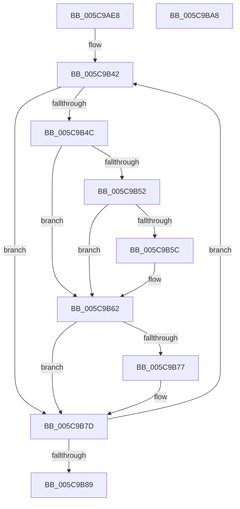

# KiComputePartialSharedReadyQueueAssignments

- RVA: `0x005C9AE8`–`0x005C9BA9` (길이 `193` bytes)
- VA: `0x00000001405C9AE8`
- 실행 섹션: `.text`
- PDB 이름 있음: `예`; PDB Function 태그: `아니요`
- unwind 정보 RVA: `0x000BE338`
- 디코드: `60`개 명령, `193/193` bytes 표시
- 미해석 바이트: `0` (있으면 어셈블리에 `.byte`로 보존)

> 이 문서는 커널 이미지의 기계어와 PDB 기호를 분석해 생성했습니다. 4번과 5번은 함수 원형과 자료형을 바이너리 사용 방식에서 추정한 C 해석이며 원본 소스 복구 결과는 아닙니다.

## 1. Dependencies

- 직접 호출 지점: **2**; 고유 호출 대상: **2**
- 직접 호출자로 확인된 함수: **1**
- RIP 상대 이미지 참조: **1**

### Outgoing calls
- `0x005C9B19` → [memset](../6C/memset_function_006C6C40.md) (function, `0x006C6C40`)
- `0x005C9B91` → [_security_check_cookie](../6A/_security_check_cookie_function_006AC640.md) (function, `0x006AC640`)

### Direct callers
- [KiComputeSharedReadyQueueAssignments](KiComputeSharedReadyQueueAssignments_function_005C9BB0.md) at `0x005C9C4F`

### Static image references
- `0x005C9AF7` → RVA `0x00E0A740` (`.data`; read)

## 2. Other-region calls and transfers

- 다른 실행 섹션으로 향하는 call: **0**
- 별도 외부 분기/꼬리 이동을 확인하지 못했습니다.

## 3. Assembly (complete function range)

```asm
005C9AE8  48 89 5C 24 08                  mov qword ptr [rsp + 8], rbx
005C9AED  48 89 74 24 10                  mov qword ptr [rsp + 0x10], rsi
005C9AF2  57                              push rdi
005C9AF3  48 83 EC 70                     sub rsp, 0x70
005C9AF7  48 8B 05 42 0C 84 00            mov rax, qword ptr [rip + 0x840c42]
005C9AFE  48 33 C4                        xor rax, rsp
005C9B01  48 89 44 24 60                  mov qword ptr [rsp + 0x60], rax
005C9B06  8B DA                           mov ebx, edx
005C9B08  49 8B F8                        mov rdi, r8
005C9B0B  33 D2                           xor edx, edx
005C9B0D  48 8B F1                        mov rsi, rcx
005C9B10  48 8D 4C 24 20                  lea rcx, [rsp + 0x20]
005C9B15  44 8D 42 40                     lea r8d, [rdx + 0x40]
005C9B19  E8 22 D1 0F 00                  call 0x1406c6c40
005C9B1E  F3 4C 0F B8 CE                  popcnt r9, rsi
005C9B23  33 D2                           xor edx, edx
005C9B25  8D 43 FF                        lea eax, [rbx - 1]
005C9B28  41 03 C1                        add eax, r9d
005C9B2B  45 33 D2                        xor r10d, r10d
005C9B2E  F7 F3                           div ebx
005C9B30  33 D2                           xor edx, edx
005C9B32  8B C8                           mov ecx, eax
005C9B34  41 8B C1                        mov eax, r9d
005C9B37  F7 F1                           div ecx
005C9B39  41 B1 FF                        mov r9b, 0xff
005C9B3C  45 32 C0                        xor r8b, r8b
005C9B3F  44 8B D8                        mov r11d, eax
005C9B42  41 0F B6 C8                     movzx ecx, r8b
005C9B46  48 0F A3 CE                     bt rsi, rcx
005C9B4A  73 31                           jae 0x1405c9b7d
005C9B4C  41 80 F9 FF                     cmp r9b, 0xff
005C9B50  75 10                           jne 0x1405c9b62
005C9B52  45 8A C8                        mov r9b, r8b
005C9B55  45 8B D3                        mov r10d, r11d
005C9B58  85 D2                           test edx, edx
005C9B5A  74 06                           je 0x1405c9b62
005C9B5C  45 8D 53 01                     lea r10d, [r11 + 1]
005C9B60  FF CA                           dec edx
005C9B62  41 0F B6 C1                     movzx eax, r9b
005C9B66  44 88 0F                        mov byte ptr [rdi], r9b
005C9B69  FE 44 04 20                     inc byte ptr [rsp + rax + 0x20]
005C9B6D  0F B6 44 04 20                  movzx eax, byte ptr [rsp + rax + 0x20]
005C9B72  41 3B C2                        cmp eax, r10d
005C9B75  72 06                           jb 0x1405c9b7d
005C9B77  41 B1 FF                        mov r9b, 0xff
005C9B7A  45 33 D2                        xor r10d, r10d
005C9B7D  41 FE C0                        inc r8b
005C9B80  48 FF C7                        inc rdi
005C9B83  41 80 F8 40                     cmp r8b, 0x40
005C9B87  72 B9                           jb 0x1405c9b42
005C9B89  48 8B 4C 24 60                  mov rcx, qword ptr [rsp + 0x60]
005C9B8E  48 33 CC                        xor rcx, rsp
005C9B91  E8 AA 2A 0E 00                  call 0x1406ac640
005C9B96  4C 8D 5C 24 70                  lea r11, [rsp + 0x70]
005C9B9B  49 8B 5B 10                     mov rbx, qword ptr [r11 + 0x10]
005C9B9F  49 8B 73 18                     mov rsi, qword ptr [r11 + 0x18]
005C9BA3  49 8B E3                        mov rsp, r11
005C9BA6  5F                              pop rdi
005C9BA7  C3                              ret
005C9BA8  CC                              int3
```

## 4. C-style interpretation (structured pseudocode)

```c
__int64 __fastcall KiComputePartialSharedReadyQueueAssignments(__int64 a1, int a2, __int64 a3)
{
    __int64 result;
    __int64 v_r10;
    __int64 v_rdi;
    __int64 v_rsp;
    unsigned __int64 v_stack_m18;
    unsigned __int64 v_stack_m58;
    unsigned __int64 v_stack_m8;
    unsigned __int64 v_stack_p10;
    unsigned __int64 v_stack_p8;

    v_stack_p8 = v_rbx;
    v_stack_p10 = v_rsi;
    v_rsp = (v_rsp) - (112);
    result = (*(unsigned __int64 *)(v_rip + 8653890)) ^ (v_rsp);
    v_stack_m18 = result;
    a2 = 0;
    result = memset(v_stack_m58, a2, a2 + 64, a4);
    a2 = 0;
    result = (unsigned int)(((unsigned int)(a2) - 1) + ((unsigned int)(a4)));
    v_r10 = 0;
    a2 = 0;
    a3 = 0;
loc_005C9B42:
    if (condition_is_above_or_equal) goto loc_005C9B7D;
    if (255 != 255) goto loc_005C9B62;
    v_r10 = (unsigned int)((unsigned int)((unsigned int)((unsigned int)((unsigned int)((unsigned int)(a4))))));
    if (0 != 0) {
        v_r10 = (unsigned int)((unsigned int)((unsigned int)((unsigned int)(a4)))) + 1;
        a2 = (unsigned int)((a2) - 1);
    }
    *(unsigned __int8 *)(a3) = 0;
    if (((unsigned int)(*(unsigned __int8 *)(v_rsp + 0 * 1 + 32))) >= ((unsigned int)(v_r10))) {
        a4 = 255;
        v_r10 = 0;
    }
    a3 = (unsigned __int8)((a3) + 1);
    v_rdi = (a3) + 1;
    if (((unsigned __int8)(a3)) < 64) goto loc_005C9B42;
    a1 = (v_stack_m18) ^ (v_rsp);
    result = _security_check_cookie(a1, a2, a3, a4);
    return result;
}
```

## 5. (Beta) C Style

```c
int64_t KiComputePartialSharedReadyQueueAssignments(int64_t Arg1, void *Arg2, int64_t Arg3)
{
    uint8_t *arg2 = (uint8_t *)Arg2;

    int64_t result;
    int64_t local_r10;
    int64_t local_rdi;
    int64_t local_rsp;
    uint64_t v_stack_m18;
    uint64_t v_stack_m58;
    uint64_t v_stack_m8;
    uint64_t v_stack_p10;
    uint64_t v_stack_p8;

    v_stack_p8 = local_rbx;
    v_stack_p10 = local_rsi;
    local_rsp = (local_rsp) - (112);
    result = (*(uint64_t *)(v_rip + 0x840C42)) ^ (local_rsp);
    v_stack_m18 = result;
    Arg2 = 0;
    result = memset(v_stack_m58, Arg2, Arg2 + 64, a4);
    Arg2 = 0;
    result = (uint32_t)(((uint32_t)(Arg2) - 1) + ((uint32_t)(a4)));
    local_r10 = 0;
    Arg2 = 0;
    Arg3 = 0;
loc_005C9B42:
    if (condition_is_above_or_equal) goto loc_005C9B7D;
    if (255 != 255) goto loc_005C9B62;
    local_r10 = (uint32_t)((uint32_t)((uint32_t)((uint32_t)((uint32_t)((uint32_t)(a4))))));
    if (0 != 0) {
        local_r10 = (uint32_t)((uint32_t)((uint32_t)((uint32_t)(a4)))) + 1;
        Arg2 = (uint32_t)((Arg2) - 1);
    }
    *(uint8_t *)(Arg3) = 0;
    if (((uint32_t)(*(uint8_t *)(local_rsp + 0x0 * 1 + 0x20))) >= ((uint32_t)(local_r10))) {
        a4 = 255;
        local_r10 = 0;
    }
    Arg3 = (uint8_t)((Arg3) + 1);
    local_rdi = (Arg3) + 1;
    if (((uint8_t)(Arg3)) < 64) goto loc_005C9B42;
    Arg1 = (v_stack_m18) ^ (local_rsp);
    result = _security_check_cookie(Arg1, Arg2, Arg3, a4);
    return result;
}
```

### 관측된 메모리 오프셋

구조체 형식이 확인되지 않은 접근은 인자 기준의 오프셋으로만 기록했습니다.

| 기준 인자 | 오프셋 표현 | 폭 (bit) | 접근 |
|---|---:|---:|---|
| `Arg2` | `- 0x1` | `32` | `R` |

## 6. Execution-region graph

[열기: 2D/3D 그래프와 함수 탐색 컨트롤 패널](../../../control-panel.html?section=text&rva=0x005C9AE8&view=graph)

- 2D 그래프는 위에서 아래로 흐르고, 3D 그래프는 빈 공간을 드래그해 회전합니다. Shift+드래그는 이동, 휠은 확대·축소, 함수 노드 선택은 대상 보고서 이동입니다.

### Static fallback


