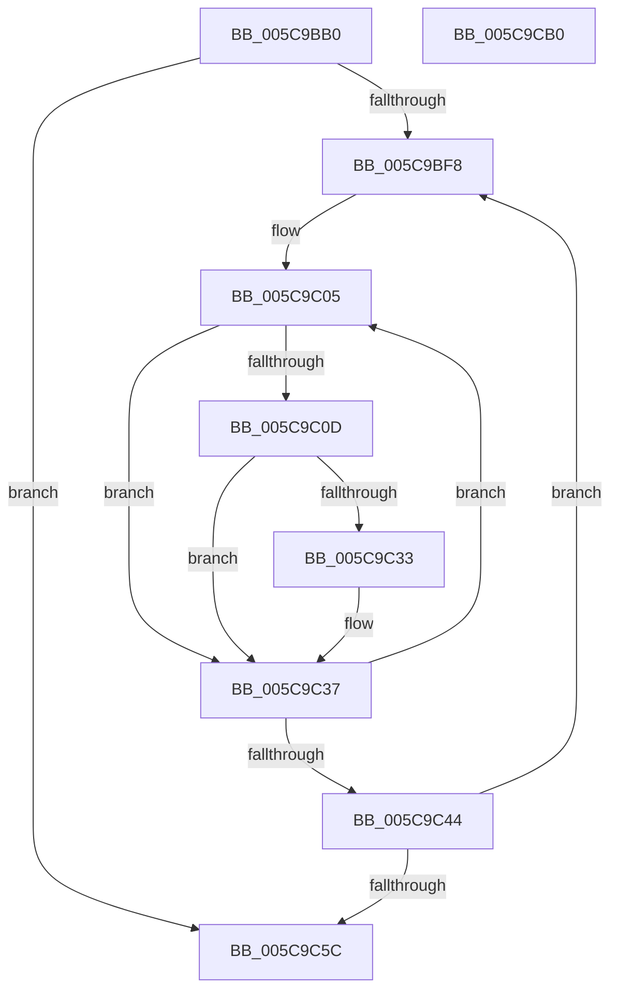

# KiComputeSharedReadyQueueAssignments

- RVA: `0x005C9BB0`–`0x005C9CB1` (길이 `257` bytes)
- VA: `0x00000001405C9BB0`
- 실행 섹션: `.text`
- PDB 이름 있음: `예`; PDB Function 태그: `아니요`
- unwind 정보 RVA: `0x000CB2B0`
- 디코드: `78`개 명령, `257/257` bytes 표시
- 미해석 바이트: `0` (있으면 어셈블리에 `.byte`로 보존)

> 이 문서는 커널 이미지의 기계어와 PDB 기호를 분석해 생성했습니다. 4번과 5번은 함수 원형과 자료형을 바이너리 사용 방식에서 추정한 C 해석이며 원본 소스 복구 결과는 아닙니다.

## 1. Dependencies

- 직접 호출 지점: **4**; 고유 호출 대상: **4**
- 직접 호출자로 확인된 함수: **1**
- RIP 상대 이미지 참조: **1**

### Outgoing calls
- `0x005C9BEB` → [memset](../6C/memset_function_006C6C40.md) (function, `0x006C6C40`)
- `0x005C9C4F` → [KiComputePartialSharedReadyQueueAssignments](KiComputePartialSharedReadyQueueAssignments_function_005C9AE8.md) (function, `0x005C9AE8`)
- `0x005C9C67` → [KiMergeSmallSharedReadyQueueAssignments](KiMergeSmallSharedReadyQueueAssignments_function_005CA460.md) (function, `0x005CA460`)
- `0x005C9C97` → [_security_check_cookie](../6A/_security_check_cookie_function_006AC640.md) (function, `0x006AC640`)

### Direct callers
- [KiAssignSubNodeSharedReadyQueues](../5B/KiAssignSubNodeSharedReadyQueues_function_005B737C.md) at `0x005B745F`

### Static image references
- `0x005C9BC0` → RVA `0x00E0A740` (`.data`; read)

## 2. Other-region calls and transfers

- 다른 실행 섹션으로 향하는 call: **0**
- 별도 외부 분기/꼬리 이동을 확인하지 못했습니다.

## 3. Assembly (complete function range)

```asm
005C9BB0  48 89 5C 24 08                  mov qword ptr [rsp + 8], rbx
005C9BB5  55                              push rbp
005C9BB6  56                              push rsi
005C9BB7  57                              push rdi
005C9BB8  41 56                           push r14
005C9BBA  41 57                           push r15
005C9BBC  48 83 EC 70                     sub rsp, 0x70
005C9BC0  48 8B 05 79 0B 84 00            mov rax, qword ptr [rip + 0x840b79]
005C9BC7  48 33 C4                        xor rax, rsp
005C9BCA  48 89 44 24 60                  mov qword ptr [rsp + 0x60], rax
005C9BCF  4D 8B F8                        mov r15, r8
005C9BD2  44 8B F2                        mov r14d, edx
005C9BD5  48 8B E9                        mov rbp, rcx
005C9BD8  BA FF 00 00 00                  mov edx, 0xff
005C9BDD  41 B8 40 00 00 00               mov r8d, 0x40
005C9BE3  48 8D 4C 24 20                  lea rcx, [rsp + 0x20]
005C9BE8  49 8B F9                        mov rdi, r9
005C9BEB  E8 50 D0 0F 00                  call 0x1406c6c40
005C9BF0  48 8B F5                        mov rsi, rbp
005C9BF3  48 85 ED                        test rbp, rbp
005C9BF6  74 64                           je 0x1405c9c5c
005C9BF8  33 DB                           xor ebx, ebx
005C9BFA  33 D2                           xor edx, edx
005C9BFC  45 33 C0                        xor r8d, r8d
005C9BFF  41 B2 FF                        mov r10b, 0xff
005C9C02  4D 8B CF                        mov r9, r15
005C9C05  8B C2                           mov eax, edx
005C9C07  48 0F A3 C6                     bt rsi, rax
005C9C0B  73 2A                           jae 0x1405c9c37
005C9C0D  41 0F B6 09                     movzx ecx, byte ptr [r9]
005C9C11  41 3A CA                        cmp cl, r10b
005C9C14  41 0F B6 C2                     movzx eax, r10b
005C9C18  44 8B D9                        mov r11d, ecx
005C9C1B  44 0F 43 D8                     cmovae r11d, eax
005C9C1F  33 C0                           xor eax, eax
005C9C21  41 3A CA                        cmp cl, r10b
005C9C24  45 8A D3                        mov r10b, r11b
005C9C27  48 0F 43 C3                     cmovae rax, rbx
005C9C2B  48 8B D8                        mov rbx, rax
005C9C2E  41 3A CB                        cmp cl, r11b
005C9C31  75 04                           jne 0x1405c9c37
005C9C33  4C 0F AB C3                     bts rbx, r8
005C9C37  FF C2                           inc edx
005C9C39  49 FF C0                        inc r8
005C9C3C  49 FF C1                        inc r9
005C9C3F  83 FA 40                        cmp edx, 0x40
005C9C42  72 C1                           jb 0x1405c9c05
005C9C44  4C 8D 44 24 20                  lea r8, [rsp + 0x20]
005C9C49  41 8B D6                        mov edx, r14d
005C9C4C  48 8B CB                        mov rcx, rbx
005C9C4F  E8 94 FE FF FF                  call 0x1405c9ae8
005C9C54  48 F7 D3                        not rbx
005C9C57  48 23 F3                        and rsi, rbx
005C9C5A  75 9C                           jne 0x1405c9bf8
005C9C5C  4C 8D 44 24 20                  lea r8, [rsp + 0x20]
005C9C61  41 8B D6                        mov edx, r14d
005C9C64  48 8B CD                        mov rcx, rbp
005C9C67  E8 F4 07 00 00                  call 0x1405ca460
005C9C6C  0F 28 44 24 20                  movaps xmm0, xmmword ptr [rsp + 0x20]
005C9C71  0F 28 4C 24 30                  movaps xmm1, xmmword ptr [rsp + 0x30]
005C9C76  0F 11 07                        movups xmmword ptr [rdi], xmm0
005C9C79  0F 28 44 24 40                  movaps xmm0, xmmword ptr [rsp + 0x40]
005C9C7E  0F 11 4F 10                     movups xmmword ptr [rdi + 0x10], xmm1
005C9C82  0F 28 4C 24 50                  movaps xmm1, xmmword ptr [rsp + 0x50]
005C9C87  0F 11 47 20                     movups xmmword ptr [rdi + 0x20], xmm0
005C9C8B  0F 11 4F 30                     movups xmmword ptr [rdi + 0x30], xmm1
005C9C8F  48 8B 4C 24 60                  mov rcx, qword ptr [rsp + 0x60]
005C9C94  48 33 CC                        xor rcx, rsp
005C9C97  E8 A4 29 0E 00                  call 0x1406ac640
005C9C9C  48 8B 9C 24 A0 00 00 00         mov rbx, qword ptr [rsp + 0xa0]
005C9CA4  48 83 C4 70                     add rsp, 0x70
005C9CA8  41 5F                           pop r15
005C9CAA  41 5E                           pop r14
005C9CAC  5F                              pop rdi
005C9CAD  5E                              pop rsi
005C9CAE  5D                              pop rbp
005C9CAF  C3                              ret
005C9CB0  CC                              int3
```

## 4. C-style interpretation (structured pseudocode)

```c
__int64 __fastcall KiComputeSharedReadyQueueAssignments(__int64 a1, int a2, __int64 a3, __int64 a4)
{
    __int64 result;
    __int64 v_r11;
    __int64 v_rbx;
    __int64 v_rsi;
    __int64 v_rsp;
    unsigned __int64 v_stack_m38;
    unsigned __int64 v_stack_m48;
    unsigned __int64 v_stack_m58;
    unsigned __int64 v_stack_m68;
    unsigned __int64 v_stack_m78;
    unsigned __int64 v_stack_p8;

    v_stack_p8 = v_rbx;
    v_rsp = (v_rsp) - (112);
    result = (*(unsigned __int64 *)(v_rip + 8653689)) ^ (v_rsp);
    v_stack_m38 = result;
    result = memset(v_stack_m78, 255, 64, a4);
    if (a1 == 0) goto loc_005C9C5C;
loc_005C9BF8:
    v_rbx = 0;
    a2 = 0;
    a3 = 0;
loc_005C9C05:
    if (condition_is_above_or_equal) goto loc_005C9C37;
    v_r11 = (unsigned int)((unsigned int)(*(unsigned __int8 *)(0)));
    if (((unsigned __int8)(*(unsigned __int8 *)(0))) >= 255) { v_r11 = 255; }
    result = 0;
    if (((unsigned __int8)(*(unsigned __int8 *)(0))) >= 255) { result = 0; }
    if (((unsigned __int8)(*(unsigned __int8 *)(0))) == ((unsigned __int8)(v_r11))) {
    }
    a2 = (unsigned int)((a2) + 1);
    a3 = (a3) + 1;
    a4 = (0) + 1;
    if (a2 < 64) goto loc_005C9C05;
    result = KiComputePartialSharedReadyQueueAssignments(result, (unsigned int)((unsigned int)((unsigned int)(a2))), v_stack_m78, a4);
    v_rbx = ~(result);
    v_rsi = (a1) & (v_rbx);
    if (condition_is_not_equal) goto loc_005C9BF8;
loc_005C9C5C:
    result = KiMergeSmallSharedReadyQueueAssignments(a1, (unsigned int)((unsigned int)((unsigned int)(a2))), v_stack_m78, a4);
    *(unsigned __int64 *)(a4) = v_xmm0;
    *(unsigned __int64 *)(a4 + 16) = v_xmm1;
    *(unsigned __int64 *)(a4 + 32) = v_xmm0;
    *(unsigned __int64 *)(a4 + 48) = v_xmm1;
    a1 = (v_stack_m38) ^ (v_rsp);
    result = _security_check_cookie(a1, (unsigned int)((unsigned int)((unsigned int)(a2))), v_stack_m78, a4);
    v_rsp = (v_rsp) + (112);
    return result;
}
```

## 5. (Beta) C Style

```c
int64_t KiComputeSharedReadyQueueAssignments(int64_t Arg1, int32_t Arg2, int64_t Arg3, void *Arg4)
{
    uint8_t *arg4 = (uint8_t *)Arg4;

    int64_t result;
    int64_t local_r11;
    int64_t local_rbx;
    int64_t local_rsi;
    int64_t local_rsp;
    uint64_t v_stack_m38;
    uint64_t v_stack_m48;
    uint64_t v_stack_m58;
    uint64_t v_stack_m68;
    uint64_t v_stack_m78;
    uint64_t v_stack_p8;

    v_stack_p8 = local_rbx;
    local_rsp = (local_rsp) - (112);
    result = (*(uint64_t *)(v_rip + 0x840B79)) ^ (local_rsp);
    v_stack_m38 = result;
    result = memset(v_stack_m78, 255, 64, Arg4);
    if (Arg1 == 0) goto loc_005C9C5C;
loc_005C9BF8:
    local_rbx = 0;
    Arg2 = 0;
    Arg3 = 0;
loc_005C9C05:
    if (condition_is_above_or_equal) goto loc_005C9C37;
    local_r11 = (uint32_t)((uint32_t)(*(uint8_t *)(0)));
    if (((uint8_t)(*(uint8_t *)(0))) >= 255) { local_r11 = 255; }
    result = 0;
    if (((uint8_t)(*(uint8_t *)(0))) >= 255) { result = 0; }
    if (((uint8_t)(*(uint8_t *)(0))) == ((uint8_t)(local_r11))) {
    }
    Arg2 = (uint32_t)((Arg2) + 1);
    Arg3 = (Arg3) + 1;
    Arg4 = (0) + 1;
    if (Arg2 < 64) goto loc_005C9C05;
    result = KiComputePartialSharedReadyQueueAssignments(result, (uint32_t)((uint32_t)((uint32_t)(Arg2))), v_stack_m78, Arg4);
    local_rbx = ~(result);
    local_rsi = (Arg1) & (local_rbx);
    if (condition_is_not_equal) goto loc_005C9BF8;
loc_005C9C5C:
    result = KiMergeSmallSharedReadyQueueAssignments(Arg1, (uint32_t)((uint32_t)((uint32_t)(Arg2))), v_stack_m78, Arg4);
    *(uint64_t *)(arg4) = v_xmm0;
    *(uint64_t *)(arg4 + 0x10) = v_xmm1;
    *(uint64_t *)(arg4 + 0x20) = v_xmm0;
    *(uint64_t *)(arg4 + 0x30) = v_xmm1;
    Arg1 = (v_stack_m38) ^ (local_rsp);
    result = _security_check_cookie(Arg1, (uint32_t)((uint32_t)((uint32_t)(Arg2))), v_stack_m78, Arg4);
    local_rsp = (local_rsp) + (112);
    return result;
}
```

### 관측된 메모리 오프셋

구조체 형식이 확인되지 않은 접근은 인자 기준의 오프셋으로만 기록했습니다.

| 기준 인자 | 오프셋 표현 | 폭 (bit) | 접근 |
|---|---:|---:|---|
| `Arg4` | `+ 0x0` | `128` | `R` |
| `Arg4` | `+ 0x10` | `128` | `R` |
| `Arg4` | `+ 0x20` | `128` | `R` |
| `Arg4` | `+ 0x30` | `128` | `R` |

## 6. Execution-region graph

[열기: 2D/3D 그래프와 함수 탐색 컨트롤 패널](../../../control-panel.html?section=text&rva=0x005C9BB0&view=graph)

- 2D 그래프는 위에서 아래로 흐르고, 3D 그래프는 빈 공간을 드래그해 회전합니다. Shift+드래그는 이동, 휠은 확대·축소, 함수 노드 선택은 대상 보고서 이동입니다.

### Static fallback


