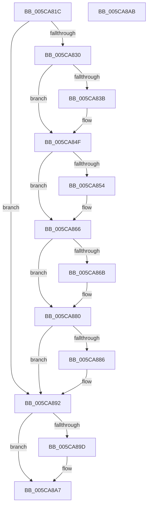

# KiComputeThreadPriorityNonStacking

- RVA: `0x005CA81C`–`0x005CA8AC` (길이 `144` bytes)
- VA: `0x00000001405CA81C`
- 실행 섹션: `.text`
- PDB 이름 있음: `예`; PDB Function 태그: `아니요`
- unwind 정보 RVA: `0x000DB714`
- 디코드: `39`개 명령, `144/144` bytes 표시
- 미해석 바이트: `0` (있으면 어셈블리에 `.byte`로 보존)

> 이 문서는 커널 이미지의 기계어와 PDB 기호를 분석해 생성했습니다. 4번과 5번은 함수 원형과 자료형을 바이너리 사용 방식에서 추정한 C 해석이며 원본 소스 복구 결과는 아닙니다.

## 1. Dependencies

- 직접 호출 지점: **0**; 고유 호출 대상: **0**
- 직접 호출자로 확인된 함수: **13**
- RIP 상대 이미지 참조: **0**

### Outgoing calls
- 직접 디코드된 call 명령이 없습니다.

### Direct callers
- [sub_002099FA](../20/Unknown_function_002099FA.md) at `0x00209C17`
- [sub_0020C2D4](../20/Unknown_function_0020C2D4.md) at `0x0020C96A`
- [sub_0020C2D4](../20/Unknown_function_0020C2D4.md) at `0x0020CAF0`
- [KeWaitForSingleObject](../20/KeWaitForSingleObject_function_0020E6B0.md) at `0x0020F081`
- [KeWaitForSingleObject](../20/KeWaitForSingleObject_function_0020E6B0.md) at `0x0020F473`
- [sub_00210E15](../21/Unknown_function_00210E15.md) at `0x00210E79`
- [sub_0021C0DA](../21/Unknown_function_0021C0DA.md) at `0x0021C1A5`
- [KiWakePriQueueWaiter](../21/KiWakePriQueueWaiter_function_0021F720.md) at `0x0021F862`
- [sub_002202B6](../22/Unknown_function_002202B6.md) at `0x002203AA`
- [sub_0022053D](../22/Unknown_function_0022053D.md) at `0x0022061F`
- [KiFastExitThreadWait](../22/KiFastExitThreadWait_function_00220BB0.md) at `0x00220DC1`
- [sub_00352D10](../35/Unknown_function_00352D10.md) at `0x00352DE7`
- [KeAdjustWobPriority](../39/KeAdjustWobPriority_function_00393570.md) at `0x0039374B`
- [KiClearPriorityFloor](../39/KiClearPriorityFloor_function_00396314.md) at `0x0039647E`
- [KiComputeThreadPriority](../3C/KiComputeThreadPriority_function_003C45F4.md) at `0x003C4632`

### Static image references
- 디코드된 RIP-relative 메모리 참조가 없습니다.

## 2. Other-region calls and transfers

- 다른 실행 섹션으로 향하는 call: **0**
- 별도 외부 분기/꼬리 이동을 확인하지 못했습니다.

## 3. Assembly (complete function range)

```asm
005CA81C  44 0F BE 91 33 02 00 00         movsx r10d, byte ptr [rcx + 0x233]
005CA824  4C 8B C9                        mov r9, rcx
005CA827  45 8B C2                        mov r8d, r10d
005CA82A  41 83 FA 10                     cmp r10d, 0x10
005CA82E  7D 62                           jge 0x1405ca892
005CA830  41 BB 0F 00 00 00               mov r11d, 0xf
005CA836  F6 C2 01                        test dl, 1
005CA839  75 14                           jne 0x1405ca84f
005CA83B  0F B7 89 06 02 00 00            movzx ecx, word ptr [rcx + 0x206]
005CA842  41 23 CB                        and ecx, r11d
005CA845  41 03 CA                        add ecx, r10d
005CA848  41 3B CA                        cmp ecx, r10d
005CA84B  44 0F 4F C1                     cmovg r8d, ecx
005CA84F  F6 C2 04                        test dl, 4
005CA852  75 12                           jne 0x1405ca866
005CA854  41 0F BE 89 66 03 00 00         movsx ecx, byte ptr [r9 + 0x366]
005CA85C  41 03 CA                        add ecx, r10d
005CA85F  41 3B C8                        cmp ecx, r8d
005CA862  44 0F 4F C1                     cmovg r8d, ecx
005CA866  F6 C2 02                        test dl, 2
005CA869  75 15                           jne 0x1405ca880
005CA86B  41 0F B7 81 06 02 00 00         movzx eax, word ptr [r9 + 0x206]
005CA873  C1 E8 04                        shr eax, 4
005CA876  0F B6 C8                        movzx ecx, al
005CA879  41 3B C8                        cmp ecx, r8d
005CA87C  44 0F 4F C1                     cmovg r8d, ecx
005CA880  41 83 F8 10                     cmp r8d, 0x10
005CA884  7C 0C                           jl 0x1405ca892
005CA886  41 F7 41 78 00 00 40 00         test dword ptr [r9 + 0x78], 0x400000
005CA88E  45 0F 44 C3                     cmove r8d, r11d
005CA892  41 8B 81 58 03 00 00            mov eax, dword ptr [r9 + 0x358]
005CA899  85 C0                           test eax, eax
005CA89B  74 0A                           je 0x1405ca8a7
005CA89D  0F BD C8                        bsr ecx, eax
005CA8A0  44 3B C1                        cmp r8d, ecx
005CA8A3  44 0F 4C C1                     cmovl r8d, ecx
005CA8A7  41 8B C0                        mov eax, r8d
005CA8AA  C3                              ret
005CA8AB  CC                              int3
```

## 4. C-style interpretation (structured pseudocode)

```c
__int64 __fastcall KiComputeThreadPriorityNonStacking(__int64 a1, unsigned __int8 a2)
{
    __int64 result;

    if (((unsigned int)((__int8)(*(unsigned __int8 *)(a1 + 563)))) >= 16) goto loc_005CA892;
    if (((a2) & (1)) == 0) {
        a1 = *(unsigned __int16 *)(a1 + 518);
        a1 = (unsigned int)((a1) & (15));
        a1 = (unsigned int)((a1) + ((unsigned int)((__int8)(*(unsigned __int8 *)(a1 + 563)))));
        a3 = (unsigned int)((unsigned int)((__int8)(*(unsigned __int8 *)(a1 + 563))));
        if (((unsigned int)(a1)) > ((unsigned int)((__int8)(*(unsigned __int8 *)(a1 + 563))))) { a3 = (unsigned int)(a1); }
    }
    if (((a2) & (4)) == 0) {
        a1 = (__int8)(*(unsigned __int8 *)(a1 + 870));
        a1 = (unsigned int)((a1) + ((unsigned int)((__int8)(*(unsigned __int8 *)(a1 + 563)))));
        if (((unsigned int)(a1)) > ((unsigned int)(a3))) { a3 = (unsigned int)(a1); }
    }
    if (((a2) & (2)) == 0) {
        result = *(unsigned __int16 *)(a1 + 518);
        result = (unsigned int)((result) >> (4));
        a1 = (unsigned __int8)(result);
        if (((unsigned int)(a1)) > ((unsigned int)(a3))) { a3 = (unsigned int)(a1); }
    }
    if (((unsigned int)(a3)) >= 16) {
        if (((*(unsigned int *)(a1 + 120)) & (0x400000ULL)) == 0) { a3 = 15; }
    }
    if ((unsigned int)((unsigned int)(*(unsigned int *)(a1 + 856))) != 0) {
        if (((unsigned int)(a3)) < ((unsigned int)(a1))) { a3 = (unsigned int)(a1); }
    }
    return (unsigned int)((unsigned int)(a3));
}
```

## 5. (Beta) C Style

```c
int64_t KiComputeThreadPriorityNonStacking(void *Arg1, uint8_t Arg2)
{
    uint8_t *arg1 = (uint8_t *)Arg1;

    int64_t result;

    if (((uint32_t)((int8_t)(*(uint8_t *)(arg1 + 0x233)))) >= 16) goto loc_005CA892;
    if (((Arg2) & (1)) == 0) {
        Arg1 = *(uint16_t *)(arg1 + 0x206);
        Arg1 = (uint32_t)((Arg1) & (15));
        Arg1 = (uint32_t)((Arg1) + ((uint32_t)((int8_t)(*(uint8_t *)(arg1 + 0x233)))));
        a3 = (uint32_t)((uint32_t)((int8_t)(*(uint8_t *)(arg1 + 0x233))));
        if (((uint32_t)(Arg1)) > ((uint32_t)((int8_t)(*(uint8_t *)(arg1 + 0x233))))) { a3 = (uint32_t)(Arg1); }
    }
    if (((Arg2) & (4)) == 0) {
        Arg1 = (int8_t)(*(uint8_t *)(arg1 + 0x366));
        Arg1 = (uint32_t)((Arg1) + ((uint32_t)((int8_t)(*(uint8_t *)(arg1 + 0x233)))));
        if (((uint32_t)(Arg1)) > ((uint32_t)(a3))) { a3 = (uint32_t)(Arg1); }
    }
    if (((Arg2) & (2)) == 0) {
        result = *(uint16_t *)(arg1 + 0x206);
        result = (uint32_t)((result) >> (4));
        Arg1 = (uint8_t)(result);
        if (((uint32_t)(Arg1)) > ((uint32_t)(a3))) { a3 = (uint32_t)(Arg1); }
    }
    if (((uint32_t)(a3)) >= 16) {
        if (((*(uint32_t *)(arg1 + 0x78)) & (0x400000ULL)) == 0) { a3 = 15; }
    }
    if ((uint32_t)((uint32_t)(*(uint32_t *)(arg1 + 0x358))) != 0) {
        if (((uint32_t)(a3)) < ((uint32_t)(Arg1))) { a3 = (uint32_t)(Arg1); }
    }
    return (uint32_t)((uint32_t)(a3));
}
```

### 관측된 메모리 오프셋

구조체 형식이 확인되지 않은 접근은 인자 기준의 오프셋으로만 기록했습니다.

| 기준 인자 | 오프셋 표현 | 폭 (bit) | 접근 |
|---|---:|---:|---|
| `Arg1` | `+ 0x78` | `32` | `R` |
| `Arg1` | `+ 0x206` | `16` | `R` |
| `Arg1` | `+ 0x233` | `8` | `R` |
| `Arg1` | `+ 0x358` | `32` | `R` |
| `Arg1` | `+ 0x366` | `8` | `R` |

## 6. Execution-region graph

[열기: 2D/3D 그래프와 함수 탐색 컨트롤 패널](../../../control-panel.html?section=text&rva=0x005CA81C&view=graph)

- 2D 그래프는 위에서 아래로 흐르고, 3D 그래프는 빈 공간을 드래그해 회전합니다. Shift+드래그는 이동, 휠은 확대·축소, 함수 노드 선택은 대상 보고서 이동입니다.

### Static fallback


