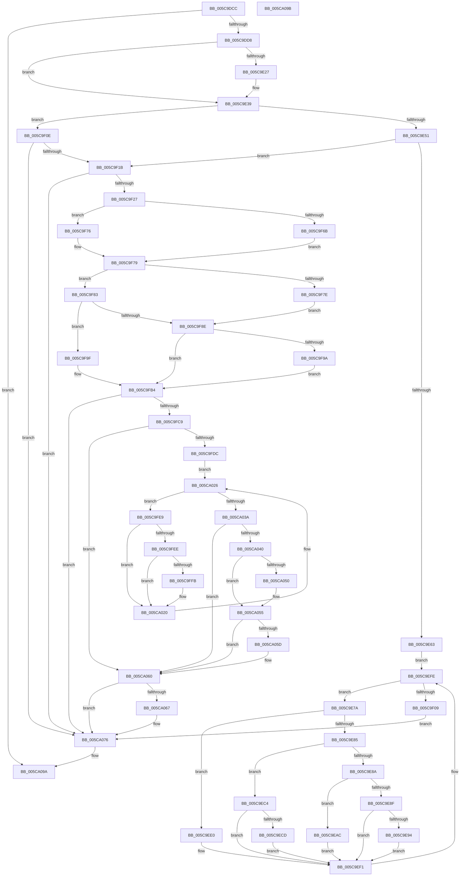

# KiComputeTopologyConstantsAmd

- RVA: `0x005C9DCC`–`0x005CA09C` (길이 `720` bytes)
- VA: `0x00000001405C9DCC`
- 실행 섹션: `.text`
- PDB 이름 있음: `예`; PDB Function 태그: `아니요`
- unwind 정보 RVA: `0x000CB22C`
- 디코드: `227`개 명령, `720/720` bytes 표시
- 미해석 바이트: `0` (있으면 어셈블리에 `.byte`로 보존)

> 이 문서는 커널 이미지의 기계어와 PDB 기호를 분석해 생성했습니다. 4번과 5번은 함수 원형과 자료형을 바이너리 사용 방식에서 추정한 C 해석이며 원본 소스 복구 결과는 아닙니다.

## 1. Dependencies

- 직접 호출 지점: **3**; 고유 호출 대상: **2**
- 직접 호출자로 확인된 함수: **1**
- RIP 상대 이미지 참조: **1**

### Outgoing calls
- `0x005C9EC4` → [Feature_PpmParkEx__private_IsEnabledNoReportingNoInline](../4F/Feature_PpmParkEx__private_IsEnabledNoReportingNoInline_function_004F40E0.md) (function, `0x004F40E0`)
- `0x005C9FBC` → [Feature_PpmParkEx__private_IsEnabledNoReportingNoInline](../4F/Feature_PpmParkEx__private_IsEnabledNoReportingNoInline_function_004F40E0.md) (function, `0x004F40E0`)
- `0x005CA07D` → [_security_check_cookie](../6A/_security_check_cookie_function_006AC640.md) (function, `0x006AC640`)

### Direct callers
- [KiComputeTopologyConstants](KiComputeTopologyConstants_function_005C9CB8.md) at `0x005C9D05`

### Static image references
- `0x005C9DF3` → RVA `0x00E0A740` (`.data`; read)

## 2. Other-region calls and transfers

- 다른 실행 섹션으로 향하는 call: **0**
- 별도 외부 분기/꼬리 이동을 확인하지 못했습니다.

## 3. Assembly (complete function range)

```asm
005C9DCC  81 F9 08 00 00 80               cmp ecx, 0x80000008
005C9DD2  0F 82 C2 02 00 00               jb 0x1405ca09a
005C9DD8  48 89 5C 24 08                  mov qword ptr [rsp + 8], rbx
005C9DDD  48 89 74 24 10                  mov qword ptr [rsp + 0x10], rsi
005C9DE2  48 89 7C 24 18                  mov qword ptr [rsp + 0x18], rdi
005C9DE7  55                              push rbp
005C9DE8  41 56                           push r14
005C9DEA  41 57                           push r15
005C9DEC  48 8B EC                        mov rbp, rsp
005C9DEF  48 83 EC 40                     sub rsp, 0x40
005C9DF3  48 8B 05 46 09 84 00            mov rax, qword ptr [rip + 0x840946]
005C9DFA  48 33 C4                        xor rax, rsp
005C9DFD  48 89 45 F8                     mov qword ptr [rbp - 8], rax
005C9E01  49 8B F9                        mov rdi, r9
005C9E04  B8 08 00 00 80                  mov eax, 0x80000008
005C9E09  44 8B C9                        mov r9d, ecx
005C9E0C  4C 8B DA                        mov r11, rdx
005C9E0F  33 C9                           xor ecx, ecx
005C9E11  4D 8B D0                        mov r10, r8
005C9E14  0F A2                           cpuid
005C9E16  44 8B C1                        mov r8d, ecx
005C9E19  41 BE 01 00 00 00               mov r14d, 1
005C9E1F  C1 E9 0C                        shr ecx, 0xc
005C9E22  83 E1 0F                        and ecx, 0xf
005C9E25  75 12                           jne 0x1405c9e39
005C9E27  83 65 E0 00                     and dword ptr [rbp - 0x20], 0
005C9E2B  41 0F B6 C0                     movzx eax, r8b
005C9E2F  8D 04 45 01 00 00 00            lea eax, [rax*2 + 1]
005C9E36  0F BD C8                        bsr ecx, eax
005C9E39  83 0F 02                        or dword ptr [rdi], 2
005C9E3C  41 8B C6                        mov eax, r14d
005C9E3F  D3 E0                           shl eax, cl
005C9E41  89 47 0C                        mov dword ptr [rdi + 0xc], eax
005C9E44  41 81 F9 26 00 00 80            cmp r9d, 0x80000026
005C9E4B  0F 82 BD 00 00 00               jb 0x1405c9f0e
005C9E51  33 C9                           xor ecx, ecx
005C9E53  B8 26 00 00 80                  mov eax, 0x80000026
005C9E58  0F A2                           cpuid
005C9E5A  66 85 DB                        test bx, bx
005C9E5D  0F 84 B8 00 00 00               je 0x1405c9f1b
005C9E63  33 C9                           xor ecx, ecx
005C9E65  B8 26 00 00 80                  mov eax, 0x80000026
005C9E6A  0F A2                           cpuid
005C9E6C  45 33 FF                        xor r15d, r15d
005C9E6F  89 57 18                        mov dword ptr [rdi + 0x18], edx
005C9E72  83 0F 10                        or dword ptr [rdi], 0x10
005C9E75  E9 84 00 00 00                  jmp 0x1405c9efe
005C9E7A  C1 E9 08                        shr ecx, 8
005C9E7D  0F B6 C1                        movzx eax, cl
005C9E80  83 E8 01                        sub eax, 1
005C9E83  74 5B                           je 0x1405c9ee0
005C9E85  83 E8 01                        sub eax, 1
005C9E88  74 3A                           je 0x1405c9ec4
005C9E8A  83 E8 01                        sub eax, 1
005C9E8D  74 1D                           je 0x1405c9eac
005C9E8F  83 F8 01                        cmp eax, 1
005C9E92  75 5D                           jne 0x1405c9ef1
005C9E94  83 E6 1F                        and esi, 0x1f
005C9E97  33 D2                           xor edx, edx
005C9E99  40 8A CE                        mov cl, sil
005C9E9C  41 8B C6                        mov eax, r14d
005C9E9F  D3 E0                           shl eax, cl
005C9EA1  F7 77 08                        div dword ptr [rdi + 8]
005C9EA4  83 0F 02                        or dword ptr [rdi], 2
005C9EA7  89 47 0C                        mov dword ptr [rdi + 0xc], eax
005C9EAA  EB 45                           jmp 0x1405c9ef1
005C9EAC  83 E6 1F                        and esi, 0x1f
005C9EAF  33 D2                           xor edx, edx
005C9EB1  40 8A CE                        mov cl, sil
005C9EB4  41 8B C6                        mov eax, r14d
005C9EB7  D3 E0                           shl eax, cl
005C9EB9  F7 77 08                        div dword ptr [rdi + 8]
005C9EBC  83 0F 04                        or dword ptr [rdi], 4
005C9EBF  89 47 10                        mov dword ptr [rdi + 0x10], eax
005C9EC2  EB 2D                           jmp 0x1405c9ef1
005C9EC4  E8 17 A2 F2 FF                  call 0x1404f40e0
005C9EC9  85 C0                           test eax, eax
005C9ECB  74 24                           je 0x1405c9ef1
005C9ECD  83 E6 1F                        and esi, 0x1f
005C9ED0  41 8B C6                        mov eax, r14d
005C9ED3  40 8A CE                        mov cl, sil
005C9ED6  D3 E0                           shl eax, cl
005C9ED8  83 0F 20                        or dword ptr [rdi], 0x20
005C9EDB  89 47 1C                        mov dword ptr [rdi + 0x1c], eax
005C9EDE  EB 11                           jmp 0x1405c9ef1
005C9EE0  83 E6 1F                        and esi, 0x1f
005C9EE3  41 8B C6                        mov eax, r14d
005C9EE6  40 8A CE                        mov cl, sil
005C9EE9  D3 E0                           shl eax, cl
005C9EEB  44 09 37                        or dword ptr [rdi], r14d
005C9EEE  89 47 08                        mov dword ptr [rdi + 8], eax
005C9EF1  45 03 FE                        add r15d, r14d
005C9EF4  B8 26 00 00 80                  mov eax, 0x80000026
005C9EF9  41 8B CF                        mov ecx, r15d
005C9EFC  0F A2                           cpuid
005C9EFE  8B F0                           mov esi, eax
005C9F00  66 85 DB                        test bx, bx
005C9F03  0F 85 71 FF FF FF               jne 0x1405c9e7a
005C9F09  E9 68 01 00 00                  jmp 0x1405ca076
005C9F0E  41 81 F9 1E 00 00 80            cmp r9d, 0x8000001e
005C9F15  0F 82 5B 01 00 00               jb 0x1405ca076
005C9F1B  41 0F BA 62 08 16               bt dword ptr [r10 + 8], 0x16
005C9F21  0F 83 4F 01 00 00               jae 0x1405ca076
005C9F27  44 8B 17                        mov r10d, dword ptr [rdi]
005C9F2A  33 C9                           xor ecx, ecx
005C9F2C  B8 1E 00 00 80                  mov eax, 0x8000001e
005C9F31  0F A2                           cpuid
005C9F33  C1 EB 08                        shr ebx, 8
005C9F36  8B F0                           mov esi, eax
005C9F38  8B 47 0C                        mov eax, dword ptr [rdi + 0xc]
005C9F3B  33 D2                           xor edx, edx
005C9F3D  0F B6 DB                        movzx ebx, bl
005C9F40  44 8B C1                        mov r8d, ecx
005C9F43  FF C3                           inc ebx
005C9F45  41 8B CA                        mov ecx, r10d
005C9F48  F7 F3                           div ebx
005C9F4A  83 C9 03                        or ecx, 3
005C9F4D  89 5F 08                        mov dword ptr [rdi + 8], ebx
005C9F50  8B D8                           mov ebx, eax
005C9F52  89 47 0C                        mov dword ptr [rdi + 0xc], eax
005C9F55  41 8B 03                        mov eax, dword ptr [r11]
005C9F58  44 8B C8                        mov r9d, eax
005C9F5B  41 C1 E9 08                     shr r9d, 8
005C9F5F  41 83 E1 0F                     and r9d, 0xf
005C9F63  89 0F                           mov dword ptr [rdi], ecx
005C9F65  41 83 F9 0F                     cmp r9d, 0xf
005C9F69  75 0B                           jne 0x1405c9f76
005C9F6B  C1 E8 14                        shr eax, 0x14
005C9F6E  0F B6 D0                        movzx edx, al
005C9F71  41 03 D1                        add edx, r9d
005C9F74  EB 03                           jmp 0x1405c9f79
005C9F76  41 8B D1                        mov edx, r9d
005C9F79  83 FA 17                        cmp edx, 0x17
005C9F7C  75 05                           jne 0x1405c9f83
005C9F7E  83 C9 04                        or ecx, 4
005C9F81  EB 0B                           jmp 0x1405c9f8e
005C9F83  41 8B CA                        mov ecx, r10d
005C9F86  83 C9 07                        or ecx, 7
005C9F89  83 FA 19                        cmp edx, 0x19
005C9F8C  75 11                           jne 0x1405c9f9f
005C9F8E  C7 47 10 08 00 00 00            mov dword ptr [rdi + 0x10], 8
005C9F95  83 FB 08                        cmp ebx, 8
005C9F98  73 1A                           jae 0x1405c9fb4
005C9F9A  89 5F 10                        mov dword ptr [rdi + 0x10], ebx
005C9F9D  EB 15                           jmp 0x1405c9fb4
005C9F9F  41 C1 E8 08                     shr r8d, 8
005C9FA3  33 D2                           xor edx, edx
005C9FA5  41 83 E0 07                     and r8d, 7
005C9FA9  8B C3                           mov eax, ebx
005C9FAB  45 03 C6                        add r8d, r14d
005C9FAE  41 F7 F0                        div r8d
005C9FB1  89 47 10                        mov dword ptr [rdi + 0x10], eax
005C9FB4  83 C9 10                        or ecx, 0x10
005C9FB7  89 77 18                        mov dword ptr [rdi + 0x18], esi
005C9FBA  89 0F                           mov dword ptr [rdi], ecx
005C9FBC  E8 1F A1 F2 FF                  call 0x1404f40e0
005C9FC1  85 C0                           test eax, eax
005C9FC3  0F 84 AD 00 00 00               je 0x1405ca076
005C9FC9  33 C9                           xor ecx, ecx
005C9FCB  B8 01 00 00 80                  mov eax, 0x80000001
005C9FD0  0F A2                           cpuid
005C9FD2  0F BA E1 16                     bt ecx, 0x16
005C9FD6  0F 83 84 00 00 00               jae 0x1405ca060
005C9FDC  45 33 C9                        xor r9d, r9d
005C9FDF  41 BA 1D 00 00 80               mov r10d, 0x8000001d
005C9FE5  33 C9                           xor ecx, ecx
005C9FE7  EB 3D                           jmp 0x1405ca026
005C9FE9  83 F9 03                        cmp ecx, 3
005C9FEC  75 32                           jne 0x1405ca020
005C9FEE  41 8B C0                        mov eax, r8d
005C9FF1  25 E0 00 00 00                  and eax, 0xe0
005C9FF6  83 F8 60                        cmp eax, 0x60
005C9FF9  77 25                           ja 0x1405ca020
005C9FFB  83 65 E0 00                     and dword ptr [rbp - 0x20], 0
005C9FFF  41 C1 E8 0E                     shr r8d, 0xe
005CA003  41 81 E0 FF 0F 00 00            and r8d, 0xfff
005CA00A  42 8D 04 45 01 00 00 00         lea eax, [r8*2 + 1]
005CA012  0F BD C8                        bsr ecx, eax
005CA015  41 8B C6                        mov eax, r14d
005CA018  D3 E0                           shl eax, cl
005CA01A  83 0F 20                        or dword ptr [rdi], 0x20
005CA01D  89 47 1C                        mov dword ptr [rdi + 0x1c], eax
005CA020  45 03 CE                        add r9d, r14d
005CA023  41 8B C9                        mov ecx, r9d
005CA026  41 8B C2                        mov eax, r10d
005CA029  0F A2                           cpuid
005CA02B  8B C8                           mov ecx, eax
005CA02D  44 8B C0                        mov r8d, eax
005CA030  C1 E1 1B                        shl ecx, 0x1b
005CA033  C1 F9 1B                        sar ecx, 0x1b
005CA036  85 C9                           test ecx, ecx
005CA038  75 AF                           jne 0x1405c9fe9
005CA03A  8B 07                           mov eax, dword ptr [rdi]
005CA03C  A8 20                           test al, 0x20
005CA03E  74 20                           je 0x1405ca060
005CA040  8B 47 08                        mov eax, dword ptr [rdi + 8]
005CA043  8B C8                           mov ecx, eax
005CA045  0F AF 4F 10                     imul ecx, dword ptr [rdi + 0x10]
005CA049  8B 57 1C                        mov edx, dword ptr [rdi + 0x1c]
005CA04C  3B D1                           cmp edx, ecx
005CA04E  76 05                           jbe 0x1405ca055
005CA050  89 4F 1C                        mov dword ptr [rdi + 0x1c], ecx
005CA053  8B D1                           mov edx, ecx
005CA055  0F AF 47 0C                     imul eax, dword ptr [rdi + 0xc]
005CA059  3B D0                           cmp edx, eax
005CA05B  76 03                           jbe 0x1405ca060
005CA05D  89 47 1C                        mov dword ptr [rdi + 0x1c], eax
005CA060  8B 0F                           mov ecx, dword ptr [rdi]
005CA062  F6 C1 20                        test cl, 0x20
005CA065  75 0F                           jne 0x1405ca076
005CA067  8B 47 10                        mov eax, dword ptr [rdi + 0x10]
005CA06A  0F AF 47 08                     imul eax, dword ptr [rdi + 8]
005CA06E  83 C9 20                        or ecx, 0x20
005CA071  89 0F                           mov dword ptr [rdi], ecx
005CA073  89 47 1C                        mov dword ptr [rdi + 0x1c], eax
005CA076  48 8B 4D F8                     mov rcx, qword ptr [rbp - 8]
005CA07A  48 33 CC                        xor rcx, rsp
005CA07D  E8 BE 25 0E 00                  call 0x1406ac640
005CA082  48 8B 5C 24 60                  mov rbx, qword ptr [rsp + 0x60]
005CA087  48 8B 74 24 68                  mov rsi, qword ptr [rsp + 0x68]
005CA08C  48 8B 7C 24 70                  mov rdi, qword ptr [rsp + 0x70]
005CA091  48 83 C4 40                     add rsp, 0x40
005CA095  41 5F                           pop r15
005CA097  41 5E                           pop r14
005CA099  5D                              pop rbp
005CA09A  C3                              ret
005CA09B  CC                              int3
```

## 4. C-style interpretation (structured pseudocode)

```c
__int64 __fastcall KiComputeTopologyConstantsAmd(int a1, __int64 a2, __int64 a3, __int64 a4)
{
    __int64 result;
    __int64 v_r15;
    __int64 v_rbx;
    __int64 v_rsi;
    __int64 v_rsp;
    unsigned __int64 v_stack_m20;
    unsigned int v_stack_m38;
    unsigned __int64 v_stack_p10;
    unsigned __int64 v_stack_p18;
    unsigned __int64 v_stack_p8;

    if (a1 < 0x80000008ULL) goto loc_005CA09A;
    v_stack_p8 = v_rbx;
    v_stack_p10 = v_rsi;
    v_stack_p18 = v_rdi;
    v_rsp = (v_rsp) - (64);
    result = (*(unsigned __int64 *)(v_rip + 8653126)) ^ (v_rsp);
    v_stack_m20 = result;
    a1 = 0;
    a1 = (unsigned int)((a1) >> (12));
    a1 = (unsigned int)((a1) & (15));
    result = (unsigned int)(0x80000008ULL);
    if (!(condition_is_not_equal)) {
        result = 0;
        result = result * 2 + 1;
    }
    result = (unsigned int)((1) << ((unsigned __int8)(a1)));
    *(unsigned int *)(a4 + 12) = (unsigned int)(result);
    if (((unsigned int)((unsigned int)(a1))) < 0x80000026ULL) goto loc_005C9F0E;
    a1 = 0;
    if ((unsigned __int16)(v_rbx) == 0) goto loc_005C9F1B;
    a1 = 0;
    v_r15 = 0;
    *(unsigned int *)(a4 + 24) = (unsigned int)(a2);
    goto loc_005C9EFE;
loc_005C9E7A:
    a1 = (unsigned int)((a1) >> (8));
    result = (unsigned int)(((unsigned __int8)(a1)) - (1));
    if (condition_is_equal) goto loc_005C9EE0;
    result = (unsigned int)((result) - (1));
    if (condition_is_equal) goto loc_005C9EC4;
    result = (unsigned int)((result) - (1));
    if (condition_is_equal) goto loc_005C9EAC;
    if (((unsigned int)(result)) != 1) goto loc_005C9EF1;
    v_rsi = (unsigned int)((v_rsi) & (31));
    a2 = 0;
    result = (unsigned int)((1) << ((unsigned __int8)((unsigned __int8)(v_rsi))));
    *(unsigned int *)(a4 + 12) = (unsigned int)(result);
    goto loc_005C9EF1;
loc_005C9EAC:
    v_rsi = (unsigned int)((v_rsi) & (31));
    a2 = 0;
    result = (unsigned int)((1) << ((unsigned __int8)((unsigned __int8)(v_rsi))));
    *(unsigned int *)(a4 + 16) = (unsigned int)(result);
    goto loc_005C9EF1;
loc_005C9EC4:
    result = Feature_PpmParkEx__private_IsEnabledNoReportingNoInline((unsigned __int8)(v_rsi), a2, 0, (unsigned int)(a1));
    if ((unsigned int)(result) == 0) goto loc_005C9EF1;
    v_rsi = (unsigned int)((v_rsi) & (31));
    result = (unsigned int)((1) << ((unsigned __int8)((unsigned __int8)(v_rsi))));
    *(unsigned int *)(a4 + 28) = (unsigned int)(result);
    goto loc_005C9EF1;
loc_005C9EE0:
    v_rsi = (unsigned int)((v_rsi) & (31));
    result = (unsigned int)((1) << ((unsigned __int8)((unsigned __int8)(v_rsi))));
    *(unsigned int *)(a4 + 8) = (unsigned int)(result);
loc_005C9EF1:
    v_r15 = (unsigned int)((v_r15) + (1));
loc_005C9EFE:
    if ((unsigned __int16)(v_rbx) != 0) goto loc_005C9E7A;
    goto loc_005CA076;
loc_005C9F0E:
    if (((unsigned int)((unsigned int)(a1))) < 0x8000001EULL) goto loc_005CA076;
loc_005C9F1B:
    if (((unsigned int)((unsigned int)(a1))) >= 0x8000001EULL) goto loc_005CA076;
    a1 = 0;
    v_rbx = (unsigned int)((v_rbx) >> (8));
    a2 = 0;
    v_rbx = (unsigned int)(((unsigned __int8)(v_rbx)) + 1);
    a1 = (unsigned int)(((unsigned int)((unsigned int)((unsigned int)(*(unsigned int *)(a4))))) | (3));
    *(unsigned int *)(a4 + 8) = (unsigned int)(v_rbx);
    *(unsigned int *)(a4 + 12) = (unsigned int)((unsigned int)(*(unsigned int *)(a4 + 12)));
    a4 = (unsigned int)(((unsigned int)((unsigned int)((unsigned int)(*(unsigned int *)(a2))))) >> (8));
    a4 = (unsigned int)((a4) & (15));
    *(unsigned int *)(a4) = a1;
    if (((unsigned int)(a4)) != 15) goto loc_005C9F76;
    result = (unsigned int)(((unsigned int)(*(unsigned int *)(a2))) >> (20));
    a2 = (unsigned int)(((unsigned __int8)(result)) + ((unsigned int)(a4)));
    goto loc_005C9F79;
loc_005C9F76:
loc_005C9F79:
    if (((unsigned int)((unsigned int)((unsigned int)(a4)))) != 23) goto loc_005C9F83;
    a1 = (unsigned int)((a1) | (4));
    goto loc_005C9F8E;
loc_005C9F83:
    a1 = (unsigned int)(((unsigned int)((unsigned int)((unsigned int)(*(unsigned int *)(a4))))) | (7));
    if (((unsigned int)((unsigned int)((unsigned int)(a4)))) != 25) goto loc_005C9F9F;
loc_005C9F8E:
    *(unsigned int *)(a4 + 16) = 8;
    if (((unsigned int)((unsigned int)((unsigned int)((unsigned int)(*(unsigned int *)(a4 + 12)))))) >= 8) goto loc_005C9FB4;
    *(unsigned int *)(a4 + 16) = (unsigned int)((unsigned int)((unsigned int)((unsigned int)(*(unsigned int *)(a4 + 12)))));
    goto loc_005C9FB4;
loc_005C9F9F:
    a3 = (unsigned int)((0) >> (8));
    a2 = 0;
    a3 = (unsigned int)((a3) & (7));
    a3 = (unsigned int)((a3) + (1));
    *(unsigned int *)(a4 + 16) = (unsigned int)((unsigned int)((unsigned int)((unsigned int)((unsigned int)((unsigned int)(*(unsigned int *)(a4 + 12)))))));
loc_005C9FB4:
    a1 = (unsigned int)((a1) | (16));
    *(unsigned int *)(a4 + 24) = (unsigned int)((unsigned int)((unsigned int)((unsigned int)(0x8000001EULL))));
    *(unsigned int *)(a4) = a1;
    result = Feature_PpmParkEx__private_IsEnabledNoReportingNoInline(a1, a2, a3, a4);
    if ((unsigned int)(result) == 0) goto loc_005CA076;
    a1 = 0;
    if (condition_is_above_or_equal) goto loc_005CA060;
    a4 = 0;
    a1 = 0;
    goto loc_005CA026;
loc_005C9FE9:
    if (0 != 3) goto loc_005CA020;
    result = (unsigned int)(((unsigned int)((unsigned int)(a3))) & (224));
    if (((unsigned int)(result)) <= 96) {
        a3 = (unsigned int)((a3) >> (14));
        a3 = (unsigned int)((a3) & (0xFFFULL));
        result = a3 * 2 + 1;
        result = 1;
        result = (unsigned int)((result) << (0));
        *(unsigned int *)(a4 + 28) = (unsigned int)(result);
    }
    a4 = (unsigned int)((a4) + (1));
loc_005CA026:
    a1 = (unsigned int)(((unsigned int)((unsigned int)((unsigned int)((unsigned int)((unsigned int)(0x8000001DULL)))))) << (27));
    a1 = (unsigned int)((a1) >> (27));
    if (a1 != 0) goto loc_005C9FE9;
    if ((((unsigned __int8)((unsigned int)(*(unsigned int *)(a4)))) & (32)) == 0) goto loc_005CA060;
    a1 = (unsigned int)(((unsigned int)((unsigned int)((unsigned int)(*(unsigned int *)(a4 + 8))))) * (*(unsigned int *)(a4 + 16)));
    if (((unsigned int)((unsigned int)(*(unsigned int *)(a4 + 28)))) >= = a1) {
        *(unsigned int *)(a4 + 28) = a1;
        a2 = a1;
    }
    result = (unsigned int)(((unsigned int)(*(unsigned int *)(a4 + 8))) * (*(unsigned int *)(a4 + 12)));
    if (((unsigned int)(a2)) >= = ((unsigned int)(result))) {
        *(unsigned int *)(a4 + 28) = (unsigned int)(result);
    }
    if ((((unsigned __int8)((unsigned int)(*(unsigned int *)(a4)))) & (32)) == 0) {
        result = *(unsigned int *)(a4 + 16);
        result = (unsigned int)((result) * (*(unsigned int *)(a4 + 8)));
        a1 = (unsigned int)(((unsigned int)(*(unsigned int *)(a4))) | (32));
        *(unsigned int *)(a4) = a1;
        *(unsigned int *)(a4 + 28) = (unsigned int)(result);
    }
    a1 = (v_stack_m20) ^ (v_rsp);
    result = _security_check_cookie(a1, a2, (unsigned int)((unsigned int)((unsigned int)((unsigned int)((unsigned int)(0x8000001DULL))))), a4);
    v_rsp = (v_rsp) + (64);
loc_005CA09A:
    return result;
}
```

## 5. (Beta) C Style

```c
int64_t KiComputeTopologyConstantsAmd(int32_t Arg1, void *Arg2, void *Arg3, void *Arg4)
{
    uint8_t *arg2 = (uint8_t *)Arg2;
    uint8_t *arg3 = (uint8_t *)Arg3;
    uint8_t *arg4 = (uint8_t *)Arg4;

    int64_t result;
    int64_t local_r15;
    int64_t local_rbx;
    int64_t local_rsi;
    int64_t local_rsp;
    uint64_t v_stack_m20;
    uint32_t v_stack_m38;
    uint64_t v_stack_p10;
    uint64_t v_stack_p18;
    uint64_t v_stack_p8;

    if (Arg1 < 0x80000008ULL) goto loc_005CA09A;
    v_stack_p8 = local_rbx;
    v_stack_p10 = local_rsi;
    v_stack_p18 = local_rdi;
    local_rsp = (local_rsp) - (64);
    result = (*(uint64_t *)(v_rip + 0x840946)) ^ (local_rsp);
    v_stack_m20 = result;
    Arg1 = 0;
    Arg1 = (uint32_t)((Arg1) >> (12));
    Arg1 = (uint32_t)((Arg1) & (15));
    result = (uint32_t)(0x80000008ULL);
    if (!(condition_is_not_equal)) {
        result = 0;
        result = result * 2 + 1;
    }
    result = (uint32_t)((1) << ((uint8_t)(Arg1)));
    *(uint32_t *)(arg4 + 0xC) = (uint32_t)(result);
    if (((uint32_t)((uint32_t)(Arg1))) < 0x80000026ULL) goto loc_005C9F0E;
    Arg1 = 0;
    if ((uint16_t)(local_rbx) == 0) goto loc_005C9F1B;
    Arg1 = 0;
    local_r15 = 0;
    *(uint32_t *)(arg4 + 0x18) = (uint32_t)(Arg2);
    goto loc_005C9EFE;
loc_005C9E7A:
    Arg1 = (uint32_t)((Arg1) >> (8));
    result = (uint32_t)(((uint8_t)(Arg1)) - (1));
    if (condition_is_equal) goto loc_005C9EE0;
    result = (uint32_t)((result) - (1));
    if (condition_is_equal) goto loc_005C9EC4;
    result = (uint32_t)((result) - (1));
    if (condition_is_equal) goto loc_005C9EAC;
    if (((uint32_t)(result)) != 1) goto loc_005C9EF1;
    local_rsi = (uint32_t)((local_rsi) & (31));
    Arg2 = 0;
    result = (uint32_t)((1) << ((uint8_t)((uint8_t)(local_rsi))));
    *(uint32_t *)(arg4 + 0xC) = (uint32_t)(result);
    goto loc_005C9EF1;
loc_005C9EAC:
    local_rsi = (uint32_t)((local_rsi) & (31));
    Arg2 = 0;
    result = (uint32_t)((1) << ((uint8_t)((uint8_t)(local_rsi))));
    *(uint32_t *)(arg4 + 0x10) = (uint32_t)(result);
    goto loc_005C9EF1;
loc_005C9EC4:
    result = Feature_PpmParkEx__private_IsEnabledNoReportingNoInline((uint8_t)(local_rsi), Arg2, 0, (uint32_t)(Arg1));
    if ((uint32_t)(result) == 0) goto loc_005C9EF1;
    local_rsi = (uint32_t)((local_rsi) & (31));
    result = (uint32_t)((1) << ((uint8_t)((uint8_t)(local_rsi))));
    *(uint32_t *)(arg4 + 0x1C) = (uint32_t)(result);
    goto loc_005C9EF1;
loc_005C9EE0:
    local_rsi = (uint32_t)((local_rsi) & (31));
    result = (uint32_t)((1) << ((uint8_t)((uint8_t)(local_rsi))));
    *(uint32_t *)(arg4 + 0x8) = (uint32_t)(result);
loc_005C9EF1:
    local_r15 = (uint32_t)((local_r15) + (1));
loc_005C9EFE:
    if ((uint16_t)(local_rbx) != 0) goto loc_005C9E7A;
    goto loc_005CA076;
loc_005C9F0E:
    if (((uint32_t)((uint32_t)(Arg1))) < 0x8000001EULL) goto loc_005CA076;
loc_005C9F1B:
    if (((uint32_t)((uint32_t)(Arg1))) >= 0x8000001EULL) goto loc_005CA076;
    Arg1 = 0;
    local_rbx = (uint32_t)((local_rbx) >> (8));
    Arg2 = 0;
    local_rbx = (uint32_t)(((uint8_t)(local_rbx)) + 1);
    Arg1 = (uint32_t)(((uint32_t)((uint32_t)((uint32_t)(*(uint32_t *)(arg4))))) | (3));
    *(uint32_t *)(arg4 + 0x8) = (uint32_t)(local_rbx);
    *(uint32_t *)(arg4 + 0xC) = (uint32_t)((uint32_t)(*(uint32_t *)(arg4 + 0xC)));
    Arg4 = (uint32_t)(((uint32_t)((uint32_t)((uint32_t)(*(uint32_t *)(arg2))))) >> (8));
    Arg4 = (uint32_t)((Arg4) & (15));
    *(uint32_t *)(arg4) = Arg1;
    if (((uint32_t)(Arg4)) != 15) goto loc_005C9F76;
    result = (uint32_t)(((uint32_t)(*(uint32_t *)(arg2))) >> (20));
    Arg2 = (uint32_t)(((uint8_t)(result)) + ((uint32_t)(Arg4)));
    goto loc_005C9F79;
loc_005C9F76:
loc_005C9F79:
    if (((uint32_t)((uint32_t)((uint32_t)(Arg4)))) != 23) goto loc_005C9F83;
    Arg1 = (uint32_t)((Arg1) | (4));
    goto loc_005C9F8E;
loc_005C9F83:
    Arg1 = (uint32_t)(((uint32_t)((uint32_t)((uint32_t)(*(uint32_t *)(arg4))))) | (7));
    if (((uint32_t)((uint32_t)((uint32_t)(Arg4)))) != 25) goto loc_005C9F9F;
loc_005C9F8E:
    *(uint32_t *)(arg4 + 0x10) = 8;
    if (((uint32_t)((uint32_t)((uint32_t)((uint32_t)(*(uint32_t *)(arg4 + 0xC)))))) >= 8) goto loc_005C9FB4;
    *(uint32_t *)(arg4 + 0x10) = (uint32_t)((uint32_t)((uint32_t)((uint32_t)(*(uint32_t *)(arg4 + 0xC)))));
    goto loc_005C9FB4;
loc_005C9F9F:
    Arg3 = (uint32_t)((0) >> (8));
    Arg2 = 0;
    Arg3 = (uint32_t)((Arg3) & (7));
    Arg3 = (uint32_t)((Arg3) + (1));
    *(uint32_t *)(arg4 + 0x10) = (uint32_t)((uint32_t)((uint32_t)((uint32_t)((uint32_t)((uint32_t)(*(uint32_t *)(arg4 + 0xC)))))));
loc_005C9FB4:
    Arg1 = (uint32_t)((Arg1) | (16));
    *(uint32_t *)(arg4 + 0x18) = (uint32_t)((uint32_t)((uint32_t)((uint32_t)(0x8000001EULL))));
    *(uint32_t *)(arg4) = Arg1;
    result = Feature_PpmParkEx__private_IsEnabledNoReportingNoInline(Arg1, Arg2, Arg3, Arg4);
    if ((uint32_t)(result) == 0) goto loc_005CA076;
    Arg1 = 0;
    if (condition_is_above_or_equal) goto loc_005CA060;
    Arg4 = 0;
    Arg1 = 0;
    goto loc_005CA026;
loc_005C9FE9:
    if (0 != 3) goto loc_005CA020;
    result = (uint32_t)(((uint32_t)((uint32_t)(Arg3))) & (224));
    if (((uint32_t)(result)) <= 96) {
        Arg3 = (uint32_t)((Arg3) >> (14));
        Arg3 = (uint32_t)((Arg3) & (0xFFFULL));
        result = Arg3 * 2 + 1;
        result = 1;
        result = (uint32_t)((result) << (0));
        *(uint32_t *)(arg4 + 0x1C) = (uint32_t)(result);
    }
    Arg4 = (uint32_t)((Arg4) + (1));
loc_005CA026:
    Arg1 = (uint32_t)(((uint32_t)((uint32_t)((uint32_t)((uint32_t)((uint32_t)(0x8000001DULL)))))) << (27));
    Arg1 = (uint32_t)((Arg1) >> (27));
    if (Arg1 != 0) goto loc_005C9FE9;
    if ((((uint8_t)((uint32_t)(*(uint32_t *)(arg4)))) & (32)) == 0) goto loc_005CA060;
    Arg1 = (uint32_t)(((uint32_t)((uint32_t)((uint32_t)(*(uint32_t *)(arg4 + 0x8))))) * (*(uint32_t *)(arg4 + 0x10)));
    if (((uint32_t)((uint32_t)(*(uint32_t *)(arg4 + 0x1C)))) >= = Arg1) {
        *(uint32_t *)(arg4 + 0x1C) = Arg1;
        Arg2 = Arg1;
    }
    result = (uint32_t)(((uint32_t)(*(uint32_t *)(arg4 + 0x8))) * (*(uint32_t *)(arg4 + 0xC)));
    if (((uint32_t)(Arg2)) >= = ((uint32_t)(result))) {
        *(uint32_t *)(arg4 + 0x1C) = (uint32_t)(result);
    }
    if ((((uint8_t)((uint32_t)(*(uint32_t *)(arg4)))) & (32)) == 0) {
        result = *(uint32_t *)(arg4 + 0x10);
        result = (uint32_t)((result) * (*(uint32_t *)(arg4 + 0x8)));
        Arg1 = (uint32_t)(((uint32_t)(*(uint32_t *)(arg4))) | (32));
        *(uint32_t *)(arg4) = Arg1;
        *(uint32_t *)(arg4 + 0x1C) = (uint32_t)(result);
    }
    Arg1 = (v_stack_m20) ^ (local_rsp);
    result = _security_check_cookie(Arg1, Arg2, (uint32_t)((uint32_t)((uint32_t)((uint32_t)((uint32_t)(0x8000001DULL))))), Arg4);
    local_rsp = (local_rsp) + (64);
loc_005CA09A:
    return result;
}
```

### 관측된 메모리 오프셋

구조체 형식이 확인되지 않은 접근은 인자 기준의 오프셋으로만 기록했습니다.

| 기준 인자 | 오프셋 표현 | 폭 (bit) | 접근 |
|---|---:|---:|---|
| `Arg2` | `+ 0x0` | `32` | `R` |
| `Arg3` | `+ 0x8` | `32` | `R` |
| `Arg4` | `+ 0x0` | `32` | `R` |
| `Arg4` | `+ 0x0` | `32` | `R/W` |
| `Arg4` | `+ 0x0` | `32` | `W` |
| `Arg4` | `+ 0x8` | `32` | `R` |
| `Arg4` | `+ 0x8` | `32` | `W` |
| `Arg4` | `+ 0xC` | `32` | `R` |
| `Arg4` | `+ 0xC` | `32` | `W` |
| `Arg4` | `+ 0x10` | `32` | `R` |
| `Arg4` | `+ 0x10` | `32` | `W` |
| `Arg4` | `+ 0x18` | `32` | `W` |
| `Arg4` | `+ 0x1C` | `32` | `R` |
| `Arg4` | `+ 0x1C` | `32` | `W` |

## 6. Execution-region graph

[열기: 2D/3D 그래프와 함수 탐색 컨트롤 패널](../../../control-panel.html?section=text&rva=0x005C9DCC&view=graph)

- 2D 그래프는 위에서 아래로 흐르고, 3D 그래프는 빈 공간을 드래그해 회전합니다. Shift+드래그는 이동, 휠은 확대·축소, 함수 노드 선택은 대상 보고서 이동입니다.

### Static fallback


