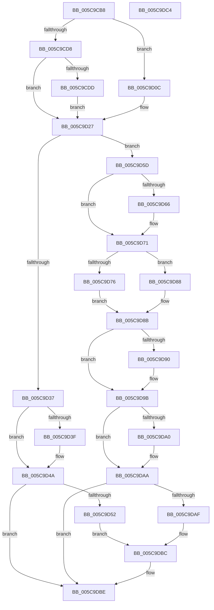

# KiComputeTopologyConstants

- RVA: `0x005C9CB8`–`0x005C9DC5` (길이 `269` bytes)
- VA: `0x00000001405C9CB8`
- 실행 섹션: `.text`
- PDB 이름 있음: `예`; PDB Function 태그: `아니요`
- unwind 정보 RVA: `0x000697A4`
- 디코드: `88`개 명령, `269/269` bytes 표시
- 미해석 바이트: `0` (있으면 어셈블리에 `.byte`로 보존)

> 이 문서는 커널 이미지의 기계어와 PDB 기호를 분석해 생성했습니다. 4번과 5번은 함수 원형과 자료형을 바이너리 사용 방식에서 추정한 C 해석이며 원본 소스 복구 결과는 아닙니다.

## 1. Dependencies

- 직접 호출 지점: **3**; 고유 호출 대상: **3**
- 직접 호출자로 확인된 함수: **1**
- RIP 상대 이미지 참조: **0**

### Outgoing calls
- `0x005C9D05` → [KiComputeTopologyConstantsAmd](KiComputeTopologyConstantsAmd_function_005C9DCC.md) (function, `0x005C9DCC`)
- `0x005C9D22` → [KiComputeTopologyConstantsIntelCompatible](KiComputeTopologyConstantsIntelCompatible_function_005CA0A4.md) (function, `0x005CA0A4`)
- `0x005C9D2C` → [Feature_PpmParkEx__private_IsEnabledNoReportingNoInline](../4F/Feature_PpmParkEx__private_IsEnabledNoReportingNoInline_function_004F40E0.md) (function, `0x004F40E0`)

### Direct callers
- [KiSetFeatureBits](../../pagelk/B6/KiSetFeatureBits_function_00B6A03C.md) at `0x00B6A4D3`

### Static image references
- 디코드된 RIP-relative 메모리 참조가 없습니다.

## 2. Other-region calls and transfers

- 다른 실행 섹션으로 향하는 call: **0**
- 별도 외부 분기/꼬리 이동을 확인하지 못했습니다.

## 3. Assembly (complete function range)

```asm
005C9CB8  40 53                           push rbx
005C9CBA  48 83 EC 40                     sub rsp, 0x40
005C9CBE  48 8B 5C 24 78                  mov rbx, qword ptr [rsp + 0x78]
005C9CC3  8D 41 FE                        lea eax, [rcx - 2]
005C9CC6  0F 57 C0                        xorps xmm0, xmm0
005C9CC9  45 8B D0                        mov r10d, r8d
005C9CCC  0F 11 03                        movups xmmword ptr [rbx], xmm0
005C9CCF  0F 11 43 10                     movups xmmword ptr [rbx + 0x10], xmm0
005C9CD3  83 F8 01                        cmp eax, 1
005C9CD6  76 34                           jbe 0x1405c9d0c
005C9CD8  83 F9 01                        cmp ecx, 1
005C9CDB  75 4A                           jne 0x1405c9d27
005C9CDD  41 0F 28 01                     movaps xmm0, xmmword ptr [r9]
005C9CE1  4C 8D 44 24 20                  lea r8, [rsp + 0x20]
005C9CE6  48 8B 44 24 70                  mov rax, qword ptr [rsp + 0x70]
005C9CEB  48 8D 54 24 30                  lea rdx, [rsp + 0x30]
005C9CF0  4C 8B CB                        mov r9, rbx
005C9CF3  66 0F 7F 44 24 20               movdqa xmmword ptr [rsp + 0x20], xmm0
005C9CF9  41 8B CA                        mov ecx, r10d
005C9CFC  0F 28 08                        movaps xmm1, xmmword ptr [rax]
005C9CFF  66 0F 7F 4C 24 30               movdqa xmmword ptr [rsp + 0x30], xmm1
005C9D05  E8 C2 00 00 00                  call 0x1405c9dcc
005C9D0A  EB 1B                           jmp 0x1405c9d27
005C9D0C  48 8B 44 24 70                  mov rax, qword ptr [rsp + 0x70]
005C9D11  4C 8D 44 24 30                  lea r8, [rsp + 0x30]
005C9D16  4C 8B CB                        mov r9, rbx
005C9D19  0F 28 00                        movaps xmm0, xmmword ptr [rax]
005C9D1C  66 0F 7F 44 24 30               movdqa xmmword ptr [rsp + 0x30], xmm0
005C9D22  E8 7D 03 00 00                  call 0x1405ca0a4
005C9D27  8B 03                           mov eax, dword ptr [rbx]
005C9D29  89 43 04                        mov dword ptr [rbx + 4], eax
005C9D2C  E8 AF A3 F2 FF                  call 0x1404f40e0
005C9D31  8B 0B                           mov ecx, dword ptr [rbx]
005C9D33  85 C0                           test eax, eax
005C9D35  75 26                           jne 0x1405c9d5d
005C9D37  8B C1                           mov eax, ecx
005C9D39  24 06                           and al, 6
005C9D3B  3C 02                           cmp al, 2
005C9D3D  75 0B                           jne 0x1405c9d4a
005C9D3F  8B 43 0C                        mov eax, dword ptr [rbx + 0xc]
005C9D42  83 C9 04                        or ecx, 4
005C9D45  89 0B                           mov dword ptr [rbx], ecx
005C9D47  89 43 10                        mov dword ptr [rbx + 0x10], eax
005C9D4A  8B C1                           mov eax, ecx
005C9D4C  24 09                           and al, 9
005C9D4E  3C 01                           cmp al, 1
005C9D50  75 6C                           jne 0x1405c9dbe
005C9D52  8B 43 08                        mov eax, dword ptr [rbx + 8]
005C9D55  83 C9 08                        or ecx, 8
005C9D58  89 43 14                        mov dword ptr [rbx + 0x14], eax
005C9D5B  EB 5F                           jmp 0x1405c9dbc
005C9D5D  48 8D 53 08                     lea rdx, [rbx + 8]
005C9D61  F6 C1 01                        test cl, 1
005C9D64  75 0B                           jne 0x1405c9d71
005C9D66  83 C9 01                        or ecx, 1
005C9D69  C7 02 01 00 00 00               mov dword ptr [rdx], 1
005C9D6F  89 0B                           mov dword ptr [rbx], ecx
005C9D71  F6 C1 02                        test cl, 2
005C9D74  75 12                           jne 0x1405c9d88
005C9D76  83 C9 02                        or ecx, 2
005C9D79  C7 43 0C 01 00 00 00            mov dword ptr [rbx + 0xc], 1
005C9D80  89 0B                           mov dword ptr [rbx], ecx
005C9D82  4C 8D 43 08                     lea r8, [rbx + 8]
005C9D86  EB 03                           jmp 0x1405c9d8b
005C9D88  4C 8B C2                        mov r8, rdx
005C9D8B  F6 C1 04                        test cl, 4
005C9D8E  75 0B                           jne 0x1405c9d9b
005C9D90  8B 43 0C                        mov eax, dword ptr [rbx + 0xc]
005C9D93  83 C9 04                        or ecx, 4
005C9D96  89 0B                           mov dword ptr [rbx], ecx
005C9D98  89 43 10                        mov dword ptr [rbx + 0x10], eax
005C9D9B  F6 C1 08                        test cl, 8
005C9D9E  75 0A                           jne 0x1405c9daa
005C9DA0  8B 02                           mov eax, dword ptr [rdx]
005C9DA2  83 C9 08                        or ecx, 8
005C9DA5  89 0B                           mov dword ptr [rbx], ecx
005C9DA7  89 43 14                        mov dword ptr [rbx + 0x14], eax
005C9DAA  F6 C1 20                        test cl, 0x20
005C9DAD  75 0F                           jne 0x1405c9dbe
005C9DAF  41 8B 00                        mov eax, dword ptr [r8]
005C9DB2  0F AF 43 10                     imul eax, dword ptr [rbx + 0x10]
005C9DB6  83 C9 20                        or ecx, 0x20
005C9DB9  89 43 1C                        mov dword ptr [rbx + 0x1c], eax
005C9DBC  89 0B                           mov dword ptr [rbx], ecx
005C9DBE  48 83 C4 40                     add rsp, 0x40
005C9DC2  5B                              pop rbx
005C9DC3  C3                              ret
005C9DC4  CC                              int3
```

## 4. C-style interpretation (structured pseudocode)

```c
__int64 __fastcall KiComputeTopologyConstants(__int64 a1, __int64 a2, int a3, __int64 a4, __int64 a5, __int64 a6)
{
    __int64 result;
    __int64 v_rsp;
    unsigned __int64 v_stack_m18;
    unsigned __int64 v_stack_m28;

    v_rsp = (v_rsp) - (64);
    *(unsigned __int64 *)(a6) = v_xmm0;
    *(unsigned __int64 *)(a6 + 16) = v_xmm0;
    if (((unsigned int)(a1 - 2)) <= 1) goto loc_005C9D0C;
    if (((unsigned int)(a1)) != 1) goto loc_005C9D27;
    v_stack_m28 = v_xmm0;
    v_stack_m18 = v_xmm1;
    result = KiComputeTopologyConstantsAmd((unsigned int)((unsigned int)((unsigned int)(a3))), v_stack_m18, v_stack_m28, a6);
    goto loc_005C9D27;
loc_005C9D0C:
    v_stack_m18 = v_xmm0;
    result = KiComputeTopologyConstantsIntelCompatible((unsigned int)((unsigned int)((unsigned int)(a3))), v_stack_m18, v_stack_m18, a6);
loc_005C9D27:
    *(unsigned int *)(a6 + 4) = (unsigned int)((unsigned int)(*(unsigned int *)(a6)));
    result = Feature_PpmParkEx__private_IsEnabledNoReportingNoInline((unsigned int)((unsigned int)((unsigned int)(a3))), v_stack_m18, v_stack_m18, a6);
    if ((unsigned int)(result) != 0) goto loc_005C9D5D;
    result = (unsigned __int8)(((unsigned int)((unsigned int)((unsigned int)(*(unsigned int *)(a6))))) & (6));
    if (((unsigned __int8)(result)) == 2) {
        result = *(unsigned int *)(a6 + 12);
        a1 = (unsigned int)(((unsigned int)(*(unsigned int *)(a6))) | (4));
        *(unsigned int *)(a6) = (unsigned int)(a1);
        *(unsigned int *)(a6 + 16) = (unsigned int)(result);
    }
    result = (unsigned __int8)(((unsigned int)((unsigned int)(a1))) & (9));
    if (((unsigned __int8)(result)) != 1) goto loc_005C9DBE;
    a1 = (unsigned int)((a1) | (8));
    *(unsigned int *)(a6 + 20) = (unsigned int)((unsigned int)(*(unsigned int *)(a6 + 8)));
    goto loc_005C9DBC;
loc_005C9D5D:
    if ((((unsigned __int8)(a1)) & (1)) == 0) {
        a1 = (unsigned int)((a1) | (1));
        *(unsigned int *)(a6 + 8) = 1;
        *(unsigned int *)(a6) = (unsigned int)(a1);
    }
    if ((((unsigned __int8)(a1)) & (2)) != 0) goto loc_005C9D88;
    a1 = (unsigned int)((a1) | (2));
    *(unsigned int *)(a6 + 12) = 1;
    *(unsigned int *)(a6) = (unsigned int)(a1);
    goto loc_005C9D8B;
loc_005C9D88:
loc_005C9D8B:
    result = (unsigned int)(*(unsigned int *)(a6 + 8));
    if ((((unsigned __int8)(a1)) & (4)) == 0) {
        result = *(unsigned int *)(a6 + 12);
        a1 = (unsigned int)((a1) | (4));
        *(unsigned int *)(a6) = (unsigned int)(a1);
        *(unsigned int *)(a6 + 16) = (unsigned int)(result);
    }
    if ((((unsigned __int8)(a1)) & (8)) == 0) {
        result = *(unsigned int *)(a6 + 8);
        a1 = (unsigned int)((a1) | (8));
        *(unsigned int *)(a6) = (unsigned int)(a1);
        *(unsigned int *)(a6 + 20) = (unsigned int)(result);
    }
    if ((((unsigned __int8)(a1)) & (32)) != 0) goto loc_005C9DBE;
    result = (unsigned int)(((unsigned int)(*(unsigned int *)(a6 + 8))) * (*(unsigned int *)(a6 + 16)));
    a1 = (unsigned int)((a1) | (32));
    *(unsigned int *)(a6 + 28) = (unsigned int)(result);
loc_005C9DBC:
    *(unsigned int *)(a6) = (unsigned int)(a1);
loc_005C9DBE:
    v_rsp = (v_rsp) + (64);
    return result;
}
```

## 5. (Beta) C Style

```c
int64_t KiComputeTopologyConstants(void *Arg1, int64_t Arg2, int32_t Arg3, void *Arg4, void *Arg5, void *Arg6)
{
    uint8_t *arg1 = (uint8_t *)Arg1;
    uint8_t *arg4 = (uint8_t *)Arg4;
    uint8_t *arg5 = (uint8_t *)Arg5;
    uint8_t *arg6 = (uint8_t *)Arg6;

    int64_t result;
    int64_t local_rsp;
    uint64_t v_stack_m18;
    uint64_t v_stack_m28;

    local_rsp = (local_rsp) - (64);
    *(uint64_t *)(arg6) = v_xmm0;
    *(uint64_t *)(arg6 + 0x10) = v_xmm0;
    if (((uint32_t)(Arg1 - 2)) <= 1) goto loc_005C9D0C;
    if (((uint32_t)(Arg1)) != 1) goto loc_005C9D27;
    v_stack_m28 = v_xmm0;
    v_stack_m18 = v_xmm1;
    result = KiComputeTopologyConstantsAmd((uint32_t)((uint32_t)((uint32_t)(Arg3))), v_stack_m18, v_stack_m28, Arg6);
    goto loc_005C9D27;
loc_005C9D0C:
    v_stack_m18 = v_xmm0;
    result = KiComputeTopologyConstantsIntelCompatible((uint32_t)((uint32_t)((uint32_t)(Arg3))), v_stack_m18, v_stack_m18, Arg6);
loc_005C9D27:
    *(uint32_t *)(arg6 + 0x4) = (uint32_t)((uint32_t)(*(uint32_t *)(arg6)));
    result = Feature_PpmParkEx__private_IsEnabledNoReportingNoInline((uint32_t)((uint32_t)((uint32_t)(Arg3))), v_stack_m18, v_stack_m18, Arg6);
    if ((uint32_t)(result) != 0) goto loc_005C9D5D;
    result = (uint8_t)(((uint32_t)((uint32_t)((uint32_t)(*(uint32_t *)(arg6))))) & (6));
    if (((uint8_t)(result)) == 2) {
        result = *(uint32_t *)(arg6 + 0xC);
        Arg1 = (uint32_t)(((uint32_t)(*(uint32_t *)(arg6))) | (4));
        *(uint32_t *)(arg6) = (uint32_t)(Arg1);
        *(uint32_t *)(arg6 + 0x10) = (uint32_t)(result);
    }
    result = (uint8_t)(((uint32_t)((uint32_t)(Arg1))) & (9));
    if (((uint8_t)(result)) != 1) goto loc_005C9DBE;
    Arg1 = (uint32_t)((Arg1) | (8));
    *(uint32_t *)(arg6 + 0x14) = (uint32_t)((uint32_t)(*(uint32_t *)(arg6 + 0x8)));
    goto loc_005C9DBC;
loc_005C9D5D:
    if ((((uint8_t)(Arg1)) & (1)) == 0) {
        Arg1 = (uint32_t)((Arg1) | (1));
        *(uint32_t *)(arg6 + 0x8) = 1;
        *(uint32_t *)(arg6) = (uint32_t)(Arg1);
    }
    if ((((uint8_t)(Arg1)) & (2)) != 0) goto loc_005C9D88;
    Arg1 = (uint32_t)((Arg1) | (2));
    *(uint32_t *)(arg6 + 0xC) = 1;
    *(uint32_t *)(arg6) = (uint32_t)(Arg1);
    goto loc_005C9D8B;
loc_005C9D88:
loc_005C9D8B:
    result = (uint32_t)(*(uint32_t *)(arg6 + 0x8));
    if ((((uint8_t)(Arg1)) & (4)) == 0) {
        result = *(uint32_t *)(arg6 + 0xC);
        Arg1 = (uint32_t)((Arg1) | (4));
        *(uint32_t *)(arg6) = (uint32_t)(Arg1);
        *(uint32_t *)(arg6 + 0x10) = (uint32_t)(result);
    }
    if ((((uint8_t)(Arg1)) & (8)) == 0) {
        result = *(uint32_t *)(arg6 + 0x8);
        Arg1 = (uint32_t)((Arg1) | (8));
        *(uint32_t *)(arg6) = (uint32_t)(Arg1);
        *(uint32_t *)(arg6 + 0x14) = (uint32_t)(result);
    }
    if ((((uint8_t)(Arg1)) & (32)) != 0) goto loc_005C9DBE;
    result = (uint32_t)(((uint32_t)(*(uint32_t *)(arg6 + 0x8))) * (*(uint32_t *)(arg6 + 0x10)));
    Arg1 = (uint32_t)((Arg1) | (32));
    *(uint32_t *)(arg6 + 0x1C) = (uint32_t)(result);
loc_005C9DBC:
    *(uint32_t *)(arg6) = (uint32_t)(Arg1);
loc_005C9DBE:
    local_rsp = (local_rsp) + (64);
    return result;
}
```

### 관측된 메모리 오프셋

구조체 형식이 확인되지 않은 접근은 인자 기준의 오프셋으로만 기록했습니다.

| 기준 인자 | 오프셋 표현 | 폭 (bit) | 접근 |
|---|---:|---:|---|
| `Arg1` | `- 0x2` | `32` | `R` |
| `Arg4` | `+ 0x0` | `128` | `R` |
| `Arg5` | `+ 0x0` | `128` | `R` |
| `Arg6` | `+ 0x0` | `32` | `R` |
| `Arg6` | `+ 0x0` | `32` | `W` |
| `Arg6` | `+ 0x0` | `128` | `R` |
| `Arg6` | `+ 0x4` | `32` | `W` |
| `Arg6` | `+ 0x8` | `32` | `R` |
| `Arg6` | `+ 0x8` | `64` | `R` |
| `Arg6` | `+ 0xC` | `32` | `R` |
| `Arg6` | `+ 0xC` | `32` | `W` |
| `Arg6` | `+ 0x10` | `32` | `R` |
| `Arg6` | `+ 0x10` | `32` | `W` |
| `Arg6` | `+ 0x10` | `128` | `R` |
| `Arg6` | `+ 0x14` | `32` | `W` |
| `Arg6` | `+ 0x1C` | `32` | `W` |

## 6. Execution-region graph

[열기: 2D/3D 그래프와 함수 탐색 컨트롤 패널](../../../control-panel.html?section=text&rva=0x005C9CB8&view=graph)

- 2D 그래프는 위에서 아래로 흐르고, 3D 그래프는 빈 공간을 드래그해 회전합니다. Shift+드래그는 이동, 휠은 확대·축소, 함수 노드 선택은 대상 보고서 이동입니다.

### Static fallback


