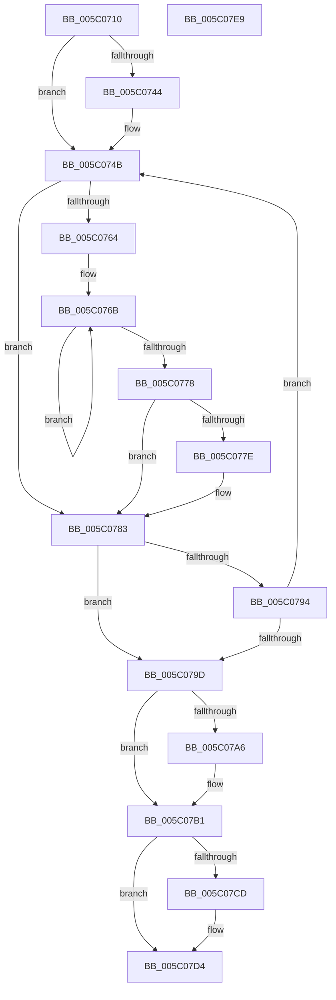

# KiCopyCounters

- RVA: `0x005C0710`–`0x005C07EA` (길이 `218` bytes)
- VA: `0x00000001405C0710`
- 실행 섹션: `.text`
- PDB 이름 있음: `예`; PDB Function 태그: `아니요`
- unwind 정보 RVA: `0x0005C954`
- 디코드: `58`개 명령, `218/218` bytes 표시
- 미해석 바이트: `0` (있으면 어셈블리에 `.byte`로 보존)

> 이 문서는 커널 이미지의 기계어와 PDB 기호를 분석해 생성했습니다. 4번과 5번은 함수 원형과 자료형을 바이너리 사용 방식에서 추정한 C 해석이며 원본 소스 복구 결과는 아닙니다.

## 1. Dependencies

- 직접 호출 지점: **5**; 고유 호출 대상: **5**
- 직접 호출자로 확인된 함수: **29**
- RIP 상대 이미지 참조: **1**

### Outgoing calls
- `0x005C0746` → [KiRaiseIrqlProcessIrqlFlags](../4F/KiRaiseIrqlProcessIrqlFlags_function_004F56FC.md) (function, `0x004F56FC`)
- `0x005C077E` → [KiRemoveSystemWorkPriorityKick](../26/KiRemoveSystemWorkPriorityKick_function_002631D0.md) (function, `0x002631D0`)
- `0x005C078A` → [KiCopyCountersWorker](../../page/74/KiCopyCountersWorker_function_00747058.md) (function, `0x00747058`)
- `0x005C07AC` → [KiLowerIrqlProcessIrqlFlags](../4F/KiLowerIrqlProcessIrqlFlags_function_004F5698.md) (function, `0x004F5698`)
- `0x005C07CF` → [KiUpdateStibpPairing](../3E/KiUpdateStibpPairing_function_003E71C0.md) (function, `0x003E71C0`)

### Direct callers
- [NtContinueEx](../6B/NtContinueEx_function_006B10D0.md) at `0x006B1288`
- [NtRaiseException](../6B/NtRaiseException_function_006B1560.md) at `0x006B1728`
- [KiRestoreSetContextState](../6B/KiRestoreSetContextState_function_006B1CA0.md) at `0x006B1DFD`
- [KxStartUserThread](../6B/KxStartUserThread_function_006B2E50.md) at `0x006B2FC3`
- [KiChainedDispatch](../6B/KiChainedDispatch_function_006B3480.md) at `0x006B3595`
- [KiInterruptDispatch](../6B/KiInterruptDispatch_function_006B3B30.md) at `0x006B3C45`
- [KiInterruptDispatchNoLock](../6B/KiInterruptDispatchNoLock_function_006B3F10.md) at `0x006B4025`
- [KiInterruptDispatchNoLockNoEtw](../6B/KiInterruptDispatchNoLockNoEtw_function_006B42F0.md) at `0x006B4405`
- [KiInterruptDispatchNoEOI](../6B/KiInterruptDispatchNoEOI_function_006B46D0.md) at `0x006B47DD`
- [KiSpuriousDispatchNoEOI](../6B/KiSpuriousDispatchNoEOI_function_006B4AA0.md) at `0x006B4BA2`
- [KxIsrLinkage](../6B/KxIsrLinkage_function_006B5680.md) at `0x006B5B51`
- [KiApcInterrupt](../6B/KiApcInterrupt_function_006B5E20.md) at `0x006B627E`
- [KiHvInterruptDispatch](../6B/KiHvInterruptDispatch_function_006B7750.md) at `0x006B7873`
- [KiVmbusInterruptDispatch](../6B/KiVmbusInterruptDispatch_function_006B7B40.md) at `0x006B7C4F`
- [KiSwInterrupt](../6B/KiSwInterrupt_function_006B8070.md) at `0x006B84EA`
- [KiDpcInterrupt](../6B/KiDpcInterrupt_function_006B87C0.md) at `0x006B8C12`
- [KiIpiInterrupt](../6B/KiIpiInterrupt_function_006B8F20.md) at `0x006B9393`
- [NtCallEnclave](../6B/NtCallEnclave_function_006BABA0.md) at `0x006BAC9A`
- [KiNmiInterrupt](../6B/KiNmiInterrupt_function_006BD3C0.md) at `0x006BD686`
- [KiBoundFault](../6B/KiBoundFault_function_006BE040.md) at `0x006BE46D`
- [KiInvalidOpcodeFault](../6B/KiInvalidOpcodeFault_function_006BE740.md) at `0x006BEB23`
- [KiPageFault](../6C/KiPageFault_function_006C0740.md) at `0x006C0C84`
- [KiMcheckAbort](../6C/KiMcheckAbort_function_006C16C0.md) at `0x006C1A28`
- [KxMcheckAlternateReturn](../6C/KxMcheckAlternateReturn_function_006C1E00.md) at `0x006C2212`
- [KiVirtualizationException](../6C/KiVirtualizationException_function_006C2900.md) at `0x006C2D34`
- [KiControlProtectionFault](../6C/KiControlProtectionFault_function_006C3040.md) at `0x006C34D6`
- [KiSystemCall64](../6C/KiSystemCall64_function_006C4A40.md) at `0x006C50B3`
- [KiSystemCall64](../6C/KiSystemCall64_function_006C4A40.md) at `0x006C5442`
- [KiExceptionDispatch](../6C/KiExceptionDispatch_function_006C5900.md) at `0x006C5B46`
- [KiFastFailDispatch](../6C/KiFastFailDispatch_function_006C5E40.md) at `0x006C6007`

### Static image references
- `0x005C073B` → RVA `0x00FC6D20` (`ALMOSTRO`; read)

## 2. Other-region calls and transfers

- 다른 실행 섹션으로 향하는 call: **1**
  - `0x005C078A` → [KiCopyCountersWorker](../../page/74/KiCopyCountersWorker_function_00747058.md) (`.text` → `PAGE`)
- 별도 외부 분기/꼬리 이동을 확인하지 못했습니다.

## 3. Assembly (complete function range)

```asm
005C0710  48 89 5C 24 08                  mov qword ptr [rsp + 8], rbx
005C0715  48 89 6C 24 10                  mov qword ptr [rsp + 0x10], rbp
005C071A  48 89 74 24 18                  mov qword ptr [rsp + 0x18], rsi
005C071F  57                              push rdi
005C0720  48 83 EC 20                     sub rsp, 0x20
005C0724  48 8B A9 68 01 00 00            mov rbp, qword ptr [rcx + 0x168]
005C072B  48 8B F9                        mov rdi, rcx
005C072E  44 0F 20 C3                     mov rbx, cr8
005C0732  BA 01 00 00 00                  mov edx, 1
005C0737  44 0F 22 C2                     mov cr8, rdx
005C073B  83 3D DE 65 A0 00 00            cmp dword ptr [rip + 0xa065de], 0
005C0742  74 07                           je 0x1405c074b
005C0744  8A CB                           mov cl, bl
005C0746  E8 B1 4F F3 FF                  call 0x1404f56fc
005C074B  48 8B 77 48                     mov rsi, qword ptr [rdi + 0x48]
005C074F  65 48 8B 0C 25 20 00 00 00      mov rcx, qword ptr gs:[0x20]
005C0758  4C 8B 81 B8 8E 00 00            mov r8, qword ptr [rcx + 0x8eb8]
005C075F  4D 85 C0                        test r8, r8
005C0762  74 1F                           je 0x1405c0783
005C0764  41 0F 0D 08                     prefetchw byte ptr [r8]
005C0768  41 8B 00                        mov eax, dword ptr [r8]
005C076B  8B D0                           mov edx, eax
005C076D  0F BA F2 15                     btr edx, 0x15
005C0771  F0 41 0F B1 10                  lock cmpxchg dword ptr [r8], edx
005C0776  75 F3                           jne 0x1405c076b
005C0778  0F BA E0 15                     bt eax, 0x15
005C077C  73 05                           jae 0x1405c0783
005C077E  E8 4D 2A CA FF                  call 0x1402631d0
005C0783  FB                              sti
005C0784  48 8B D5                        mov rdx, rbp
005C0787  48 8B CF                        mov rcx, rdi
005C078A  E8 C9 68 18 00                  call 0x140747058
005C078F  FA                              cli
005C0790  85 C0                           test eax, eax
005C0792  75 09                           jne 0x1405c079d
005C0794  48 8B 47 48                     mov rax, qword ptr [rdi + 0x48]
005C0798  48 3B F0                        cmp rsi, rax
005C079B  75 AE                           jne 0x1405c074b
005C079D  83 3D 7C 65 A0 00 00            cmp dword ptr [rip + 0xa0657c], 0
005C07A4  74 0B                           je 0x1405c07b1
005C07A6  44 0F 20 C1                     mov rcx, cr8
005C07AA  8A D3                           mov dl, bl
005C07AC  E8 E7 4E F3 FF                  call 0x1404f5698
005C07B1  0F B6 C3                        movzx eax, bl
005C07B4  44 0F 22 C0                     mov cr8, rax
005C07B8  65 48 8B 04 25 20 00 00 00      mov rax, qword ptr gs:[0x20]
005C07C1  0F B7 88 E0 06 00 00            movzx ecx, word ptr [rax + 0x6e0]
005C07C8  F6 C1 02                        test cl, 2
005C07CB  74 07                           je 0x1405c07d4
005C07CD  33 C9                           xor ecx, ecx
005C07CF  E8 EC 69 E2 FF                  call 0x1403e71c0
005C07D4  48 8B 5C 24 30                  mov rbx, qword ptr [rsp + 0x30]
005C07D9  48 8B 6C 24 38                  mov rbp, qword ptr [rsp + 0x38]
005C07DE  48 8B 74 24 40                  mov rsi, qword ptr [rsp + 0x40]
005C07E3  48 83 C4 20                     add rsp, 0x20
005C07E7  5F                              pop rdi
005C07E8  C3                              ret
005C07E9  CC                              int3
```

## 4. C-style interpretation (structured pseudocode)

```c
__int64 __fastcall KiCopyCounters(__int64 a1)
{
    __int64 result;
    __int64 v_rsp;
    unsigned __int64 v_stack_p10;
    unsigned __int64 v_stack_p18;
    unsigned __int64 v_stack_p8;

    v_stack_p8 = v_rbx;
    v_stack_p10 = v_rbp;
    v_stack_p18 = v_rsi;
    v_rsp = (v_rsp) - (32);
    if ((*(unsigned int *)(v_rip + 10511838)) != 0) {
        a1 = (unsigned __int8)(v_cr8);
        result = KiRaiseIrqlProcessIrqlFlags(a1, 1, a3, a4);
    }
    if (*(unsigned __int64 *)(*(unsigned __int64 *)(gs_base + (0 + 32)) + 36536) == 0) goto loc_005C0783;
loc_005C076B:
    if (*(unsigned __int64 *)(*(unsigned __int64 *)(gs_base + (0 + 32)) + 36536) != 0) goto loc_005C076B;
    result = (unsigned int)(*(unsigned int *)(*(unsigned __int64 *)(*(unsigned __int64 *)(gs_base + (0 + 32)) + 36536)));
    if (!(condition_is_above_or_equal)) {
        result = KiRemoveSystemWorkPriorityKick(*(unsigned __int64 *)(gs_base + (0 + 32)), (unsigned int)((unsigned int)((unsigned int)(*(unsigned int *)(*(unsigned __int64 *)(*(unsigned __int64 *)(gs_base + (0 + 32)) + 36536))))), *(unsigned __int64 *)(*(unsigned __int64 *)(gs_base + (0 + 32)) + 36536), a4);
    }
    result = KiCopyCountersWorker(a1, *(unsigned __int64 *)(a1 + 360), *(unsigned __int64 *)(*(unsigned __int64 *)(gs_base + (0 + 32)) + 36536), a4);
    if ((unsigned int)(result) != 0) goto loc_005C079D;
    if ((*(unsigned __int64 *)(a1 + 72)) != (*(unsigned __int64 *)(a1 + 72))) goto loc_005C074B;
loc_005C079D:
    result = *(unsigned __int64 *)(a1 + 72);
    if ((*(unsigned int *)(v_rip + 10511740)) != 0) {
        a1 = 1;
        a2 = (unsigned __int8)(v_cr8);
        result = KiLowerIrqlProcessIrqlFlags(a1, a2, *(unsigned __int64 *)(*(unsigned __int64 *)(gs_base + (0 + 32)) + 36536), a4);
    }
    result = *(unsigned __int64 *)(gs_base + (0 + 32));
    if ((((unsigned __int8)(*(unsigned __int16 *)(*(unsigned __int64 *)(gs_base + (0 + 32)) + 1760))) & (2)) != 0) {
        a1 = 0;
        result = KiUpdateStibpPairing(a1, a2, *(unsigned __int64 *)(*(unsigned __int64 *)(gs_base + (0 + 32)) + 36536), a4);
    }
    v_rsp = (v_rsp) + (32);
    return result;
}
```

## 5. (Beta) C Style

```c
int64_t KiCopyCounters(void *Arg1)
{
    uint8_t *arg1 = (uint8_t *)Arg1;

    int64_t result;
    int64_t local_rsp;
    uint64_t v_stack_p10;
    uint64_t v_stack_p18;
    uint64_t v_stack_p8;

    v_stack_p8 = local_rbx;
    v_stack_p10 = local_rbp;
    v_stack_p18 = local_rsi;
    local_rsp = (local_rsp) - (32);
    if ((*(uint32_t *)(v_rip + 0xA065DE)) != 0) {
        Arg1 = (uint8_t)(v_cr8);
        result = KiRaiseIrqlProcessIrqlFlags(Arg1, 1, a3, a4);
    }
    if (*(uint64_t *)(*(uint64_t *)(gs_base + (0 + 0x20)) + 0x8EB8) == 0) goto loc_005C0783;
loc_005C076B:
    if (*(uint64_t *)(*(uint64_t *)(gs_base + (0 + 0x20)) + 0x8EB8) != 0) goto loc_005C076B;
    result = (uint32_t)(*(uint32_t *)(*(uint64_t *)(*(uint64_t *)(gs_base + (0 + 0x20)) + 0x8EB8)));
    if (!(condition_is_above_or_equal)) {
        result = KiRemoveSystemWorkPriorityKick(*(uint64_t *)(gs_base + (0 + 0x20)), (uint32_t)((uint32_t)((uint32_t)(*(uint32_t *)(*(uint64_t *)(*(uint64_t *)(gs_base + (0 + 0x20)) + 0x8EB8))))), *(uint64_t *)(*(uint64_t *)(gs_base + (0 + 0x20)) + 0x8EB8), a4);
    }
    result = KiCopyCountersWorker(Arg1, *(uint64_t *)(arg1 + 0x168), *(uint64_t *)(*(uint64_t *)(gs_base + (0 + 0x20)) + 0x8EB8), a4);
    if ((uint32_t)(result) != 0) goto loc_005C079D;
    if ((*(uint64_t *)(arg1 + 0x48)) != (*(uint64_t *)(arg1 + 0x48))) goto loc_005C074B;
loc_005C079D:
    result = *(uint64_t *)(arg1 + 0x48);
    if ((*(uint32_t *)(v_rip + 0xA0657C)) != 0) {
        Arg1 = 1;
        a2 = (uint8_t)(v_cr8);
        result = KiLowerIrqlProcessIrqlFlags(Arg1, a2, *(uint64_t *)(*(uint64_t *)(gs_base + (0 + 0x20)) + 0x8EB8), a4);
    }
    result = *(uint64_t *)(gs_base + (0 + 0x20));
    if ((((uint8_t)(*(uint16_t *)(*(uint64_t *)(gs_base + (0 + 0x20)) + 0x6E0))) & (2)) != 0) {
        Arg1 = 0;
        result = KiUpdateStibpPairing(Arg1, a2, *(uint64_t *)(*(uint64_t *)(gs_base + (0 + 0x20)) + 0x8EB8), a4);
    }
    local_rsp = (local_rsp) + (32);
    return result;
}
```

### 관측된 메모리 오프셋

구조체 형식이 확인되지 않은 접근은 인자 기준의 오프셋으로만 기록했습니다.

| 기준 인자 | 오프셋 표현 | 폭 (bit) | 접근 |
|---|---:|---:|---|
| `Arg1` | `+ 0x48` | `64` | `R` |
| `Arg1` | `+ 0x168` | `64` | `R` |

## 6. Execution-region graph

[열기: 2D/3D 그래프와 함수 탐색 컨트롤 패널](../../../control-panel.html?section=text&rva=0x005C0710&view=graph)

- 2D 그래프는 위에서 아래로 흐르고, 3D 그래프는 빈 공간을 드래그해 회전합니다. Shift+드래그는 이동, 휠은 확대·축소, 함수 노드 선택은 대상 보고서 이동입니다.

### Static fallback


