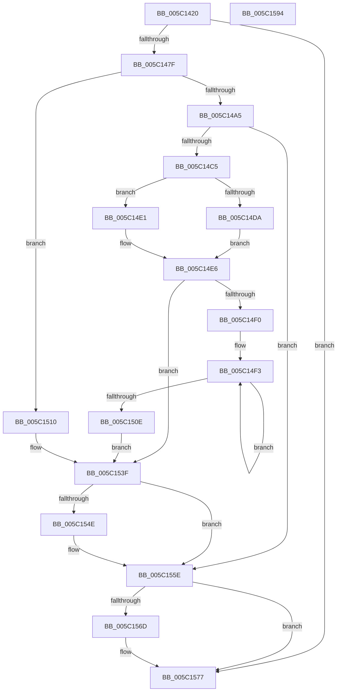

# KiCpuPartitionCheckAffinitization

- RVA: `0x005C1420`–`0x005C1595` (길이 `373` bytes)
- VA: `0x00000001405C1420`
- 실행 섹션: `.text`
- PDB 이름 있음: `예`; PDB Function 태그: `아니요`
- unwind 정보 RVA: `0x000BCDB8`
- 디코드: `104`개 명령, `373/373` bytes 표시
- 미해석 바이트: `0` (있으면 어셈블리에 `.byte`로 보존)

> 이 문서는 커널 이미지의 기계어와 PDB 기호를 분석해 생성했습니다. 4번과 5번은 함수 원형과 자료형을 바이너리 사용 방식에서 추정한 C 해석이며 원본 소스 복구 결과는 아닙니다.

## 1. Dependencies

- 직접 호출 지점: **13**; 고유 호출 대상: **11**
- 직접 호출자로 확인된 함수: **4**
- RIP 상대 이미지 참조: **2**

### Outgoing calls
- `0x005C146E` → [ExAllocatePool2](../../poolcode/B8/ExAllocatePool2_function_00B820F0.md) (function, `0x00B820F0`)
- `0x005C1494` → [memset](../6C/memset_function_006C6C40.md) (function, `0x006C6C40`)
- `0x005C14B1` → [ExAllocatePool2](../../poolcode/B8/ExAllocatePool2_function_00B820F0.md) (function, `0x00B820F0`)
- `0x005C14DA` → [KeQueryCpuSetsProcess](../4D/KeQueryCpuSetsProcess_function_004DE068.md) (function, `0x004DE068`)
- `0x005C14E1` → [KiQueryCpuSetsProcessWithLock](../4F/KiQueryCpuSetsProcessWithLock_function_004F6080.md) (function, `0x004F6080`)
- `0x005C14FC` → [KeAddGroupAffinityEx](../25/KeAddGroupAffinityEx_function_0025B6C0.md) (function, `0x0025B6C0`)
- `0x005C151B` → [KeAcquireSpinLockAtDpcLevel](../20/KeAcquireSpinLockAtDpcLevel_function_00208430.md) (function, `0x00208430`)
- `0x005C1531` → [KiCopyAffinityEx](../2C/KiCopyAffinityEx_function_002CE860.md) (function, `0x002CE860`)
- `0x005C153A` → [KxReleaseSpinLock](../20/KxReleaseSpinLock_function_00206670.md) (function, `0x00206670`)
- `0x005C1545` → [KiAndAffinityExNoResult](../2C/KiAndAffinityExNoResult_function_002CF84C.md) (function, `0x002CF84C`)
- `0x005C1559` → [EtwTraceCpuPartitionAffinityViolation](../64/EtwTraceCpuPartitionAffinityViolation_function_0064F644.md) (function, `0x0064F644`)
- `0x005C1563` → [ExFreePoolWithTag](../../poolcode/B8/ExFreePoolWithTag_function_00B82870.md) (function, `0x00B82870`)
- `0x005C1572` → [ExFreePoolWithTag](../../poolcode/B8/ExFreePoolWithTag_function_00B82870.md) (function, `0x00B82870`)

### Direct callers
- [sub_002092A9](../20/Unknown_function_002092A9.md) at `0x002094CD`
- [KiSetAffinityThread](../2C/KiSetAffinityThread_function_002CE010.md) at `0x002CE3E4`
- [sub_003993C0](../39/Unknown_function_003993C0.md) at `0x003993D0`
- [KeSetSystemMultipleGroupAffinityThread](../4D/KeSetSystemMultipleGroupAffinityThread_function_004D0C88.md) at `0x004D0EC8`

### Static image references
- `0x005C1440` → RVA `0x00FC5014` (`ALMOSTRO`; read)
- `0x005C1510` → RVA `0x00FC6C20` (`ALMOSTRO`; read)

## 2. Other-region calls and transfers

- 다른 실행 섹션으로 향하는 call: **4**
  - `0x005C146E` → [ExAllocatePool2](../../poolcode/B8/ExAllocatePool2_function_00B820F0.md) (`.text` → `POOLCODE`)
  - `0x005C14B1` → [ExAllocatePool2](../../poolcode/B8/ExAllocatePool2_function_00B820F0.md) (`.text` → `POOLCODE`)
  - `0x005C1563` → [ExFreePoolWithTag](../../poolcode/B8/ExFreePoolWithTag_function_00B82870.md) (`.text` → `POOLCODE`)
  - `0x005C1572` → [ExFreePoolWithTag](../../poolcode/B8/ExFreePoolWithTag_function_00B82870.md) (`.text` → `POOLCODE`)
- 별도 외부 분기/꼬리 이동을 확인하지 못했습니다.

## 3. Assembly (complete function range)

```asm
005C1420  48 8B C4                        mov rax, rsp
005C1423  48 89 58 08                     mov qword ptr [rax + 8], rbx
005C1427  48 89 68 10                     mov qword ptr [rax + 0x10], rbp
005C142B  48 89 70 20                     mov qword ptr [rax + 0x20], rsi
005C142F  44 88 40 18                     mov byte ptr [rax + 0x18], r8b
005C1433  57                              push rdi
005C1434  41 54                           push r12
005C1436  41 55                           push r13
005C1438  41 56                           push r14
005C143A  41 57                           push r15
005C143C  48 83 EC 20                     sub rsp, 0x20
005C1440  0F B7 2D CD 3B A0 00            movzx ebp, word ptr [rip + 0xa03bcd]
005C1447  4C 8B FA                        mov r15, rdx
005C144A  48 8B 99 20 02 00 00            mov rbx, qword ptr [rcx + 0x220]
005C1451  4C 8B E9                        mov r13, rcx
005C1454  33 FF                           xor edi, edi
005C1456  41 B8 4B 69 43 75               mov r8d, 0x7543694b
005C145C  45 8A E1                        mov r12b, r9b
005C145F  4C 8D 34 ED 00 00 00 00         lea r14, [rbp*8]
005C1467  49 8D 56 08                     lea rdx, [r14 + 8]
005C146B  8D 4F 40                        lea ecx, [rdi + 0x40]
005C146E  E8 7D 0C 5C 00                  call 0x140b820f0
005C1473  48 8B F0                        mov rsi, rax
005C1476  48 85 C0                        test rax, rax
005C1479  0F 84 F8 00 00 00               je 0x1405c1577
005C147F  21 78 04                        and dword ptr [rax + 4], edi
005C1482  48 8D 48 08                     lea rcx, [rax + 8]
005C1486  4D 8B C6                        mov r8, r14
005C1489  66 C7 00 01 00                  mov word ptr [rax], 1
005C148E  33 D2                           xor edx, edx
005C1490  66 89 68 02                     mov word ptr [rax + 2], bp
005C1494  E8 A7 57 10 00                  call 0x1406c6c40
005C1499  48 8D 83 B0 01 00 00            lea rax, [rbx + 0x1b0]
005C14A0  48 39 00                        cmp qword ptr [rax], rax
005C14A3  74 6B                           je 0x1405c1510
005C14A5  41 B8 4B 69 43 75               mov r8d, 0x7543694b
005C14AB  8D 4F 40                        lea ecx, [rdi + 0x40]
005C14AE  49 8B D6                        mov rdx, r14
005C14B1  E8 3A 0C 5C 00                  call 0x140b820f0
005C14B6  45 33 F6                        xor r14d, r14d
005C14B9  48 8B F8                        mov rdi, rax
005C14BC  48 85 C0                        test rax, rax
005C14BF  0F 84 99 00 00 00               je 0x1405c155e
005C14C5  45 84 E4                        test r12b, r12b
005C14C8  44 8B C5                        mov r8d, ebp
005C14CB  45 8D 66 01                     lea r12d, [r14 + 1]
005C14CF  48 8B D0                        mov rdx, rax
005C14D2  45 8B CC                        mov r9d, r12d
005C14D5  48 8B CB                        mov rcx, rbx
005C14D8  75 07                           jne 0x1405c14e1
005C14DA  E8 89 CB F1 FF                  call 0x1404de068
005C14DF  EB 05                           jmp 0x1405c14e6
005C14E1  E8 9A 4B F3 FF                  call 0x1404f6080
005C14E6  41 0F B7 DE                     movzx ebx, r14w
005C14EA  66 44 3B F5                     cmp r14w, bp
005C14EE  73 4F                           jae 0x1405c153f
005C14F0  4C 8B F7                        mov r14, rdi
005C14F3  4D 8B 06                        mov r8, qword ptr [r14]
005C14F6  0F B7 D3                        movzx edx, bx
005C14F9  48 8B CE                        mov rcx, rsi
005C14FC  E8 BF A1 C9 FF                  call 0x14025b6c0
005C1501  66 41 03 DC                     add bx, r12w
005C1505  4D 8D 76 08                     lea r14, [r14 + 8]
005C1509  66 3B DD                        cmp bx, bp
005C150C  72 E5                           jb 0x1405c14f3
005C150E  EB 2F                           jmp 0x1405c153f
005C1510  48 8B 0D 09 57 A0 00            mov rcx, qword ptr [rip + 0xa05709]
005C1517  48 83 C1 08                     add rcx, 8
005C151B  E8 10 6F C4 FF                  call 0x140208430
005C1520  48 8B 1D F9 56 A0 00            mov rbx, qword ptr [rip + 0xa056f9]
005C1527  48 8B CE                        mov rcx, rsi
005C152A  0F B7 56 02                     movzx edx, word ptr [rsi + 2]
005C152E  4C 8B 03                        mov r8, qword ptr [rbx]
005C1531  E8 2A D3 D0 FF                  call 0x1402ce860
005C1536  48 8D 4B 08                     lea rcx, [rbx + 8]
005C153A  E8 31 51 C4 FF                  call 0x140206670
005C153F  49 8B D7                        mov rdx, r15
005C1542  48 8B CE                        mov rcx, rsi
005C1545  E8 02 E3 D0 FF                  call 0x1402cf84c
005C154A  85 C0                           test eax, eax
005C154C  75 10                           jne 0x1405c155e
005C154E  0F B6 4C 24 60                  movzx ecx, byte ptr [rsp + 0x60]
005C1553  4D 8B C7                        mov r8, r15
005C1556  49 8B D5                        mov rdx, r13
005C1559  E8 E6 E0 08 00                  call 0x14064f644
005C155E  33 D2                           xor edx, edx
005C1560  48 8B CE                        mov rcx, rsi
005C1563  E8 08 13 5C 00                  call 0x140b82870
005C1568  48 85 FF                        test rdi, rdi
005C156B  74 0A                           je 0x1405c1577
005C156D  33 D2                           xor edx, edx
005C156F  48 8B CF                        mov rcx, rdi
005C1572  E8 F9 12 5C 00                  call 0x140b82870
005C1577  48 8B 5C 24 50                  mov rbx, qword ptr [rsp + 0x50]
005C157C  48 8B 6C 24 58                  mov rbp, qword ptr [rsp + 0x58]
005C1581  48 8B 74 24 68                  mov rsi, qword ptr [rsp + 0x68]
005C1586  48 83 C4 20                     add rsp, 0x20
005C158A  41 5F                           pop r15
005C158C  41 5E                           pop r14
005C158E  41 5D                           pop r13
005C1590  41 5C                           pop r12
005C1592  5F                              pop rdi
005C1593  C3                              ret
005C1594  CC                              int3
```

## 4. C-style interpretation (structured pseudocode)

```c
__int64 __fastcall KiCpuPartitionCheckAffinitization(__int64 a1, __int64 a2, unsigned __int8 a3, unsigned __int8 a4)
{
    __int64 result;
    __int64 v_r14;
    __int64 v_rbx;
    __int64 v_rdi;
    __int64 v_rsp;
    unsigned __int64 v_stack_p10;
    unsigned __int8 v_stack_p18;
    unsigned __int64 v_stack_p20;
    unsigned __int64 v_stack_p8;

    *(unsigned __int64 *)(v_rsp + 8) = v_rbx;
    *(unsigned __int64 *)(v_rsp + 16) = v_rbp;
    *(unsigned __int64 *)(v_rsp + 32) = v_rsi;
    *(unsigned __int8 *)(v_rsp + 24) = a3;
    v_rsp = (v_rsp) - (32);
    v_rdi = 0;
    result = ExAllocatePool2(v_rdi + 64, *(unsigned __int16 *)(v_rip + 10501069) * 8 + 8, (unsigned int)(0x7543694BULL), a4);
    if (result == 0) goto loc_005C1577;
    *(unsigned __int16 *)(result) = 1;
    a2 = 0;
    *(unsigned __int16 *)(result + 2) = (unsigned __int16)(*(unsigned __int16 *)(v_rip + 10501069));
    result = memset(result + 8, a2, *(unsigned __int16 *)(v_rip + 10501069) * 8, a4);
    if ((*(unsigned __int64 *)(*(unsigned __int64 *)(a1 + 544) + 432)) == (*(unsigned __int64 *)(a1 + 544) + 432)) goto loc_005C1510;
    result = ExAllocatePool2(v_rdi + 64, *(unsigned __int16 *)(v_rip + 10501069) * 8, (unsigned int)(0x7543694BULL), a4);
    v_r14 = 0;
    if (result == 0) goto loc_005C155E;
    if (a4 != 0) goto loc_005C14E1;
    result = KeQueryCpuSetsProcess(*(unsigned __int64 *)(a1 + 544), result, (unsigned int)((unsigned int)(*(unsigned __int16 *)(v_rip + 10501069))), (unsigned int)((unsigned int)(v_r14 + 1)));
    goto loc_005C14E6;
loc_005C14E1:
    result = KiQueryCpuSetsProcessWithLock(*(unsigned __int64 *)(a1 + 544), result, (unsigned int)((unsigned int)(*(unsigned __int16 *)(v_rip + 10501069))), (unsigned int)((unsigned int)(v_r14 + 1)));
loc_005C14E6:
    if (0 >= ((unsigned __int16)(*(unsigned __int16 *)(v_rip + 10501069)))) goto loc_005C153F;
loc_005C14F3:
    result = KeAddGroupAffinityEx(result, 0, *(unsigned __int64 *)(result), (unsigned int)((unsigned int)(v_r14 + 1)));
    v_rbx = (unsigned __int16)((0) + ((unsigned __int16)(v_r14 + 1)));
    if (((unsigned __int16)(v_rbx)) < ((unsigned __int16)(*(unsigned __int16 *)(v_rip + 10501069)))) goto loc_005C14F3;
    goto loc_005C153F;
loc_005C1510:
    a1 = (*(unsigned __int64 *)(v_rip + 10508041)) + (8);
    result = KeAcquireSpinLockAtDpcLevel(a1, 0, *(unsigned __int64 *)(result), (unsigned int)((unsigned int)(v_r14 + 1)));
    result = KiCopyAffinityEx(result, *(unsigned __int16 *)(result + 2), *(unsigned __int64 *)(*(unsigned __int64 *)(v_rip + 10508025)), (unsigned int)((unsigned int)(v_r14 + 1)));
    result = KxReleaseSpinLock(*(unsigned __int64 *)(v_rip + 10508025) + 8, *(unsigned __int16 *)(result + 2), *(unsigned __int64 *)(*(unsigned __int64 *)(v_rip + 10508025)), (unsigned int)((unsigned int)(v_r14 + 1)));
loc_005C153F:
    result = KiAndAffinityExNoResult(result, 0, *(unsigned __int64 *)(*(unsigned __int64 *)(v_rip + 10508025)), (unsigned int)((unsigned int)(v_r14 + 1)));
    if ((unsigned int)(result) == 0) {
        a1 = v_stack_p18;
        a3 = 0;
        a2 = a1;
        result = EtwTraceCpuPartitionAffinityViolation(a1, a2, a3, (unsigned int)((unsigned int)(v_r14 + 1)));
    }
    a2 = 0;
    result = ExFreePoolWithTag(result, a2, a3, (unsigned int)((unsigned int)(v_r14 + 1)));
    if (result != 0) {
        a2 = 0;
        a1 = result;
        result = ExFreePoolWithTag(a1, a2, a3, (unsigned int)((unsigned int)(v_r14 + 1)));
    }
    v_rsp = (v_rsp) + (32);
    return result;
}
```

## 5. (Beta) C Style

```c
int64_t KiCpuPartitionCheckAffinitization(void *Arg1, int64_t Arg2, uint8_t Arg3, uint8_t Arg4)
{
    uint8_t *arg1 = (uint8_t *)Arg1;

    int64_t result;
    int64_t local_r14;
    int64_t local_rbx;
    int64_t local_rdi;
    int64_t local_rsp;
    uint64_t v_stack_p10;
    uint8_t v_stack_p18;
    uint64_t v_stack_p20;
    uint64_t v_stack_p8;

    *(uint64_t *)(local_rsp + 0x8) = local_rbx;
    *(uint64_t *)(local_rsp + 0x10) = local_rbp;
    *(uint64_t *)(local_rsp + 0x20) = local_rsi;
    *(uint8_t *)(local_rsp + 0x18) = Arg3;
    local_rsp = (local_rsp) - (32);
    local_rdi = 0;
    result = ExAllocatePool2(local_rdi + 64, *(uint16_t *)(v_rip + 0xA03BCD) * 8 + 8, (uint32_t)(0x7543694BULL), Arg4);
    if (result == 0) goto loc_005C1577;
    *(uint16_t *)(result) = 1;
    Arg2 = 0;
    *(uint16_t *)(result + 0x2) = (uint16_t)(*(uint16_t *)(v_rip + 0xA03BCD));
    result = memset(result + 8, Arg2, *(uint16_t *)(v_rip + 0xA03BCD) * 8, Arg4);
    if ((*(uint64_t *)(*(uint64_t *)(arg1 + 0x220) + 0x1B0)) == (*(uint64_t *)(arg1 + 0x220) + 432)) goto loc_005C1510;
    result = ExAllocatePool2(local_rdi + 64, *(uint16_t *)(v_rip + 0xA03BCD) * 8, (uint32_t)(0x7543694BULL), Arg4);
    local_r14 = 0;
    if (result == 0) goto loc_005C155E;
    if (Arg4 != 0) goto loc_005C14E1;
    result = KeQueryCpuSetsProcess(*(uint64_t *)(arg1 + 0x220), result, (uint32_t)((uint32_t)(*(uint16_t *)(v_rip + 0xA03BCD))), (uint32_t)((uint32_t)(local_r14 + 1)));
    goto loc_005C14E6;
loc_005C14E1:
    result = KiQueryCpuSetsProcessWithLock(*(uint64_t *)(arg1 + 0x220), result, (uint32_t)((uint32_t)(*(uint16_t *)(v_rip + 0xA03BCD))), (uint32_t)((uint32_t)(local_r14 + 1)));
loc_005C14E6:
    if (0 >= ((uint16_t)(*(uint16_t *)(v_rip + 0xA03BCD)))) goto loc_005C153F;
loc_005C14F3:
    result = KeAddGroupAffinityEx(result, 0, *(uint64_t *)(result), (uint32_t)((uint32_t)(local_r14 + 1)));
    local_rbx = (uint16_t)((0) + ((uint16_t)(local_r14 + 1)));
    if (((uint16_t)(local_rbx)) < ((uint16_t)(*(uint16_t *)(v_rip + 0xA03BCD)))) goto loc_005C14F3;
    goto loc_005C153F;
loc_005C1510:
    Arg1 = (*(uint64_t *)(v_rip + 0xA05709)) + (8);
    result = KeAcquireSpinLockAtDpcLevel(Arg1, 0, *(uint64_t *)(result), (uint32_t)((uint32_t)(local_r14 + 1)));
    result = KiCopyAffinityEx(result, *(uint16_t *)(result + 0x2), *(uint64_t *)(*(uint64_t *)(v_rip + 0xA056F9)), (uint32_t)((uint32_t)(local_r14 + 1)));
    result = KxReleaseSpinLock(*(uint64_t *)(v_rip + 0xA056F9) + 8, *(uint16_t *)(result + 0x2), *(uint64_t *)(*(uint64_t *)(v_rip + 0xA056F9)), (uint32_t)((uint32_t)(local_r14 + 1)));
loc_005C153F:
    result = KiAndAffinityExNoResult(result, 0, *(uint64_t *)(*(uint64_t *)(v_rip + 0xA056F9)), (uint32_t)((uint32_t)(local_r14 + 1)));
    if ((uint32_t)(result) == 0) {
        Arg1 = v_stack_p18;
        Arg3 = 0;
        Arg2 = Arg1;
        result = EtwTraceCpuPartitionAffinityViolation(Arg1, Arg2, Arg3, (uint32_t)((uint32_t)(local_r14 + 1)));
    }
    Arg2 = 0;
    result = ExFreePoolWithTag(result, Arg2, Arg3, (uint32_t)((uint32_t)(local_r14 + 1)));
    if (result != 0) {
        Arg2 = 0;
        Arg1 = result;
        result = ExFreePoolWithTag(Arg1, Arg2, Arg3, (uint32_t)((uint32_t)(local_r14 + 1)));
    }
    local_rsp = (local_rsp) + (32);
    return result;
}
```

### 관측된 메모리 오프셋

구조체 형식이 확인되지 않은 접근은 인자 기준의 오프셋으로만 기록했습니다.

| 기준 인자 | 오프셋 표현 | 폭 (bit) | 접근 |
|---|---:|---:|---|
| `Arg1` | `+ 0x220` | `64` | `R` |

## 6. Execution-region graph

[열기: 2D/3D 그래프와 함수 탐색 컨트롤 패널](../../../control-panel.html?section=text&rva=0x005C1420&view=graph)

- 2D 그래프는 위에서 아래로 흐르고, 3D 그래프는 빈 공간을 드래그해 회전합니다. Shift+드래그는 이동, 휠은 확대·축소, 함수 노드 선택은 대상 보고서 이동입니다.

### Static fallback


