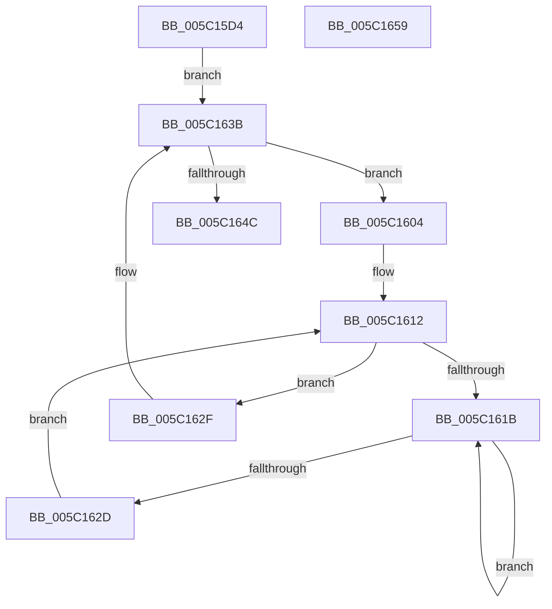

# KiCpuPartitionUpdatePrcbs

- RVA: `0x005C15D4`–`0x005C165A` (길이 `134` bytes)
- VA: `0x00000001405C15D4`
- 실행 섹션: `.text`
- PDB 이름 있음: `예`; PDB Function 태그: `아니요`
- unwind 정보 RVA: `0x000C8D78`
- 디코드: `42`개 명령, `134/134` bytes 표시
- 미해석 바이트: `0` (있으면 어셈블리에 `.byte`로 보존)

> 이 문서는 커널 이미지의 기계어와 PDB 기호를 분석해 생성했습니다. 4번과 5번은 함수 원형과 자료형을 바이너리 사용 방식에서 추정한 C 해석이며 원본 소스 복구 결과는 아닙니다.

## 1. Dependencies

- 직접 호출 지점: **3**; 고유 호출 대상: **3**
- 직접 호출자로 확인된 함수: **1**
- RIP 상대 이미지 참조: **0**

### Outgoing calls
- `0x005C1607` → [KeGetPrcb](../2D/KeGetPrcb_function_002D85D0.md) (function, `0x002D85D0`)
- `0x005C161F` → [KeYieldProcessorEx](../3F/KeYieldProcessorEx_function_003FBD00.md) (function, `0x003FBD00`)
- `0x005C1643` → [KeEnumerateNextProcessor](../41/KeEnumerateNextProcessor_function_00415480.md) (function, `0x00415480`)

### Direct callers
- [KeCpuPartitionMoveCpus](KeCpuPartitionMoveCpus_function_005C0B70.md) at `0x005C0C8D`

### Static image references
- 디코드된 RIP-relative 메모리 참조가 없습니다.

## 2. Other-region calls and transfers

- 다른 실행 섹션으로 향하는 call: **0**
- 별도 외부 분기/꼬리 이동을 확인하지 못했습니다.

## 3. Assembly (complete function range)

```asm
005C15D4  48 89 5C 24 08                  mov qword ptr [rsp + 8], rbx
005C15D9  55                              push rbp
005C15DA  56                              push rsi
005C15DB  57                              push rdi
005C15DC  48 8B EC                        mov rbp, rsp
005C15DF  48 83 EC 40                     sub rsp, 0x40
005C15E3  48 8B 42 08                     mov rax, qword ptr [rdx + 8]
005C15E7  33 F6                           xor esi, esi
005C15E9  89 75 F2                        mov dword ptr [rbp - 0xe], esi
005C15EC  48 8B F9                        mov rdi, rcx
005C15EF  66 89 75 F6                     mov word ptr [rbp - 0xa], si
005C15F3  89 75 28                        mov dword ptr [rbp + 0x28], esi
005C15F6  66 89 75 F0                     mov word ptr [rbp - 0x10], si
005C15FA  48 89 45 E8                     mov qword ptr [rbp - 0x18], rax
005C15FE  48 89 55 E0                     mov qword ptr [rbp - 0x20], rdx
005C1602  EB 37                           jmp 0x1405c163b
005C1604  8B 4D 28                        mov ecx, dword ptr [rbp + 0x28]
005C1607  E8 C4 6F D1 FF                  call 0x1402d85d0
005C160C  48 8B D8                        mov rbx, rax
005C160F  89 75 30                        mov dword ptr [rbp + 0x30], esi
005C1612  F0 48 0F BA 6B 30 00            lock bts qword ptr [rbx + 0x30], 0
005C1619  73 14                           jae 0x1405c162f
005C161B  48 8D 4D 30                     lea rcx, [rbp + 0x30]
005C161F  E8 DC A6 E3 FF                  call 0x1403fbd00
005C1624  48 8B 43 30                     mov rax, qword ptr [rbx + 0x30]
005C1628  48 85 C0                        test rax, rax
005C162B  75 EE                           jne 0x1405c161b
005C162D  EB E3                           jmp 0x1405c1612
005C162F  48 89 BB F0 37 00 00            mov qword ptr [rbx + 0x37f0], rdi
005C1636  F0 48 21 73 30                  lock and qword ptr [rbx + 0x30], rsi
005C163B  48 8D 55 E0                     lea rdx, [rbp - 0x20]
005C163F  48 8D 4D 28                     lea rcx, [rbp + 0x28]
005C1643  E8 38 3E E5 FF                  call 0x140415480
005C1648  85 C0                           test eax, eax
005C164A  74 B8                           je 0x1405c1604
005C164C  48 8B 5C 24 60                  mov rbx, qword ptr [rsp + 0x60]
005C1651  48 83 C4 40                     add rsp, 0x40
005C1655  5F                              pop rdi
005C1656  5E                              pop rsi
005C1657  5D                              pop rbp
005C1658  C3                              ret
005C1659  CC                              int3
```

## 4. C-style interpretation (structured pseudocode)

```c
__int64 __fastcall KiCpuPartitionUpdatePrcbs(__int64 a1, __int64 a2)
{
    __int64 result;
    __int64 v_rsi;
    __int64 v_rsp;
    unsigned __int16 v_stack_m22;
    unsigned int v_stack_m26;
    unsigned __int16 v_stack_m28;
    unsigned __int64 v_stack_m30;
    unsigned __int64 v_stack_m38;
    unsigned int v_stack_p10;
    unsigned int v_stack_p18;
    unsigned __int64 v_stack_p8;

    v_stack_p8 = v_rbx;
    v_rsp = (v_rsp) - (64);
    v_rsi = 0;
    v_stack_m26 = 0;
    v_stack_m22 = 0;
    v_stack_p10 = 0;
    v_stack_m28 = 0;
    v_stack_m30 = *(unsigned __int64 *)(a2 + 8);
    v_stack_m38 = a2;
    goto loc_005C163B;
loc_005C1604:
    result = KeGetPrcb((unsigned int)(v_stack_p10), a2, a3, a4);
    v_stack_p18 = 0;
loc_005C1612:
    if (condition_is_above_or_equal) goto loc_005C162F;
loc_005C161B:
    result = KeYieldProcessorEx(v_stack_p18, a2, a3, a4);
    if (*(unsigned __int64 *)(result + 48) != 0) goto loc_005C161B;
    goto loc_005C1612;
loc_005C162F:
    *(unsigned __int64 *)(result + 14320) = a1;
loc_005C163B:
    result = KeEnumerateNextProcessor(v_stack_p10, v_stack_m38, a3, a4);
    if ((unsigned int)(result) == 0) goto loc_005C1604;
    v_rsp = (v_rsp) + (64);
    return result;
}
```

## 5. (Beta) C Style

```c
int64_t KiCpuPartitionUpdatePrcbs(int64_t Arg1, void *Arg2)
{
    uint8_t *arg2 = (uint8_t *)Arg2;

    int64_t result;
    int64_t local_rsi;
    int64_t local_rsp;
    uint16_t v_stack_m22;
    uint32_t v_stack_m26;
    uint16_t v_stack_m28;
    uint64_t v_stack_m30;
    uint64_t v_stack_m38;
    uint32_t v_stack_p10;
    uint32_t v_stack_p18;
    uint64_t v_stack_p8;

    v_stack_p8 = local_rbx;
    local_rsp = (local_rsp) - (64);
    local_rsi = 0;
    v_stack_m26 = 0;
    v_stack_m22 = 0;
    v_stack_p10 = 0;
    v_stack_m28 = 0;
    v_stack_m30 = *(uint64_t *)(arg2 + 0x8);
    v_stack_m38 = Arg2;
    goto loc_005C163B;
loc_005C1604:
    result = KeGetPrcb((uint32_t)(v_stack_p10), Arg2, a3, a4);
    v_stack_p18 = 0;
loc_005C1612:
    if (condition_is_above_or_equal) goto loc_005C162F;
loc_005C161B:
    result = KeYieldProcessorEx(v_stack_p18, Arg2, a3, a4);
    if (*(uint64_t *)(result + 0x30) != 0) goto loc_005C161B;
    goto loc_005C1612;
loc_005C162F:
    *(uint64_t *)(result + 0x37F0) = Arg1;
loc_005C163B:
    result = KeEnumerateNextProcessor(v_stack_p10, v_stack_m38, a3, a4);
    if ((uint32_t)(result) == 0) goto loc_005C1604;
    local_rsp = (local_rsp) + (64);
    return result;
}
```

### 관측된 메모리 오프셋

구조체 형식이 확인되지 않은 접근은 인자 기준의 오프셋으로만 기록했습니다.

| 기준 인자 | 오프셋 표현 | 폭 (bit) | 접근 |
|---|---:|---:|---|
| `Arg2` | `+ 0x8` | `64` | `R` |

## 6. Execution-region graph

[열기: 2D/3D 그래프와 함수 탐색 컨트롤 패널](../../../control-panel.html?section=text&rva=0x005C15D4&view=graph)

- 2D 그래프는 위에서 아래로 흐르고, 3D 그래프는 빈 공간을 드래그해 회전합니다. Shift+드래그는 이동, 휠은 확대·축소, 함수 노드 선택은 대상 보고서 이동입니다.

### Static fallback


