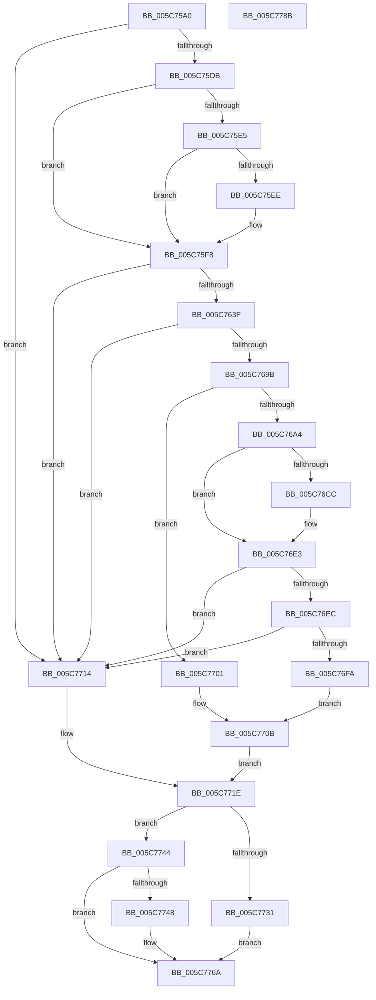

# KiDeferredBugcheckRecoveryWorker

- RVA: `0x005C75A0`–`0x005C778C` (길이 `492` bytes)
- VA: `0x00000001405C75A0`
- 실행 섹션: `.text`
- PDB 이름 있음: `예`; PDB Function 태그: `아니요`
- unwind 정보 RVA: `0x000CABC0`
- 디코드: `122`개 명령, `492/492` bytes 표시
- 미해석 바이트: `0` (있으면 어셈블리에 `.byte`로 보존)

> 이 문서는 커널 이미지의 기계어와 PDB 기호를 분석해 생성했습니다. 4번과 5번은 함수 원형과 자료형을 바이너리 사용 방식에서 추정한 C 해석이며 원본 소스 복구 결과는 아닙니다.

## 1. Dependencies

- 직접 호출 지점: **22**; 고유 호출 대상: **16**
- 직접 호출자로 확인된 함수: **0**
- RIP 상대 이미지 참조: **12**

### Outgoing calls
- `0x005C75CE` → [KiSaveBugcheckRecoveryProgress](KiSaveBugcheckRecoveryProgress_function_005C7AF0.md) (function, `0x005C7AF0`)
- `0x005C75E5` → [IoWriteCapturedPristineTriageDumpToDedicatedDumpFile](../59/IoWriteCapturedPristineTriageDumpToDedicatedDumpFile_function_005934C0.md) (function, `0x005934C0`)
- `0x005C75F3` → [KiSetBugCheckRecoveryProgressFlag](KiSetBugCheckRecoveryProgressFlag_function_005C7C48.md) (function, `0x005C7C48`)
- `0x005C762A` → [KeSetSystemGroupAffinityThread](../39/KeSetSystemGroupAffinityThread_function_00399140.md) (function, `0x00399140`)
- `0x005C7666` → [KiInvokeBugCheckEntryCallbacks](../5B/KiInvokeBugCheckEntryCallbacks_function_005B51A0.md) (function, `0x005B51A0`)
- `0x005C7688` → [IoSaveBugCheckRecoveryStatus](../59/IoSaveBugCheckRecoveryStatus_function_00592EEC.md) (function, `0x00592EEC`)
- `0x005C7692` → [KiSaveBugcheckRecoveryProgress](KiSaveBugcheckRecoveryProgress_function_005C7AF0.md) (function, `0x005C7AF0`)
- `0x005C76B4` → [KiBugCheckRecoveryPrepareForCrashDump](KiBugCheckRecoveryPrepareForCrashDump_function_005C7410.md) (function, `0x005C7410`)
- `0x005C76C3` → [KiInvokeBugCheckEntryCallbacks](../5B/KiInvokeBugCheckEntryCallbacks_function_005B51A0.md) (function, `0x005B51A0`)
- `0x005C76D3` → [KiBugCheckWriteCrashDump](../5B/KiBugCheckWriteCrashDump_function_005B4148.md) (function, `0x005B4148`)
- `0x005C76DE` → [KiBugCheckRecoveryCleanupFromCrashDump](KiBugCheckRecoveryCleanupFromCrashDump_function_005C706C.md) (function, `0x005C706C`)
- `0x005C76F1` → [KiSaveBugcheckRecoveryProgress](KiSaveBugcheckRecoveryProgress_function_005C7AF0.md) (function, `0x005C7AF0`)
- `0x005C76FA` → [ExRebootSystemForRecovery](../65/ExRebootSystemForRecovery_function_00655924.md) (function, `0x00655924`)
- `0x005C7706` → [KiRecordRecoveryFailure](KiRecordRecoveryFailure_function_005C7AB8.md) (function, `0x005C7AB8`)
- `0x005C7719` → [KiRecordRecoveryFailure](KiRecordRecoveryFailure_function_005C7AB8.md) (function, `0x005C7AB8`)
- `0x005C7722` → [KeRevertToUserGroupAffinityThread](../39/KeRevertToUserGroupAffinityThread_function_00398EC0.md) (function, `0x00398EC0`)
- `0x005C773D` → [KeSetEvent](../33/KeSetEvent_function_0033F310.md) (function, `0x0033F310`)
- `0x005C774D` → [KiSaveBugcheckRecoveryProgress](KiSaveBugcheckRecoveryProgress_function_005C7AF0.md) (function, `0x005C7AF0`)
- `0x005C775B` → [guard_dispatch_icall](../6B/guard_dispatch_icall_function_006BAAD0.md) (function, `0x006BAAD0`)
- `0x005C7765` → [HalReturnToFirmware](../54/HalReturnToFirmware_function_00546550.md) (function, `0x00546550`)
- `0x005C776F` → [KiSaveBugcheckRecoveryProgress](KiSaveBugcheckRecoveryProgress_function_005C7AF0.md) (function, `0x005C7AF0`)
- `0x005C777B` → [_security_check_cookie](../6A/_security_check_cookie_function_006AC640.md) (function, `0x006AC640`)

### Direct callers
- 이 함수 시작 RVA로 연결되는 직접 call은 확인되지 않았습니다. 간접 호출은 완전히 역산할 수 없습니다.

### Static image references
- `0x005C75AD` → RVA `0x00E0A740` (`.data`; read)
- `0x005C75DB` → RVA `0x00F10894` (`.data`; read)
- `0x005C75F8` → RVA `0x00F231B0` (`.data`; read)
- `0x005C7647` → RVA `0x00F109A0` (`.data`; read)
- `0x005C7654` → RVA `0x00F10904` (`.data`; write)
- `0x005C765F` → RVA `0x00F10908` (`.data`; write)
- `0x005C7678` → RVA `0x00F109A4` (`.data`; read)
- `0x005C76CC` → RVA `0x00F23500` (`.data`; read)
- `0x005C76E3` → RVA `0x00F10890` (`.data`; read)
- `0x005C7727` → RVA `0x00F109B7` (`.data`; read)
- `0x005C7734` → RVA `0x00F10980` (`.data`; read)
- `0x005C7752` → RVA `0x00E00B08` (`.data`; read)

## 2. Other-region calls and transfers

- 다른 실행 섹션으로 향하는 call: **0**
- 별도 외부 분기/꼬리 이동을 확인하지 못했습니다.

## 3. Assembly (complete function range)

```asm
005C75A0  48 89 5C 24 08                  mov qword ptr [rsp + 8], rbx
005C75A5  55                              push rbp
005C75A6  48 8B EC                        mov rbp, rsp
005C75A9  48 83 EC 60                     sub rsp, 0x60
005C75AD  48 8B 05 8C 31 84 00            mov rax, qword ptr [rip + 0x84318c]
005C75B4  48 33 C4                        xor rax, rsp
005C75B7  48 89 45 F8                     mov qword ptr [rbp - 8], rax
005C75BB  0F 57 C0                        xorps xmm0, xmm0
005C75BE  0F 57 C9                        xorps xmm1, xmm1
005C75C1  B9 C7 00 00 00                  mov ecx, 0xc7
005C75C6  0F 11 45 D8                     movups xmmword ptr [rbp - 0x28], xmm0
005C75CA  0F 11 4D E8                     movups xmmword ptr [rbp - 0x18], xmm1
005C75CE  E8 1D 05 00 00                  call 0x1405c7af0
005C75D3  85 C0                           test eax, eax
005C75D5  0F 88 39 01 00 00               js 0x1405c7714
005C75DB  8B 05 B3 92 94 00               mov eax, dword ptr [rip + 0x9492b3]
005C75E1  A8 10                           test al, 0x10
005C75E3  75 13                           jne 0x1405c75f8
005C75E5  E8 D6 BE FC FF                  call 0x1405934c0
005C75EA  85 C0                           test eax, eax
005C75EC  78 0A                           js 0x1405c75f8
005C75EE  B9 00 20 00 00                  mov ecx, 0x2000
005C75F3  E8 50 06 00 00                  call 0x1405c7c48
005C75F8  48 8B 05 B1 BB 95 00            mov rax, qword ptr [rip + 0x95bbb1]
005C75FF  48 8D 55 E8                     lea rdx, [rbp - 0x18]
005C7603  8B 08                           mov ecx, dword ptr [rax]
005C7605  33 C0                           xor eax, eax
005C7607  89 45 E2                        mov dword ptr [rbp - 0x1e], eax
005C760A  66 89 45 E6                     mov word ptr [rbp - 0x1a], ax
005C760E  8B C1                           mov eax, ecx
005C7610  C1 E8 06                        shr eax, 6
005C7613  83 E1 3F                        and ecx, 0x3f
005C7616  66 89 45 E0                     mov word ptr [rbp - 0x20], ax
005C761A  B8 01 00 00 00                  mov eax, 1
005C761F  48 D3 E0                        shl rax, cl
005C7622  48 8D 4D D8                     lea rcx, [rbp - 0x28]
005C7626  48 89 45 D8                     mov qword ptr [rbp - 0x28], rax
005C762A  E8 11 1B DD FF                  call 0x140399140
005C762F  65 8B 04 25 A4 01 00 00         mov eax, dword ptr gs:[0x1a4]
005C7637  85 C0                           test eax, eax
005C7639  0F 85 D5 00 00 00               jne 0x1405c7714
005C763F  65 8B 04 25 A4 01 00 00         mov eax, dword ptr gs:[0x1a4]
005C7647  48 8D 15 52 93 94 00            lea rdx, [rip + 0x949352]
005C764E  41 B8 4C 00 00 00               mov r8d, 0x4c
005C7654  89 05 AA 92 94 00               mov dword ptr [rip + 0x9492aa], eax
005C765A  B9 00 04 00 00                  mov ecx, 0x400
005C765F  C6 05 A2 92 94 00 01            mov byte ptr [rip + 0x9492a2], 1
005C7666  E8 35 DB FE FF                  call 0x1405b51a0
005C766B  33 C0                           xor eax, eax
005C766D  48 8D 4D C8                     lea rcx, [rbp - 0x38]
005C7671  48 89 45 C8                     mov qword ptr [rbp - 0x38], rax
005C7675  89 45 D0                        mov dword ptr [rbp - 0x30], eax
005C7678  8A 05 26 93 94 00               mov al, byte ptr [rip + 0x949326]
005C767E  88 45 CC                        mov byte ptr [rbp - 0x34], al
005C7681  C7 45 C8 02 00 00 00            mov dword ptr [rbp - 0x38], 2
005C7688  E8 5F B8 FC FF                  call 0x140592eec
005C768D  B9 C4 00 00 00                  mov ecx, 0xc4
005C7692  E8 59 04 00 00                  call 0x1405c7af0
005C7697  85 C0                           test eax, eax
005C7699  78 79                           js 0x1405c7714
005C769B  80 3D 02 93 94 00 00            cmp byte ptr [rip + 0x949302], 0
005C76A2  74 5D                           je 0x1405c7701
005C76A4  48 8D 55 C0                     lea rdx, [rbp - 0x40]
005C76A8  C6 45 C0 00                     mov byte ptr [rbp - 0x40], 0
005C76AC  48 8D 4D C1                     lea rcx, [rbp - 0x3f]
005C76B0  C6 45 C1 00                     mov byte ptr [rbp - 0x3f], 0
005C76B4  E8 57 FD FF FF                  call 0x1405c7410
005C76B9  33 D2                           xor edx, edx
005C76BB  45 33 C0                        xor r8d, r8d
005C76BE  8A D8                           mov bl, al
005C76C0  8D 4A 09                        lea ecx, [rdx + 9]
005C76C3  E8 D8 DA FE FF                  call 0x1405b51a0
005C76C8  84 DB                           test bl, bl
005C76CA  74 17                           je 0x1405c76e3
005C76CC  48 8D 0D 2D BE 95 00            lea rcx, [rip + 0x95be2d]
005C76D3  E8 70 CA FE FF                  call 0x1405b4148
005C76D8  8A 55 C0                        mov dl, byte ptr [rbp - 0x40]
005C76DB  8A 4D C1                        mov cl, byte ptr [rbp - 0x3f]
005C76DE  E8 89 F9 FF FF                  call 0x1405c706c
005C76E3  80 3D A6 91 94 00 00            cmp byte ptr [rip + 0x9491a6], 0
005C76EA  75 28                           jne 0x1405c7714
005C76EC  B9 04 00 00 00                  mov ecx, 4
005C76F1  E8 FA 03 00 00                  call 0x1405c7af0
005C76F6  85 C0                           test eax, eax
005C76F8  78 1A                           js 0x1405c7714
005C76FA  E8 25 E2 08 00                  call 0x140655924
005C76FF  EB 0A                           jmp 0x1405c770b
005C7701  B9 03 00 00 00                  mov ecx, 3
005C7706  E8 AD 03 00 00                  call 0x1405c7ab8
005C770B  C6 05 F6 91 94 00 00            mov byte ptr [rip + 0x9491f6], 0
005C7712  EB 0A                           jmp 0x1405c771e
005C7714  B9 05 00 00 00                  mov ecx, 5
005C7719  E8 9A 03 00 00                  call 0x1405c7ab8
005C771E  48 8D 4D E8                     lea rcx, [rbp - 0x18]
005C7722  E8 99 17 DD FF                  call 0x140398ec0
005C7727  8A 05 8A 92 94 00               mov al, byte ptr [rip + 0x94928a]
005C772D  A8 02                           test al, 2
005C772F  74 13                           je 0x1405c7744
005C7731  45 33 C0                        xor r8d, r8d
005C7734  48 8D 0D 45 92 94 00            lea rcx, [rip + 0x949245]
005C773B  33 D2                           xor edx, edx
005C773D  E8 CE 7B D7 FF                  call 0x14033f310
005C7742  EB 26                           jmp 0x1405c776a
005C7744  A8 04                           test al, 4
005C7746  74 22                           je 0x1405c776a
005C7748  B9 C6 00 00 00                  mov ecx, 0xc6
005C774D  E8 9E 03 00 00                  call 0x1405c7af0
005C7752  48 8B 05 AF 93 83 00            mov rax, qword ptr [rip + 0x8393af]
005C7759  33 C9                           xor ecx, ecx
005C775B  E8 70 33 0F 00                  call 0x1406baad0
005C7760  B9 03 00 00 00                  mov ecx, 3
005C7765  E8 E6 ED F7 FF                  call 0x140546550
005C776A  B9 C5 00 00 00                  mov ecx, 0xc5
005C776F  E8 7C 03 00 00                  call 0x1405c7af0
005C7774  48 8B 4D F8                     mov rcx, qword ptr [rbp - 8]
005C7778  48 33 CC                        xor rcx, rsp
005C777B  E8 C0 4E 0E 00                  call 0x1406ac640
005C7780  48 8B 5C 24 70                  mov rbx, qword ptr [rsp + 0x70]
005C7785  48 83 C4 60                     add rsp, 0x60
005C7789  5D                              pop rbp
005C778A  C3                              ret
005C778B  CC                              int3
```

## 4. C-style interpretation (structured pseudocode)

```c
__int64 __fastcall KiDeferredBugcheckRecoveryWorker(void)
{
    __int64 result;
    __int64 v_rsp;
    unsigned __int64 v_stack_m10;
    unsigned __int64 v_stack_m20;
    unsigned __int16 v_stack_m22;
    unsigned int v_stack_m26;
    unsigned __int16 v_stack_m28;
    unsigned __int64 v_stack_m30;
    unsigned int v_stack_m38;
    unsigned __int8 v_stack_m3C;
    unsigned __int64 v_stack_m40;
    unsigned __int64 v_stack_m47;
    unsigned __int64 v_stack_m48;
    unsigned __int64 v_stack_p8;

    v_stack_p8 = v_rbx;
    v_rsp = (v_rsp) - (96);
    result = (*(unsigned __int64 *)(v_rip + 8663436)) ^ (v_rsp);
    v_stack_m10 = result;
    v_stack_m30 = v_xmm0;
    v_stack_m20 = v_xmm1;
    result = KiSaveBugcheckRecoveryProgress(199, a2, a3, a4);
    if (sign_flag) goto loc_005C7714;
    if ((((unsigned __int8)((unsigned int)(*(unsigned int *)(v_rip + 9736883)))) & (16)) != 0) goto loc_005C75F8;
    result = IoWriteCapturedPristineTriageDumpToDedicatedDumpFile(199, a2, a3, a4);
    if (!(sign_flag)) {
        a1 = 0x2000ULL;
        result = KiSetBugCheckRecoveryProgressFlag(a1, a2, a3, a4);
    }
    result = 0;
    v_stack_m26 = 0;
    v_stack_m22 = 0;
    result = (unsigned int)(((unsigned int)((unsigned int)((unsigned int)(*(unsigned int *)(*(unsigned __int64 *)(v_rip + 9812913)))))) >> (6));
    a1 = (unsigned int)(((unsigned int)(*(unsigned int *)(*(unsigned __int64 *)(v_rip + 9812913)))) & (63));
    v_stack_m28 = (unsigned __int16)(result);
    result = (1) << ((unsigned __int8)(a1));
    v_stack_m30 = result;
    result = KeSetSystemGroupAffinityThread(v_stack_m30, v_stack_m20, a3, a4);
    if ((unsigned int)((unsigned int)(*(unsigned int *)(gs_base + (0 + 420)))) != 0) goto loc_005C7714;
    *(unsigned int *)(v_rip + 9736874) = (unsigned int)((unsigned int)(*(unsigned int *)(gs_base + (0 + 420))));
    *(unsigned __int8 *)(v_rip + 9736866) = 1;
    result = KiInvokeBugCheckEntryCallbacks((unsigned int)(0x400ULL), v_rip + 9737042, 76, a4);
    result = 0;
    v_stack_m40 = 0;
    v_stack_m38 = 0;
    v_stack_m3C = (unsigned __int8)(*(unsigned __int8 *)(v_rip + 9736998));
    v_stack_m40 = 2;
    result = IoSaveBugCheckRecoveryStatus(v_stack_m40, v_rip + 9737042, 76, a4);
    result = KiSaveBugcheckRecoveryProgress(196, v_rip + 9737042, 76, a4);
    if (sign_flag) goto loc_005C7714;
    if ((*(unsigned __int8 *)(v_rip + 9736962)) == 0) goto loc_005C7701;
    v_stack_m48 = 0;
    v_stack_m47 = 0;
    result = KiBugCheckRecoveryPrepareForCrashDump(v_stack_m47, v_stack_m48, 76, a4);
    a2 = 0;
    a3 = 0;
    result = KiInvokeBugCheckEntryCallbacks(a2 + 9, a2, a3, a4);
    if ((unsigned __int8)((unsigned __int8)(result)) != 0) {
        a1 = v_rip + 9813549;
        result = KiBugCheckWriteCrashDump(a1, a2, a3, a4);
        a2 = v_stack_m48;
        a1 = v_stack_m47;
        result = KiBugCheckRecoveryCleanupFromCrashDump(a1, a2, a3, a4);
    }
    if ((*(unsigned __int8 *)(v_rip + 9736614)) != 0) goto loc_005C7714;
    result = KiSaveBugcheckRecoveryProgress(4, a2, a3, a4);
    if (sign_flag) goto loc_005C7714;
    result = ExRebootSystemForRecovery(4, a2, a3, a4);
    goto loc_005C770B;
loc_005C7701:
    result = KiRecordRecoveryFailure(3, a2, a3, a4);
loc_005C770B:
    *(unsigned __int8 *)(v_rip + 9736694) = 0;
    goto loc_005C771E;
loc_005C7714:
    result = KiRecordRecoveryFailure(5, a2, a3, a4);
loc_005C771E:
    result = KeRevertToUserGroupAffinityThread(v_stack_m20, a2, a3, a4);
    if ((((unsigned __int8)(*(unsigned __int8 *)(v_rip + 9736842))) & (2)) == 0) goto loc_005C7744;
    a3 = 0;
    a2 = 0;
    result = KeSetEvent(v_rip + 9736773, a2, a3, a4);
    goto loc_005C776A;
loc_005C7744:
    if ((((unsigned __int8)(result)) & (4)) != 0) {
        a1 = 198;
        result = KiSaveBugcheckRecoveryProgress(a1, a2, a3, a4);
        result = *(unsigned __int64 *)(v_rip + 8623023);
        a1 = 0;
        result = guard_dispatch_icall(a1, a2, a3, a4);
        a1 = 3;
        result = HalReturnToFirmware(a1, a2, a3, a4);
    }
    result = KiSaveBugcheckRecoveryProgress(197, a2, a3, a4);
    a1 = (v_stack_m10) ^ (v_rsp);
    result = _security_check_cookie(a1, a2, a3, a4);
    v_rsp = (v_rsp) + (96);
    return result;
}
```

## 5. (Beta) C Style

```c
void KiDeferredBugcheckRecoveryWorker(void)
{
    int64_t result;
    int64_t local_rsp;
    uint64_t v_stack_m10;
    uint64_t v_stack_m20;
    uint16_t v_stack_m22;
    uint32_t v_stack_m26;
    uint16_t v_stack_m28;
    uint64_t v_stack_m30;
    uint32_t v_stack_m38;
    uint8_t v_stack_m3C;
    uint64_t v_stack_m40;
    uint64_t v_stack_m47;
    uint64_t v_stack_m48;
    uint64_t v_stack_p8;

    v_stack_p8 = local_rbx;
    local_rsp = (local_rsp) - (96);
    result = (*(uint64_t *)(v_rip + 0x84318C)) ^ (local_rsp);
    v_stack_m10 = result;
    v_stack_m30 = v_xmm0;
    v_stack_m20 = v_xmm1;
    result = KiSaveBugcheckRecoveryProgress(199, a2, a3, a4);
    if (sign_flag) goto loc_005C7714;
    if ((((uint8_t)((uint32_t)(*(uint32_t *)(v_rip + 0x9492B3)))) & (16)) != 0) goto loc_005C75F8;
    result = IoWriteCapturedPristineTriageDumpToDedicatedDumpFile(199, a2, a3, a4);
    if (!(sign_flag)) {
        a1 = 0x2000ULL;
        result = KiSetBugCheckRecoveryProgressFlag(a1, a2, a3, a4);
    }
    result = 0;
    v_stack_m26 = 0;
    v_stack_m22 = 0;
    result = (uint32_t)(((uint32_t)((uint32_t)((uint32_t)(*(uint32_t *)(*(uint64_t *)(v_rip + 0x95BBB1)))))) >> (6));
    a1 = (uint32_t)(((uint32_t)(*(uint32_t *)(*(uint64_t *)(v_rip + 0x95BBB1)))) & (63));
    v_stack_m28 = (uint16_t)(result);
    result = (1) << ((uint8_t)(a1));
    v_stack_m30 = result;
    result = KeSetSystemGroupAffinityThread(v_stack_m30, v_stack_m20, a3, a4);
    if ((uint32_t)((uint32_t)(*(uint32_t *)(gs_base + (0 + 0x1A4)))) != 0) goto loc_005C7714;
    *(uint32_t *)(v_rip + 0x9492AA) = (uint32_t)((uint32_t)(*(uint32_t *)(gs_base + (0 + 0x1A4))));
    *(uint8_t *)(v_rip + 0x9492A2) = 1;
    result = KiInvokeBugCheckEntryCallbacks((uint32_t)(0x400ULL), v_rip + 9737042, 76, a4);
    result = 0;
    v_stack_m40 = 0;
    v_stack_m38 = 0;
    v_stack_m3C = (uint8_t)(*(uint8_t *)(v_rip + 0x949326));
    v_stack_m40 = 2;
    result = IoSaveBugCheckRecoveryStatus(v_stack_m40, v_rip + 9737042, 76, a4);
    result = KiSaveBugcheckRecoveryProgress(196, v_rip + 9737042, 76, a4);
    if (sign_flag) goto loc_005C7714;
    if ((*(uint8_t *)(v_rip + 0x949302)) == 0) goto loc_005C7701;
    v_stack_m48 = 0;
    v_stack_m47 = 0;
    result = KiBugCheckRecoveryPrepareForCrashDump(v_stack_m47, v_stack_m48, 76, a4);
    a2 = 0;
    a3 = 0;
    result = KiInvokeBugCheckEntryCallbacks(a2 + 9, a2, a3, a4);
    if ((uint8_t)((uint8_t)(result)) != 0) {
        a1 = v_rip + 9813549;
        result = KiBugCheckWriteCrashDump(a1, a2, a3, a4);
        a2 = v_stack_m48;
        a1 = v_stack_m47;
        result = KiBugCheckRecoveryCleanupFromCrashDump(a1, a2, a3, a4);
    }
    if ((*(uint8_t *)(v_rip + 0x9491A6)) != 0) goto loc_005C7714;
    result = KiSaveBugcheckRecoveryProgress(4, a2, a3, a4);
    if (sign_flag) goto loc_005C7714;
    result = ExRebootSystemForRecovery(4, a2, a3, a4);
    goto loc_005C770B;
loc_005C7701:
    result = KiRecordRecoveryFailure(3, a2, a3, a4);
loc_005C770B:
    *(uint8_t *)(v_rip + 0x9491F6) = 0;
    goto loc_005C771E;
loc_005C7714:
    result = KiRecordRecoveryFailure(5, a2, a3, a4);
loc_005C771E:
    result = KeRevertToUserGroupAffinityThread(v_stack_m20, a2, a3, a4);
    if ((((uint8_t)(*(uint8_t *)(v_rip + 0x94928A))) & (2)) == 0) goto loc_005C7744;
    a3 = 0;
    a2 = 0;
    result = KeSetEvent(v_rip + 9736773, a2, a3, a4);
    goto loc_005C776A;
loc_005C7744:
    if ((((uint8_t)(result)) & (4)) != 0) {
        a1 = 198;
        result = KiSaveBugcheckRecoveryProgress(a1, a2, a3, a4);
        result = *(uint64_t *)(v_rip + 0x8393AF);
        a1 = 0;
        result = guard_dispatch_icall(a1, a2, a3, a4);
        a1 = 3;
        result = HalReturnToFirmware(a1, a2, a3, a4);
    }
    result = KiSaveBugcheckRecoveryProgress(197, a2, a3, a4);
    a1 = (v_stack_m10) ^ (local_rsp);
    result = _security_check_cookie(a1, a2, a3, a4);
    local_rsp = (local_rsp) + (96);
    return result;
}
```

## 6. Execution-region graph

[열기: 2D/3D 그래프와 함수 탐색 컨트롤 패널](../../../control-panel.html?section=text&rva=0x005C75A0&view=graph)

- 2D 그래프는 위에서 아래로 흐르고, 3D 그래프는 빈 공간을 드래그해 회전합니다. Shift+드래그는 이동, 휠은 확대·축소, 함수 노드 선택은 대상 보고서 이동입니다.

### Static fallback


