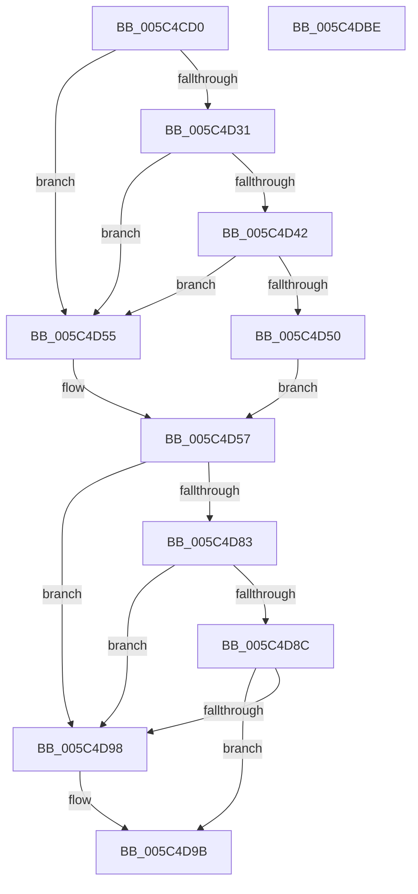

# KiDetectKvaLeakage

- RVA: `0x005C4CD0`–`0x005C4DBF` (길이 `239` bytes)
- VA: `0x00000001405C4CD0`
- 실행 섹션: `.text`
- PDB 이름 있음: `예`; PDB Function 태그: `아니요`
- unwind 정보 RVA: `0x000937EC`
- 디코드: `67`개 명령, `239/239` bytes 표시
- 미해석 바이트: `0` (있으면 어셈블리에 `.byte`로 보존)

> 이 문서는 커널 이미지의 기계어와 PDB 기호를 분석해 생성했습니다. 4번과 5번은 함수 원형과 자료형을 바이너리 사용 방식에서 추정한 C 해석이며 원본 소스 복구 결과는 아닙니다.

## 1. Dependencies

- 직접 호출 지점: **7**; 고유 호출 대상: **6**
- 직접 호출자로 확인된 함수: **1**
- RIP 상대 이미지 참조: **2**

### Outgoing calls
- `0x005C4D21` → [KiDetectHardwareSpecControlFeatures](../5B/KiDetectHardwareSpecControlFeatures_function_005BEC4C.md) (function, `0x005BEC4C`)
- `0x005C4D39` → [KiIsBranchConfusionMitigationDesired](../5B/KiIsBranchConfusionMitigationDesired_function_005BF27C.md) (function, `0x005BF27C`)
- `0x005C4D47` → [KiIsBranchConfusionMitigationSupported](../5B/KiIsBranchConfusionMitigationSupported_function_005BF2BC.md) (function, `0x005BF2BC`)
- `0x005C4D73` → [KiDetectHardwareSpecControlFeatures](../5B/KiDetectHardwareSpecControlFeatures_function_005BEC4C.md) (function, `0x005BEC4C`)
- `0x005C4D83` → [KiIsTsaMitigationDesired](../5B/KiIsTsaMitigationDesired_function_005BF438.md) (function, `0x005BF438`)
- `0x005C4D8F` → [KiIsTsaMitigationSupported](../5B/KiIsTsaMitigationSupported_function_005BF454.md) (function, `0x005BF454`)
- `0x005C4DA9` → [SpcDetectKvaLeakage](../../pagelk/B7/SpcDetectKvaLeakage_function_00B75098.md) (function, `0x00B75098`)

### Direct callers
- [KiSetFeatureBits](../../pagelk/B6/KiSetFeatureBits_function_00B6A03C.md) at `0x00B6A373`

### Static image references
- `0x005C4CE0` → RVA `0x01201841` (`CFGRO`; read)
- `0x005C4CF9` → RVA `0x00F10EC4` (`.data`; read)

## 2. Other-region calls and transfers

- 다른 실행 섹션으로 향하는 call: **1**
  - `0x005C4DA9` → [SpcDetectKvaLeakage](../../pagelk/B7/SpcDetectKvaLeakage_function_00B75098.md) (`.text` → `PAGELK`)
- 별도 외부 분기/꼬리 이동을 확인하지 못했습니다.

## 3. Assembly (complete function range)

```asm
005C4CD0  4C 8B DC                        mov r11, rsp
005C4CD3  49 89 5B 10                     mov qword ptr [r11 + 0x10], rbx
005C4CD7  49 89 73 18                     mov qword ptr [r11 + 0x18], rsi
005C4CDB  57                              push rdi
005C4CDC  48 83 EC 40                     sub rsp, 0x40
005C4CE0  8A 05 5B CB C3 00               mov al, byte ptr [rip + 0xc3cb5b]
005C4CE6  4D 8D 43 D8                     lea r8, [r11 - 0x28]
005C4CEA  83 64 24 50 00                  and dword ptr [rsp + 0x50], 0
005C4CEF  0F 57 C0                        xorps xmm0, xmm0
005C4CF2  88 44 24 53                     mov byte ptr [rsp + 0x53], al
005C4CF6  40 B6 01                        mov sil, 1
005C4CF9  8A 05 C5 C1 94 00               mov al, byte ptr [rip + 0x94c1c5]
005C4CFF  45 33 C9                        xor r9d, r9d
005C4D02  C0 E8 04                        shr al, 4
005C4D05  33 D2                           xor edx, edx
005C4D07  40 22 C6                        and al, sil
005C4D0A  C6 44 24 51 00                  mov byte ptr [rsp + 0x51], 0
005C4D0F  88 44 24 52                     mov byte ptr [rsp + 0x52], al
005C4D13  48 8B F9                        mov rdi, rcx
005C4D16  33 C0                           xor eax, eax
005C4D18  0F 11 44 24 20                  movups xmmword ptr [rsp + 0x20], xmm0
005C4D1D  49 89 43 E8                     mov qword ptr [r11 - 0x18], rax
005C4D21  E8 26 9F FF FF                  call 0x1405bec4c
005C4D26  48 F7 44 24 20 00 80 00 00      test qword ptr [rsp + 0x20], 0x8000
005C4D2F  74 24                           je 0x1405c4d55
005C4D31  48 8D 54 24 20                  lea rdx, [rsp + 0x20]
005C4D36  48 8B CF                        mov rcx, rdi
005C4D39  E8 3E A5 FF FF                  call 0x1405bf27c
005C4D3E  85 C0                           test eax, eax
005C4D40  74 13                           je 0x1405c4d55
005C4D42  48 8D 54 24 20                  lea rdx, [rsp + 0x20]
005C4D47  E8 70 A5 FF FF                  call 0x1405bf2bc
005C4D4C  85 C0                           test eax, eax
005C4D4E  74 05                           je 0x1405c4d55
005C4D50  40 8A DE                        mov bl, sil
005C4D53  EB 02                           jmp 0x1405c4d57
005C4D55  32 DB                           xor bl, bl
005C4D57  0F 57 C0                        xorps xmm0, xmm0
005C4D5A  4C 8D 44 24 20                  lea r8, [rsp + 0x20]
005C4D5F  33 C0                           xor eax, eax
005C4D61  45 33 C9                        xor r9d, r9d
005C4D64  33 D2                           xor edx, edx
005C4D66  48 89 44 24 30                  mov qword ptr [rsp + 0x30], rax
005C4D6B  48 8B CF                        mov rcx, rdi
005C4D6E  0F 11 44 24 20                  movups xmmword ptr [rsp + 0x20], xmm0
005C4D73  E8 D4 9E FF FF                  call 0x1405bec4c
005C4D78  48 F7 44 24 20 00 00 00 08      test qword ptr [rsp + 0x20], 0x8000000
005C4D81  74 15                           je 0x1405c4d98
005C4D83  E8 B0 A6 FF FF                  call 0x1405bf438
005C4D88  85 C0                           test eax, eax
005C4D8A  74 0C                           je 0x1405c4d98
005C4D8C  48 8B CF                        mov rcx, rdi
005C4D8F  E8 C0 A6 FF FF                  call 0x1405bf454
005C4D94  85 C0                           test eax, eax
005C4D96  75 03                           jne 0x1405c4d9b
005C4D98  40 32 F6                        xor sil, sil
005C4D9B  8B 4F 24                        mov ecx, dword ptr [rdi + 0x24]
005C4D9E  40 0A DE                        or bl, sil
005C4DA1  88 5C 24 50                     mov byte ptr [rsp + 0x50], bl
005C4DA5  8B 54 24 50                     mov edx, dword ptr [rsp + 0x50]
005C4DA9  E8 EA 02 5B 00                  call 0x140b75098
005C4DAE  48 8B 5C 24 58                  mov rbx, qword ptr [rsp + 0x58]
005C4DB3  48 8B 74 24 60                  mov rsi, qword ptr [rsp + 0x60]
005C4DB8  48 83 C4 40                     add rsp, 0x40
005C4DBC  5F                              pop rdi
005C4DBD  C3                              ret
005C4DBE  CC                              int3
```

## 4. C-style interpretation (structured pseudocode)

```c
__int64 __fastcall KiDetectKvaLeakage(__int64 a1, int a2, __int64 a3, int a4)
{
    __int64 result;
    __int64 v_rbx;
    __int64 v_rsi;
    __int64 v_rsp;
    unsigned __int64 v_stack_m18;
    unsigned __int64 v_stack_m28;
    unsigned __int64 v_stack_p10;
    unsigned __int64 v_stack_p18;
    unsigned int v_stack_p8;
    unsigned __int8 v_stack_p9;
    unsigned __int8 v_stack_pA;
    unsigned __int8 v_stack_pB;

    *(unsigned __int64 *)(v_rsp + 16) = v_rbx;
    *(unsigned __int64 *)(v_rsp + 24) = v_rsi;
    v_rsp = (v_rsp) - (64);
    v_stack_pB = (unsigned __int8)(*(unsigned __int8 *)(v_rip + 12831579));
    a4 = 0;
    result = (unsigned __int8)((*(unsigned __int8 *)(v_rip + 9748933)) >> (4));
    a2 = 0;
    result = (unsigned __int8)((result) & (1));
    v_stack_p9 = 0;
    v_stack_pA = (unsigned __int8)(result);
    result = 0;
    v_stack_m28 = v_xmm0;
    *(unsigned __int64 *)(v_rsp - 24) = 0;
    result = KiDetectHardwareSpecControlFeatures(a1, a2, v_rsp - 40, a4);
    if (((v_stack_m28) & (0x8000ULL)) == 0) goto loc_005C4D55;
    result = KiIsBranchConfusionMitigationDesired(a1, v_stack_m28, v_rsp - 40, a4);
    if ((unsigned int)(result) == 0) goto loc_005C4D55;
    result = KiIsBranchConfusionMitigationSupported(a1, v_stack_m28, v_rsp - 40, a4);
    if ((unsigned int)(result) == 0) goto loc_005C4D55;
    goto loc_005C4D57;
loc_005C4D55:
    v_rbx = 0;
loc_005C4D57:
    result = 0;
    a4 = 0;
    a2 = 0;
    v_stack_m18 = 0;
    v_stack_m28 = v_xmm0;
    result = KiDetectHardwareSpecControlFeatures(a1, a2, v_stack_m28, a4);
    if (((v_stack_m28) & (0x8000000ULL)) == 0) goto loc_005C4D98;
    result = KiIsTsaMitigationDesired(a1, a2, v_stack_m28, a4);
    if ((unsigned int)(result) == 0) goto loc_005C4D98;
    result = KiIsTsaMitigationSupported(a1, a2, v_stack_m28, a4);
    v_rsi = 1;
    if ((unsigned int)(result) == 0) {
        v_rsi = 0;
    }
    v_rbx = (unsigned __int8)((v_rbx) | (0));
    v_stack_p8 = (unsigned __int8)(v_rbx);
    result = SpcDetectKvaLeakage((unsigned int)(*(unsigned int *)(a1 + 36)), (unsigned int)(v_stack_p8), v_stack_m28, a4);
    v_rsp = (v_rsp) + (64);
    return result;
}
```

## 5. (Beta) C Style

```c
int64_t KiDetectKvaLeakage(void *Arg1, int32_t Arg2, int64_t Arg3, int32_t Arg4)
{
    uint8_t *arg1 = (uint8_t *)Arg1;

    int64_t result;
    int64_t local_rbx;
    int64_t local_rsi;
    int64_t local_rsp;
    uint64_t v_stack_m18;
    uint64_t v_stack_m28;
    uint64_t v_stack_p10;
    uint64_t v_stack_p18;
    uint32_t v_stack_p8;
    uint8_t v_stack_p9;
    uint8_t v_stack_pA;
    uint8_t v_stack_pB;

    *(uint64_t *)(local_rsp + 0x10) = local_rbx;
    *(uint64_t *)(local_rsp + 0x18) = local_rsi;
    local_rsp = (local_rsp) - (64);
    v_stack_pB = (uint8_t)(*(uint8_t *)(v_rip + 0xC3CB5B));
    Arg4 = 0;
    result = (uint8_t)((*(uint8_t *)(v_rip + 0x94C1C5)) >> (4));
    Arg2 = 0;
    result = (uint8_t)((result) & (1));
    v_stack_p9 = 0;
    v_stack_pA = (uint8_t)(result);
    result = 0;
    v_stack_m28 = v_xmm0;
    *(uint64_t *)(local_rsp - 0x18) = 0;
    result = KiDetectHardwareSpecControlFeatures(Arg1, Arg2, local_rsp - 40, Arg4);
    if (((v_stack_m28) & (0x8000ULL)) == 0) goto loc_005C4D55;
    result = KiIsBranchConfusionMitigationDesired(Arg1, v_stack_m28, local_rsp - 40, Arg4);
    if ((uint32_t)(result) == 0) goto loc_005C4D55;
    result = KiIsBranchConfusionMitigationSupported(Arg1, v_stack_m28, local_rsp - 40, Arg4);
    if ((uint32_t)(result) == 0) goto loc_005C4D55;
    goto loc_005C4D57;
loc_005C4D55:
    local_rbx = 0;
loc_005C4D57:
    result = 0;
    Arg4 = 0;
    Arg2 = 0;
    v_stack_m18 = 0;
    v_stack_m28 = v_xmm0;
    result = KiDetectHardwareSpecControlFeatures(Arg1, Arg2, v_stack_m28, Arg4);
    if (((v_stack_m28) & (0x8000000ULL)) == 0) goto loc_005C4D98;
    result = KiIsTsaMitigationDesired(Arg1, Arg2, v_stack_m28, Arg4);
    if ((uint32_t)(result) == 0) goto loc_005C4D98;
    result = KiIsTsaMitigationSupported(Arg1, Arg2, v_stack_m28, Arg4);
    local_rsi = 1;
    if ((uint32_t)(result) == 0) {
        local_rsi = 0;
    }
    local_rbx = (uint8_t)((local_rbx) | (0));
    v_stack_p8 = (uint8_t)(local_rbx);
    result = SpcDetectKvaLeakage((uint32_t)(*(uint32_t *)(arg1 + 0x24)), (uint32_t)(v_stack_p8), v_stack_m28, Arg4);
    local_rsp = (local_rsp) + (64);
    return result;
}
```

### 관측된 메모리 오프셋

구조체 형식이 확인되지 않은 접근은 인자 기준의 오프셋으로만 기록했습니다.

| 기준 인자 | 오프셋 표현 | 폭 (bit) | 접근 |
|---|---:|---:|---|
| `Arg1` | `+ 0x24` | `32` | `R` |

## 6. Execution-region graph

[열기: 2D/3D 그래프와 함수 탐색 컨트롤 패널](../../../control-panel.html?section=text&rva=0x005C4CD0&view=graph)

- 2D 그래프는 위에서 아래로 흐르고, 3D 그래프는 빈 공간을 드래그해 회전합니다. Shift+드래그는 이동, 휠은 확대·축소, 함수 노드 선택은 대상 보고서 이동입니다.

### Static fallback


