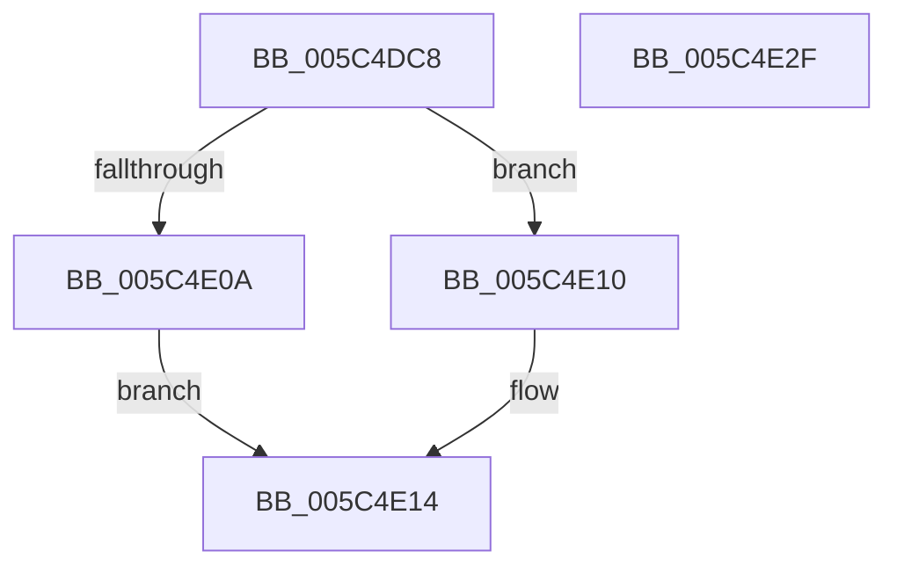

# KiDisableCacheErrataSource

- RVA: `0x005C4DC8`–`0x005C4E30` (길이 `104` bytes)
- VA: `0x00000001405C4DC8`
- 실행 섹션: `.text`
- PDB 이름 있음: `예`; PDB Function 태그: `아니요`
- unwind 정보 RVA: `0x0005C788`
- 디코드: `27`개 명령, `104/104` bytes 표시
- 미해석 바이트: `0` (있으면 어셈블리에 `.byte`로 보존)

> 이 문서는 커널 이미지의 기계어와 PDB 기호를 분석해 생성했습니다. 4번과 5번은 함수 원형과 자료형을 바이너리 사용 방식에서 추정한 C 해석이며 원본 소스 복구 결과는 아닙니다.

## 1. Dependencies

- 직접 호출 지점: **2**; 고유 호출 대상: **2**
- 직접 호출자로 확인된 함수: **2**
- RIP 상대 이미지 참조: **1**

### Outgoing calls
- `0x005C4DF7` → [ReadAMDMsr](../6B/ReadAMDMsr_function_006B9ED0.md) (function, `0x006B9ED0`)
- `0x005C4E25` → [WriteAMDMsr](../6B/WriteAMDMsr_function_006B9EF0.md) (function, `0x006B9EF0`)

### Direct callers
- [KeRestoreProcessorSpecificFeatures](../4D/KeRestoreProcessorSpecificFeatures_function_004D4C90.md) at `0x004D4CBA`
- [KiInitializeCacheErrataSupport](../../init/C3/KiInitializeCacheErrataSupport_function_00C3A0D0.md) at `0x00C3A0EA`
- [KiInitializeCacheErrataSupport](../../init/C3/KiInitializeCacheErrataSupport_function_00C3A0D0.md) at `0x00C3A123`

### Static image references
- `0x005C4DFC` → RVA `0x00FC6C70` (`ALMOSTRO`; read)

## 2. Other-region calls and transfers

- 다른 실행 섹션으로 향하는 call: **0**
- 별도 외부 분기/꼬리 이동을 확인하지 못했습니다.

## 3. Assembly (complete function range)

```asm
005C4DC8  48 83 EC 28                     sub rsp, 0x28
005C4DCC  B9 15 00 01 C0                  mov ecx, 0xc0010015
005C4DD1  0F 32                           rdmsr
005C4DD3  48 C1 E2 20                     shl rdx, 0x20
005C4DD7  48 0B C2                        or rax, rdx
005C4DDA  48 89 44 24 30                  mov qword ptr [rsp + 0x30], rax
005C4DDF  83 4C 24 30 08                  or dword ptr [rsp + 0x30], 8
005C4DE4  48 8B 54 24 30                  mov rdx, qword ptr [rsp + 0x30]
005C4DE9  48 8B C2                        mov rax, rdx
005C4DEC  48 C1 EA 20                     shr rdx, 0x20
005C4DF0  0F 30                           wrmsr
005C4DF2  B9 23 10 01 C0                  mov ecx, 0xc0011023
005C4DF7  E8 D4 50 0F 00                  call 0x1406b9ed0
005C4DFC  83 3D 6D 1E A0 00 01            cmp dword ptr [rip + 0xa01e6d], 1
005C4E03  48 89 44 24 30                  mov qword ptr [rsp + 0x30], rax
005C4E08  75 06                           jne 0x1405c4e10
005C4E0A  0F BA F0 15                     btr eax, 0x15
005C4E0E  EB 04                           jmp 0x1405c4e14
005C4E10  0F BA E8 17                     bts eax, 0x17
005C4E14  83 C8 02                        or eax, 2
005C4E17  B9 23 10 01 C0                  mov ecx, 0xc0011023
005C4E1C  89 44 24 30                     mov dword ptr [rsp + 0x30], eax
005C4E20  48 8B 54 24 30                  mov rdx, qword ptr [rsp + 0x30]
005C4E25  E8 C6 50 0F 00                  call 0x1406b9ef0
005C4E2A  48 83 C4 28                     add rsp, 0x28
005C4E2E  C3                              ret
005C4E2F  CC                              int3
```

## 4. C-style interpretation (structured pseudocode)

```c
__int64 __fastcall KiDisableCacheErrataSource(__int64 a1, __int64 a2)
{
    __int64 result;
    __int64 v_rsp;
    unsigned __int64 v_stack_p8;

    v_rsp = (v_rsp) - (40);
    a2 = (a2) << (32);
    result = (result) | (a2);
    v_stack_p8 = result;
    a2 = (v_stack_p8) >> (32);
    result = ReadAMDMsr((unsigned int)(0xC0011023ULL), a2, a3, a4);
    v_stack_p8 = result;
    if ((*(unsigned int *)(v_rip + 10493549)) != 1) goto loc_005C4E10;
    goto loc_005C4E14;
loc_005C4E10:
loc_005C4E14:
    result = (unsigned int)((result) | (2));
    v_stack_p8 = (unsigned int)(result);
    result = WriteAMDMsr((unsigned int)(0xC0011023ULL), v_stack_p8, a3, a4);
    v_rsp = (v_rsp) + (40);
    return result;
}
```

## 5. (Beta) C Style

```c
int64_t KiDisableCacheErrataSource(int64_t Arg1, int64_t Arg2)
{
    int64_t result;
    int64_t local_rsp;
    uint64_t v_stack_p8;

    local_rsp = (local_rsp) - (40);
    Arg2 = (Arg2) << (32);
    result = (result) | (Arg2);
    v_stack_p8 = result;
    Arg2 = (v_stack_p8) >> (32);
    result = ReadAMDMsr((uint32_t)(0xC0011023ULL), Arg2, a3, a4);
    v_stack_p8 = result;
    if ((*(uint32_t *)(v_rip + 0xA01E6D)) != 1) goto loc_005C4E10;
    goto loc_005C4E14;
loc_005C4E10:
loc_005C4E14:
    result = (uint32_t)((result) | (2));
    v_stack_p8 = (uint32_t)(result);
    result = WriteAMDMsr((uint32_t)(0xC0011023ULL), v_stack_p8, a3, a4);
    local_rsp = (local_rsp) + (40);
    return result;
}
```

## 6. Execution-region graph

[열기: 2D/3D 그래프와 함수 탐색 컨트롤 패널](../../../control-panel.html?section=text&rva=0x005C4DC8&view=graph)

- 2D 그래프는 위에서 아래로 흐르고, 3D 그래프는 빈 공간을 드래그해 회전합니다. Shift+드래그는 이동, 휠은 확대·축소, 함수 노드 선택은 대상 보고서 이동입니다.

### Static fallback


