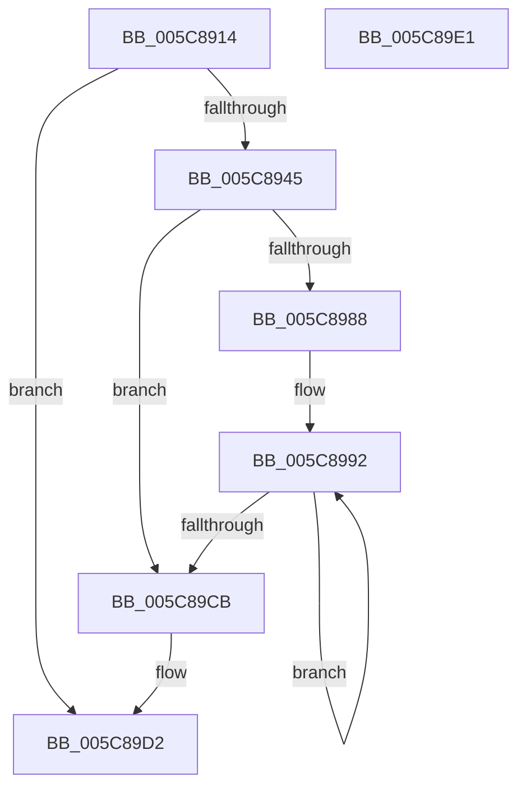

# KiEnableGroupScheduling

- RVA: `0x005C8914`–`0x005C89E2` (길이 `206` bytes)
- VA: `0x00000001405C8914`
- 실행 섹션: `.text`
- PDB 이름 있음: `예`; PDB Function 태그: `아니요`
- unwind 정보 RVA: `0x00063458`
- 디코드: `43`개 명령, `206/206` bytes 표시
- 미해석 바이트: `0` (있으면 어셈블리에 `.byte`로 보존)

> 이 문서는 커널 이미지의 기계어와 PDB 기호를 분석해 생성했습니다. 4번과 5번은 함수 원형과 자료형을 바이너리 사용 방식에서 추정한 C 해석이며 원본 소스 복구 결과는 아닙니다.

## 1. Dependencies

- 직접 호출 지점: **3**; 고유 호출 대상: **3**
- 직접 호출자로 확인된 함수: **1**
- RIP 상대 이미지 참조: **11**

### Outgoing calls
- `0x005C8933` → [KeAcquireInStackQueuedSpinLock](../27/KeAcquireInStackQueuedSpinLock_function_002757A0.md) (function, `0x002757A0`)
- `0x005C895C` → [KeUpdateGroupSchedulingConstants](KeUpdateGroupSchedulingConstants_function_005C8E14.md) (function, `0x005C8E14`)
- `0x005C89D7` → [KeReleaseInStackQueuedSpinLock](../34/KeReleaseInStackQueuedSpinLock_function_00342CE0.md) (function, `0x00342CE0`)

### Direct callers
- [KeInsertSchedulingGroup](../46/KeInsertSchedulingGroup_function_0046D324.md) at `0x0046D69E`

### Static image references
- `0x005C8922` → RVA `0x00FCF180` (`CACHEALI`; read)
- `0x005C8938` → RVA `0x00FC6ABC` (`ALMOSTRO`; read)
- `0x005C8945` → RVA `0x00F23420` (`.data`; read)
- `0x005C894E` → RVA `0x00F23428` (`.data`; write)
- `0x005C8955` → RVA `0x00F23420` (`.data`; write)
- `0x005C896E` → RVA `0x00FC6DB8` (`ALMOSTRO`; read)
- `0x005C8977` → RVA `0x00FC6A80` (`ALMOSTRO`; read)
- `0x005C897D` → RVA `0x00F23150` (`.data`; write)
- `0x005C8988` → RVA `0x00FC8C40` (`ALMOSTRO`; read)
- `0x005C89B7` → RVA `0x00F23150` (`.data`; read)
- `0x005C89CB` → RVA `0x00FC6ABC` (`ALMOSTRO`; write)

## 2. Other-region calls and transfers

- 다른 실행 섹션으로 향하는 call: **0**
- 별도 외부 분기/꼬리 이동을 확인하지 못했습니다.

## 3. Assembly (complete function range)

```asm
005C8914  48 83 EC 48                     sub rsp, 0x48
005C8918  0F 57 C0                        xorps xmm0, xmm0
005C891B  48 8D 54 24 20                  lea rdx, [rsp + 0x20]
005C8920  33 C0                           xor eax, eax
005C8922  48 8D 0D 57 68 A0 00            lea rcx, [rip + 0xa06857]
005C8929  0F 11 44 24 20                  movups xmmword ptr [rsp + 0x20], xmm0
005C892E  48 89 44 24 30                  mov qword ptr [rsp + 0x30], rax
005C8933  E8 68 CE CA FF                  call 0x1402757a0
005C8938  80 3D 7D E1 9F 00 00            cmp byte ptr [rip + 0x9fe17d], 0
005C893F  0F 85 8D 00 00 00               jne 0x1405c89d2
005C8945  48 8D 05 D4 AA 95 00            lea rax, [rip + 0x95aad4]
005C894C  B1 01                           mov cl, 1
005C894E  48 89 05 D3 AA 95 00            mov qword ptr [rip + 0x95aad3], rax
005C8955  48 89 05 C4 AA 95 00            mov qword ptr [rip + 0x95aac4], rax
005C895C  E8 B3 04 00 00                  call 0x1405c8e14
005C8961  48 B8 20 03 00 00 80 F7 FF FF   movabs rax, 0xfffff78000000320
005C896B  48 8B 00                        mov rax, qword ptr [rax]
005C896E  8B 0D 44 E4 9F 00               mov ecx, dword ptr [rip + 0x9fe444]
005C8974  48 03 C8                        add rcx, rax
005C8977  8B 05 03 E1 9F 00               mov eax, dword ptr [rip + 0x9fe103]
005C897D  48 89 0D CC A7 95 00            mov qword ptr [rip + 0x95a7cc], rcx
005C8984  85 C0                           test eax, eax
005C8986  74 43                           je 0x1405c89cb
005C8988  48 8D 15 B1 02 A0 00            lea rdx, [rip + 0xa002b1]
005C898F  44 8B C0                        mov r8d, eax
005C8992  48 8B 0A                        mov rcx, qword ptr [rdx]
005C8995  48 8D 52 08                     lea rdx, [rdx + 8]
005C8999  48 8D 81 88 8A 00 00            lea rax, [rcx + 0x8a88]
005C89A0  48 89 40 08                     mov qword ptr [rax + 8], rax
005C89A4  48 89 00                        mov qword ptr [rax], rax
005C89A7  69 41 24 B8 01 00 00            imul eax, dword ptr [rcx + 0x24], 0x1b8
005C89AE  83 E8 80                        sub eax, -0x80
005C89B1  89 81 D8 00 00 00               mov dword ptr [rcx + 0xd8], eax
005C89B7  48 8B 05 92 A7 95 00            mov rax, qword ptr [rip + 0x95a792]
005C89BE  48 89 81 D8 8B 00 00            mov qword ptr [rcx + 0x8bd8], rax
005C89C5  49 83 E8 01                     sub r8, 1
005C89C9  75 C7                           jne 0x1405c8992
005C89CB  C6 05 EA E0 9F 00 01            mov byte ptr [rip + 0x9fe0ea], 1
005C89D2  48 8D 4C 24 20                  lea rcx, [rsp + 0x20]
005C89D7  E8 04 A3 D7 FF                  call 0x140342ce0
005C89DC  48 83 C4 48                     add rsp, 0x48
005C89E0  C3                              ret
005C89E1  CC                              int3
```

## 4. C-style interpretation (structured pseudocode)

```c
__int64 __fastcall KiEnableGroupScheduling(void)
{
    __int64 result;
    __int64 v_rsp;
    unsigned __int64 v_stack_m18;
    unsigned __int64 v_stack_m28;

    v_rsp = (v_rsp) - (72);
    result = 0;
    v_stack_m28 = v_xmm0;
    v_stack_m18 = 0;
    result = KeAcquireInStackQueuedSpinLock(v_rip + 10512471, v_stack_m28, a3, a4);
    if ((*(unsigned __int8 *)(v_rip + 10477949)) != 0) goto loc_005C89D2;
    *(unsigned __int64 *)(v_rip + 9808595) = v_rip + 9808596;
    *(unsigned __int64 *)(v_rip + 9808580) = v_rip + 9808596;
    result = KeUpdateGroupSchedulingConstants(1, v_stack_m28, a3, a4);
    a1 = ((unsigned int)(*(unsigned int *)(v_rip + 10478660))) + (*(unsigned __int64 *)(result));
    *(unsigned __int64 *)(v_rip + 9807820) = a1;
    if ((unsigned int)((unsigned int)(*(unsigned int *)(v_rip + 10477827))) == 0) goto loc_005C89CB;
loc_005C8992:
    *(unsigned __int64 *)(*(unsigned __int64 *)(v_rip + 10486449) + 35464 + 8) = *(unsigned __int64 *)(v_rip + 10486449) + 35464;
    *(unsigned __int64 *)(*(unsigned __int64 *)(v_rip + 10486449) + 35464) = *(unsigned __int64 *)(v_rip + 10486449) + 35464;
    result = (unsigned int)((*(unsigned __int64 *)(v_rip + 10486449) + 35464) * (*(unsigned int *)(*(unsigned __int64 *)(v_rip + 10486449) + 36)));
    result = (unsigned int)((result) - (-128));
    *(unsigned int *)(*(unsigned __int64 *)(v_rip + 10486449) + 216) = (unsigned int)(result);
    *(unsigned __int64 *)(*(unsigned __int64 *)(v_rip + 10486449) + 35800) = *(unsigned __int64 *)(v_rip + 9807762);
    a3 = ((unsigned int)((unsigned int)((unsigned int)(*(unsigned int *)(v_rip + 10477827))))) - (1);
    if (condition_is_not_equal) goto loc_005C8992;
loc_005C89CB:
    *(unsigned __int8 *)(v_rip + 10477802) = 1;
loc_005C89D2:
    result = KeReleaseInStackQueuedSpinLock(v_stack_m28, v_rip + 10486449 + 8, a3, a4);
    v_rsp = (v_rsp) + (72);
    return result;
}
```

## 5. (Beta) C Style

```c
void KiEnableGroupScheduling(void)
{
    int64_t result;
    int64_t local_rsp;
    uint64_t v_stack_m18;
    uint64_t v_stack_m28;

    local_rsp = (local_rsp) - (72);
    result = 0;
    v_stack_m28 = v_xmm0;
    v_stack_m18 = 0;
    result = KeAcquireInStackQueuedSpinLock(v_rip + 10512471, v_stack_m28, a3, a4);
    if ((*(uint8_t *)(v_rip + 0x9FE17D)) != 0) goto loc_005C89D2;
    *(uint64_t *)(v_rip + 0x95AAD3) = v_rip + 9808596;
    *(uint64_t *)(v_rip + 0x95AAC4) = v_rip + 9808596;
    result = KeUpdateGroupSchedulingConstants(1, v_stack_m28, a3, a4);
    a1 = ((uint32_t)(*(uint32_t *)(v_rip + 0x9FE444))) + (*(uint64_t *)(result));
    *(uint64_t *)(v_rip + 0x95A7CC) = a1;
    if ((uint32_t)((uint32_t)(*(uint32_t *)(v_rip + 0x9FE103))) == 0) goto loc_005C89CB;
loc_005C8992:
    *(uint64_t *)(*(uint64_t *)(v_rip + 0xA002B1) + 0x8A88 + 0x8) = *(uint64_t *)(v_rip + 0xA002B1) + 35464;
    *(uint64_t *)(*(uint64_t *)(v_rip + 0xA002B1) + 0x8A88) = *(uint64_t *)(v_rip + 0xA002B1) + 35464;
    result = (uint32_t)((*(uint64_t *)(v_rip + 0xA002B1) + 35464) * (*(uint32_t *)(*(uint64_t *)(v_rip + 0xA002B1) + 0x24)));
    result = (uint32_t)((result) - (-128));
    *(uint32_t *)(*(uint64_t *)(v_rip + 0xA002B1) + 0xD8) = (uint32_t)(result);
    *(uint64_t *)(*(uint64_t *)(v_rip + 0xA002B1) + 0x8BD8) = *(uint64_t *)(v_rip + 0x95A792);
    a3 = ((uint32_t)((uint32_t)((uint32_t)(*(uint32_t *)(v_rip + 0x9FE103))))) - (1);
    if (condition_is_not_equal) goto loc_005C8992;
loc_005C89CB:
    *(uint8_t *)(v_rip + 0x9FE0EA) = 1;
loc_005C89D2:
    result = KeReleaseInStackQueuedSpinLock(v_stack_m28, v_rip + 10486449 + 8, a3, a4);
    local_rsp = (local_rsp) + (72);
    return result;
}
```

## 6. Execution-region graph

[열기: 2D/3D 그래프와 함수 탐색 컨트롤 패널](../../../control-panel.html?section=text&rva=0x005C8914&view=graph)

- 2D 그래프는 위에서 아래로 흐르고, 3D 그래프는 빈 공간을 드래그해 회전합니다. Shift+드래그는 이동, 휠은 확대·축소, 함수 노드 선택은 대상 보고서 이동입니다.

### Static fallback


