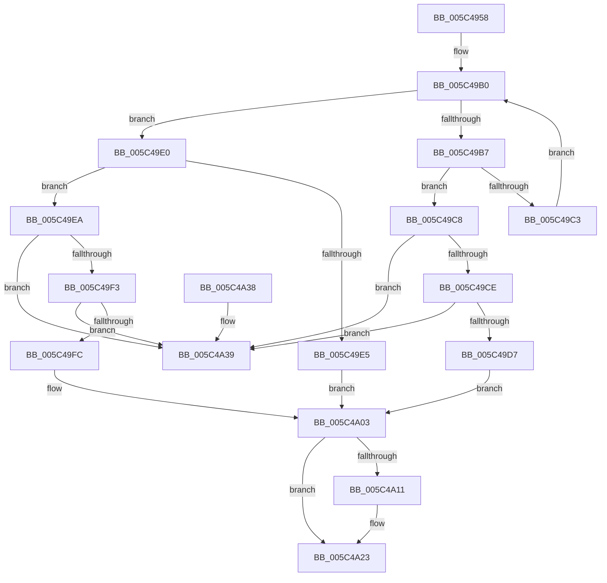

# KiEpfComplete

- RVA: `0x005C4958`–`0x005C4A40` (길이 `232` bytes)
- VA: `0x00000001405C4958`
- 실행 섹션: `.text`
- PDB 이름 있음: `예`; PDB Function 태그: `아니요`
- unwind 정보 RVA: `0x00069AD0`
- 디코드: `71`개 명령, `232/232` bytes 표시
- 미해석 바이트: `0` (있으면 어셈블리에 `.byte`로 보존)

> 이 문서는 커널 이미지의 기계어와 PDB 기호를 분석해 생성했습니다. 4번과 5번은 함수 원형과 자료형을 바이너리 사용 방식에서 추정한 C 해석이며 원본 소스 복구 결과는 아닙니다.

## 1. Dependencies

- 직접 호출 지점: **3**; 고유 호출 대상: **3**
- 직접 호출자로 확인된 함수: **1**
- RIP 상대 이미지 참조: **2**

### Outgoing calls
- `0x005C49A5` → [KeAcquireSpinLockAtDpcLevel](../20/KeAcquireSpinLockAtDpcLevel_function_00208430.md) (function, `0x00208430`)
- `0x005C4A07` → [KxReleaseSpinLock](../20/KxReleaseSpinLock_function_00206670.md) (function, `0x00206670`)
- `0x005C4A1E` → [KeSignalGate](../2C/KeSignalGate_function_002C748C.md) (function, `0x002C748C`)

### Direct callers
- [KiEpfDrainCompletionQueue](KiEpfDrainCompletionQueue_function_005C4A6C.md) at `0x005C4ACF`

### Static image references
- `0x005C499A` → RVA `0x00F10DE0` (`.data`; read)
- `0x005C4A11` → RVA `0x00F10DC4` (`.data`; read/write)

## 2. Other-region calls and transfers

- 다른 실행 섹션으로 향하는 call: **0**
- 별도 외부 분기/꼬리 이동을 확인하지 못했습니다.

## 3. Assembly (complete function range)

```asm
005C4958  48 89 5C 24 08                  mov qword ptr [rsp + 8], rbx
005C495D  48 89 6C 24 10                  mov qword ptr [rsp + 0x10], rbp
005C4962  48 89 74 24 18                  mov qword ptr [rsp + 0x18], rsi
005C4967  57                              push rdi
005C4968  48 83 EC 20                     sub rsp, 0x20
005C496C  4C 8B C1                        mov r8, rcx
005C496F  B8 4D 91 CF BA                  mov eax, 0xbacf914d
005C4974  49 C1 E8 0C                     shr r8, 0xc
005C4978  48 8B F1                        mov rsi, rcx
005C497B  44 03 C1                        add r8d, ecx
005C497E  41 F7 E0                        mul r8d
005C4981  41 8B C0                        mov eax, r8d
005C4984  2B C2                           sub eax, edx
005C4986  D1 E8                           shr eax, 1
005C4988  03 C2                           add eax, edx
005C498A  C1 E8 05                        shr eax, 5
005C498D  6B C0 25                        imul eax, eax, 0x25
005C4990  44 2B C0                        sub r8d, eax
005C4993  41 8B D8                        mov ebx, r8d
005C4996  48 C1 E3 05                     shl rbx, 5
005C499A  48 03 1D 3F C4 94 00            add rbx, qword ptr [rip + 0x94c43f]
005C49A1  48 8D 4B 10                     lea rcx, [rbx + 0x10]
005C49A5  E8 86 3A C4 FF                  call 0x140208430
005C49AA  48 8B 13                        mov rdx, qword ptr [rbx]
005C49AD  48 8B C2                        mov rax, rdx
005C49B0  33 FF                           xor edi, edi
005C49B2  48 3B C3                        cmp rax, rbx
005C49B5  74 29                           je 0x1405c49e0
005C49B7  48 8B F8                        mov rdi, rax
005C49BA  48 8B 08                        mov rcx, qword ptr [rax]
005C49BD  48 39 70 10                     cmp qword ptr [rax + 0x10], rsi
005C49C1  74 05                           je 0x1405c49c8
005C49C3  48 8B C1                        mov rax, rcx
005C49C6  EB E8                           jmp 0x1405c49b0
005C49C8  48 39 41 08                     cmp qword ptr [rcx + 8], rax
005C49CC  75 6B                           jne 0x1405c4a39
005C49CE  48 8B 50 08                     mov rdx, qword ptr [rax + 8]
005C49D2  48 39 02                        cmp qword ptr [rdx], rax
005C49D5  75 62                           jne 0x1405c4a39
005C49D7  48 89 0A                        mov qword ptr [rdx], rcx
005C49DA  48 89 51 08                     mov qword ptr [rcx + 8], rdx
005C49DE  EB 23                           jmp 0x1405c4a03
005C49E0  48 3B D3                        cmp rdx, rbx
005C49E3  75 05                           jne 0x1405c49ea
005C49E5  FF 43 18                        inc dword ptr [rbx + 0x18]
005C49E8  EB 19                           jmp 0x1405c4a03
005C49EA  48 8B FA                        mov rdi, rdx
005C49ED  48 39 5A 08                     cmp qword ptr [rdx + 8], rbx
005C49F1  75 46                           jne 0x1405c4a39
005C49F3  48 8B 02                        mov rax, qword ptr [rdx]
005C49F6  48 39 50 08                     cmp qword ptr [rax + 8], rdx
005C49FA  75 3D                           jne 0x1405c4a39
005C49FC  48 89 03                        mov qword ptr [rbx], rax
005C49FF  48 89 58 08                     mov qword ptr [rax + 8], rbx
005C4A03  48 8D 4B 10                     lea rcx, [rbx + 0x10]
005C4A07  E8 64 1C C4 FF                  call 0x140206670
005C4A0C  48 85 FF                        test rdi, rdi
005C4A0F  74 12                           je 0x1405c4a23
005C4A11  F0 FF 05 AC C3 94 00            lock inc dword ptr [rip + 0x94c3ac]
005C4A18  48 8D 4F 18                     lea rcx, [rdi + 0x18]
005C4A1C  33 D2                           xor edx, edx
005C4A1E  E8 69 2A D0 FF                  call 0x1402c748c
005C4A23  48 8B 5C 24 30                  mov rbx, qword ptr [rsp + 0x30]
005C4A28  48 8B 6C 24 38                  mov rbp, qword ptr [rsp + 0x38]
005C4A2D  48 8B 74 24 40                  mov rsi, qword ptr [rsp + 0x40]
005C4A32  48 83 C4 20                     add rsp, 0x20
005C4A36  5F                              pop rdi
005C4A37  C3                              ret
005C4A38  CC                              int3
005C4A39  B9 03 00 00 00                  mov ecx, 3
005C4A3E  CD 29                           int 0x29
```

## 4. C-style interpretation (structured pseudocode)

```c
__int64 __fastcall KiEpfComplete(__int64 a1, int a2)
{
    __int64 result;
    __int64 v_rbx;
    __int64 v_rdi;
    __int64 v_rsp;
    unsigned __int64 v_stack_p10;
    unsigned __int64 v_stack_p18;
    unsigned __int64 v_stack_p8;

    v_stack_p8 = v_rbx;
    v_stack_p10 = v_rbp;
    v_stack_p18 = v_rsi;
    v_rsp = (v_rsp) - (32);
    a3 = (a1) >> (12);
    a3 = (unsigned int)((a3) + ((unsigned int)(a1)));
    result = (unsigned int)(((unsigned int)((unsigned int)(a3))) - (a2));
    result = (unsigned int)((result) >> (1));
    result = (unsigned int)((result) + (a2));
    result = (unsigned int)((result) >> (5));
    result = (unsigned int)((result) * ((unsigned int)(result)));
    a3 = (unsigned int)((a3) - ((unsigned int)(result)));
    v_rbx = ((unsigned int)((unsigned int)(a3))) << (5);
    v_rbx = (v_rbx) + (*(unsigned __int64 *)(v_rip + 9749567));
    result = KeAcquireSpinLockAtDpcLevel(v_rbx + 16, a2, a3, a4);
loc_005C49B0:
    v_rdi = 0;
    if ((*(unsigned __int64 *)(v_rbx)) == v_rbx) goto loc_005C49E0;
    if ((*(unsigned __int64 *)(*(unsigned __int64 *)(v_rbx) + 16)) == a1) goto loc_005C49C8;
    goto loc_005C49B0;
loc_005C49C8:
    if ((*(unsigned __int64 *)(*(unsigned __int64 *)(*(unsigned __int64 *)(v_rbx)) + 8)) != (*(unsigned __int64 *)(*(unsigned __int64 *)(v_rbx)))) goto loc_005C4A39;
    if ((*(unsigned __int64 *)(*(unsigned __int64 *)(*(unsigned __int64 *)(*(unsigned __int64 *)(v_rbx)) + 8))) != (*(unsigned __int64 *)(*(unsigned __int64 *)(v_rbx)))) goto loc_005C4A39;
    *(unsigned __int64 *)(*(unsigned __int64 *)(*(unsigned __int64 *)(*(unsigned __int64 *)(v_rbx)) + 8)) = *(unsigned __int64 *)(*(unsigned __int64 *)(v_rbx));
    *(unsigned __int64 *)(*(unsigned __int64 *)(*(unsigned __int64 *)(v_rbx)) + 8) = *(unsigned __int64 *)(*(unsigned __int64 *)(*(unsigned __int64 *)(v_rbx)) + 8);
    goto loc_005C4A03;
loc_005C49E0:
    if ((*(unsigned __int64 *)(*(unsigned __int64 *)(*(unsigned __int64 *)(v_rbx)) + 8)) != v_rbx) goto loc_005C49EA;
    goto loc_005C4A03;
loc_005C49EA:
    if ((*(unsigned __int64 *)(*(unsigned __int64 *)(*(unsigned __int64 *)(*(unsigned __int64 *)(v_rbx)) + 8) + 8)) != v_rbx) goto loc_005C4A39;
    if ((*(unsigned __int64 *)(*(unsigned __int64 *)(*(unsigned __int64 *)(*(unsigned __int64 *)(*(unsigned __int64 *)(v_rbx)) + 8)) + 8)) != (*(unsigned __int64 *)(*(unsigned __int64 *)(*(unsigned __int64 *)(v_rbx)) + 8))) goto loc_005C4A39;
    *(unsigned __int64 *)(v_rbx) = *(unsigned __int64 *)(*(unsigned __int64 *)(*(unsigned __int64 *)(*(unsigned __int64 *)(v_rbx)) + 8));
    *(unsigned __int64 *)(*(unsigned __int64 *)(*(unsigned __int64 *)(*(unsigned __int64 *)(*(unsigned __int64 *)(v_rbx)) + 8)) + 8) = v_rbx;
loc_005C4A03:
    result = KxReleaseSpinLock(v_rbx + 16, *(unsigned __int64 *)(*(unsigned __int64 *)(*(unsigned __int64 *)(v_rbx)) + 8), a3, a4);
    if (*(unsigned __int64 *)(*(unsigned __int64 *)(*(unsigned __int64 *)(v_rbx)) + 8) != 0) {
        a1 = *(unsigned __int64 *)(*(unsigned __int64 *)(*(unsigned __int64 *)(v_rbx)) + 8) + 24;
        a2 = 0;
        result = KeSignalGate(a1, a2, a3, a4);
    }
    v_rsp = (v_rsp) + (32);
    return result;
loc_005C4A39:
    return result;
}
```

## 5. (Beta) C Style

```c
int64_t KiEpfComplete(int64_t Arg1, int32_t Arg2)
{
    int64_t result;
    int64_t local_rbx;
    int64_t local_rdi;
    int64_t local_rsp;
    uint64_t v_stack_p10;
    uint64_t v_stack_p18;
    uint64_t v_stack_p8;

    v_stack_p8 = local_rbx;
    v_stack_p10 = local_rbp;
    v_stack_p18 = local_rsi;
    local_rsp = (local_rsp) - (32);
    a3 = (Arg1) >> (12);
    a3 = (uint32_t)((a3) + ((uint32_t)(Arg1)));
    result = (uint32_t)(((uint32_t)((uint32_t)(a3))) - (Arg2));
    result = (uint32_t)((result) >> (1));
    result = (uint32_t)((result) + (Arg2));
    result = (uint32_t)((result) >> (5));
    result = (uint32_t)((result) * ((uint32_t)(result)));
    a3 = (uint32_t)((a3) - ((uint32_t)(result)));
    local_rbx = ((uint32_t)((uint32_t)(a3))) << (5);
    local_rbx = (local_rbx) + (*(uint64_t *)(v_rip + 0x94C43F));
    result = KeAcquireSpinLockAtDpcLevel(local_rbx + 16, Arg2, a3, a4);
loc_005C49B0:
    local_rdi = 0;
    if ((*(uint64_t *)(local_rbx)) == local_rbx) goto loc_005C49E0;
    if ((*(uint64_t *)(*(uint64_t *)(local_rbx) + 0x10)) == Arg1) goto loc_005C49C8;
    goto loc_005C49B0;
loc_005C49C8:
    if ((*(uint64_t *)(*(uint64_t *)(*(uint64_t *)(local_rbx)) + 0x8)) != (*(uint64_t *)(*(uint64_t *)(local_rbx)))) goto loc_005C4A39;
    if ((*(uint64_t *)(*(uint64_t *)(*(uint64_t *)(*(uint64_t *)(local_rbx)) + 0x8))) != (*(uint64_t *)(*(uint64_t *)(local_rbx)))) goto loc_005C4A39;
    *(uint64_t *)(*(uint64_t *)(*(uint64_t *)(*(uint64_t *)(local_rbx)) + 0x8)) = *(uint64_t *)(*(uint64_t *)(local_rbx));
    *(uint64_t *)(*(uint64_t *)(*(uint64_t *)(local_rbx)) + 0x8) = *(uint64_t *)(*(uint64_t *)(*(uint64_t *)(local_rbx)) + 0x8);
    goto loc_005C4A03;
loc_005C49E0:
    if ((*(uint64_t *)(*(uint64_t *)(*(uint64_t *)(local_rbx)) + 0x8)) != local_rbx) goto loc_005C49EA;
    goto loc_005C4A03;
loc_005C49EA:
    if ((*(uint64_t *)(*(uint64_t *)(*(uint64_t *)(*(uint64_t *)(local_rbx)) + 0x8) + 0x8)) != local_rbx) goto loc_005C4A39;
    if ((*(uint64_t *)(*(uint64_t *)(*(uint64_t *)(*(uint64_t *)(*(uint64_t *)(local_rbx)) + 0x8)) + 0x8)) != (*(uint64_t *)(*(uint64_t *)(*(uint64_t *)(local_rbx)) + 0x8))) goto loc_005C4A39;
    *(uint64_t *)(local_rbx) = *(uint64_t *)(*(uint64_t *)(*(uint64_t *)(*(uint64_t *)(local_rbx)) + 0x8));
    *(uint64_t *)(*(uint64_t *)(*(uint64_t *)(*(uint64_t *)(*(uint64_t *)(local_rbx)) + 0x8)) + 0x8) = local_rbx;
loc_005C4A03:
    result = KxReleaseSpinLock(local_rbx + 16, *(uint64_t *)(*(uint64_t *)(*(uint64_t *)(local_rbx)) + 0x8), a3, a4);
    if (*(uint64_t *)(*(uint64_t *)(*(uint64_t *)(local_rbx)) + 0x8) != 0) {
        Arg1 = *(uint64_t *)(*(uint64_t *)(*(uint64_t *)(local_rbx)) + 0x8) + 24;
        Arg2 = 0;
        result = KeSignalGate(Arg1, Arg2, a3, a4);
    }
    local_rsp = (local_rsp) + (32);
    return result;
loc_005C4A39:
    return result;
}
```

## 6. Execution-region graph

[열기: 2D/3D 그래프와 함수 탐색 컨트롤 패널](../../../control-panel.html?section=text&rva=0x005C4958&view=graph)

- 2D 그래프는 위에서 아래로 흐르고, 3D 그래프는 빈 공간을 드래그해 회전합니다. Shift+드래그는 이동, 휠은 확대·축소, 함수 노드 선택은 대상 보고서 이동입니다.

### Static fallback


