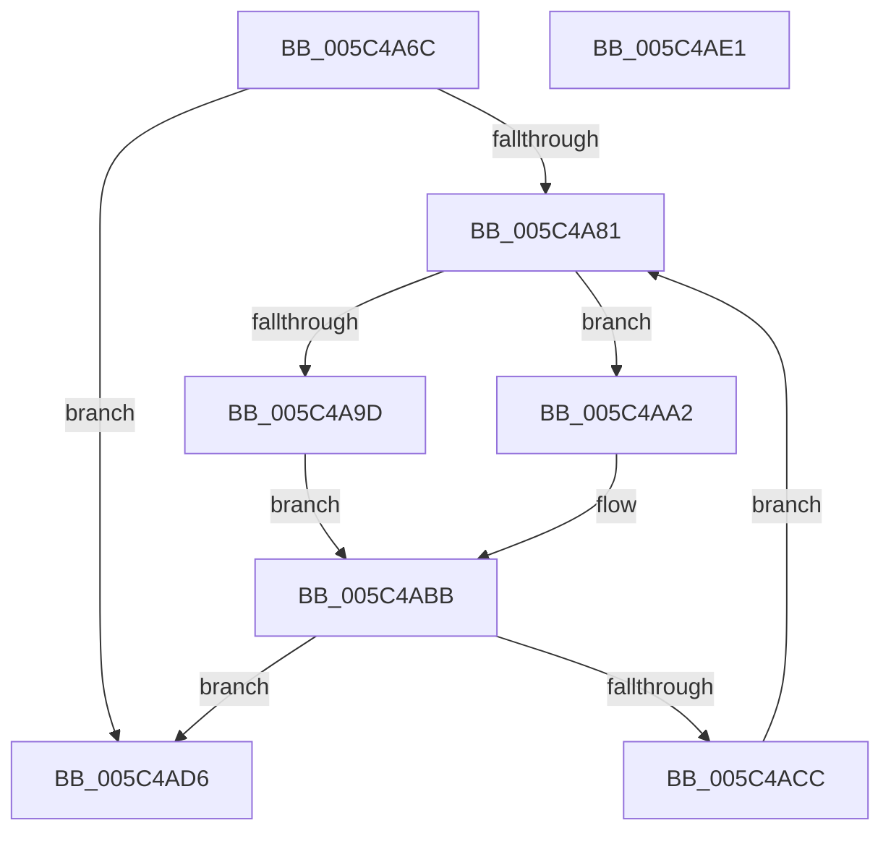

# KiEpfDrainCompletionQueue

- RVA: `0x005C4A6C`–`0x005C4AE2` (길이 `118` bytes)
- VA: `0x00000001405C4A6C`
- 실행 섹션: `.text`
- PDB 이름 있음: `예`; PDB Function 태그: `아니요`
- unwind 정보 RVA: `0x0005CAAC`
- 디코드: `33`개 명령, `118/118` bytes 표시
- 미해석 바이트: `0` (있으면 어셈블리에 `.byte`로 보존)

> 이 문서는 커널 이미지의 기계어와 PDB 기호를 분석해 생성했습니다. 4번과 5번은 함수 원형과 자료형을 바이너리 사용 방식에서 추정한 C 해석이며 원본 소스 복구 결과는 아닙니다.

## 1. Dependencies

- 직접 호출 지점: **3**; 고유 호출 대상: **3**
- 직접 호출자로 확인된 함수: **4**
- RIP 상대 이미지 참조: **3**

### Outgoing calls
- `0x005C4A88` → [KeAcquireSpinLockAtDpcLevel](../20/KeAcquireSpinLockAtDpcLevel_function_00208430.md) (function, `0x00208430`)
- `0x005C4AC2` → [KxReleaseSpinLock](../20/KxReleaseSpinLock_function_00206670.md) (function, `0x00206670`)
- `0x005C4ACF` → [KiEpfComplete](KiEpfComplete_function_005C4958.md) (function, `0x005C4958`)

### Direct callers
- [KiEpfCompletionDpcRoutine](KiEpfCompletionDpcRoutine_function_005C4A50.md) at `0x005C4A5B`
- [KiEpfHandleNotification](KiEpfHandleNotification_function_005C4AF0.md) at `0x005C4AF9`
- [HvlNotifyPageHeat](../6A/HvlNotifyPageHeat_function_006A7E60.md) at `0x006A80D3`
- [KiEpfInitialize](../../init/C3/KiEpfInitialize_function_00C39FC0.md) at `0x00C3A09C`

### Static image references
- `0x005C4A78` → RVA `0x00F10D68` (`.data`; read)
- `0x005C4A81` → RVA `0x00E170C0` (`.data`; read)
- `0x005C4AA9` → RVA `0x00F10D70` (`.data`; read)

## 2. Other-region calls and transfers

- 다른 실행 섹션으로 향하는 call: **0**
- 별도 외부 분기/꼬리 이동을 확인하지 못했습니다.

## 3. Assembly (complete function range)

```asm
005C4A6C  48 89 5C 24 08                  mov qword ptr [rsp + 8], rbx
005C4A71  57                              push rdi
005C4A72  48 83 EC 20                     sub rsp, 0x20
005C4A76  33 DB                           xor ebx, ebx
005C4A78  48 39 1D E9 C2 94 00            cmp qword ptr [rip + 0x94c2e9], rbx
005C4A7F  74 55                           je 0x1405c4ad6
005C4A81  48 8D 0D 38 26 85 00            lea rcx, [rip + 0x852638]
005C4A88  E8 A3 39 C4 FF                  call 0x140208430
005C4A8D  4C 8B 05 D4 C2 94 00            mov r8, qword ptr [rip + 0x94c2d4]
005C4A94  49 8B 00                        mov rax, qword ptr [r8]
005C4A97  49 3B 40 08                     cmp rax, qword ptr [r8 + 8]
005C4A9B  75 05                           jne 0x1405c4aa2
005C4A9D  40 32 FF                        xor dil, dil
005C4AA0  EB 19                           jmp 0x1405c4abb
005C4AA2  49 8B 5C C0 10                  mov rbx, qword ptr [r8 + rax*8 + 0x10]
005C4AA7  33 D2                           xor edx, edx
005C4AA9  8B 0D C1 C2 94 00               mov ecx, dword ptr [rip + 0x94c2c1]
005C4AAF  48 FF C0                        inc rax
005C4AB2  48 F7 F1                        div rcx
005C4AB5  40 B7 01                        mov dil, 1
005C4AB8  49 89 10                        mov qword ptr [r8], rdx
005C4ABB  48 8D 0D FE 25 85 00            lea rcx, [rip + 0x8525fe]
005C4AC2  E8 A9 1B C4 FF                  call 0x140206670
005C4AC7  40 84 FF                        test dil, dil
005C4ACA  74 0A                           je 0x1405c4ad6
005C4ACC  48 8B CB                        mov rcx, rbx
005C4ACF  E8 84 FE FF FF                  call 0x1405c4958
005C4AD4  EB AB                           jmp 0x1405c4a81
005C4AD6  48 8B 5C 24 30                  mov rbx, qword ptr [rsp + 0x30]
005C4ADB  48 83 C4 20                     add rsp, 0x20
005C4ADF  5F                              pop rdi
005C4AE0  C3                              ret
005C4AE1  CC                              int3
```

## 4. C-style interpretation (structured pseudocode)

```c
__int64 __fastcall KiEpfDrainCompletionQueue(__int64 a1, int a2)
{
    __int64 result;
    __int64 v_rbx;
    __int64 v_rdi;
    __int64 v_rsp;
    unsigned __int64 v_stack_p8;

    v_stack_p8 = v_rbx;
    v_rsp = (v_rsp) - (32);
    v_rbx = 0;
    if ((*(unsigned __int64 *)(v_rip + 9749225)) == 0) goto loc_005C4AD6;
loc_005C4A81:
    result = KeAcquireSpinLockAtDpcLevel(v_rip + 8726072, a2, a3, a4);
    if ((*(unsigned __int64 *)(*(unsigned __int64 *)(v_rip + 9749204))) != (*(unsigned __int64 *)(*(unsigned __int64 *)(v_rip + 9749204) + 8))) goto loc_005C4AA2;
    v_rdi = 0;
    goto loc_005C4ABB;
loc_005C4AA2:
    a2 = 0;
    result = (*(unsigned __int64 *)(*(unsigned __int64 *)(v_rip + 9749204))) + 1;
    *(unsigned __int64 *)(*(unsigned __int64 *)(v_rip + 9749204)) = 0;
loc_005C4ABB:
    result = KxReleaseSpinLock(v_rip + 8726014, a2, *(unsigned __int64 *)(v_rip + 9749204), a4);
    if (1 == 0) goto loc_005C4AD6;
    result = KiEpfComplete(*(unsigned __int64 *)(*(unsigned __int64 *)(v_rip + 9749204) + *(unsigned __int64 *)(*(unsigned __int64 *)(v_rip + 9749204)) * 8 + 16), a2, *(unsigned __int64 *)(v_rip + 9749204), a4);
    goto loc_005C4A81;
loc_005C4AD6:
    v_rsp = (v_rsp) + (32);
    return result;
}
```

## 5. (Beta) C Style

```c
int64_t KiEpfDrainCompletionQueue(int64_t Arg1, int32_t Arg2)
{
    int64_t result;
    int64_t local_rbx;
    int64_t local_rdi;
    int64_t local_rsp;
    uint64_t v_stack_p8;

    v_stack_p8 = local_rbx;
    local_rsp = (local_rsp) - (32);
    local_rbx = 0;
    if ((*(uint64_t *)(v_rip + 0x94C2E9)) == 0) goto loc_005C4AD6;
loc_005C4A81:
    result = KeAcquireSpinLockAtDpcLevel(v_rip + 8726072, Arg2, a3, a4);
    if ((*(uint64_t *)(*(uint64_t *)(v_rip + 0x94C2D4))) != (*(uint64_t *)(*(uint64_t *)(v_rip + 0x94C2D4) + 0x8))) goto loc_005C4AA2;
    local_rdi = 0;
    goto loc_005C4ABB;
loc_005C4AA2:
    Arg2 = 0;
    result = (*(uint64_t *)(*(uint64_t *)(v_rip + 0x94C2D4))) + 1;
    *(uint64_t *)(*(uint64_t *)(v_rip + 0x94C2D4)) = 0;
loc_005C4ABB:
    result = KxReleaseSpinLock(v_rip + 8726014, Arg2, *(uint64_t *)(v_rip + 0x94C2D4), a4);
    if (1 == 0) goto loc_005C4AD6;
    result = KiEpfComplete(*(uint64_t *)(*(uint64_t *)(v_rip + 0x94C2D4) + *(uint64_t *)(*(uint64_t *)(v_rip + 0x94C2D4)) * 8 + 0x10), Arg2, *(uint64_t *)(v_rip + 0x94C2D4), a4);
    goto loc_005C4A81;
loc_005C4AD6:
    local_rsp = (local_rsp) + (32);
    return result;
}
```

## 6. Execution-region graph

[열기: 2D/3D 그래프와 함수 탐색 컨트롤 패널](../../../control-panel.html?section=text&rva=0x005C4A6C&view=graph)

- 2D 그래프는 위에서 아래로 흐르고, 3D 그래프는 빈 공간을 드래그해 회전합니다. Shift+드래그는 이동, 휠은 확대·축소, 함수 노드 선택은 대상 보고서 이동입니다.

### Static fallback


