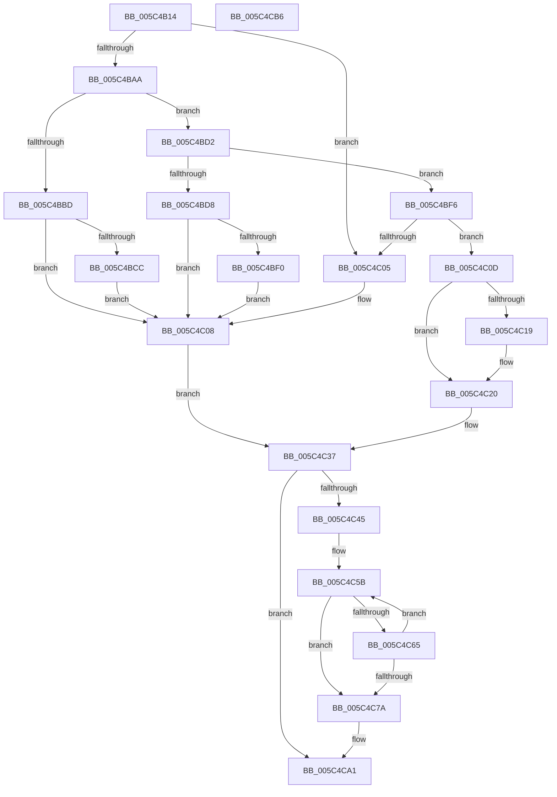

# KiEpfStart

- RVA: `0x005C4B14`–`0x005C4CB7` (길이 `419` bytes)
- VA: `0x00000001405C4B14`
- 실행 섹션: `.text`
- PDB 이름 있음: `예`; PDB Function 태그: `아니요`
- unwind 정보 RVA: `0x00093D80`
- 디코드: `109`개 명령, `419/419` bytes 표시
- 미해석 바이트: `0` (있으면 어셈블리에 `.byte`로 보존)

> 이 문서는 커널 이미지의 기계어와 PDB 기호를 분석해 생성했습니다. 4번과 5번은 함수 원형과 자료형을 바이너리 사용 방식에서 추정한 C 해석이며 원본 소스 복구 결과는 아닙니다.

## 1. Dependencies

- 직접 호출 지점: **5**; 고유 호출 대상: **4**
- 직접 호출자로 확인된 함수: **2**
- RIP 상대 이미지 참조: **6**

### Outgoing calls
- `0x005C4B9F` → [KeAcquireSpinLockAtDpcLevel](../20/KeAcquireSpinLockAtDpcLevel_function_00208430.md) (function, `0x00208430`)
- `0x005C4C3B` → [KxReleaseSpinLock](../20/KxReleaseSpinLock_function_00206670.md) (function, `0x00206670`)
- `0x005C4C7C` → [KeSetKernelStackSwapEnable](../45/KeSetKernelStackSwapEnable_function_00450760.md) (function, `0x00450760`)
- `0x005C4C8E` → [KeWaitForGate](../2C/KeWaitForGate_function_002CA794.md) (function, `0x002CA794`)
- `0x005C4C95` → [KeSetKernelStackSwapEnable](../45/KeSetKernelStackSwapEnable_function_00450760.md) (function, `0x00450760`)

### Direct callers
- [KiEpfHandleNotification](KiEpfHandleNotification_function_005C4AF0.md) at `0x005C4B01`
- [HvlNotifyPageHeat](../6A/HvlNotifyPageHeat_function_006A7E60.md) at `0x006A80DB`

### Static image references
- `0x005C4B3C` → RVA `0x00F10DC0` (`.data`; read/write)
- `0x005C4B94` → RVA `0x00F10DE0` (`.data`; read)
- `0x005C4BB3` → RVA `0x00F10D68` (`.data`; read)
- `0x005C4C45` → RVA `0x00F10DD0` (`.data`; read/write)
- `0x005C4C51` → RVA `0x00F10DD4` (`.data`; read/write)
- `0x005C4C5B` → RVA `0x00F10DD8` (`.data`; read)

## 2. Other-region calls and transfers

- 다른 실행 섹션으로 향하는 call: **0**
- 별도 외부 분기/꼬리 이동을 확인하지 못했습니다.

## 3. Assembly (complete function range)

```asm
005C4B14  48 89 5C 24 10                  mov qword ptr [rsp + 0x10], rbx
005C4B19  48 89 74 24 18                  mov qword ptr [rsp + 0x18], rsi
005C4B1E  48 89 7C 24 20                  mov qword ptr [rsp + 0x20], rdi
005C4B23  55                              push rbp
005C4B24  48 8B EC                        mov rbp, rsp
005C4B27  48 83 EC 50                     sub rsp, 0x50
005C4B2B  48 83 65 D0 00                  and qword ptr [rbp - 0x30], 0
005C4B30  48 8B C1                        mov rax, rcx
005C4B33  48 83 65 D8 00                  and qword ptr [rbp - 0x28], 0
005C4B38  C6 45 EB 00                     mov byte ptr [rbp - 0x15], 0
005C4B3C  F0 FF 05 7D C2 94 00            lock inc dword ptr [rip + 0x94c27d]
005C4B43  65 48 8B 3C 25 88 01 00 00      mov rdi, qword ptr gs:[0x188]
005C4B4C  83 65 EC 00                     and dword ptr [rbp - 0x14], 0
005C4B50  48 89 4D E0                     mov qword ptr [rbp - 0x20], rcx
005C4B54  48 8D 4D F0                     lea rcx, [rbp - 0x10]
005C4B58  48 89 4D F8                     mov qword ptr [rbp - 8], rcx
005C4B5C  48 8D 4D F0                     lea rcx, [rbp - 0x10]
005C4B60  48 89 4D F0                     mov qword ptr [rbp - 0x10], rcx
005C4B64  48 8B C8                        mov rcx, rax
005C4B67  48 C1 E9 0C                     shr rcx, 0xc
005C4B6B  03 C8                           add ecx, eax
005C4B6D  66 C7 45 E8 07 01               mov word ptr [rbp - 0x18], 0x107
005C4B73  B8 4D 91 CF BA                  mov eax, 0xbacf914d
005C4B78  C6 45 EA 06                     mov byte ptr [rbp - 0x16], 6
005C4B7C  F7 E1                           mul ecx
005C4B7E  8B C1                           mov eax, ecx
005C4B80  2B C2                           sub eax, edx
005C4B82  D1 E8                           shr eax, 1
005C4B84  03 C2                           add eax, edx
005C4B86  C1 E8 05                        shr eax, 5
005C4B89  6B C0 25                        imul eax, eax, 0x25
005C4B8C  2B C8                           sub ecx, eax
005C4B8E  8B D9                           mov ebx, ecx
005C4B90  48 C1 E3 05                     shl rbx, 5
005C4B94  48 03 1D 45 C2 94 00            add rbx, qword ptr [rip + 0x94c245]
005C4B9B  48 8D 4B 10                     lea rcx, [rbx + 0x10]
005C4B9F  E8 8C 38 C4 FF                  call 0x140208430
005C4BA4  83 7B 18 00                     cmp dword ptr [rbx + 0x18], 0
005C4BA8  7F 5B                           jg 0x1405c4c05
005C4BAA  65 48 8B 04 25 20 00 00 00      mov rax, qword ptr gs:[0x20]
005C4BB3  48 83 3D AD C1 94 00 00         cmp qword ptr [rip + 0x94c1ad], 0
005C4BBB  75 15                           jne 0x1405c4bd2
005C4BBD  48 8B 80 B8 8E 00 00            mov rax, qword ptr [rax + 0x8eb8]
005C4BC4  40 32 FF                        xor dil, dil
005C4BC7  48 85 C0                        test rax, rax
005C4BCA  74 3C                           je 0x1405c4c08
005C4BCC  C6 40 10 01                     mov byte ptr [rax + 0x10], 1
005C4BD0  EB 36                           jmp 0x1405c4c08
005C4BD2  48 3B 78 18                     cmp rdi, qword ptr [rax + 0x18]
005C4BD6  75 1E                           jne 0x1405c4bf6
005C4BD8  65 48 8B 04 25 20 00 00 00      mov rax, qword ptr gs:[0x20]
005C4BE1  40 32 FF                        xor dil, dil
005C4BE4  48 8B 88 B8 8E 00 00            mov rcx, qword ptr [rax + 0x8eb8]
005C4BEB  48 85 C9                        test rcx, rcx
005C4BEE  74 18                           je 0x1405c4c08
005C4BF0  C6 41 10 01                     mov byte ptr [rcx + 0x10], 1
005C4BF4  EB 12                           jmp 0x1405c4c08
005C4BF6  65 8B 04 25 3C 3A 00 00         mov eax, dword ptr gs:[0x3a3c]
005C4BFE  A9 01 00 01 00                  test eax, 0x10001
005C4C03  74 08                           je 0x1405c4c0d
005C4C05  40 32 FF                        xor dil, dil
005C4C08  FF 4B 18                        dec dword ptr [rbx + 0x18]
005C4C0B  EB 2A                           jmp 0x1405c4c37
005C4C0D  48 8B 43 08                     mov rax, qword ptr [rbx + 8]
005C4C11  40 B7 01                        mov dil, 1
005C4C14  48 39 18                        cmp qword ptr [rax], rbx
005C4C17  74 07                           je 0x1405c4c20
005C4C19  B9 03 00 00 00                  mov ecx, 3
005C4C1E  CD 29                           int 0x29
005C4C20  48 89 45 D8                     mov qword ptr [rbp - 0x28], rax
005C4C24  48 8D 4D D0                     lea rcx, [rbp - 0x30]
005C4C28  48 89 5D D0                     mov qword ptr [rbp - 0x30], rbx
005C4C2C  48 89 08                        mov qword ptr [rax], rcx
005C4C2F  48 8D 45 D0                     lea rax, [rbp - 0x30]
005C4C33  48 89 43 08                     mov qword ptr [rbx + 8], rax
005C4C37  48 8D 4B 10                     lea rcx, [rbx + 0x10]
005C4C3B  E8 30 1A C4 FF                  call 0x140206670
005C4C40  40 84 FF                        test dil, dil
005C4C43  74 5C                           je 0x1405c4ca1
005C4C45  F0 FF 05 84 C1 94 00            lock inc dword ptr [rip + 0x94c184]
005C4C4C  BA 01 00 00 00                  mov edx, 1
005C4C51  F0 0F C1 15 7B C1 94 00         lock xadd dword ptr [rip + 0x94c17b], edx
005C4C59  FF C2                           inc edx
005C4C5B  8B 05 77 C1 94 00               mov eax, dword ptr [rip + 0x94c177]
005C4C61  3B C2                           cmp eax, edx
005C4C63  7D 15                           jge 0x1405c4c7a
005C4C65  89 45 10                        mov dword ptr [rbp + 0x10], eax
005C4C68  8B 4D 10                        mov ecx, dword ptr [rbp + 0x10]
005C4C6B  8B 45 10                        mov eax, dword ptr [rbp + 0x10]
005C4C6E  F0 0F B1 15 62 C1 94 00         lock cmpxchg dword ptr [rip + 0x94c162], edx
005C4C76  3B C8                           cmp ecx, eax
005C4C78  75 E1                           jne 0x1405c4c5b
005C4C7A  33 C9                           xor ecx, ecx
005C4C7C  E8 DF BA E8 FF                  call 0x140450760
005C4C81  45 33 C0                        xor r8d, r8d
005C4C84  48 8D 4D E8                     lea rcx, [rbp - 0x18]
005C4C88  8A D8                           mov bl, al
005C4C8A  41 8D 50 27                     lea edx, [r8 + 0x27]
005C4C8E  E8 01 5B D0 FF                  call 0x1402ca794
005C4C93  8A CB                           mov cl, bl
005C4C95  E8 C6 BA E8 FF                  call 0x140450760
005C4C9A  F0 FF 0D 33 C1 94 00            lock dec dword ptr [rip + 0x94c133]
005C4CA1  48 8B 5C 24 68                  mov rbx, qword ptr [rsp + 0x68]
005C4CA6  48 8B 74 24 70                  mov rsi, qword ptr [rsp + 0x70]
005C4CAB  48 8B 7C 24 78                  mov rdi, qword ptr [rsp + 0x78]
005C4CB0  48 83 C4 50                     add rsp, 0x50
005C4CB4  5D                              pop rbp
005C4CB5  C3                              ret
005C4CB6  CC                              int3
```

## 4. C-style interpretation (structured pseudocode)

```c
__int64 __fastcall KiEpfStart(__int64 a1, int a2, int a3)
{
    __int64 result;
    __int64 v_rbx;
    __int64 v_rdi;
    __int64 v_rsp;
    unsigned __int64 v_stack_m10;
    unsigned __int64 v_stack_m18;
    unsigned int v_stack_m1C;
    unsigned __int8 v_stack_m1D;
    unsigned __int8 v_stack_m1E;
    unsigned __int16 v_stack_m20;
    unsigned __int64 v_stack_m28;
    unsigned __int64 v_stack_m30;
    unsigned __int64 v_stack_m38;
    unsigned __int64 v_stack_p10;
    unsigned __int64 v_stack_p18;
    unsigned __int64 v_stack_p20;
    unsigned int v_stack_p8;

    v_stack_p10 = v_rbx;
    v_stack_p18 = v_rsi;
    v_stack_p20 = v_rdi;
    v_rsp = (v_rsp) - (80);
    v_stack_m1D = 0;
    v_stack_m28 = a1;
    v_stack_m10 = v_stack_m18;
    v_stack_m18 = v_stack_m18;
    a1 = (a1) >> (12);
    a1 = (unsigned int)((a1) + ((unsigned int)(a1)));
    v_stack_m20 = 263;
    v_stack_m1E = 6;
    result = (unsigned int)(((unsigned int)((unsigned int)(a1))) - (a2));
    result = (unsigned int)((result) >> (1));
    result = (unsigned int)((result) + (a2));
    result = (unsigned int)((result) >> (5));
    result = (unsigned int)((result) * ((unsigned int)(result)));
    a1 = (unsigned int)((a1) - ((unsigned int)(result)));
    v_rbx = ((unsigned int)((unsigned int)(a1))) << (5);
    v_rbx = (v_rbx) + (*(unsigned __int64 *)(v_rip + 9749061));
    result = KeAcquireSpinLockAtDpcLevel(v_rbx + 16, a2, a3, a4);
    if ((*(unsigned int *)(v_rbx + 24)) > 0) goto loc_005C4C05;
    if ((*(unsigned __int64 *)(v_rip + 9748909)) != 0) goto loc_005C4BD2;
    v_rdi = 0;
    if (*(unsigned __int64 *)(*(unsigned __int64 *)(gs_base + (0 + 32)) + 36536) == 0) goto loc_005C4C08;
    *(unsigned __int8 *)(*(unsigned __int64 *)(*(unsigned __int64 *)(gs_base + (0 + 32)) + 36536) + 16) = 1;
    goto loc_005C4C08;
loc_005C4BD2:
    if (0 != (*(unsigned __int64 *)(*(unsigned __int64 *)(*(unsigned __int64 *)(gs_base + (0 + 32)) + 36536) + 24))) goto loc_005C4BF6;
    v_rdi = 0;
    if (*(unsigned __int64 *)(*(unsigned __int64 *)(gs_base + (0 + 32)) + 36536) == 0) goto loc_005C4C08;
    *(unsigned __int8 *)(*(unsigned __int64 *)(*(unsigned __int64 *)(gs_base + (0 + 32)) + 36536) + 16) = 1;
    goto loc_005C4C08;
loc_005C4BF6:
    if ((((unsigned int)((unsigned int)(*(unsigned int *)(gs_base + (0 + 14908))))) & (0x10001ULL)) == 0) goto loc_005C4C0D;
loc_005C4C05:
    v_rdi = 0;
loc_005C4C08:
    goto loc_005C4C37;
loc_005C4C0D:
    if ((*(unsigned __int64 *)(*(unsigned __int64 *)(v_rbx + 8))) != v_rbx) {
        a1 = 3;
    }
    v_stack_m30 = *(unsigned __int64 *)(v_rbx + 8);
    v_stack_m38 = v_rbx;
    *(unsigned __int64 *)(*(unsigned __int64 *)(v_rbx + 8)) = v_stack_m38;
    *(unsigned __int64 *)(v_rbx + 8) = v_stack_m38;
loc_005C4C37:
    result = KxReleaseSpinLock(v_rbx + 16, a2, a3, a4);
    if (1 == 0) goto loc_005C4CA1;
    a2 = (unsigned int)((1) + 1);
loc_005C4C5B:
    if (((unsigned int)((unsigned int)(*(unsigned int *)(v_rip + 9748855)))) >= a2) goto loc_005C4C7A;
    v_stack_p8 = (unsigned int)((unsigned int)(*(unsigned int *)(v_rip + 9748855)));
    if (((unsigned int)((unsigned int)(v_stack_p8))) != ((unsigned int)((unsigned int)(v_stack_p8)))) goto loc_005C4C5B;
loc_005C4C7A:
    a1 = 0;
    result = KeSetKernelStackSwapEnable(a1, a2, a3, a4);
    a3 = 0;
    result = KeWaitForGate(v_stack_m20, a3 + 39, a3, a4);
    result = KeSetKernelStackSwapEnable((unsigned __int8)((unsigned __int8)(result)), a3 + 39, a3, a4);
loc_005C4CA1:
    v_rsp = (v_rsp) + (80);
    return result;
}
```

## 5. (Beta) C Style

```c
int64_t KiEpfStart(int64_t Arg1, int32_t Arg2, int32_t Arg3)
{
    int64_t result;
    int64_t local_rbx;
    int64_t local_rdi;
    int64_t local_rsp;
    uint64_t v_stack_m10;
    uint64_t v_stack_m18;
    uint32_t v_stack_m1C;
    uint8_t v_stack_m1D;
    uint8_t v_stack_m1E;
    uint16_t v_stack_m20;
    uint64_t v_stack_m28;
    uint64_t v_stack_m30;
    uint64_t v_stack_m38;
    uint64_t v_stack_p10;
    uint64_t v_stack_p18;
    uint64_t v_stack_p20;
    uint32_t v_stack_p8;

    v_stack_p10 = local_rbx;
    v_stack_p18 = local_rsi;
    v_stack_p20 = local_rdi;
    local_rsp = (local_rsp) - (80);
    v_stack_m1D = 0;
    v_stack_m28 = Arg1;
    v_stack_m10 = v_stack_m18;
    v_stack_m18 = v_stack_m18;
    Arg1 = (Arg1) >> (12);
    Arg1 = (uint32_t)((Arg1) + ((uint32_t)(Arg1)));
    v_stack_m20 = 263;
    v_stack_m1E = 6;
    result = (uint32_t)(((uint32_t)((uint32_t)(Arg1))) - (Arg2));
    result = (uint32_t)((result) >> (1));
    result = (uint32_t)((result) + (Arg2));
    result = (uint32_t)((result) >> (5));
    result = (uint32_t)((result) * ((uint32_t)(result)));
    Arg1 = (uint32_t)((Arg1) - ((uint32_t)(result)));
    local_rbx = ((uint32_t)((uint32_t)(Arg1))) << (5);
    local_rbx = (local_rbx) + (*(uint64_t *)(v_rip + 0x94C245));
    result = KeAcquireSpinLockAtDpcLevel(local_rbx + 16, Arg2, Arg3, a4);
    if ((*(uint32_t *)(local_rbx + 0x18)) > 0) goto loc_005C4C05;
    if ((*(uint64_t *)(v_rip + 0x94C1AD)) != 0) goto loc_005C4BD2;
    local_rdi = 0;
    if (*(uint64_t *)(*(uint64_t *)(gs_base + (0 + 0x20)) + 0x8EB8) == 0) goto loc_005C4C08;
    *(uint8_t *)(*(uint64_t *)(*(uint64_t *)(gs_base + (0 + 0x20)) + 0x8EB8) + 0x10) = 1;
    goto loc_005C4C08;
loc_005C4BD2:
    if (0 != (*(uint64_t *)(*(uint64_t *)(*(uint64_t *)(gs_base + (0 + 0x20)) + 0x8EB8) + 0x18))) goto loc_005C4BF6;
    local_rdi = 0;
    if (*(uint64_t *)(*(uint64_t *)(gs_base + (0 + 0x20)) + 0x8EB8) == 0) goto loc_005C4C08;
    *(uint8_t *)(*(uint64_t *)(*(uint64_t *)(gs_base + (0 + 0x20)) + 0x8EB8) + 0x10) = 1;
    goto loc_005C4C08;
loc_005C4BF6:
    if ((((uint32_t)((uint32_t)(*(uint32_t *)(gs_base + (0 + 0x3A3C))))) & (0x10001ULL)) == 0) goto loc_005C4C0D;
loc_005C4C05:
    local_rdi = 0;
loc_005C4C08:
    goto loc_005C4C37;
loc_005C4C0D:
    if ((*(uint64_t *)(*(uint64_t *)(local_rbx + 0x8))) != local_rbx) {
        Arg1 = 3;
    }
    v_stack_m30 = *(uint64_t *)(local_rbx + 0x8);
    v_stack_m38 = local_rbx;
    *(uint64_t *)(*(uint64_t *)(local_rbx + 0x8)) = v_stack_m38;
    *(uint64_t *)(local_rbx + 0x8) = v_stack_m38;
loc_005C4C37:
    result = KxReleaseSpinLock(local_rbx + 16, Arg2, Arg3, a4);
    if (1 == 0) goto loc_005C4CA1;
    Arg2 = (uint32_t)((1) + 1);
loc_005C4C5B:
    if (((uint32_t)((uint32_t)(*(uint32_t *)(v_rip + 0x94C177)))) >= Arg2) goto loc_005C4C7A;
    v_stack_p8 = (uint32_t)((uint32_t)(*(uint32_t *)(v_rip + 0x94C177)));
    if (((uint32_t)((uint32_t)(v_stack_p8))) != ((uint32_t)((uint32_t)(v_stack_p8)))) goto loc_005C4C5B;
loc_005C4C7A:
    Arg1 = 0;
    result = KeSetKernelStackSwapEnable(Arg1, Arg2, Arg3, a4);
    Arg3 = 0;
    result = KeWaitForGate(v_stack_m20, Arg3 + 39, Arg3, a4);
    result = KeSetKernelStackSwapEnable((uint8_t)((uint8_t)(result)), Arg3 + 39, Arg3, a4);
loc_005C4CA1:
    local_rsp = (local_rsp) + (80);
    return result;
}
```

## 6. Execution-region graph

[열기: 2D/3D 그래프와 함수 탐색 컨트롤 패널](../../../control-panel.html?section=text&rva=0x005C4B14&view=graph)

- 2D 그래프는 위에서 아래로 흐르고, 3D 그래프는 빈 공간을 드래그해 회전합니다. Shift+드래그는 이동, 휠은 확대·축소, 함수 노드 선택은 대상 보고서 이동입니다.

### Static fallback


