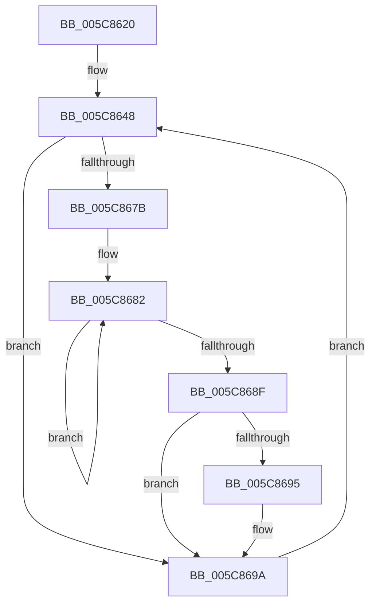

# KiExecuteDpcDelegate

- RVA: `0x005C8620`–`0x005C86B2` (길이 `146` bytes)
- VA: `0x00000001405C8620`
- 실행 섹션: `.text`
- PDB 이름 있음: `예`; PDB Function 태그: `아니요`
- unwind 정보 RVA: `0x000C5600`
- 디코드: `33`개 명령, `146/146` bytes 표시
- 미해석 바이트: `0` (있으면 어셈블리에 `.byte`로 보존)

> 이 문서는 커널 이미지의 기계어와 PDB 기호를 분석해 생성했습니다. 4번과 5번은 함수 원형과 자료형을 바이너리 사용 방식에서 추정한 C 해석이며 원본 소스 복구 결과는 아닙니다.

## 1. Dependencies

- 직접 호출 지점: **4**; 고유 호출 대상: **4**
- 직접 호출자로 확인된 함수: **0**
- RIP 상대 이미지 참조: **1**

### Outgoing calls
- `0x005C8643` → [KeAttachProcess](../48/KeAttachProcess_function_00486540.md) (function, `0x00486540`)
- `0x005C8659` → [KiRetireDpcList](../21/KiRetireDpcList_function_0021A0B0.md) (function, `0x0021A0B0`)
- `0x005C8695` → [KiRemoveSystemWorkPriorityKick](../26/KiRemoveSystemWorkPriorityKick_function_002631D0.md) (function, `0x002631D0`)
- `0x005C86AB` → [KiSwapThread](../35/KiSwapThread_function_00355640.md) (function, `0x00355640`)

### Direct callers
- 이 함수 시작 RVA로 연결되는 직접 call은 확인되지 않았습니다. 간접 호출은 완전히 역산할 수 없습니다.

### Static image references
- `0x005C863C` → RVA `0x00FC6AB0` (`ALMOSTRO`; read)

## 2. Other-region calls and transfers

- 다른 실행 섹션으로 향하는 call: **0**
- 별도 외부 분기/꼬리 이동을 확인하지 못했습니다.

## 3. Assembly (complete function range)

```asm
005C8620  48 89 5C 24 08                  mov qword ptr [rsp + 8], rbx
005C8625  57                              push rdi
005C8626  48 83 EC 20                     sub rsp, 0x20
005C862A  65 48 8B 3C 25 88 01 00 00      mov rdi, qword ptr gs:[0x188]
005C8633  65 48 8B 1C 25 20 00 00 00      mov rbx, qword ptr gs:[0x20]
005C863C  48 8B 0D 6D E4 9F 00            mov rcx, qword ptr [rip + 0x9fe46d]
005C8643  E8 F8 DE EB FF                  call 0x140486540
005C8648  FA                              cli
005C8649  B8 7F FF FF FF                  mov eax, 0xffffff7f
005C864E  66 F0 21 83 BC 38 00 00         lock and word ptr [rbx + 0x38bc], ax
005C8656  48 8B CB                        mov rcx, rbx
005C8659  E8 52 1A C5 FF                  call 0x14021a0b0
005C865E  0F BA B3 EC 00 00 00 0B         btr dword ptr [rbx + 0xec], 0xb
005C8666  65 48 8B 0C 25 20 00 00 00      mov rcx, qword ptr gs:[0x20]
005C866F  4C 8B 81 B8 8E 00 00            mov r8, qword ptr [rcx + 0x8eb8]
005C8676  4D 85 C0                        test r8, r8
005C8679  74 1F                           je 0x1405c869a
005C867B  41 0F 0D 08                     prefetchw byte ptr [r8]
005C867F  41 8B 00                        mov eax, dword ptr [r8]
005C8682  8B D0                           mov edx, eax
005C8684  0F BA F2 15                     btr edx, 0x15
005C8688  F0 41 0F B1 10                  lock cmpxchg dword ptr [r8], edx
005C868D  75 F3                           jne 0x1405c8682
005C868F  0F BA E0 15                     bt eax, 0x15
005C8693  73 05                           jae 0x1405c869a
005C8695  E8 36 AB C9 FF                  call 0x1402631d0
005C869A  FB                              sti
005C869B  45 33 C0                        xor r8d, r8d
005C869E  C6 87 86 01 00 00 02            mov byte ptr [rdi + 0x186], 2
005C86A5  48 8B D3                        mov rdx, rbx
005C86A8  48 8B CF                        mov rcx, rdi
005C86AB  E8 90 CF D8 FF                  call 0x140355640
005C86B0  EB 96                           jmp 0x1405c8648
```

## 4. C-style interpretation (structured pseudocode)

```c
__int64 __fastcall KiExecuteDpcDelegate(void)
{
    __int64 result;
    __int64 v_rsp;
    unsigned __int64 v_stack_p8;

    v_stack_p8 = v_rbx;
    v_rsp = (v_rsp) - (32);
    result = KeAttachProcess(*(unsigned __int64 *)(v_rip + 10478701), a2, a3, a4);
loc_005C8648:
    result = KiRetireDpcList(*(unsigned __int64 *)(gs_base + (0 + 32)), a2, a3, a4);
    if (*(unsigned __int64 *)(*(unsigned __int64 *)(gs_base + (0 + 32)) + 36536) == 0) goto loc_005C869A;
loc_005C8682:
    if (*(unsigned __int64 *)(*(unsigned __int64 *)(gs_base + (0 + 32)) + 36536) != 0) goto loc_005C8682;
    result = (unsigned int)(*(unsigned int *)(*(unsigned __int64 *)(*(unsigned __int64 *)(gs_base + (0 + 32)) + 36536)));
    if (!(condition_is_above_or_equal)) {
        result = KiRemoveSystemWorkPriorityKick(*(unsigned __int64 *)(gs_base + (0 + 32)), (unsigned int)((unsigned int)((unsigned int)(*(unsigned int *)(*(unsigned __int64 *)(*(unsigned __int64 *)(gs_base + (0 + 32)) + 36536))))), *(unsigned __int64 *)(*(unsigned __int64 *)(gs_base + (0 + 32)) + 36536), a4);
    }
    a3 = 0;
    *(unsigned __int8 *)(*(unsigned __int64 *)(gs_base + (0 + 392)) + 390) = 2;
    result = KiSwapThread(*(unsigned __int64 *)(gs_base + (0 + 392)), *(unsigned __int64 *)(gs_base + (0 + 32)), a3, a4);
    goto loc_005C8648;
}
```

## 5. (Beta) C Style

```c
void KiExecuteDpcDelegate(void)
{
    int64_t result;
    int64_t local_rsp;
    uint64_t v_stack_p8;

    v_stack_p8 = local_rbx;
    local_rsp = (local_rsp) - (32);
    result = KeAttachProcess(*(uint64_t *)(v_rip + 0x9FE46D), a2, a3, a4);
loc_005C8648:
    result = KiRetireDpcList(*(uint64_t *)(gs_base + (0 + 0x20)), a2, a3, a4);
    if (*(uint64_t *)(*(uint64_t *)(gs_base + (0 + 0x20)) + 0x8EB8) == 0) goto loc_005C869A;
loc_005C8682:
    if (*(uint64_t *)(*(uint64_t *)(gs_base + (0 + 0x20)) + 0x8EB8) != 0) goto loc_005C8682;
    result = (uint32_t)(*(uint32_t *)(*(uint64_t *)(*(uint64_t *)(gs_base + (0 + 0x20)) + 0x8EB8)));
    if (!(condition_is_above_or_equal)) {
        result = KiRemoveSystemWorkPriorityKick(*(uint64_t *)(gs_base + (0 + 0x20)), (uint32_t)((uint32_t)((uint32_t)(*(uint32_t *)(*(uint64_t *)(*(uint64_t *)(gs_base + (0 + 0x20)) + 0x8EB8))))), *(uint64_t *)(*(uint64_t *)(gs_base + (0 + 0x20)) + 0x8EB8), a4);
    }
    a3 = 0;
    *(uint8_t *)(*(uint64_t *)(gs_base + (0 + 0x188)) + 0x186) = 2;
    result = KiSwapThread(*(uint64_t *)(gs_base + (0 + 0x188)), *(uint64_t *)(gs_base + (0 + 0x20)), a3, a4);
    goto loc_005C8648;
}
```

## 6. Execution-region graph

[열기: 2D/3D 그래프와 함수 탐색 컨트롤 패널](../../../control-panel.html?section=text&rva=0x005C8620&view=graph)

- 2D 그래프는 위에서 아래로 흐르고, 3D 그래프는 빈 공간을 드래그해 회전합니다. Shift+드래그는 이동, 휠은 확대·축소, 함수 노드 선택은 대상 보고서 이동입니다.

### Static fallback


