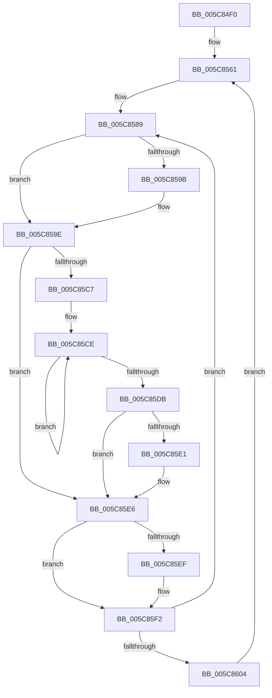

# KiExecuteDpc

- RVA: `0x005C84F0`–`0x005C8615` (길이 `293` bytes)
- VA: `0x00000001405C84F0`
- 실행 섹션: `.text`
- PDB 이름 있음: `예`; PDB Function 태그: `아니요`
- unwind 정보 RVA: `0x000CAC10`
- 디코드: `68`개 명령, `293/293` bytes 표시
- 미해석 바이트: `0` (있으면 어셈블리에 `.byte`로 보존)

> 이 문서는 커널 이미지의 기계어와 PDB 기호를 분석해 생성했습니다. 4번과 5번은 함수 원형과 자료형을 바이너리 사용 방식에서 추정한 C 해석이며 원본 소스 복구 결과는 아닙니다.

## 1. Dependencies

- 직접 호출 지점: **7**; 고유 호출 대상: **7**
- 직접 호출자로 확인된 함수: **0**
- RIP 상대 이미지 참조: **2**

### Outgoing calls
- `0x005C8527` → [memset](../6C/memset_function_006C6C40.md) (function, `0x006C6C40`)
- `0x005C853D` → [KeSetPriorityThread](../2C/KeSetPriorityThread_function_002C76E0.md) (function, `0x002C76E0`)
- `0x005C854D` → [KiSetSystemAffinityThreadToProcessor](KiSetSystemAffinityThreadToProcessor_function_005C4588.md) (function, `0x005C4588`)
- `0x005C8573` → [KeWaitForGate](../2C/KeWaitForGate_function_002CA794.md) (function, `0x002CA794`)
- `0x005C85AD` → [KiExecuteAllDpcs](../25/KiExecuteAllDpcs_function_0025B740.md) (function, `0x0025B740`)
- `0x005C85E1` → [KiRemoveSystemWorkPriorityKick](../26/KiRemoveSystemWorkPriorityKick_function_002631D0.md) (function, `0x002631D0`)
- `0x005C860B` → [KeLeaveGuardedRegion](../2E/KeLeaveGuardedRegion_function_002E2C40.md) (function, `0x002E2C40`)

### Direct callers
- 이 함수 시작 RVA로 연결되는 직접 call은 확인되지 않았습니다. 간접 호출은 완전히 역산할 수 없습니다.

### Static image references
- `0x005C8505` → RVA `0x00E0A740` (`.data`; read)
- `0x005C8593` → RVA `0x00FC6BF0` (`ALMOSTRO`; read)

## 2. Other-region calls and transfers

- 다른 실행 섹션으로 향하는 call: **0**
- 별도 외부 분기/꼬리 이동을 확인하지 못했습니다.

## 3. Assembly (complete function range)

```asm
005C84F0  48 89 5C 24 10                  mov qword ptr [rsp + 0x10], rbx
005C84F5  48 89 6C 24 18                  mov qword ptr [rsp + 0x18], rbp
005C84FA  56                              push rsi
005C84FB  57                              push rdi
005C84FC  41 56                           push r14
005C84FE  48 81 EC C0 01 00 00            sub rsp, 0x1c0
005C8505  48 8B 05 34 22 84 00            mov rax, qword ptr [rip + 0x842234]
005C850C  48 33 C4                        xor rax, rsp
005C850F  48 89 84 24 B0 01 00 00         mov qword ptr [rsp + 0x1b0], rax
005C8517  48 8B D9                        mov rbx, rcx
005C851A  33 D2                           xor edx, edx
005C851C  48 8D 4C 24 24                  lea rcx, [rsp + 0x24]
005C8521  41 B8 8C 01 00 00               mov r8d, 0x18c
005C8527  E8 14 E7 0F 00                  call 0x1406c6c40
005C852C  65 48 8B 3C 25 88 01 00 00      mov rdi, qword ptr gs:[0x188]
005C8535  BA 1F 00 00 00                  mov edx, 0x1f
005C853A  48 8B CF                        mov rcx, rdi
005C853D  E8 9E F1 CF FF                  call 0x1402c76e0
005C8542  F0 0F BA 6F 78 08               lock bts dword ptr [rdi + 0x78], 8
005C8548  8B 4B 24                        mov ecx, dword ptr [rbx + 0x24]
005C854B  33 D2                           xor edx, edx
005C854D  E8 36 C0 FF FF                  call 0x1405c4588
005C8552  41 BE 01 00 00 00               mov r14d, 1
005C8558  33 ED                           xor ebp, ebp
005C855A  44 88 B3 B8 38 00 00            mov byte ptr [rbx + 0x38b8], r14b
005C8561  45 33 C0                        xor r8d, r8d
005C8564  89 6C 24 20                     mov dword ptr [rsp + 0x20], ebp
005C8568  48 8D 8B 40 83 00 00            lea rcx, [rbx + 0x8340]
005C856F  41 8D 50 05                     lea edx, [r8 + 5]
005C8573  E8 1C 22 D0 FF                  call 0x1402ca794
005C8578  65 48 8B 04 25 88 01 00 00      mov rax, qword ptr gs:[0x188]
005C8581  66 FF 88 E6 01 00 00            dec word ptr [rax + 0x1e6]
005C8588  90                              nop
005C8589  41 8B C6                        mov eax, r14d
005C858C  66 87 83 BE 38 00 00            xchg word ptr [rbx + 0x38be], ax
005C8593  39 2D 57 E6 9F 00               cmp dword ptr [rip + 0x9fe657], ebp
005C8599  74 03                           je 0x1405c859e
005C859B  0F 01 CA                        clac
005C859E  FA                              cli
005C859F  45 8B CE                        mov r9d, r14d
005C85A2  4C 8D 44 24 20                  lea r8, [rsp + 0x20]
005C85A7  48 8B D7                        mov rdx, rdi
005C85AA  48 8B CB                        mov rcx, rbx
005C85AD  E8 8E 31 C9 FF                  call 0x14025b740
005C85B2  65 48 8B 0C 25 20 00 00 00      mov rcx, qword ptr gs:[0x20]
005C85BB  4C 8B 81 B8 8E 00 00            mov r8, qword ptr [rcx + 0x8eb8]
005C85C2  4D 85 C0                        test r8, r8
005C85C5  74 1F                           je 0x1405c85e6
005C85C7  41 0F 0D 08                     prefetchw byte ptr [r8]
005C85CB  41 8B 00                        mov eax, dword ptr [r8]
005C85CE  8B D0                           mov edx, eax
005C85D0  0F BA F2 15                     btr edx, 0x15
005C85D4  F0 41 0F B1 10                  lock cmpxchg dword ptr [r8], edx
005C85D9  75 F3                           jne 0x1405c85ce
005C85DB  0F BA E0 15                     bt eax, 0x15
005C85DF  73 05                           jae 0x1405c85e6
005C85E1  E8 EA AB C9 FF                  call 0x1402631d0
005C85E6  FB                              sti
005C85E7  39 2D 03 E6 9F 00               cmp dword ptr [rip + 0x9fe603], ebp
005C85ED  74 03                           je 0x1405c85f2
005C85EF  0F 01 CB                        stac
005C85F2  41 8B C6                        mov eax, r14d
005C85F5  66 F0 0F B1 AB BE 38 00 00      lock cmpxchg word ptr [rbx + 0x38be], bp
005C85FE  66 41 3B C6                     cmp ax, r14w
005C8602  75 85                           jne 0x1405c8589
005C8604  48 89 AB 90 38 00 00            mov qword ptr [rbx + 0x3890], rbp
005C860B  E8 30 A6 D1 FF                  call 0x1402e2c40
005C8610  E9 4C FF FF FF                  jmp 0x1405c8561
```

## 4. C-style interpretation (structured pseudocode)

```c
__int64 __fastcall KiExecuteDpc(__int64 a1, int a2)
{
    __int64 result;
    __int64 v_rbp;
    __int64 v_rsp;
    unsigned __int64 v_stack_m1B4;
    unsigned int v_stack_m1B8;
    unsigned __int64 v_stack_m28;
    unsigned __int64 v_stack_p10;
    unsigned __int64 v_stack_p18;

    v_stack_p10 = v_rbx;
    v_stack_p18 = v_rbp;
    v_rsp = (v_rsp) - (448);
    result = (*(unsigned __int64 *)(v_rip + 8659508)) ^ (v_rsp);
    v_stack_m28 = result;
    a2 = 0;
    result = memset(v_stack_m1B4, a2, 396, a4);
    result = KeSetPriorityThread(*(unsigned __int64 *)(gs_base + (0 + 392)), 31, 396, a4);
    a2 = 0;
    result = KiSetSystemAffinityThreadToProcessor((unsigned int)(*(unsigned int *)(a1 + 36)), a2, 396, a4);
    v_rbp = 0;
    *(unsigned __int8 *)(a1 + 14520) = 1;
loc_005C8561:
    a3 = 0;
    v_stack_m1B8 = 0;
    result = KeWaitForGate(a1 + 33600, a3 + 5, a3, a4);
loc_005C8589:
    if ((*(unsigned int *)(v_rip + 10479191)) != 0) {
    }
    result = KiExecuteAllDpcs(a1, *(unsigned __int64 *)(gs_base + (0 + 392)), v_stack_m1B8, 1);
    if (*(unsigned __int64 *)(*(unsigned __int64 *)(gs_base + (0 + 32)) + 36536) == 0) goto loc_005C85E6;
loc_005C85CE:
    if (*(unsigned __int64 *)(*(unsigned __int64 *)(gs_base + (0 + 32)) + 36536) != 0) goto loc_005C85CE;
    result = (unsigned int)(*(unsigned int *)(*(unsigned __int64 *)(*(unsigned __int64 *)(gs_base + (0 + 32)) + 36536)));
    if (!(condition_is_above_or_equal)) {
        result = KiRemoveSystemWorkPriorityKick(*(unsigned __int64 *)(gs_base + (0 + 32)), (unsigned int)((unsigned int)((unsigned int)(*(unsigned int *)(*(unsigned __int64 *)(*(unsigned __int64 *)(gs_base + (0 + 32)) + 36536))))), *(unsigned __int64 *)(*(unsigned __int64 *)(gs_base + (0 + 32)) + 36536), 1);
    }
    if ((*(unsigned int *)(v_rip + 10479107)) != 0) {
    }
    if (1 != 1) goto loc_005C8589;
    *(unsigned __int64 *)(a1 + 14480) = 0;
    result = KeLeaveGuardedRegion(*(unsigned __int64 *)(gs_base + (0 + 32)), (unsigned int)((unsigned int)((unsigned int)(*(unsigned int *)(*(unsigned __int64 *)(*(unsigned __int64 *)(gs_base + (0 + 32)) + 36536))))), *(unsigned __int64 *)(*(unsigned __int64 *)(gs_base + (0 + 32)) + 36536), 1);
    goto loc_005C8561;
}
```

## 5. (Beta) C Style

```c
int64_t KiExecuteDpc(void *Arg1, int32_t Arg2)
{
    uint8_t *arg1 = (uint8_t *)Arg1;

    int64_t result;
    int64_t local_rbp;
    int64_t local_rsp;
    uint64_t v_stack_m1B4;
    uint32_t v_stack_m1B8;
    uint64_t v_stack_m28;
    uint64_t v_stack_p10;
    uint64_t v_stack_p18;

    v_stack_p10 = local_rbx;
    v_stack_p18 = local_rbp;
    local_rsp = (local_rsp) - (448);
    result = (*(uint64_t *)(v_rip + 0x842234)) ^ (local_rsp);
    v_stack_m28 = result;
    Arg2 = 0;
    result = memset(v_stack_m1B4, Arg2, 396, a4);
    result = KeSetPriorityThread(*(uint64_t *)(gs_base + (0 + 0x188)), 31, 396, a4);
    Arg2 = 0;
    result = KiSetSystemAffinityThreadToProcessor((uint32_t)(*(uint32_t *)(arg1 + 0x24)), Arg2, 396, a4);
    local_rbp = 0;
    *(uint8_t *)(arg1 + 0x38B8) = 1;
loc_005C8561:
    a3 = 0;
    v_stack_m1B8 = 0;
    result = KeWaitForGate(Arg1 + 33600, a3 + 5, a3, a4);
loc_005C8589:
    if ((*(uint32_t *)(v_rip + 0x9FE657)) != 0) {
    }
    result = KiExecuteAllDpcs(Arg1, *(uint64_t *)(gs_base + (0 + 0x188)), v_stack_m1B8, 1);
    if (*(uint64_t *)(*(uint64_t *)(gs_base + (0 + 0x20)) + 0x8EB8) == 0) goto loc_005C85E6;
loc_005C85CE:
    if (*(uint64_t *)(*(uint64_t *)(gs_base + (0 + 0x20)) + 0x8EB8) != 0) goto loc_005C85CE;
    result = (uint32_t)(*(uint32_t *)(*(uint64_t *)(*(uint64_t *)(gs_base + (0 + 0x20)) + 0x8EB8)));
    if (!(condition_is_above_or_equal)) {
        result = KiRemoveSystemWorkPriorityKick(*(uint64_t *)(gs_base + (0 + 0x20)), (uint32_t)((uint32_t)((uint32_t)(*(uint32_t *)(*(uint64_t *)(*(uint64_t *)(gs_base + (0 + 0x20)) + 0x8EB8))))), *(uint64_t *)(*(uint64_t *)(gs_base + (0 + 0x20)) + 0x8EB8), 1);
    }
    if ((*(uint32_t *)(v_rip + 0x9FE603)) != 0) {
    }
    if (1 != 1) goto loc_005C8589;
    *(uint64_t *)(arg1 + 0x3890) = 0;
    result = KeLeaveGuardedRegion(*(uint64_t *)(gs_base + (0 + 0x20)), (uint32_t)((uint32_t)((uint32_t)(*(uint32_t *)(*(uint64_t *)(*(uint64_t *)(gs_base + (0 + 0x20)) + 0x8EB8))))), *(uint64_t *)(*(uint64_t *)(gs_base + (0 + 0x20)) + 0x8EB8), 1);
    goto loc_005C8561;
}
```

### 관측된 메모리 오프셋

구조체 형식이 확인되지 않은 접근은 인자 기준의 오프셋으로만 기록했습니다.

| 기준 인자 | 오프셋 표현 | 폭 (bit) | 접근 |
|---|---:|---:|---|
| `Arg1` | `+ 0x24` | `32` | `R` |
| `Arg1` | `+ 0x3890` | `64` | `W` |
| `Arg1` | `+ 0x38B8` | `8` | `W` |
| `Arg1` | `+ 0x38BE` | `16` | `R` |
| `Arg1` | `+ 0x38BE` | `16` | `R/W` |
| `Arg1` | `+ 0x8340` | `64` | `R` |

## 6. Execution-region graph

[열기: 2D/3D 그래프와 함수 탐색 컨트롤 패널](../../../control-panel.html?section=text&rva=0x005C84F0&view=graph)

- 2D 그래프는 위에서 아래로 흐르고, 3D 그래프는 빈 공간을 드래그해 회전합니다. Shift+드래그는 이동, 휠은 확대·축소, 함수 노드 선택은 대상 보고서 이동입니다.

### Static fallback


