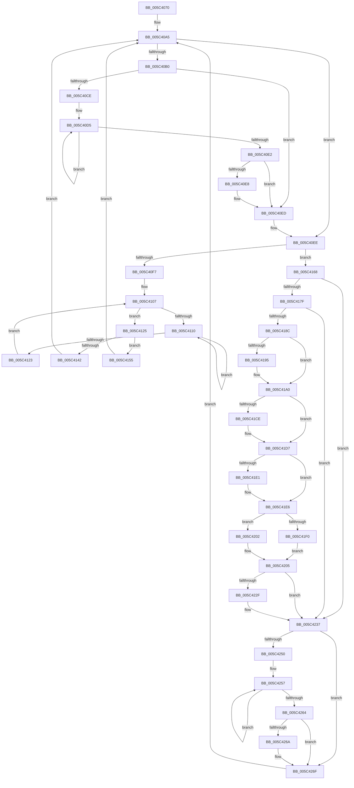

# KiExecuteSmtIsolationThread

- RVA: `0x005C4070`–`0x005C4275` (길이 `517` bytes)
- VA: `0x00000001405C4070`
- 실행 섹션: `.text`
- PDB 이름 있음: `예`; PDB Function 태그: `아니요`
- unwind 정보 RVA: `0x000CA994`
- 디코드: `139`개 명령, `517/517` bytes 표시
- 미해석 바이트: `0` (있으면 어셈블리에 `.byte`로 보존)

> 이 문서는 커널 이미지의 기계어와 PDB 기호를 분석해 생성했습니다. 4번과 5번은 함수 원형과 자료형을 바이너리 사용 방식에서 추정한 C 해석이며 원본 소스 복구 결과는 아닙니다.

## 1. Dependencies

- 직접 호출 지점: **17**; 고유 호출 대상: **15**
- 직접 호출자로 확인된 함수: **0**
- RIP 상대 이미지 참조: **2**

### Outgoing calls
- `0x005C4099` → [KeAttachProcess](../48/KeAttachProcess_function_00486540.md) (function, `0x00486540`)
- `0x005C40B4` → [KiRetireDpcList](../21/KiRetireDpcList_function_0021A0B0.md) (function, `0x0021A0B0`)
- `0x005C40E8` → [KiRemoveSystemWorkPriorityKick](../26/KiRemoveSystemWorkPriorityKick_function_002631D0.md) (function, `0x002631D0`)
- `0x005C40FD` → [KiCaptureTotalCyclesCurrentThread](../37/KiCaptureTotalCyclesCurrentThread_function_0037CB90.md) (function, `0x0037CB90`)
- `0x005C4115` → [KeYieldProcessorEx](../3F/KeYieldProcessorEx_function_003FBD00.md) (function, `0x003FBD00`)
- `0x005C4133` → [KiUpdatePriorityMatrixForRunningTransition](../37/KiUpdatePriorityMatrixForRunningTransition_function_0037B3A0.md) (function, `0x0037B3A0`)
- `0x005C414B` → [KiResumeThreadCycleAccumulation](../30/KiResumeThreadCycleAccumulation_function_00309BC4.md) (function, `0x00309BC4`)
- `0x005C415E` → [KiSwapContext](../6B/KiSwapContext_function_006B9740.md) (function, `0x006B9740`)
- `0x005C419B` → [KiLowerIrqlProcessIrqlFlags](../4F/KiLowerIrqlProcessIrqlFlags_function_004F5698.md) (function, `0x004F5698`)
- `0x005C41A4` → [KiSynchronizeIdleIsolationDomainEntry](KiSynchronizeIdleIsolationDomainEntry_function_005C04AC.md) (function, `0x005C04AC`)
- `0x005C41BD` → [KeIdleSpecCtrl](../4B/KeIdleSpecCtrl_function_004B0D40.md) (function, `0x004B0D40`)
- `0x005C41E1` → [KeExecuteVerw](../6C/KeExecuteVerw_function_006C66C0.md) (function, `0x006C66C0`)
- `0x005C41E6` → [HalProcessorIdle](../6A/HalProcessorIdle_function_006AC7C0.md) (function, `0x006AC7C0`)
- `0x005C4213` → [KeIdleSpecCtrl](../4B/KeIdleSpecCtrl_function_004B0D40.md) (function, `0x004B0D40`)
- `0x005C4219` → [KiSynchronizeIdleIsolationDomainExit](KiSynchronizeIdleIsolationDomainExit_function_005C0544.md) (function, `0x005C0544`)
- `0x005C4232` → [KiRaiseIrqlProcessIrqlFlags](../4F/KiRaiseIrqlProcessIrqlFlags_function_004F56FC.md) (function, `0x004F56FC`)
- `0x005C426A` → [KiRemoveSystemWorkPriorityKick](../26/KiRemoveSystemWorkPriorityKick_function_002631D0.md) (function, `0x002631D0`)

### Direct callers
- 이 함수 시작 RVA로 연결되는 직접 call은 확인되지 않았습니다. 간접 호출은 완전히 역산할 수 없습니다.

### Static image references
- `0x005C4092` → RVA `0x00FC6AB0` (`ALMOSTRO`; read)
- `0x005C418C` → RVA `0x00FC6D20` (`ALMOSTRO`; read)

## 2. Other-region calls and transfers

- 다른 실행 섹션으로 향하는 call: **0**
- 별도 외부 분기/꼬리 이동을 확인하지 못했습니다.

## 3. Assembly (complete function range)

```asm
005C4070  48 89 5C 24 08                  mov qword ptr [rsp + 8], rbx
005C4075  55                              push rbp
005C4076  56                              push rsi
005C4077  57                              push rdi
005C4078  41 56                           push r14
005C407A  41 57                           push r15
005C407C  48 83 EC 20                     sub rsp, 0x20
005C4080  65 48 8B 2C 25 88 01 00 00      mov rbp, qword ptr gs:[0x188]
005C4089  65 48 8B 1C 25 20 00 00 00      mov rbx, qword ptr gs:[0x20]
005C4092  48 8B 0D 17 2A A0 00            mov rcx, qword ptr [rip + 0xa02a17]
005C4099  E8 A2 24 EC FF                  call 0x140486540
005C409E  45 33 F6                        xor r14d, r14d
005C40A1  45 8D 7E 02                     lea r15d, [r14 + 2]
005C40A5  0F B7 83 BC 38 00 00            movzx eax, word ptr [rbx + 0x38bc]
005C40AC  A8 BF                           test al, 0xbf
005C40AE  74 3E                           je 0x1405c40ee
005C40B0  FA                              cli
005C40B1  48 8B CB                        mov rcx, rbx
005C40B4  E8 F7 5F C5 FF                  call 0x14021a0b0
005C40B9  65 48 8B 0C 25 20 00 00 00      mov rcx, qword ptr gs:[0x20]
005C40C2  4C 8B 81 B8 8E 00 00            mov r8, qword ptr [rcx + 0x8eb8]
005C40C9  4D 85 C0                        test r8, r8
005C40CC  74 1F                           je 0x1405c40ed
005C40CE  41 0F 0D 08                     prefetchw byte ptr [r8]
005C40D2  41 8B 00                        mov eax, dword ptr [r8]
005C40D5  8B D0                           mov edx, eax
005C40D7  0F BA F2 15                     btr edx, 0x15
005C40DB  F0 41 0F B1 10                  lock cmpxchg dword ptr [r8], edx
005C40E0  75 F3                           jne 0x1405c40d5
005C40E2  0F BA E0 15                     bt eax, 0x15
005C40E6  73 05                           jae 0x1405c40ed
005C40E8  E8 E3 F0 C9 FF                  call 0x1402631d0
005C40ED  FB                              sti
005C40EE  48 8B 43 10                     mov rax, qword ptr [rbx + 0x10]
005C40F2  48 85 C0                        test rax, rax
005C40F5  74 71                           je 0x1405c4168
005C40F7  48 8B D5                        mov rdx, rbp
005C40FA  48 8B CB                        mov rcx, rbx
005C40FD  E8 8E 8A DB FF                  call 0x14037cb90
005C4102  44 89 74 24 68                  mov dword ptr [rsp + 0x68], r14d
005C4107  F0 48 0F BA 6B 30 00            lock bts qword ptr [rbx + 0x30], 0
005C410E  73 15                           jae 0x1405c4125
005C4110  48 8D 4C 24 68                  lea rcx, [rsp + 0x68]
005C4115  E8 E6 7B E3 FF                  call 0x1403fbd00
005C411A  48 8B 43 30                     mov rax, qword ptr [rbx + 0x30]
005C411E  48 85 C0                        test rax, rax
005C4121  75 ED                           jne 0x1405c4110
005C4123  EB E2                           jmp 0x1405c4107
005C4125  48 8B 7B 10                     mov rdi, qword ptr [rbx + 0x10]
005C4129  48 8B CB                        mov rcx, rbx
005C412C  48 8B D7                        mov rdx, rdi
005C412F  4C 89 73 10                     mov qword ptr [rbx + 0x10], r14
005C4133  E8 68 72 DB FF                  call 0x14037b3a0
005C4138  F0 4C 21 73 30                  lock and qword ptr [rbx + 0x30], r14
005C413D  48 3B FD                        cmp rdi, rbp
005C4140  75 13                           jne 0x1405c4155
005C4142  45 33 C0                        xor r8d, r8d
005C4145  48 8B D5                        mov rdx, rbp
005C4148  48 8B CB                        mov rcx, rbx
005C414B  E8 74 5A D4 FF                  call 0x140309bc4
005C4150  E9 50 FF FF FF                  jmp 0x1405c40a5
005C4155  45 8A C7                        mov r8b, r15b
005C4158  48 8B D7                        mov rdx, rdi
005C415B  48 8B CD                        mov rcx, rbp
005C415E  E8 DD 55 0F 00                  call 0x1406b9740
005C4163  E9 3D FF FF FF                  jmp 0x1405c40a5
005C4168  FA                              cli
005C4169  C6 43 07 01                     mov byte ptr [rbx + 7], 1
005C416D  F0 44 09 34 24                  lock or dword ptr [rsp], r14d
005C4172  48 8B 43 10                     mov rax, qword ptr [rbx + 0x10]
005C4176  48 85 C0                        test rax, rax
005C4179  0F 85 B8 00 00 00               jne 0x1405c4237
005C417F  F6 83 BC 38 00 00 BF            test byte ptr [rbx + 0x38bc], 0xbf
005C4186  0F 85 AB 00 00 00               jne 0x1405c4237
005C418C  44 39 35 8D 2B A0 00            cmp dword ptr [rip + 0xa02b8d], r14d
005C4193  74 0B                           je 0x1405c41a0
005C4195  44 0F 20 C1                     mov rcx, cr8
005C4199  33 D2                           xor edx, edx
005C419B  E8 F8 14 F3 FF                  call 0x1404f5698
005C41A0  45 0F 22 C6                     mov cr8, r14
005C41A4  E8 03 C3 FF FF                  call 0x1405c04ac
005C41A9  45 33 C9                        xor r9d, r9d
005C41AC  44 89 74 24 60                  mov dword ptr [rsp + 0x60], r14d
005C41B1  4C 8D 44 24 60                  lea r8, [rsp + 0x60]
005C41B6  48 8B CB                        mov rcx, rbx
005C41B9  41 8D 51 01                     lea edx, [r9 + 1]
005C41BD  E8 7E CB EE FF                  call 0x1404b0d40
005C41C2  8B 7C 24 60                     mov edi, dword ptr [rsp + 0x60]
005C41C6  0F B7 F0                        movzx esi, ax
005C41C9  66 85 FF                        test di, di
005C41CC  74 09                           je 0x1405c41d7
005C41CE  33 C0                           xor eax, eax
005C41D0  33 D2                           xor edx, edx
005C41D2  8D 48 48                        lea ecx, [rax + 0x48]
005C41D5  0F 30                           wrmsr
005C41D7  8B CF                           mov ecx, edi
005C41D9  C1 E9 10                        shr ecx, 0x10
005C41DC  66 85 C9                        test cx, cx
005C41DF  74 05                           je 0x1405c41e6
005C41E1  E8 DA 24 10 00                  call 0x1406c66c0
005C41E6  E8 D5 85 0E 00                  call 0x1406ac7c0
005C41EB  66 85 FF                        test di, di
005C41EE  74 12                           je 0x1405c4202
005C41F0  0F B7 D7                        movzx edx, di
005C41F3  B9 48 00 00 00                  mov ecx, 0x48
005C41F8  8B C2                           mov eax, edx
005C41FA  48 C1 EA 20                     shr rdx, 0x20
005C41FE  0F 30                           wrmsr
005C4200  EB 03                           jmp 0x1405c4205
005C4202  0F AE E8                        lfence
005C4205  44 0F B7 CE                     movzx r9d, si
005C4209  4C 8D 44 24 60                  lea r8, [rsp + 0x60]
005C420E  33 D2                           xor edx, edx
005C4210  48 8B CB                        mov rcx, rbx
005C4213  E8 28 CB EE FF                  call 0x1404b0d40
005C4218  FA                              cli
005C4219  E8 26 C3 FF FF                  call 0x1405c0544
005C421E  44 0F 20 C1                     mov rcx, cr8
005C4222  45 0F 22 C7                     mov cr8, r15
005C4226  44 39 35 F3 2A A0 00            cmp dword ptr [rip + 0xa02af3], r14d
005C422D  74 08                           je 0x1405c4237
005C422F  41 8A D7                        mov dl, r15b
005C4232  E8 C5 14 F3 FF                  call 0x1404f56fc
005C4237  44 88 73 07                     mov byte ptr [rbx + 7], r14b
005C423B  65 48 8B 0C 25 20 00 00 00      mov rcx, qword ptr gs:[0x20]
005C4244  4C 8B 81 B8 8E 00 00            mov r8, qword ptr [rcx + 0x8eb8]
005C424B  4D 85 C0                        test r8, r8
005C424E  74 1F                           je 0x1405c426f
005C4250  41 0F 0D 08                     prefetchw byte ptr [r8]
005C4254  41 8B 00                        mov eax, dword ptr [r8]
005C4257  8B D0                           mov edx, eax
005C4259  0F BA F2 15                     btr edx, 0x15
005C425D  F0 41 0F B1 10                  lock cmpxchg dword ptr [r8], edx
005C4262  75 F3                           jne 0x1405c4257
005C4264  0F BA E0 15                     bt eax, 0x15
005C4268  73 05                           jae 0x1405c426f
005C426A  E8 61 EF C9 FF                  call 0x1402631d0
005C426F  FB                              sti
005C4270  E9 30 FE FF FF                  jmp 0x1405c40a5
```

## 4. C-style interpretation (structured pseudocode)

```c
__int64 __fastcall KiExecuteSmtIsolationThread(__int64 a1, __int64 a2, __int64 a3, int a4)
{
    __int64 result;
    __int64 v_r14;
    __int64 v_rsp;
    unsigned int v_stack_m48;
    unsigned int v_stack_p18;
    unsigned int v_stack_p20;
    unsigned __int64 v_stack_p8;

    v_stack_p8 = v_rbx;
    v_rsp = (v_rsp) - (32);
    result = KeAttachProcess(*(unsigned __int64 *)(v_rip + 10496535), a2, a3, a4);
    v_r14 = 0;
loc_005C40A5:
    if ((((unsigned __int8)(*(unsigned __int16 *)(*(unsigned __int64 *)(gs_base + (0 + 32)) + 14524))) & (191)) == 0) goto loc_005C40EE;
    result = KiRetireDpcList(*(unsigned __int64 *)(gs_base + (0 + 32)), a2, a3, a4);
    if (*(unsigned __int64 *)(*(unsigned __int64 *)(gs_base + (0 + 32)) + 36536) == 0) goto loc_005C40ED;
loc_005C40D5:
    if (*(unsigned __int64 *)(*(unsigned __int64 *)(gs_base + (0 + 32)) + 36536) != 0) goto loc_005C40D5;
    result = (unsigned int)(*(unsigned int *)(*(unsigned __int64 *)(*(unsigned __int64 *)(gs_base + (0 + 32)) + 36536)));
    if (!(condition_is_above_or_equal)) {
        result = KiRemoveSystemWorkPriorityKick(*(unsigned __int64 *)(gs_base + (0 + 32)), (unsigned int)((unsigned int)((unsigned int)(*(unsigned int *)(*(unsigned __int64 *)(*(unsigned __int64 *)(gs_base + (0 + 32)) + 36536))))), *(unsigned __int64 *)(*(unsigned __int64 *)(gs_base + (0 + 32)) + 36536), a4);
    }
loc_005C40EE:
    if (*(unsigned __int64 *)(*(unsigned __int64 *)(gs_base + (0 + 32)) + 16) == 0) goto loc_005C4168;
    result = KiCaptureTotalCyclesCurrentThread(*(unsigned __int64 *)(gs_base + (0 + 32)), *(unsigned __int64 *)(gs_base + (0 + 392)), *(unsigned __int64 *)(*(unsigned __int64 *)(gs_base + (0 + 32)) + 36536), a4);
    v_stack_p20 = 0;
loc_005C4107:
    if (condition_is_above_or_equal) goto loc_005C4125;
loc_005C4110:
    result = KeYieldProcessorEx(v_stack_p20, *(unsigned __int64 *)(gs_base + (0 + 392)), *(unsigned __int64 *)(*(unsigned __int64 *)(gs_base + (0 + 32)) + 36536), a4);
    if (*(unsigned __int64 *)(*(unsigned __int64 *)(gs_base + (0 + 32)) + 48) != 0) goto loc_005C4110;
    goto loc_005C4107;
loc_005C4125:
    *(unsigned __int64 *)(*(unsigned __int64 *)(gs_base + (0 + 32)) + 16) = 0;
    result = KiUpdatePriorityMatrixForRunningTransition(*(unsigned __int64 *)(gs_base + (0 + 32)), *(unsigned __int64 *)(*(unsigned __int64 *)(gs_base + (0 + 32)) + 16), *(unsigned __int64 *)(*(unsigned __int64 *)(gs_base + (0 + 32)) + 36536), a4);
    if ((*(unsigned __int64 *)(*(unsigned __int64 *)(gs_base + (0 + 32)) + 16)) != (*(unsigned __int64 *)(gs_base + (0 + 392)))) goto loc_005C4155;
    a3 = 0;
    result = KiResumeThreadCycleAccumulation(*(unsigned __int64 *)(gs_base + (0 + 32)), *(unsigned __int64 *)(gs_base + (0 + 392)), a3, a4);
    goto loc_005C40A5;
loc_005C4155:
    result = KiSwapContext(*(unsigned __int64 *)(gs_base + (0 + 392)), *(unsigned __int64 *)(*(unsigned __int64 *)(gs_base + (0 + 32)) + 16), (unsigned __int8)(v_r14 + 2), a4);
    goto loc_005C40A5;
loc_005C4168:
    *(unsigned __int8 *)(*(unsigned __int64 *)(gs_base + (0 + 32)) + 7) = 1;
    if (*(unsigned __int64 *)(*(unsigned __int64 *)(gs_base + (0 + 32)) + 16) != 0) goto loc_005C4237;
    if (((*(unsigned __int8 *)(*(unsigned __int64 *)(gs_base + (0 + 32)) + 14524)) & (191)) != 0) goto loc_005C4237;
    result = *(unsigned __int64 *)(*(unsigned __int64 *)(gs_base + (0 + 32)) + 16);
    if ((*(unsigned int *)(v_rip + 10496909)) != 0) {
        a1 = v_cr8;
        a2 = 0;
        result = KiLowerIrqlProcessIrqlFlags(a1, a2, (unsigned __int8)(v_r14 + 2), a4);
    }
    result = KiSynchronizeIdleIsolationDomainEntry(a1, a2, (unsigned __int8)(v_r14 + 2), a4);
    a4 = 0;
    v_stack_p18 = 0;
    result = KeIdleSpecCtrl(*(unsigned __int64 *)(gs_base + (0 + 32)), a4 + 1, v_stack_p18, a4);
    if ((unsigned __int16)((unsigned int)(v_stack_p18)) != 0) {
        result = 0;
        a2 = 0;
        a1 = result + 72;
    }
    a1 = (unsigned int)(((unsigned int)((unsigned int)((unsigned int)(v_stack_p18)))) >> (16));
    if ((unsigned __int16)(a1) != 0) {
        result = KeExecuteVerw(a1, a2, v_stack_p18, a4);
    }
    result = HalProcessorIdle(a1, a2, v_stack_p18, a4);
    if ((unsigned __int16)((unsigned int)(v_stack_p18)) == 0) goto loc_005C4202;
    a2 = ((unsigned __int16)((unsigned int)(v_stack_p18))) >> (32);
    goto loc_005C4205;
loc_005C4202:
loc_005C4205:
    a2 = 0;
    result = KeIdleSpecCtrl(*(unsigned __int64 *)(gs_base + (0 + 32)), a2, v_stack_p18, (unsigned __int16)((unsigned __int16)(result)));
    result = KiSynchronizeIdleIsolationDomainExit(*(unsigned __int64 *)(gs_base + (0 + 32)), a2, v_stack_p18, (unsigned __int16)((unsigned __int16)(result)));
    if ((*(unsigned int *)(v_rip + 10496755)) != 0) {
        a2 = (unsigned __int8)(v_r14 + 2);
        result = KiRaiseIrqlProcessIrqlFlags(0, a2, v_stack_p18, (unsigned __int16)((unsigned __int16)(result)));
    }
    *(unsigned __int8 *)(*(unsigned __int64 *)(gs_base + (0 + 32)) + 7) = 0;
    if (*(unsigned __int64 *)(*(unsigned __int64 *)(gs_base + (0 + 32)) + 36536) == 0) goto loc_005C426F;
loc_005C4257:
    if (*(unsigned __int64 *)(*(unsigned __int64 *)(gs_base + (0 + 32)) + 36536) != 0) goto loc_005C4257;
    result = (unsigned int)(*(unsigned int *)(*(unsigned __int64 *)(*(unsigned __int64 *)(gs_base + (0 + 32)) + 36536)));
    if (!(condition_is_above_or_equal)) {
        result = KiRemoveSystemWorkPriorityKick(*(unsigned __int64 *)(gs_base + (0 + 32)), (unsigned int)((unsigned int)((unsigned int)(*(unsigned int *)(*(unsigned __int64 *)(*(unsigned __int64 *)(gs_base + (0 + 32)) + 36536))))), *(unsigned __int64 *)(*(unsigned __int64 *)(gs_base + (0 + 32)) + 36536), (unsigned __int16)((unsigned __int16)(result)));
    }
    goto loc_005C40A5;
}
```

## 5. (Beta) C Style

```c
int64_t KiExecuteSmtIsolationThread(int64_t Arg1, int64_t Arg2, int64_t Arg3, int32_t Arg4)
{
    int64_t result;
    int64_t local_r14;
    int64_t local_rsp;
    uint32_t v_stack_m48;
    uint32_t v_stack_p18;
    uint32_t v_stack_p20;
    uint64_t v_stack_p8;

    v_stack_p8 = local_rbx;
    local_rsp = (local_rsp) - (32);
    result = KeAttachProcess(*(uint64_t *)(v_rip + 0xA02A17), Arg2, Arg3, Arg4);
    local_r14 = 0;
loc_005C40A5:
    if ((((uint8_t)(*(uint16_t *)(*(uint64_t *)(gs_base + (0 + 0x20)) + 0x38BC))) & (191)) == 0) goto loc_005C40EE;
    result = KiRetireDpcList(*(uint64_t *)(gs_base + (0 + 0x20)), Arg2, Arg3, Arg4);
    if (*(uint64_t *)(*(uint64_t *)(gs_base + (0 + 0x20)) + 0x8EB8) == 0) goto loc_005C40ED;
loc_005C40D5:
    if (*(uint64_t *)(*(uint64_t *)(gs_base + (0 + 0x20)) + 0x8EB8) != 0) goto loc_005C40D5;
    result = (uint32_t)(*(uint32_t *)(*(uint64_t *)(*(uint64_t *)(gs_base + (0 + 0x20)) + 0x8EB8)));
    if (!(condition_is_above_or_equal)) {
        result = KiRemoveSystemWorkPriorityKick(*(uint64_t *)(gs_base + (0 + 0x20)), (uint32_t)((uint32_t)((uint32_t)(*(uint32_t *)(*(uint64_t *)(*(uint64_t *)(gs_base + (0 + 0x20)) + 0x8EB8))))), *(uint64_t *)(*(uint64_t *)(gs_base + (0 + 0x20)) + 0x8EB8), Arg4);
    }
loc_005C40EE:
    if (*(uint64_t *)(*(uint64_t *)(gs_base + (0 + 0x20)) + 0x10) == 0) goto loc_005C4168;
    result = KiCaptureTotalCyclesCurrentThread(*(uint64_t *)(gs_base + (0 + 0x20)), *(uint64_t *)(gs_base + (0 + 0x188)), *(uint64_t *)(*(uint64_t *)(gs_base + (0 + 0x20)) + 0x8EB8), Arg4);
    v_stack_p20 = 0;
loc_005C4107:
    if (condition_is_above_or_equal) goto loc_005C4125;
loc_005C4110:
    result = KeYieldProcessorEx(v_stack_p20, *(uint64_t *)(gs_base + (0 + 0x188)), *(uint64_t *)(*(uint64_t *)(gs_base + (0 + 0x20)) + 0x8EB8), Arg4);
    if (*(uint64_t *)(*(uint64_t *)(gs_base + (0 + 0x20)) + 0x30) != 0) goto loc_005C4110;
    goto loc_005C4107;
loc_005C4125:
    *(uint64_t *)(*(uint64_t *)(gs_base + (0 + 0x20)) + 0x10) = 0;
    result = KiUpdatePriorityMatrixForRunningTransition(*(uint64_t *)(gs_base + (0 + 0x20)), *(uint64_t *)(*(uint64_t *)(gs_base + (0 + 0x20)) + 0x10), *(uint64_t *)(*(uint64_t *)(gs_base + (0 + 0x20)) + 0x8EB8), Arg4);
    if ((*(uint64_t *)(*(uint64_t *)(gs_base + (0 + 0x20)) + 0x10)) != (*(uint64_t *)(gs_base + (0 + 0x188)))) goto loc_005C4155;
    Arg3 = 0;
    result = KiResumeThreadCycleAccumulation(*(uint64_t *)(gs_base + (0 + 0x20)), *(uint64_t *)(gs_base + (0 + 0x188)), Arg3, Arg4);
    goto loc_005C40A5;
loc_005C4155:
    result = KiSwapContext(*(uint64_t *)(gs_base + (0 + 0x188)), *(uint64_t *)(*(uint64_t *)(gs_base + (0 + 0x20)) + 0x10), (uint8_t)(local_r14 + 2), Arg4);
    goto loc_005C40A5;
loc_005C4168:
    *(uint8_t *)(*(uint64_t *)(gs_base + (0 + 0x20)) + 0x7) = 1;
    if (*(uint64_t *)(*(uint64_t *)(gs_base + (0 + 0x20)) + 0x10) != 0) goto loc_005C4237;
    if (((*(uint8_t *)(*(uint64_t *)(gs_base + (0 + 0x20)) + 0x38BC)) & (191)) != 0) goto loc_005C4237;
    result = *(uint64_t *)(*(uint64_t *)(gs_base + (0 + 0x20)) + 0x10);
    if ((*(uint32_t *)(v_rip + 0xA02B8D)) != 0) {
        Arg1 = v_cr8;
        Arg2 = 0;
        result = KiLowerIrqlProcessIrqlFlags(Arg1, Arg2, (uint8_t)(local_r14 + 2), Arg4);
    }
    result = KiSynchronizeIdleIsolationDomainEntry(Arg1, Arg2, (uint8_t)(local_r14 + 2), Arg4);
    Arg4 = 0;
    v_stack_p18 = 0;
    result = KeIdleSpecCtrl(*(uint64_t *)(gs_base + (0 + 0x20)), Arg4 + 1, v_stack_p18, Arg4);
    if ((uint16_t)((uint32_t)(v_stack_p18)) != 0) {
        result = 0;
        Arg2 = 0;
        Arg1 = result + 72;
    }
    Arg1 = (uint32_t)(((uint32_t)((uint32_t)((uint32_t)(v_stack_p18)))) >> (16));
    if ((uint16_t)(Arg1) != 0) {
        result = KeExecuteVerw(Arg1, Arg2, v_stack_p18, Arg4);
    }
    result = HalProcessorIdle(Arg1, Arg2, v_stack_p18, Arg4);
    if ((uint16_t)((uint32_t)(v_stack_p18)) == 0) goto loc_005C4202;
    Arg2 = ((uint16_t)((uint32_t)(v_stack_p18))) >> (32);
    goto loc_005C4205;
loc_005C4202:
loc_005C4205:
    Arg2 = 0;
    result = KeIdleSpecCtrl(*(uint64_t *)(gs_base + (0 + 0x20)), Arg2, v_stack_p18, (uint16_t)((uint16_t)(result)));
    result = KiSynchronizeIdleIsolationDomainExit(*(uint64_t *)(gs_base + (0 + 0x20)), Arg2, v_stack_p18, (uint16_t)((uint16_t)(result)));
    if ((*(uint32_t *)(v_rip + 0xA02AF3)) != 0) {
        Arg2 = (uint8_t)(local_r14 + 2);
        result = KiRaiseIrqlProcessIrqlFlags(0, Arg2, v_stack_p18, (uint16_t)((uint16_t)(result)));
    }
    *(uint8_t *)(*(uint64_t *)(gs_base + (0 + 0x20)) + 0x7) = 0;
    if (*(uint64_t *)(*(uint64_t *)(gs_base + (0 + 0x20)) + 0x8EB8) == 0) goto loc_005C426F;
loc_005C4257:
    if (*(uint64_t *)(*(uint64_t *)(gs_base + (0 + 0x20)) + 0x8EB8) != 0) goto loc_005C4257;
    result = (uint32_t)(*(uint32_t *)(*(uint64_t *)(*(uint64_t *)(gs_base + (0 + 0x20)) + 0x8EB8)));
    if (!(condition_is_above_or_equal)) {
        result = KiRemoveSystemWorkPriorityKick(*(uint64_t *)(gs_base + (0 + 0x20)), (uint32_t)((uint32_t)((uint32_t)(*(uint32_t *)(*(uint64_t *)(*(uint64_t *)(gs_base + (0 + 0x20)) + 0x8EB8))))), *(uint64_t *)(*(uint64_t *)(gs_base + (0 + 0x20)) + 0x8EB8), (uint16_t)((uint16_t)(result)));
    }
    goto loc_005C40A5;
}
```

## 6. Execution-region graph

[열기: 2D/3D 그래프와 함수 탐색 컨트롤 패널](../../../control-panel.html?section=text&rva=0x005C4070&view=graph)

- 2D 그래프는 위에서 아래로 흐르고, 3D 그래프는 빈 공간을 드래그해 회전합니다. Shift+드래그는 이동, 휠은 확대·축소, 함수 노드 선택은 대상 보고서 이동입니다.

### Static fallback


