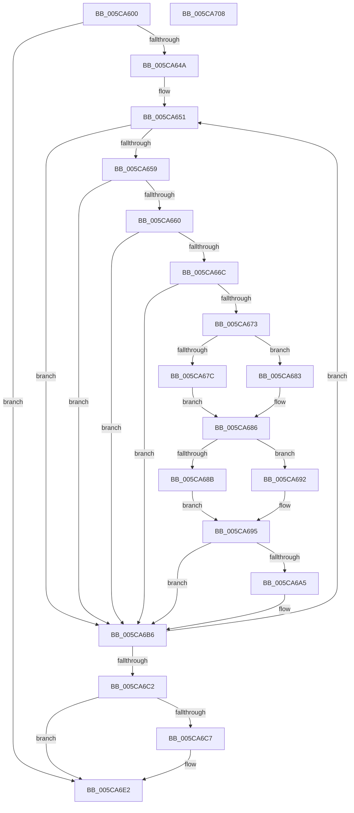

# KiExtendProcessAffinity

- RVA: `0x005CA600`–`0x005CA709` (길이 `265` bytes)
- VA: `0x00000001405CA600`
- 실행 섹션: `.text`
- PDB 이름 있음: `예`; PDB Function 태그: `아니요`
- unwind 정보 RVA: `0x000C5B6C`
- 디코드: `78`개 명령, `265/265` bytes 표시
- 미해석 바이트: `0` (있으면 어셈블리에 `.byte`로 보존)

> 이 문서는 커널 이미지의 기계어와 PDB 기호를 분석해 생성했습니다. 4번과 5번은 함수 원형과 자료형을 바이너리 사용 방식에서 추정한 C 해석이며 원본 소스 복구 결과는 아닙니다.

## 1. Dependencies

- 직접 호출 지점: **4**; 고유 호출 대상: **4**
- 직접 호출자로 확인된 함수: **2**
- RIP 상대 이미지 참조: **2**

### Outgoing calls
- `0x005CA69B` → [KeAddGroupAffinityEx](../25/KeAddGroupAffinityEx_function_0025B6C0.md) (function, `0x0025B6C0`)
- `0x005CA6AE` → [KiSetIdealNodeProcessByGroup](../3C/KiSetIdealNodeProcessByGroup_function_003C0888.md) (function, `0x003C0888`)
- `0x005CA6D0` → [KeComputeGroupMask](../4A/KeComputeGroupMask_function_004A2ECC.md) (function, `0x004A2ECC`)
- `0x005CA6EA` → [_security_check_cookie](../6A/_security_check_cookie_function_006AC640.md) (function, `0x006AC640`)

### Direct callers
- [KeSetUserAffinityThread](../2C/KeSetUserAffinityThread_function_002CFA2C.md) at `0x002CFAF7`
- [KeStartThread](../3C/KeStartThread_function_003C21B8.md) at `0x003C2609`

### Static image references
- `0x005CA616` → RVA `0x00E0A740` (`.data`; read)
- `0x005CA64A` → RVA `0x00FC7120` (`ALMOSTRO`; read)

## 2. Other-region calls and transfers

- 다른 실행 섹션으로 향하는 call: **0**
- 별도 외부 분기/꼬리 이동을 확인하지 못했습니다.

## 3. Assembly (complete function range)

```asm
005CA600  48 89 5C 24 10                  mov qword ptr [rsp + 0x10], rbx
005CA605  48 89 6C 24 18                  mov qword ptr [rsp + 0x18], rbp
005CA60A  56                              push rsi
005CA60B  57                              push rdi
005CA60C  41 54                           push r12
005CA60E  41 56                           push r14
005CA610  41 57                           push r15
005CA612  48 83 EC 40                     sub rsp, 0x40
005CA616  48 8B 05 23 01 84 00            mov rax, qword ptr [rip + 0x840123]
005CA61D  48 33 C4                        xor rax, rsp
005CA620  48 89 44 24 30                  mov qword ptr [rsp + 0x30], rax
005CA625  0F B7 02                        movzx eax, word ptr [rdx]
005CA628  45 33 FF                        xor r15d, r15d
005CA62B  0F 57 C0                        xorps xmm0, xmm0
005CA62E  4C 8B F2                        mov r14, rdx
005CA631  48 8B F9                        mov rdi, rcx
005CA634  41 8A EF                        mov bpl, r15b
005CA637  41 0F B7 DF                     movzx ebx, r15w
005CA63B  0F 11 44 24 20                  movups xmmword ptr [rsp + 0x20], xmm0
005CA640  66 44 3B F8                     cmp r15w, ax
005CA644  0F 83 98 00 00 00               jae 0x1405ca6e2
005CA64A  4C 8D 25 CF CA 9F 00            lea r12, [rip + 0x9fcacf]
005CA651  0F B7 CB                        movzx ecx, bx
005CA654  66 3B D8                        cmp bx, ax
005CA657  73 5D                           jae 0x1405ca6b6
005CA659  4D 39 7C CE 08                  cmp qword ptr [r14 + rcx*8 + 8], r15
005CA65E  74 56                           je 0x1405ca6b6
005CA660  0F B7 15 B9 CA 9F 00            movzx edx, word ptr [rip + 0x9fcab9]
005CA667  66 3B DA                        cmp bx, dx
005CA66A  73 4A                           jae 0x1405ca6b6
005CA66C  4D 39 7C CC 08                  cmp qword ptr [r12 + rcx*8 + 8], r15
005CA671  74 43                           je 0x1405ca6b6
005CA673  48 8B 47 50                     mov rax, qword ptr [rdi + 0x50]
005CA677  66 3B 18                        cmp bx, word ptr [rax]
005CA67A  73 07                           jae 0x1405ca683
005CA67C  48 8B 74 C8 08                  mov rsi, qword ptr [rax + rcx*8 + 8]
005CA681  EB 03                           jmp 0x1405ca686
005CA683  49 8B F7                        mov rsi, r15
005CA686  66 3B DA                        cmp bx, dx
005CA689  73 07                           jae 0x1405ca692
005CA68B  4D 8B 44 CC 08                  mov r8, qword ptr [r12 + rcx*8 + 8]
005CA690  EB 03                           jmp 0x1405ca695
005CA692  4D 8B C7                        mov r8, r15
005CA695  0F B7 D3                        movzx edx, bx
005CA698  48 8B C8                        mov rcx, rax
005CA69B  E8 20 10 C9 FF                  call 0x14025b6c0
005CA6A0  48 85 F6                        test rsi, rsi
005CA6A3  75 11                           jne 0x1405ca6b6
005CA6A5  44 0F B7 C3                     movzx r8d, bx
005CA6A9  33 D2                           xor edx, edx
005CA6AB  48 8B CF                        mov rcx, rdi
005CA6AE  E8 D5 61 DF FF                  call 0x1403c0888
005CA6B3  40 B5 01                        mov bpl, 1
005CA6B6  41 0F B7 06                     movzx eax, word ptr [r14]
005CA6BA  66 FF C3                        inc bx
005CA6BD  66 3B D8                        cmp bx, ax
005CA6C0  72 8F                           jb 0x1405ca651
005CA6C2  40 84 ED                        test bpl, bpl
005CA6C5  74 1B                           je 0x1405ca6e2
005CA6C7  48 8B 4F 50                     mov rcx, qword ptr [rdi + 0x50]
005CA6CB  48 8D 54 24 20                  lea rdx, [rsp + 0x20]
005CA6D0  E8 F7 87 ED FF                  call 0x1404a2ecc
005CA6D5  0F 10 4C 24 20                  movups xmm1, xmmword ptr [rsp + 0x20]
005CA6DA  F3 0F 7F 8F 98 00 00 00         movdqu xmmword ptr [rdi + 0x98], xmm1
005CA6E2  48 8B 4C 24 30                  mov rcx, qword ptr [rsp + 0x30]
005CA6E7  48 33 CC                        xor rcx, rsp
005CA6EA  E8 51 1F 0E 00                  call 0x1406ac640
005CA6EF  4C 8D 5C 24 40                  lea r11, [rsp + 0x40]
005CA6F4  49 8B 5B 38                     mov rbx, qword ptr [r11 + 0x38]
005CA6F8  49 8B 6B 40                     mov rbp, qword ptr [r11 + 0x40]
005CA6FC  49 8B E3                        mov rsp, r11
005CA6FF  41 5F                           pop r15
005CA701  41 5E                           pop r14
005CA703  41 5C                           pop r12
005CA705  5F                              pop rdi
005CA706  5E                              pop rsi
005CA707  C3                              ret
005CA708  CC                              int3
```

## 4. C-style interpretation (structured pseudocode)

```c
__int64 __fastcall KiExtendProcessAffinity(__int64 a1, __int64 a2)
{
    __int64 result;
    __int64 v_r15;
    __int64 v_rbp;
    __int64 v_rbx;
    __int64 v_rsp;
    unsigned __int64 v_stack_m28;
    unsigned __int64 v_stack_m38;
    unsigned __int64 v_stack_m48;
    unsigned __int64 v_stack_p10;
    unsigned __int64 v_stack_p18;

    v_stack_p10 = v_rbx;
    v_stack_p18 = v_rbp;
    v_rsp = (v_rsp) - (64);
    result = (*(unsigned __int64 *)(v_rip + 8651043)) ^ (v_rsp);
    v_stack_m38 = result;
    v_r15 = 0;
    v_stack_m48 = v_xmm0;
    if (0 >= ((unsigned __int16)(*(unsigned __int16 *)(a2)))) goto loc_005CA6E2;
loc_005CA651:
    if (0 >= ((unsigned __int16)(*(unsigned __int16 *)(a2)))) goto loc_005CA6B6;
    if ((*(unsigned __int64 *)(a2 + 0 * 8 + 8)) == 0) goto loc_005CA6B6;
    if (0 >= ((unsigned __int16)(*(unsigned __int16 *)(v_rip + 10472121)))) goto loc_005CA6B6;
    if ((*(unsigned __int64 *)(v_rip + 10472143 + 0 * 8 + 8)) == 0) goto loc_005CA6B6;
    if (0 >= (*(unsigned __int16 *)(*(unsigned __int64 *)(a1 + 80)))) goto loc_005CA683;
    goto loc_005CA686;
loc_005CA683:
loc_005CA686:
    if (0 >= ((unsigned __int16)(*(unsigned __int16 *)(v_rip + 10472121)))) goto loc_005CA692;
    goto loc_005CA695;
loc_005CA692:
loc_005CA695:
    result = KeAddGroupAffinityEx(*(unsigned __int64 *)(a1 + 80), 0, 0, a4);
    v_rbp = 0;
    if (0 == 0) {
        a3 = 0;
        a2 = 0;
        a1 = a1;
        result = KiSetIdealNodeProcessByGroup(a1, a2, a3, a4);
        v_rbp = 1;
    }
    v_rbx = (unsigned __int16)((0) + 1);
    if (((unsigned __int16)(v_rbx)) < ((unsigned __int16)(*(unsigned __int16 *)(a2)))) goto loc_005CA651;
    result = *(unsigned __int16 *)(a2);
    if ((unsigned __int8)(v_rbp) != 0) {
        a1 = *(unsigned __int64 *)(a1 + 80);
        a2 = v_stack_m48;
        result = KeComputeGroupMask(a1, a2, a3, a4);
        *(unsigned __int64 *)(a1 + 152) = v_xmm1;
    }
    a1 = (v_stack_m38) ^ (v_rsp);
    result = _security_check_cookie(a1, a2, a3, a4);
    return result;
}
```

## 5. (Beta) C Style

```c
int64_t KiExtendProcessAffinity(void *Arg1, void *Arg2)
{
    uint8_t *arg1 = (uint8_t *)Arg1;
    uint8_t *arg2 = (uint8_t *)Arg2;

    int64_t result;
    int64_t local_r15;
    int64_t local_rbp;
    int64_t local_rbx;
    int64_t local_rsp;
    uint64_t v_stack_m28;
    uint64_t v_stack_m38;
    uint64_t v_stack_m48;
    uint64_t v_stack_p10;
    uint64_t v_stack_p18;

    v_stack_p10 = local_rbx;
    v_stack_p18 = local_rbp;
    local_rsp = (local_rsp) - (64);
    result = (*(uint64_t *)(v_rip + 0x840123)) ^ (local_rsp);
    v_stack_m38 = result;
    local_r15 = 0;
    v_stack_m48 = v_xmm0;
    if (0 >= ((uint16_t)(*(uint16_t *)(arg2)))) goto loc_005CA6E2;
loc_005CA651:
    if (0 >= ((uint16_t)(*(uint16_t *)(arg2)))) goto loc_005CA6B6;
    if ((*(uint64_t *)(arg2 + 0x0 * 8 + 0x8)) == 0) goto loc_005CA6B6;
    if (0 >= ((uint16_t)(*(uint16_t *)(v_rip + 0x9FCAB9)))) goto loc_005CA6B6;
    if ((*(uint64_t *)(v_rip + 0x9FCACF + 0x0 * 8 + 0x8)) == 0) goto loc_005CA6B6;
    if (0 >= (*(uint16_t *)(*(uint64_t *)(arg1 + 0x50)))) goto loc_005CA683;
    goto loc_005CA686;
loc_005CA683:
loc_005CA686:
    if (0 >= ((uint16_t)(*(uint16_t *)(v_rip + 0x9FCAB9)))) goto loc_005CA692;
    goto loc_005CA695;
loc_005CA692:
loc_005CA695:
    result = KeAddGroupAffinityEx(*(uint64_t *)(arg1 + 0x50), 0, 0, a4);
    local_rbp = 0;
    if (0 == 0) {
        a3 = 0;
        Arg2 = 0;
        Arg1 = Arg1;
        result = KiSetIdealNodeProcessByGroup(Arg1, Arg2, a3, a4);
        local_rbp = 1;
    }
    local_rbx = (uint16_t)((0) + 1);
    if (((uint16_t)(local_rbx)) < ((uint16_t)(*(uint16_t *)(arg2)))) goto loc_005CA651;
    result = *(uint16_t *)(arg2);
    if ((uint8_t)(local_rbp) != 0) {
        Arg1 = *(uint64_t *)(arg1 + 0x50);
        Arg2 = v_stack_m48;
        result = KeComputeGroupMask(Arg1, Arg2, a3, a4);
        *(uint64_t *)(arg1 + 0x98) = v_xmm1;
    }
    Arg1 = (v_stack_m38) ^ (local_rsp);
    result = _security_check_cookie(Arg1, Arg2, a3, a4);
    return result;
}
```

### 관측된 메모리 오프셋

구조체 형식이 확인되지 않은 접근은 인자 기준의 오프셋으로만 기록했습니다.

| 기준 인자 | 오프셋 표현 | 폭 (bit) | 접근 |
|---|---:|---:|---|
| `Arg1` | `+ 0x50` | `64` | `R` |
| `Arg1` | `+ 0x98` | `128` | `W` |
| `Arg2` | `+ 0x0` | `16` | `R` |
| `Arg2` | `+ 0x8 + rcx*8` | `64` | `R` |

## 6. Execution-region graph

[열기: 2D/3D 그래프와 함수 탐색 컨트롤 패널](../../../control-panel.html?section=text&rva=0x005CA600&view=graph)

- 2D 그래프는 위에서 아래로 흐르고, 3D 그래프는 빈 공간을 드래그해 회전합니다. Shift+드래그는 이동, 휠은 확대·축소, 함수 노드 선택은 대상 보고서 이동입니다.

### Static fallback


