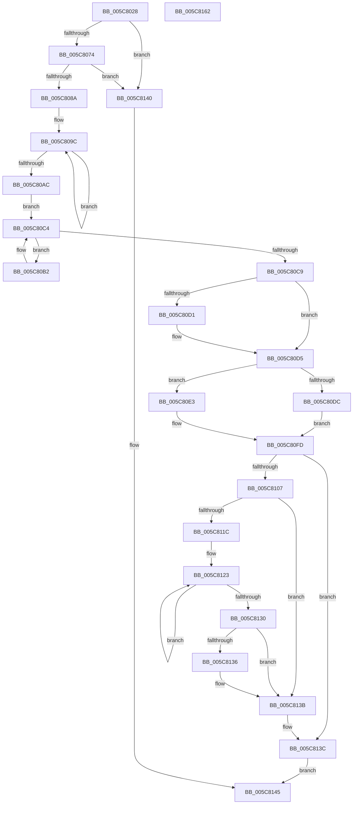

# KiFixupControlProtectionKernelModeReturnMismatch

- RVA: `0x005C8028`–`0x005C8163` (길이 `315` bytes)
- VA: `0x00000001405C8028`
- 실행 섹션: `.text`
- PDB 이름 있음: `예`; PDB Function 태그: `아니요`
- unwind 정보 RVA: `0x00075C18`
- 디코드: `91`개 명령, `315/315` bytes 표시
- 미해석 바이트: `0` (있으면 어셈블리에 `.byte`로 보존)

> 이 문서는 커널 이미지의 기계어와 PDB 기호를 분석해 생성했습니다. 4번과 5번은 함수 원형과 자료형을 바이너리 사용 방식에서 추정한 C 해석이며 원본 소스 복구 결과는 아닙니다.

## 1. Dependencies

- 직접 호출 지점: **3**; 고유 호출 대상: **3**
- 직접 호출자로 확인된 함수: **1**
- RIP 상대 이미지 참조: **0**

### Outgoing calls
- `0x005C808A` → [KeDisableInterrupts](../21/KeDisableInterrupts_function_00217BE0.md) (function, `0x00217BE0`)
- `0x005C809C` → [KiDecrementKernelShadowStack](../6B/KiDecrementKernelShadowStack_function_006B2140.md) (function, `0x006B2140`)
- `0x005C8136` → [KiRemoveSystemWorkPriorityKick](../26/KiRemoveSystemWorkPriorityKick_function_002631D0.md) (function, `0x002631D0`)

### Direct callers
- [KiProcessControlProtectionFromKernelMode](../44/KiProcessControlProtectionFromKernelMode_function_00444B2C.md) at `0x00444C52`

### Static image references
- 디코드된 RIP-relative 메모리 참조가 없습니다.

## 2. Other-region calls and transfers

- 다른 실행 섹션으로 향하는 call: **0**
- 별도 외부 분기/꼬리 이동을 확인하지 못했습니다.

## 3. Assembly (complete function range)

```asm
005C8028  48 89 5C 24 08                  mov qword ptr [rsp + 8], rbx
005C802D  48 89 6C 24 10                  mov qword ptr [rsp + 0x10], rbp
005C8032  48 89 74 24 18                  mov qword ptr [rsp + 0x18], rsi
005C8037  57                              push rdi
005C8038  41 54                           push r12
005C803A  41 55                           push r13
005C803C  41 56                           push r14
005C803E  41 57                           push r15
005C8040  48 83 EC 20                     sub rsp, 0x20
005C8044  8A 44 24 70                     mov al, byte ptr [rsp + 0x70]
005C8048  49 8B D9                        mov rbx, r9
005C804B  F6 D8                           neg al
005C804D  4D 8B E0                        mov r12, r8
005C8050  48 8B F2                        mov rsi, rdx
005C8053  48 1B ED                        sbb rbp, rbp
005C8056  33 FF                           xor edi, edi
005C8058  48 83 E5 10                     and rbp, 0x10
005C805C  48 83 C5 08                     add rbp, 8
005C8060  F3 48 0F 1E CF                  rdsspq rdi
005C8065  48 8B C7                        mov rax, rdi
005C8068  48 2B C5                        sub rax, rbp
005C806B  48 3B C1                        cmp rax, rcx
005C806E  0F 82 CC 00 00 00               jb 0x1405c8140
005C8074  48 8B C2                        mov rax, rdx
005C8077  48 2B C7                        sub rax, rdi
005C807A  48 83 C0 18                     add rax, 0x18
005C807E  48 3D 80 00 00 00               cmp rax, 0x80
005C8084  0F 83 B6 00 00 00               jae 0x1405c8140
005C808A  E8 51 FB C4 FF                  call 0x140217be0
005C808F  4C 8B FD                        mov r15, rbp
005C8092  44 8A E8                        mov r13b, al
005C8095  49 C1 EF 03                     shr r15, 3
005C8099  45 33 F6                        xor r14d, r14d
005C809C  E8 9F A0 0E 00                  call 0x1406b2140
005C80A1  41 FF C6                        inc r14d
005C80A4  41 8B CE                        mov ecx, r14d
005C80A7  49 3B CF                        cmp rcx, r15
005C80AA  72 F0                           jb 0x1405c809c
005C80AC  48 8D 56 18                     lea rdx, [rsi + 0x18]
005C80B0  EB 12                           jmp 0x1405c80c4
005C80B2  48 8B 0F                        mov rcx, qword ptr [rdi]
005C80B5  48 8B C7                        mov rax, rdi
005C80B8  48 2B C5                        sub rax, rbp
005C80BB  48 83 C7 08                     add rdi, 8
005C80BF  48 0F 38 F6 08                  wrssq qword ptr [rax], rcx
005C80C4  48 3B FA                        cmp rdi, rdx
005C80C7  72 E9                           jb 0x1405c80b2
005C80C9  48 2B F5                        sub rsi, rbp
005C80CC  48 85 DB                        test rbx, rbx
005C80CF  75 04                           jne 0x1405c80d5
005C80D1  48 8D 5E 18                     lea rbx, [rsi + 0x18]
005C80D5  80 7C 24 70 00                  cmp byte ptr [rsp + 0x70], 0
005C80DA  75 07                           jne 0x1405c80e3
005C80DC  4C 0F 38 F6 23                  wrssq qword ptr [rbx], r12
005C80E1  EB 1A                           jmp 0x1405c80fd
005C80E3  48 8D 43 18                     lea rax, [rbx + 0x18]
005C80E7  48 0F 38 F6 03                  wrssq qword ptr [rbx], rax
005C80EC  B8 10 00 00 00                  mov eax, 0x10
005C80F1  4C 0F 38 F6 63 08               wrssq qword ptr [rbx + 8], r12
005C80F7  48 0F 38 F6 43 10               wrssq qword ptr [rbx + 0x10], rax
005C80FD  48 0F 38 F6 1E                  wrssq qword ptr [rsi], rbx
005C8102  45 84 ED                        test r13b, r13b
005C8105  74 35                           je 0x1405c813c
005C8107  65 48 8B 0C 25 20 00 00 00      mov rcx, qword ptr gs:[0x20]
005C8110  4C 8B 81 B8 8E 00 00            mov r8, qword ptr [rcx + 0x8eb8]
005C8117  4D 85 C0                        test r8, r8
005C811A  74 1F                           je 0x1405c813b
005C811C  41 0F 0D 08                     prefetchw byte ptr [r8]
005C8120  41 8B 00                        mov eax, dword ptr [r8]
005C8123  8B D0                           mov edx, eax
005C8125  0F BA F2 15                     btr edx, 0x15
005C8129  F0 41 0F B1 10                  lock cmpxchg dword ptr [r8], edx
005C812E  75 F3                           jne 0x1405c8123
005C8130  0F BA E0 15                     bt eax, 0x15
005C8134  73 05                           jae 0x1405c813b
005C8136  E8 95 B0 C9 FF                  call 0x1402631d0
005C813B  FB                              sti
005C813C  33 C0                           xor eax, eax
005C813E  EB 05                           jmp 0x1405c8145
005C8140  B8 05 00 00 80                  mov eax, 0x80000005
005C8145  48 8B 5C 24 50                  mov rbx, qword ptr [rsp + 0x50]
005C814A  48 8B 6C 24 58                  mov rbp, qword ptr [rsp + 0x58]
005C814F  48 8B 74 24 60                  mov rsi, qword ptr [rsp + 0x60]
005C8154  48 83 C4 20                     add rsp, 0x20
005C8158  41 5F                           pop r15
005C815A  41 5E                           pop r14
005C815C  41 5D                           pop r13
005C815E  41 5C                           pop r12
005C8160  5F                              pop rdi
005C8161  C3                              ret
005C8162  CC                              int3
```

## 4. C-style interpretation (structured pseudocode)

```c
__int64 __fastcall KiFixupControlProtectionKernelModeReturnMismatch(__int64 a1, __int64 a2, __int64 a3, __int64 a4, unsigned __int8 a5)
{
    __int64 result;
    __int64 v_r14;
    __int64 v_r15;
    __int64 v_rbp;
    __int64 v_rbx;
    __int64 v_rdi;
    __int64 v_rsi;
    __int64 v_rsp;
    unsigned __int64 v_stack_p10;
    unsigned __int64 v_stack_p18;
    unsigned __int64 v_stack_p8;

    v_stack_p8 = v_rbx;
    v_stack_p10 = v_rbp;
    v_stack_p18 = v_rsi;
    v_rsp = (v_rsp) - (32);
    result = (unsigned __int8)(-(a5));
    v_rdi = 0;
    v_rbp = (v_rbp) & (16);
    v_rbp = (v_rbp) + (8);
    result = (0) - (v_rbp);
    if (result < a1) goto loc_005C8140;
    result = (a2) - (0);
    result = (result) + (24);
    if (result >= 128) goto loc_005C8140;
    result = KeDisableInterrupts(a1, a2, a3, a4);
    v_r15 = (v_rbp) >> (3);
    v_r14 = 0;
loc_005C809C:
    result = KiDecrementKernelShadowStack(a1, a2, a3, a4);
    v_r14 = (unsigned int)((v_r14) + 1);
    if (((unsigned int)((unsigned int)(v_r14))) < v_r15) goto loc_005C809C;
    goto loc_005C80C4;
loc_005C80B2:
    result = (0) - (v_rbp);
    v_rdi = (v_rdi) + (8);
loc_005C80C4:
    if (v_rdi < (a2 + 24)) goto loc_005C80B2;
    v_rsi = (a2) - (v_rbp);
    v_rbx = a4;
    if (a4 == 0) {
        v_rbx = v_rsi + 24;
    }
    if (a5 != 0) goto loc_005C80E3;
    goto loc_005C80FD;
loc_005C80E3:
loc_005C80FD:
    if ((unsigned __int8)((unsigned __int8)(result)) == 0) goto loc_005C813C;
    if (*(unsigned __int64 *)(*(unsigned __int64 *)(gs_base + (0 + 32)) + 36536) == 0) goto loc_005C813B;
loc_005C8123:
    if (*(unsigned __int64 *)(*(unsigned __int64 *)(gs_base + (0 + 32)) + 36536) != 0) goto loc_005C8123;
    result = (unsigned int)(*(unsigned int *)(*(unsigned __int64 *)(*(unsigned __int64 *)(gs_base + (0 + 32)) + 36536)));
    if (!(condition_is_above_or_equal)) {
        result = KiRemoveSystemWorkPriorityKick(*(unsigned __int64 *)(gs_base + (0 + 32)), (unsigned int)((unsigned int)((unsigned int)(*(unsigned int *)(*(unsigned __int64 *)(*(unsigned __int64 *)(gs_base + (0 + 32)) + 36536))))), *(unsigned __int64 *)(*(unsigned __int64 *)(gs_base + (0 + 32)) + 36536), a4);
    }
loc_005C813C:
    result = 0;
    goto loc_005C8145;
loc_005C8140:
loc_005C8145:
    v_rsp = (v_rsp) + (32);
    return (unsigned int)(0x80000005ULL);
}
```

## 5. (Beta) C Style

```c
int64_t KiFixupControlProtectionKernelModeReturnMismatch(int64_t Arg1, void *Arg2, int64_t Arg3, int64_t Arg4, uint8_t Arg5)
{
    uint8_t *arg2 = (uint8_t *)Arg2;

    int64_t result;
    int64_t local_r14;
    int64_t local_r15;
    int64_t local_rbp;
    int64_t local_rbx;
    int64_t local_rdi;
    int64_t local_rsi;
    int64_t local_rsp;
    uint64_t v_stack_p10;
    uint64_t v_stack_p18;
    uint64_t v_stack_p8;

    v_stack_p8 = local_rbx;
    v_stack_p10 = local_rbp;
    v_stack_p18 = local_rsi;
    local_rsp = (local_rsp) - (32);
    result = (uint8_t)(-(Arg5));
    local_rdi = 0;
    local_rbp = (local_rbp) & (16);
    local_rbp = (local_rbp) + (8);
    result = (0) - (local_rbp);
    if (result < Arg1) goto loc_005C8140;
    result = (Arg2) - (0);
    result = (result) + (24);
    if (result >= 128) goto loc_005C8140;
    result = KeDisableInterrupts(Arg1, Arg2, Arg3, Arg4);
    local_r15 = (local_rbp) >> (3);
    local_r14 = 0;
loc_005C809C:
    result = KiDecrementKernelShadowStack(Arg1, Arg2, Arg3, Arg4);
    local_r14 = (uint32_t)((local_r14) + 1);
    if (((uint32_t)((uint32_t)(local_r14))) < local_r15) goto loc_005C809C;
    goto loc_005C80C4;
loc_005C80B2:
    result = (0) - (local_rbp);
    local_rdi = (local_rdi) + (8);
loc_005C80C4:
    if (local_rdi < (Arg2 + 24)) goto loc_005C80B2;
    local_rsi = (Arg2) - (local_rbp);
    local_rbx = Arg4;
    if (Arg4 == 0) {
        local_rbx = local_rsi + 24;
    }
    if (Arg5 != 0) goto loc_005C80E3;
    goto loc_005C80FD;
loc_005C80E3:
loc_005C80FD:
    if ((uint8_t)((uint8_t)(result)) == 0) goto loc_005C813C;
    if (*(uint64_t *)(*(uint64_t *)(gs_base + (0 + 0x20)) + 0x8EB8) == 0) goto loc_005C813B;
loc_005C8123:
    if (*(uint64_t *)(*(uint64_t *)(gs_base + (0 + 0x20)) + 0x8EB8) != 0) goto loc_005C8123;
    result = (uint32_t)(*(uint32_t *)(*(uint64_t *)(*(uint64_t *)(gs_base + (0 + 0x20)) + 0x8EB8)));
    if (!(condition_is_above_or_equal)) {
        result = KiRemoveSystemWorkPriorityKick(*(uint64_t *)(gs_base + (0 + 0x20)), (uint32_t)((uint32_t)((uint32_t)(*(uint32_t *)(*(uint64_t *)(*(uint64_t *)(gs_base + (0 + 0x20)) + 0x8EB8))))), *(uint64_t *)(*(uint64_t *)(gs_base + (0 + 0x20)) + 0x8EB8), Arg4);
    }
loc_005C813C:
    result = 0;
    goto loc_005C8145;
loc_005C8140:
loc_005C8145:
    local_rsp = (local_rsp) + (32);
    return (uint32_t)(0x80000005ULL);
}
```

### 관측된 메모리 오프셋

구조체 형식이 확인되지 않은 접근은 인자 기준의 오프셋으로만 기록했습니다.

| 기준 인자 | 오프셋 표현 | 폭 (bit) | 접근 |
|---|---:|---:|---|
| `Arg2` | `+ 0x0` | `64` | `R` |
| `Arg2` | `+ 0x18` | `64` | `R` |

## 6. Execution-region graph

[열기: 2D/3D 그래프와 함수 탐색 컨트롤 패널](../../../control-panel.html?section=text&rva=0x005C8028&view=graph)

- 2D 그래프는 위에서 아래로 흐르고, 3D 그래프는 빈 공간을 드래그해 회전합니다. Shift+드래그는 이동, 휠은 확대·축소, 함수 노드 선택은 대상 보고서 이동입니다.

### Static fallback


