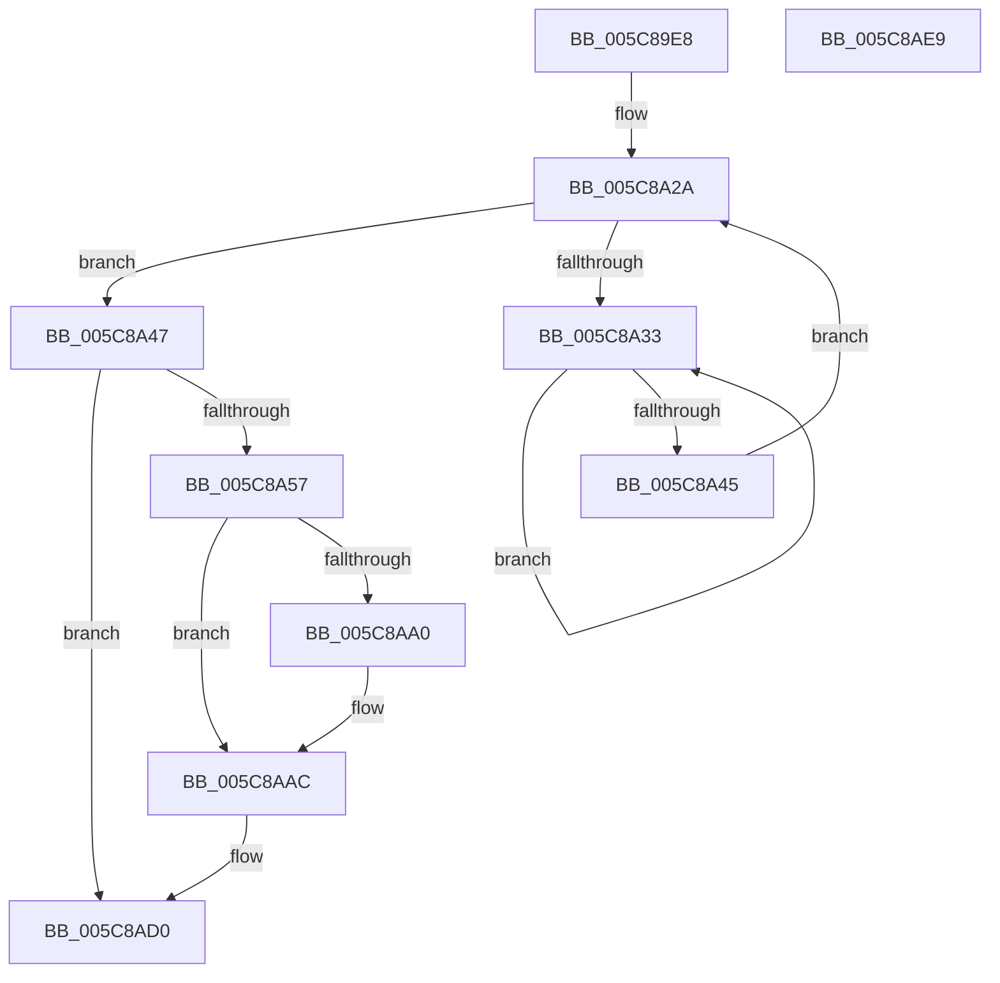

# KiFlushScbReferences

- RVA: `0x005C89E8`–`0x005C8AEA` (길이 `258` bytes)
- VA: `0x00000001405C89E8`
- 실행 섹션: `.text`
- PDB 이름 있음: `예`; PDB Function 태그: `아니요`
- unwind 정보 RVA: `0x000CAC4C`
- 디코드: `70`개 명령, `258/258` bytes 표시
- 미해석 바이트: `0` (있으면 어셈블리에 `.byte`로 보존)

> 이 문서는 커널 이미지의 기계어와 PDB 기호를 분석해 생성했습니다. 4번과 5번은 함수 원형과 자료형을 바이너리 사용 방식에서 추정한 C 해석이며 원본 소스 복구 결과는 아닙니다.

## 1. Dependencies

- 직접 호출 지점: **4**; 고유 호출 대상: **4**
- 직접 호출자로 확인된 함수: **1**
- RIP 상대 이미지 참조: **1**

### Outgoing calls
- `0x005C8A13` → [memset](../6C/memset_function_006C6C40.md) (function, `0x006C6C40`)
- `0x005C8A37` → [KeYieldProcessorEx](../3F/KeYieldProcessorEx_function_003FBD00.md) (function, `0x003FBD00`)
- `0x005C8AB5` → [KeInsertQueueDpc](../20/KeInsertQueueDpc_function_00207C50.md) (function, `0x00207C50`)
- `0x005C8ACB` → [KeWaitForSingleObject](../20/KeWaitForSingleObject_function_0020E6B0.md) (function, `0x0020E6B0`)

### Direct callers
- [sub_006FA7F8](../6F/Unknown_function_006FA7F8.md) at `0x006FA820`

### Static image references
- `0x005C8A6A` → RVA `0x005C8AF0` (`KiFlushScbReferencesDpc`; read)

## 2. Other-region calls and transfers

- 다른 실행 섹션으로 향하는 call: **0**
- 별도 외부 분기/꼬리 이동을 확인하지 못했습니다.

## 3. Assembly (complete function range)

```asm
005C89E8  48 8B C4                        mov rax, rsp
005C89EB  48 89 58 10                     mov qword ptr [rax + 0x10], rbx
005C89EF  48 89 70 18                     mov qword ptr [rax + 0x18], rsi
005C89F3  48 89 78 20                     mov qword ptr [rax + 0x20], rdi
005C89F7  55                              push rbp
005C89F8  48 8D 68 A1                     lea rbp, [rax - 0x5f]
005C89FC  48 81 EC 90 00 00 00            sub rsp, 0x90
005C8A03  48 8B FA                        mov rdi, rdx
005C8A06  48 8B D9                        mov rbx, rcx
005C8A09  33 D2                           xor edx, edx
005C8A0B  48 8D 4D 17                     lea rcx, [rbp + 0x17]
005C8A0F  44 8D 42 40                     lea r8d, [rdx + 0x40]
005C8A13  E8 28 E2 0F 00                  call 0x1406c6c40
005C8A18  33 C0                           xor eax, eax
005C8A1A  0F 57 C0                        xorps xmm0, xmm0
005C8A1D  33 F6                           xor esi, esi
005C8A1F  48 89 45 07                     mov qword ptr [rbp + 7], rax
005C8A23  89 75 67                        mov dword ptr [rbp + 0x67], esi
005C8A26  0F 11 45 F7                     movups xmmword ptr [rbp - 9], xmm0
005C8A2A  F0 48 0F BA 6B 30 00            lock bts qword ptr [rbx + 0x30], 0
005C8A31  73 14                           jae 0x1405c8a47
005C8A33  48 8D 4D 67                     lea rcx, [rbp + 0x67]
005C8A37  E8 C4 32 E3 FF                  call 0x1403fbd00
005C8A3C  48 8B 43 30                     mov rax, qword ptr [rbx + 0x30]
005C8A40  48 85 C0                        test rax, rax
005C8A43  75 EE                           jne 0x1405c8a33
005C8A45  EB E3                           jmp 0x1405c8a2a
005C8A47  0F B7 47 70                     movzx eax, word ptr [rdi + 0x70]
005C8A4B  F0 48 21 73 30                  lock and qword ptr [rbx + 0x30], rsi
005C8A50  66 0F BA E0 08                  bt ax, 8
005C8A55  73 79                           jae 0x1405c8ad0
005C8A57  8B 4B 24                        mov ecx, dword ptr [rbx + 0x24]
005C8A5A  48 8D 45 FF                     lea rax, [rbp - 1]
005C8A5E  48 89 45 07                     mov qword ptr [rbp + 7], rax
005C8A62  48 8D 45 FF                     lea rax, [rbp - 1]
005C8A66  48 89 45 FF                     mov qword ptr [rbp - 1], rax
005C8A6A  48 8D 05 7F 00 00 00            lea rax, [rip + 0x7f]
005C8A71  48 89 45 2F                     mov qword ptr [rbp + 0x2f], rax
005C8A75  48 8D 45 F7                     lea rax, [rbp - 9]
005C8A79  48 89 45 37                     mov qword ptr [rbp + 0x37], rax
005C8A7D  48 89 75 4F                     mov qword ptr [rbp + 0x4f], rsi
005C8A81  48 8B 45 4F                     mov rax, qword ptr [rbp + 0x4f]
005C8A85  66 89 75 F7                     mov word ptr [rbp - 9], si
005C8A89  C6 45 F9 06                     mov byte ptr [rbp - 7], 6
005C8A8D  89 75 FB                        mov dword ptr [rbp - 5], esi
005C8A90  C7 45 17 13 03 00 00            mov dword ptr [rbp + 0x17], 0x313
005C8A97  48 89 75 27                     mov qword ptr [rbp + 0x27], rsi
005C8A9B  48 85 C0                        test rax, rax
005C8A9E  75 0C                           jne 0x1405c8aac
005C8AA0  B8 00 08 00 00                  mov eax, 0x800
005C8AA5  66 03 C8                        add cx, ax
005C8AA8  66 89 4D 19                     mov word ptr [rbp + 0x19], cx
005C8AAC  45 33 C0                        xor r8d, r8d
005C8AAF  48 8D 4D 17                     lea rcx, [rbp + 0x17]
005C8AB3  33 D2                           xor edx, edx
005C8AB5  E8 96 F1 C3 FF                  call 0x140207c50
005C8ABA  45 33 C9                        xor r9d, r9d
005C8ABD  48 89 74 24 20                  mov qword ptr [rsp + 0x20], rsi
005C8AC2  45 33 C0                        xor r8d, r8d
005C8AC5  48 8D 4D F7                     lea rcx, [rbp - 9]
005C8AC9  33 D2                           xor edx, edx
005C8ACB  E8 E0 5B C4 FF                  call 0x14020e6b0
005C8AD0  4C 8D 9C 24 90 00 00 00         lea r11, [rsp + 0x90]
005C8AD8  49 8B 5B 18                     mov rbx, qword ptr [r11 + 0x18]
005C8ADC  49 8B 73 20                     mov rsi, qword ptr [r11 + 0x20]
005C8AE0  49 8B 7B 28                     mov rdi, qword ptr [r11 + 0x28]
005C8AE4  49 8B E3                        mov rsp, r11
005C8AE7  5D                              pop rbp
005C8AE8  C3                              ret
005C8AE9  CC                              int3
```

## 4. C-style interpretation (structured pseudocode)

```c
__int64 __fastcall KiFlushScbReferences(__int64 a1, __int64 a2, __int64 a3, int a4)
{
    __int64 result;
    __int64 v_rsi;
    __int64 v_rsp;
    unsigned __int64 v_stack_m78;
    unsigned __int64 v_stack_m8;

    *(unsigned __int64 *)(v_rsp + 16) = v_rbx;
    *(unsigned __int64 *)(v_rsp + 24) = v_rsi;
    *(unsigned __int64 *)(v_rsp + 32) = v_rdi;
    v_rsp = (v_rsp) - (144);
    a2 = 0;
    result = memset(v_rsp - 95 + 23, a2, a2 + 64, a4);
    result = 0;
    v_rsi = 0;
    *(unsigned __int64 *)(v_rsp - 95 + 7) = 0;
    *(unsigned int *)(v_rsp - 95 + 103) = 0;
    *(unsigned __int64 *)(v_rsp - 95 - 9) = v_xmm0;
loc_005C8A2A:
    if (condition_is_above_or_equal) goto loc_005C8A47;
loc_005C8A33:
    result = KeYieldProcessorEx(v_rsp - 95 + 103, a2, a2 + 64, a4);
    if (*(unsigned __int64 *)(a1 + 48) != 0) goto loc_005C8A33;
    goto loc_005C8A2A;
loc_005C8A47:
    if (condition_is_above_or_equal) goto loc_005C8AD0;
    *(unsigned __int64 *)(v_rsp - 95 + 7) = v_rsp - 95 - 1;
    *(unsigned __int64 *)(v_rsp - 95 - 1) = v_rsp - 95 - 1;
    *(unsigned __int64 *)(v_rsp - 95 + 47) = v_rip + 127;
    *(unsigned __int64 *)(v_rsp - 95 + 55) = v_rsp - 95 - 9;
    *(unsigned __int64 *)(v_rsp - 95 + 79) = 0;
    *(unsigned __int16 *)(v_rsp - 95 - 9) = 0;
    *(unsigned __int8 *)(v_rsp - 95 - 7) = 6;
    *(unsigned int *)(v_rsp - 95 - 5) = 0;
    *(unsigned int *)(v_rsp - 95 + 23) = 787;
    *(unsigned __int64 *)(v_rsp - 95 + 39) = 0;
    result = *(unsigned __int64 *)(v_rsp - 95 + 79);
    if (*(unsigned __int64 *)(v_rsp - 95 + 79) == 0) {
        result = 0x800ULL;
        a1 = (unsigned __int16)(((unsigned int)(*(unsigned int *)(a1 + 36))) + ((unsigned __int16)(result)));
        *(unsigned __int16 *)(v_rsp - 95 + 25) = (unsigned __int16)(a1);
    }
    a3 = 0;
    a2 = 0;
    result = KeInsertQueueDpc(v_rsp - 95 + 23, a2, a3, a4);
    a4 = 0;
    v_stack_m78 = 0;
    a3 = 0;
    a2 = 0;
    result = KeWaitForSingleObject(v_rsp - 95 - 9, a2, a3, a4);
loc_005C8AD0:
    return result;
}
```

## 5. (Beta) C Style

```c
int64_t KiFlushScbReferences(void *Arg1, void *Arg2, int64_t Arg3, int32_t Arg4)
{
    uint8_t *arg1 = (uint8_t *)Arg1;
    uint8_t *arg2 = (uint8_t *)Arg2;

    int64_t result;
    int64_t local_rsi;
    int64_t local_rsp;
    uint64_t v_stack_m78;
    uint64_t v_stack_m8;

    *(uint64_t *)(local_rsp + 0x10) = local_rbx;
    *(uint64_t *)(local_rsp + 0x18) = local_rsi;
    *(uint64_t *)(local_rsp + 0x20) = local_rdi;
    local_rsp = (local_rsp) - (144);
    Arg2 = 0;
    result = memset(local_rsp - 95 + 23, Arg2, Arg2 + 64, Arg4);
    result = 0;
    local_rsi = 0;
    *(uint64_t *)(local_rsp - 0x5F + 0x7) = 0;
    *(uint32_t *)(local_rsp - 0x5F + 0x67) = 0;
    *(uint64_t *)(local_rsp - 0x5F - 0x9) = v_xmm0;
loc_005C8A2A:
    if (condition_is_above_or_equal) goto loc_005C8A47;
loc_005C8A33:
    result = KeYieldProcessorEx(local_rsp - 95 + 103, Arg2, Arg2 + 64, Arg4);
    if (*(uint64_t *)(arg1 + 0x30) != 0) goto loc_005C8A33;
    goto loc_005C8A2A;
loc_005C8A47:
    if (condition_is_above_or_equal) goto loc_005C8AD0;
    *(uint64_t *)(local_rsp - 0x5F + 0x7) = local_rsp - 95 - 1;
    *(uint64_t *)(local_rsp - 0x5F - 0x1) = local_rsp - 95 - 1;
    *(uint64_t *)(local_rsp - 0x5F + 0x2F) = v_rip + 127;
    *(uint64_t *)(local_rsp - 0x5F + 0x37) = local_rsp - 95 - 9;
    *(uint64_t *)(local_rsp - 0x5F + 0x4F) = 0;
    *(uint16_t *)(local_rsp - 0x5F - 0x9) = 0;
    *(uint8_t *)(local_rsp - 0x5F - 0x7) = 6;
    *(uint32_t *)(local_rsp - 0x5F - 0x5) = 0;
    *(uint32_t *)(local_rsp - 0x5F + 0x17) = 787;
    *(uint64_t *)(local_rsp - 0x5F + 0x27) = 0;
    result = *(uint64_t *)(local_rsp - 0x5F + 0x4F);
    if (*(uint64_t *)(local_rsp - 0x5F + 0x4F) == 0) {
        result = 0x800ULL;
        Arg1 = (uint16_t)(((uint32_t)(*(uint32_t *)(arg1 + 0x24))) + ((uint16_t)(result)));
        *(uint16_t *)(local_rsp - 0x5F + 0x19) = (uint16_t)(Arg1);
    }
    Arg3 = 0;
    Arg2 = 0;
    result = KeInsertQueueDpc(local_rsp - 95 + 23, Arg2, Arg3, Arg4);
    Arg4 = 0;
    v_stack_m78 = 0;
    Arg3 = 0;
    Arg2 = 0;
    result = KeWaitForSingleObject(local_rsp - 95 - 9, Arg2, Arg3, Arg4);
loc_005C8AD0:
    return result;
}
```

### 관측된 메모리 오프셋

구조체 형식이 확인되지 않은 접근은 인자 기준의 오프셋으로만 기록했습니다.

| 기준 인자 | 오프셋 표현 | 폭 (bit) | 접근 |
|---|---:|---:|---|
| `Arg1` | `+ 0x24` | `32` | `R` |
| `Arg1` | `+ 0x30` | `64` | `R` |
| `Arg1` | `+ 0x30` | `64` | `R/W` |
| `Arg2` | `+ 0x70` | `16` | `R` |

## 6. Execution-region graph

[열기: 2D/3D 그래프와 함수 탐색 컨트롤 패널](../../../control-panel.html?section=text&rva=0x005C89E8&view=graph)

- 2D 그래프는 위에서 아래로 흐르고, 3D 그래프는 빈 공간을 드래그해 회전합니다. Shift+드래그는 이동, 휠은 확대·축소, 함수 노드 선택은 대상 보고서 이동입니다.

### Static fallback


