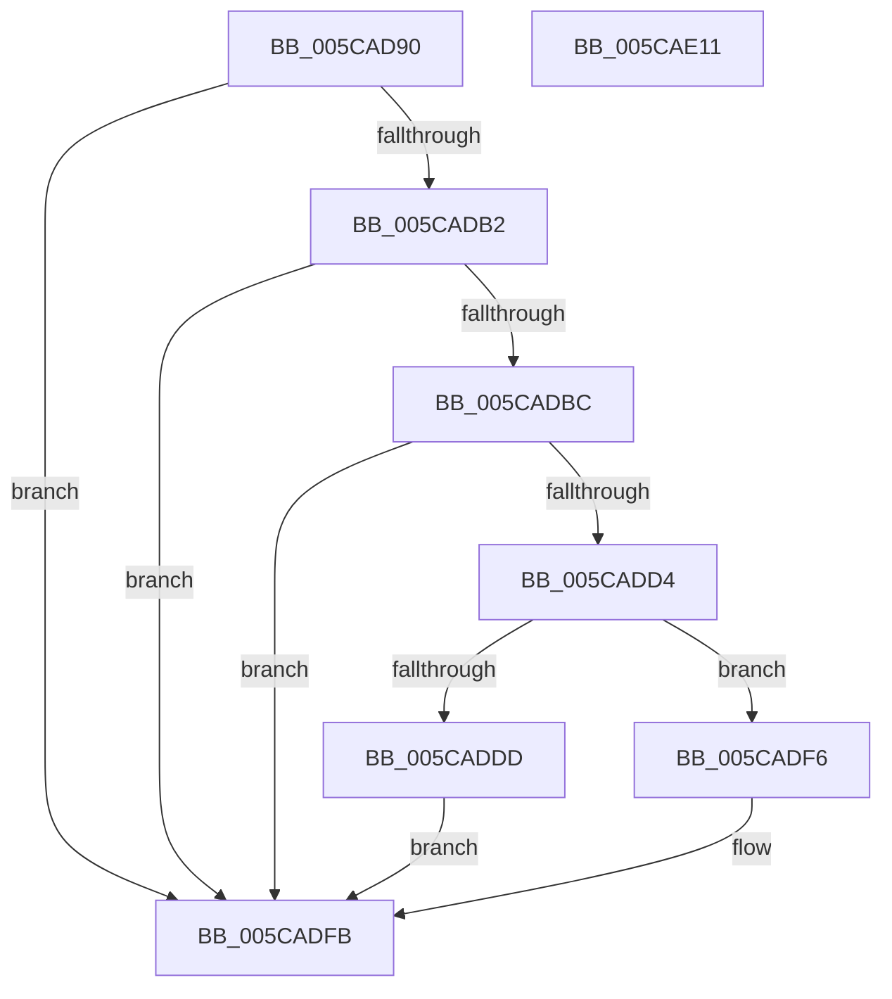

# KiFlushSingleTbWorker

- RVA: `0x005CAD90`–`0x005CAE12` (길이 `130` bytes)
- VA: `0x00000001405CAD90`
- 실행 섹션: `.text`
- PDB 이름 있음: `예`; PDB Function 태그: `아니요`
- unwind 정보 RVA: `0x000AB2E4`
- 디코드: `33`개 명령, `130/130` bytes 표시
- 미해석 바이트: `0` (있으면 어셈블리에 `.byte`로 보존)

> 이 문서는 커널 이미지의 기계어와 PDB 기호를 분석해 생성했습니다. 4번과 5번은 함수 원형과 자료형을 바이너리 사용 방식에서 추정한 C 해석이며 원본 소스 복구 결과는 아닙니다.

## 1. Dependencies

- 직접 호출 지점: **2**; 고유 호출 대상: **2**
- 직접 호출자로 확인된 함수: **0**
- RIP 상대 이미지 참조: **2**

### Outgoing calls
- `0x005CADF6` → [KiSetUserTbFlushPending](../6B/KiSetUserTbFlushPending_function_006B20C0.md) (function, `0x006B20C0`)
- `0x005CAE06` → [_security_check_cookie](../6A/_security_check_cookie_function_006AC640.md) (function, `0x006AC640`)

### Direct callers
- 이 함수 시작 RVA로 연결되는 직접 call은 확인되지 않았습니다. 간접 호출은 완전히 역산할 수 없습니다.

### Static image references
- `0x005CAD96` → RVA `0x00E0A740` (`.data`; read)
- `0x005CADB4` → RVA `0x00FC6A87` (`ALMOSTRO`; read)

## 2. Other-region calls and transfers

- 다른 실행 섹션으로 향하는 call: **0**
- 별도 외부 분기/꼬리 이동을 확인하지 못했습니다.

## 3. Assembly (complete function range)

```asm
005CAD90  40 53                           push rbx
005CAD92  48 83 EC 40                     sub rsp, 0x40
005CAD96  48 8B 05 A3 F9 83 00            mov rax, qword ptr [rip + 0x83f9a3]
005CAD9D  48 33 C4                        xor rax, rsp
005CADA0  48 89 44 24 30                  mov qword ptr [rsp + 0x30], rax
005CADA5  8B 41 08                        mov eax, dword ptr [rcx + 8]
005CADA8  48 8B 19                        mov rbx, qword ptr [rcx]
005CADAB  FF C8                           dec eax
005CADAD  83 F8 01                        cmp eax, 1
005CADB0  77 49                           ja 0x1405cadfb
005CADB2  33 D2                           xor edx, edx
005CADB4  38 15 CD BC 9F 00               cmp byte ptr [rip + 0x9fbccd], dl
005CADBA  74 3F                           je 0x1405cadfb
005CADBC  65 48 8B 04 25 88 01 00 00      mov rax, qword ptr gs:[0x188]
005CADC5  48 8B 88 B8 00 00 00            mov rcx, qword ptr [rax + 0xb8]
005CADCC  38 91 60 01 00 00               cmp byte ptr [rcx + 0x160], dl
005CADD2  75 27                           jne 0x1405cadfb
005CADD4  F6 05 AC BC 9F 00 02            test byte ptr [rip + 0x9fbcac], 2
005CADDB  74 19                           je 0x1405cadf6
005CADDD  48 C7 44 24 20 01 00 00 00      mov qword ptr [rsp + 0x20], 1
005CADE6  48 89 5C 24 28                  mov qword ptr [rsp + 0x28], rbx
005CADEB  8B C2                           mov eax, edx
005CADED  66 0F 38 82 44 24 20            invpcid rax, xmmword ptr [rsp + 0x20]
005CADF4  EB 05                           jmp 0x1405cadfb
005CADF6  E8 C5 72 0E 00                  call 0x1406b20c0
005CADFB  0F 01 3B                        invlpg byte ptr [rbx]
005CADFE  48 8B 4C 24 30                  mov rcx, qword ptr [rsp + 0x30]
005CAE03  48 33 CC                        xor rcx, rsp
005CAE06  E8 35 18 0E 00                  call 0x1406ac640
005CAE0B  48 83 C4 40                     add rsp, 0x40
005CAE0F  5B                              pop rbx
005CAE10  C3                              ret
005CAE11  CC                              int3
```

## 4. C-style interpretation (structured pseudocode)

```c
__int64 __fastcall KiFlushSingleTbWorker(__int64 a1, int a2)
{
    __int64 result;
    __int64 v_rsp;
    unsigned __int64 v_stack_m18;
    unsigned __int64 v_stack_m20;
    unsigned __int64 v_stack_m28;

    v_rsp = (v_rsp) - (64);
    result = (*(unsigned __int64 *)(v_rip + 8649123)) ^ (v_rsp);
    v_stack_m18 = result;
    result = (unsigned int)(((unsigned int)(*(unsigned int *)(a1 + 8))) - 1);
    if (((unsigned int)(result)) > 1) goto loc_005CADFB;
    a2 = 0;
    if ((*(unsigned __int8 *)(v_rip + 10468557)) == 0) goto loc_005CADFB;
    if ((*(unsigned __int8 *)(*(unsigned __int64 *)(*(unsigned __int64 *)(gs_base + (0 + 392)) + 184) + 352)) != 0) goto loc_005CADFB;
    if (((*(unsigned __int8 *)(v_rip + 10468524)) & (2)) == 0) goto loc_005CADF6;
    v_stack_m28 = 1;
    v_stack_m20 = *(unsigned __int64 *)(a1);
    goto loc_005CADFB;
loc_005CADF6:
    result = KiSetUserTbFlushPending(*(unsigned __int64 *)(*(unsigned __int64 *)(gs_base + (0 + 392)) + 184), a2, a3, a4);
loc_005CADFB:
    a1 = (v_stack_m18) ^ (v_rsp);
    result = _security_check_cookie(a1, a2, a3, a4);
    v_rsp = (v_rsp) + (64);
    return result;
}
```

## 5. (Beta) C Style

```c
int64_t KiFlushSingleTbWorker(void *Arg1, int32_t Arg2)
{
    uint8_t *arg1 = (uint8_t *)Arg1;

    int64_t result;
    int64_t local_rsp;
    uint64_t v_stack_m18;
    uint64_t v_stack_m20;
    uint64_t v_stack_m28;

    local_rsp = (local_rsp) - (64);
    result = (*(uint64_t *)(v_rip + 0x83F9A3)) ^ (local_rsp);
    v_stack_m18 = result;
    result = (uint32_t)(((uint32_t)(*(uint32_t *)(arg1 + 0x8))) - 1);
    if (((uint32_t)(result)) > 1) goto loc_005CADFB;
    Arg2 = 0;
    if ((*(uint8_t *)(v_rip + 0x9FBCCD)) == 0) goto loc_005CADFB;
    if ((*(uint8_t *)(*(uint64_t *)(*(uint64_t *)(gs_base + (0 + 0x188)) + 0xB8) + 0x160)) != 0) goto loc_005CADFB;
    if (((*(uint8_t *)(v_rip + 0x9FBCAC)) & (2)) == 0) goto loc_005CADF6;
    v_stack_m28 = 1;
    v_stack_m20 = *(uint64_t *)(arg1);
    goto loc_005CADFB;
loc_005CADF6:
    result = KiSetUserTbFlushPending(*(uint64_t *)(*(uint64_t *)(gs_base + (0 + 0x188)) + 0xB8), Arg2, a3, a4);
loc_005CADFB:
    Arg1 = (v_stack_m18) ^ (local_rsp);
    result = _security_check_cookie(Arg1, Arg2, a3, a4);
    local_rsp = (local_rsp) + (64);
    return result;
}
```

### 관측된 메모리 오프셋

구조체 형식이 확인되지 않은 접근은 인자 기준의 오프셋으로만 기록했습니다.

| 기준 인자 | 오프셋 표현 | 폭 (bit) | 접근 |
|---|---:|---:|---|
| `Arg1` | `+ 0x0` | `64` | `R` |
| `Arg1` | `+ 0x8` | `32` | `R` |

## 6. Execution-region graph

[열기: 2D/3D 그래프와 함수 탐색 컨트롤 패널](../../../control-panel.html?section=text&rva=0x005CAD90&view=graph)

- 2D 그래프는 위에서 아래로 흐르고, 3D 그래프는 빈 공간을 드래그해 회전합니다. Shift+드래그는 이동, 휠은 확대·축소, 함수 노드 선택은 대상 보고서 이동입니다.

### Static fallback


