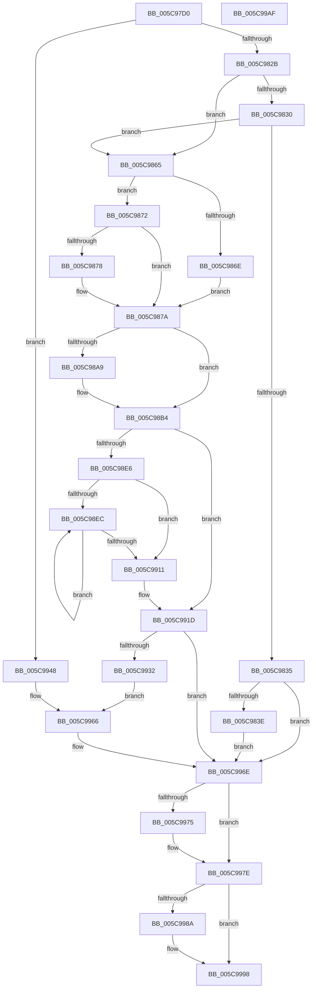

# KiForceParkDutyCycleDpcCallback

- RVA: `0x005C97D0`–`0x005C99B0` (길이 `480` bytes)
- VA: `0x00000001405C97D0`
- 실행 섹션: `.text`
- PDB 이름 있음: `예`; PDB Function 태그: `아니요`
- unwind 정보 RVA: `0x000CB210`
- 디코드: `131`개 명령, `480/480` bytes 표시
- 미해석 바이트: `0` (있으면 어셈블리에 `.byte`로 보존)

> 이 문서는 커널 이미지의 기계어와 PDB 기호를 분석해 생성했습니다. 4번과 5번은 함수 원형과 자료형을 바이너리 사용 방식에서 추정한 C 해석이며 원본 소스 복구 결과는 아닙니다.

## 1. Dependencies

- 직접 호출 지점: **17**; 고유 호출 대상: **13**
- 직접 호출자로 확인된 함수: **0**
- RIP 상대 이미지 참조: **3**

### Outgoing calls
- `0x005C97FD` → [KiAcquirePrcbLocksForIsolationUnit](../30/KiAcquirePrcbLocksForIsolationUnit_function_0030ED60.md) (function, `0x0030ED60`)
- `0x005C9842` → [KiReleasePrcbLocksForIsolationUnit](../39/KiReleasePrcbLocksForIsolationUnit_function_00399C50.md) (function, `0x00399C50`)
- `0x005C984D` → [KeCancelTimer2](../3A/KeCancelTimer2_function_003A01E0.md) (function, `0x003A01E0`)
- `0x005C985B` → [KeCancelTimer2](../3A/KeCancelTimer2_function_003A01E0.md) (function, `0x003A01E0`)
- `0x005C988F` → [memset](../6C/memset_function_006C6C40.md) (function, `0x006C6C40`)
- `0x005C989E` → [KiStartRescheduleContext](../30/KiStartRescheduleContext_function_0030C6B0.md) (function, `0x0030C6B0`)
- `0x005C98AF` → [KiAdjustRescheduleContextForParking](../35/KiAdjustRescheduleContextForParking_function_003530FC.md) (function, `0x003530FC`)
- `0x005C98C0` → [KiSearchForNewThreadsForRescheduleContext](../25/KiSearchForNewThreadsForRescheduleContext_function_00258620.md) (function, `0x00258620`)
- `0x005C98D2` → [KiCommitRescheduleContext](../30/KiCommitRescheduleContext_function_0030CF20.md) (function, `0x0030CF20`)
- `0x005C98DD` → [KiReleasePrcbLocksForIsolationUnit](../39/KiReleasePrcbLocksForIsolationUnit_function_00399C50.md) (function, `0x00399C50`)
- `0x005C9903` → [KiCompleteRescheduleContextEntry](../35/KiCompleteRescheduleContextEntry_function_00356330.md) (function, `0x00356330`)
- `0x005C9918` → [KiFlushSoftwareInterruptBatch](../25/KiFlushSoftwareInterruptBatch_function_00252200.md) (function, `0x00252200`)
- `0x005C9927` → [KiProcessDeferredReadyList](../25/KiProcessDeferredReadyList_function_00250800.md) (function, `0x00250800`)
- `0x005C994C` → [KiReleasePrcbLocksForIsolationUnit](../39/KiReleasePrcbLocksForIsolationUnit_function_00399C50.md) (function, `0x00399C50`)
- `0x005C9969` → [KeSetTimer2](../3A/KeSetTimer2_function_003A08E0.md) (function, `0x003A08E0`)
- `0x005C9979` → [KiReleasePrcbLocksForIsolationUnit](../39/KiReleasePrcbLocksForIsolationUnit_function_00399C50.md) (function, `0x00399C50`)
- `0x005C9993` → [EtwTraceForceParkTransition](../64/EtwTraceForceParkTransition_function_0064F9FC.md) (function, `0x0064F9FC`)

### Direct callers
- 이 함수 시작 RVA로 연결되는 직접 call은 확인되지 않았습니다. 간접 호출은 완전히 역산할 수 없습니다.

### Static image references
- `0x005C9932` → RVA `0x00FC52F0` (`ALMOSTRO`; read)
- `0x005C9951` → RVA `0x00FC52EC` (`ALMOSTRO`; read)
- `0x005C997E` → RVA `0x00FC6B14` (`ALMOSTRO`; read)

## 2. Other-region calls and transfers

- 다른 실행 섹션으로 향하는 call: **0**
- 별도 외부 분기/꼬리 이동을 확인하지 못했습니다.

## 3. Assembly (complete function range)

```asm
005C97D0  48 89 5C 24 08                  mov qword ptr [rsp + 8], rbx
005C97D5  48 89 74 24 18                  mov qword ptr [rsp + 0x18], rsi
005C97DA  55                              push rbp
005C97DB  57                              push rdi
005C97DC  41 54                           push r12
005C97DE  41 56                           push r14
005C97E0  41 57                           push r15
005C97E2  48 8B EC                        mov rbp, rsp
005C97E5  48 83 EC 30                     sub rsp, 0x30
005C97E9  48 83 65 38 00                  and qword ptr [rbp + 0x38], 0
005C97EE  48 8B FA                        mov rdi, rdx
005C97F1  4C 8D 45 38                     lea r8, [rbp + 0x38]
005C97F5  BA 01 00 00 00                  mov edx, 1
005C97FA  48 8B CF                        mov rcx, rdi
005C97FD  E8 5E 55 D4 FF                  call 0x14030ed60
005C9802  4C 8B BF F0 86 00 00            mov r15, qword ptr [rdi + 0x86f0]
005C9809  45 8B B7 54 01 00 00            mov r14d, dword ptr [r15 + 0x154]
005C9810  41 8B CE                        mov ecx, r14d
005C9813  41 83 A7 54 01 00 00 00         and dword ptr [r15 + 0x154], 0
005C981B  45 8B A7 50 01 00 00            mov r12d, dword ptr [r15 + 0x150]
005C9822  83 E9 01                        sub ecx, 1
005C9825  0F 84 1D 01 00 00               je 0x1405c9948
005C982B  83 E9 01                        sub ecx, 1
005C982E  74 35                           je 0x1405c9865
005C9830  83 E9 01                        sub ecx, 1
005C9833  74 30                           je 0x1405c9865
005C9835  83 F9 01                        cmp ecx, 1
005C9838  0F 85 30 01 00 00               jne 0x1405c996e
005C983E  48 8D 4D 38                     lea rcx, [rbp + 0x38]
005C9842  E8 09 04 DD FF                  call 0x140399c50
005C9847  49 8D 4F 40                     lea rcx, [r15 + 0x40]
005C984B  33 D2                           xor edx, edx
005C984D  E8 8E 69 DD FF                  call 0x1403a01e0
005C9852  49 8D 8F C8 00 00 00            lea rcx, [r15 + 0xc8]
005C9859  33 D2                           xor edx, edx
005C985B  E8 80 69 DD FF                  call 0x1403a01e0
005C9860  E9 09 01 00 00                  jmp 0x1405c996e
005C9865  8A 47 23                        mov al, byte ptr [rdi + 0x23]
005C9868  41 83 FE 02                     cmp r14d, 2
005C986C  75 04                           jne 0x1405c9872
005C986E  24 DF                           and al, 0xdf
005C9870  EB 08                           jmp 0x1405c987a
005C9872  41 83 FE 03                     cmp r14d, 3
005C9876  75 02                           jne 0x1405c987a
005C9878  0C 20                           or al, 0x20
005C987A  48 8B B7 E8 37 00 00            mov rsi, qword ptr [rdi + 0x37e8]
005C9881  33 D2                           xor edx, edx
005C9883  48 8B CE                        mov rcx, rsi
005C9886  88 47 23                        mov byte ptr [rdi + 0x23], al
005C9889  41 B8 F0 00 00 00               mov r8d, 0xf0
005C988F  E8 AC D3 0F 00                  call 0x1406c6c40
005C9894  45 33 C0                        xor r8d, r8d
005C9897  48 8D 55 38                     lea rdx, [rbp + 0x38]
005C989B  48 8B CE                        mov rcx, rsi
005C989E  E8 0D 2E D4 FF                  call 0x14030c6b0
005C98A3  41 83 FE 03                     cmp r14d, 3
005C98A7  75 0B                           jne 0x1405c98b4
005C98A9  48 8B D7                        mov rdx, rdi
005C98AC  48 8B CE                        mov rcx, rsi
005C98AF  E8 48 98 D8 FF                  call 0x1403530fc
005C98B4  48 83 65 F0 00                  and qword ptr [rbp - 0x10], 0
005C98B9  48 8D 55 F0                     lea rdx, [rbp - 0x10]
005C98BD  48 8B CE                        mov rcx, rsi
005C98C0  E8 5B ED C8 FF                  call 0x140258620
005C98C5  4C 8D 4D F0                     lea r9, [rbp - 0x10]
005C98C9  45 33 C0                        xor r8d, r8d
005C98CC  48 8B D7                        mov rdx, rdi
005C98CF  48 8B CE                        mov rcx, rsi
005C98D2  E8 49 36 D4 FF                  call 0x14030cf20
005C98D7  48 8D 4D 38                     lea rcx, [rbp + 0x38]
005C98DB  8A D8                           mov bl, al
005C98DD  E8 6E 03 DD FF                  call 0x140399c50
005C98E2  84 DB                           test bl, bl
005C98E4  74 37                           je 0x1405c991d
005C98E6  33 DB                           xor ebx, ebx
005C98E8  38 1E                           cmp byte ptr [rsi], bl
005C98EA  76 25                           jbe 0x1405c9911
005C98EC  8B CB                           mov ecx, ebx
005C98EE  45 33 C9                        xor r9d, r9d
005C98F1  48 83 C1 02                     add rcx, 2
005C98F5  45 33 C0                        xor r8d, r8d
005C98F8  48 8B D7                        mov rdx, rdi
005C98FB  48 8D 0C 99                     lea rcx, [rcx + rbx*4]
005C98FF  48 8D 0C CE                     lea rcx, [rsi + rcx*8]
005C9903  E8 28 CA D8 FF                  call 0x140356330
005C9908  0F B6 06                        movzx eax, byte ptr [rsi]
005C990B  FF C3                           inc ebx
005C990D  3B D8                           cmp ebx, eax
005C990F  72 DB                           jb 0x1405c98ec
005C9911  48 8D 8F D8 35 00 00            lea rcx, [rdi + 0x35d8]
005C9918  E8 E3 88 C8 FF                  call 0x140252200
005C991D  41 B0 02                        mov r8b, 2
005C9920  48 8D 55 F0                     lea rdx, [rbp - 0x10]
005C9924  48 8B CF                        mov rcx, rdi
005C9927  E8 D4 6E C8 FF                  call 0x140250800
005C992C  41 83 FE 02                     cmp r14d, 2
005C9930  75 3C                           jne 0x1405c996e
005C9932  8B 05 B8 B9 9F 00               mov eax, dword ptr [rip + 0x9fb9b8]
005C9938  49 8D 8F C8 00 00 00            lea rcx, [r15 + 0xc8]
005C993F  48 6B D0 F6                     imul rdx, rax, -0xa
005C9943  45 33 C0                        xor r8d, r8d
005C9946  EB 1E                           jmp 0x1405c9966
005C9948  48 8D 4D 38                     lea rcx, [rbp + 0x38]
005C994C  E8 FF 02 DD FF                  call 0x140399c50
005C9951  8B 0D 95 B9 9F 00               mov ecx, dword ptr [rip + 0x9fb995]
005C9957  48 6B D1 F6                     imul rdx, rcx, -0xa
005C995B  8D 04 89                        lea eax, [rcx + rcx*4]
005C995E  44 8D 04 00                     lea r8d, [rax + rax]
005C9962  49 8D 4F 40                     lea rcx, [r15 + 0x40]
005C9966  45 33 C9                        xor r9d, r9d
005C9969  E8 72 6F DD FF                  call 0x1403a08e0
005C996E  48 83 7D 38 00                  cmp qword ptr [rbp + 0x38], 0
005C9973  74 09                           je 0x1405c997e
005C9975  48 8D 4D 38                     lea rcx, [rbp + 0x38]
005C9979  E8 D2 02 DD FF                  call 0x140399c50
005C997E  F7 05 8C D1 9F 00 00 20 00 00   test dword ptr [rip + 0x9fd18c], 0x2000
005C9988  74 0E                           je 0x1405c9998
005C998A  45 8A C6                        mov r8b, r14b
005C998D  41 8A D4                        mov dl, r12b
005C9990  48 8B CF                        mov rcx, rdi
005C9993  E8 64 60 08 00                  call 0x14064f9fc
005C9998  48 8B 5C 24 60                  mov rbx, qword ptr [rsp + 0x60]
005C999D  48 8B 74 24 70                  mov rsi, qword ptr [rsp + 0x70]
005C99A2  48 83 C4 30                     add rsp, 0x30
005C99A6  41 5F                           pop r15
005C99A8  41 5E                           pop r14
005C99AA  41 5C                           pop r12
005C99AC  5F                              pop rdi
005C99AD  5D                              pop rbp
005C99AE  C3                              ret
005C99AF  CC                              int3
```

## 4. C-style interpretation (structured pseudocode)

```c
__int64 __fastcall KiForceParkDutyCycleDpcCallback(__int64 a1, __int64 a2)
{
    __int64 result;
    __int64 v_rbx;
    __int64 v_rsp;
    unsigned __int64 v_stack_m38;
    unsigned __int64 v_stack_p10;
    unsigned __int64 v_stack_p18;
    unsigned __int64 v_stack_p8;

    v_stack_p8 = v_rbx;
    v_stack_p18 = v_rsi;
    v_rsp = (v_rsp) - (48);
    result = KiAcquirePrcbLocksForIsolationUnit(a2, 1, v_stack_p10, a4);
    a1 = (unsigned int)(((unsigned int)((unsigned int)((unsigned int)(*(unsigned int *)(*(unsigned __int64 *)(a2 + 34544) + 340))))) - (1));
    if (condition_is_equal) goto loc_005C9948;
    a1 = (unsigned int)((a1) - (1));
    if (condition_is_equal) goto loc_005C9865;
    a1 = (unsigned int)((a1) - (1));
    if (condition_is_equal) goto loc_005C9865;
    if (((unsigned int)(a1)) != 1) goto loc_005C996E;
    result = KiReleasePrcbLocksForIsolationUnit(v_stack_p10, 1, v_stack_p10, a4);
    a2 = 0;
    result = KeCancelTimer2(*(unsigned __int64 *)(a2 + 34544) + 64, a2, v_stack_p10, a4);
    a2 = 0;
    result = KeCancelTimer2(*(unsigned __int64 *)(a2 + 34544) + 200, a2, v_stack_p10, a4);
    goto loc_005C996E;
loc_005C9865:
    if (((unsigned int)((unsigned int)(*(unsigned int *)(*(unsigned __int64 *)(a2 + 34544) + 340)))) != 2) goto loc_005C9872;
    result = (unsigned __int8)((*(unsigned __int8 *)(a2 + 35)) & (223));
    goto loc_005C987A;
loc_005C9872:
    if (((unsigned int)((unsigned int)(*(unsigned int *)(*(unsigned __int64 *)(a2 + 34544) + 340)))) == 3) {
        result = (unsigned __int8)((result) | (32));
    }
    a2 = 0;
    *(unsigned __int8 *)(a2 + 35) = (unsigned __int8)(result);
    result = memset(*(unsigned __int64 *)(a2 + 14312), a2, 240, a4);
    a3 = 0;
    result = KiStartRescheduleContext(*(unsigned __int64 *)(a2 + 14312), v_stack_p10, a3, a4);
    if (((unsigned int)((unsigned int)(*(unsigned int *)(*(unsigned __int64 *)(a2 + 34544) + 340)))) == 3) {
        a2 = 0;
        a1 = *(unsigned __int64 *)(a2 + 14312);
        result = KiAdjustRescheduleContextForParking(a1, a2, a3, a4);
    }
    result = KiSearchForNewThreadsForRescheduleContext(*(unsigned __int64 *)(a2 + 14312), v_stack_m38, a3, a4);
    a3 = 0;
    result = KiCommitRescheduleContext(*(unsigned __int64 *)(a2 + 14312), a2, a3, v_stack_m38);
    result = KiReleasePrcbLocksForIsolationUnit(v_stack_p10, a2, a3, v_stack_m38);
    if ((unsigned __int8)((unsigned __int8)(result)) == 0) goto loc_005C991D;
    v_rbx = 0;
    if ((*(unsigned __int8 *)(*(unsigned __int64 *)(a2 + 14312))) <= 0) goto loc_005C9911;
loc_005C98EC:
    a4 = 0;
    a1 = (0) + (2);
    a3 = 0;
    result = KiCompleteRescheduleContextEntry(*(unsigned __int64 *)(a2 + 14312) + a1 + v_rbx * 4 * 8, a2, a3, a4);
    v_rbx = (unsigned int)((v_rbx) + 1);
    if (((unsigned int)(v_rbx)) < ((unsigned int)(*(unsigned __int8 *)(*(unsigned __int64 *)(a2 + 14312))))) goto loc_005C98EC;
loc_005C9911:
    result = KiFlushSoftwareInterruptBatch(a2 + 13784, a2, a3, a4);
loc_005C991D:
    result = KiProcessDeferredReadyList(a2, v_stack_m38, 2, a4);
    if (((unsigned int)((unsigned int)(*(unsigned int *)(*(unsigned __int64 *)(a2 + 34544) + 340)))) != 2) goto loc_005C996E;
    a2 = (v_stack_m38) * ((unsigned int)(*(unsigned int *)(v_rip + 10467768)));
    a3 = 0;
    goto loc_005C9966;
loc_005C9948:
    result = KiReleasePrcbLocksForIsolationUnit(v_stack_p10, a2, a3, a4);
    a2 = (a2) * ((unsigned int)(*(unsigned int *)(v_rip + 10467733)));
loc_005C9966:
    a4 = 0;
    result = KeSetTimer2(*(unsigned __int64 *)(a2 + 34544) + 64, a2, (unsigned int)(*(unsigned int *)(v_rip + 10467733)) + (unsigned int)(*(unsigned int *)(v_rip + 10467733)) * 4 + (unsigned int)(*(unsigned int *)(v_rip + 10467733)) + (unsigned int)(*(unsigned int *)(v_rip + 10467733)) * 4 * 1, a4);
loc_005C996E:
    if (v_stack_p10 != 0) {
        a1 = v_stack_p10;
        result = KiReleasePrcbLocksForIsolationUnit(a1, a2, (unsigned int)(*(unsigned int *)(v_rip + 10467733)) + (unsigned int)(*(unsigned int *)(v_rip + 10467733)) * 4 + (unsigned int)(*(unsigned int *)(v_rip + 10467733)) + (unsigned int)(*(unsigned int *)(v_rip + 10467733)) * 4 * 1, a4);
    }
    if (((*(unsigned int *)(v_rip + 10473868)) & (0x2000ULL)) != 0) {
        a3 = (unsigned __int8)((unsigned int)(*(unsigned int *)(*(unsigned __int64 *)(a2 + 34544) + 340)));
        a2 = (unsigned __int8)((unsigned int)(*(unsigned int *)(*(unsigned __int64 *)(a2 + 34544) + 336)));
        a1 = a2;
        result = EtwTraceForceParkTransition(a1, a2, a3, a4);
    }
    v_rsp = (v_rsp) + (48);
    return result;
}
```

## 5. (Beta) C Style

```c
int64_t KiForceParkDutyCycleDpcCallback(int64_t Arg1, void *Arg2)
{
    uint8_t *arg2 = (uint8_t *)Arg2;

    int64_t result;
    int64_t local_rbx;
    int64_t local_rsp;
    uint64_t v_stack_m38;
    uint64_t v_stack_p10;
    uint64_t v_stack_p18;
    uint64_t v_stack_p8;

    v_stack_p8 = local_rbx;
    v_stack_p18 = local_rsi;
    local_rsp = (local_rsp) - (48);
    result = KiAcquirePrcbLocksForIsolationUnit(Arg2, 1, v_stack_p10, a4);
    Arg1 = (uint32_t)(((uint32_t)((uint32_t)((uint32_t)(*(uint32_t *)(*(uint64_t *)(arg2 + 0x86F0) + 0x154))))) - (1));
    if (condition_is_equal) goto loc_005C9948;
    Arg1 = (uint32_t)((Arg1) - (1));
    if (condition_is_equal) goto loc_005C9865;
    Arg1 = (uint32_t)((Arg1) - (1));
    if (condition_is_equal) goto loc_005C9865;
    if (((uint32_t)(Arg1)) != 1) goto loc_005C996E;
    result = KiReleasePrcbLocksForIsolationUnit(v_stack_p10, 1, v_stack_p10, a4);
    Arg2 = 0;
    result = KeCancelTimer2(*(uint64_t *)(arg2 + 0x86F0) + 64, Arg2, v_stack_p10, a4);
    Arg2 = 0;
    result = KeCancelTimer2(*(uint64_t *)(arg2 + 0x86F0) + 200, Arg2, v_stack_p10, a4);
    goto loc_005C996E;
loc_005C9865:
    if (((uint32_t)((uint32_t)(*(uint32_t *)(*(uint64_t *)(arg2 + 0x86F0) + 0x154)))) != 2) goto loc_005C9872;
    result = (uint8_t)((*(uint8_t *)(arg2 + 0x23)) & (223));
    goto loc_005C987A;
loc_005C9872:
    if (((uint32_t)((uint32_t)(*(uint32_t *)(*(uint64_t *)(arg2 + 0x86F0) + 0x154)))) == 3) {
        result = (uint8_t)((result) | (32));
    }
    Arg2 = 0;
    *(uint8_t *)(arg2 + 0x23) = (uint8_t)(result);
    result = memset(*(uint64_t *)(arg2 + 0x37E8), Arg2, 240, a4);
    a3 = 0;
    result = KiStartRescheduleContext(*(uint64_t *)(arg2 + 0x37E8), v_stack_p10, a3, a4);
    if (((uint32_t)((uint32_t)(*(uint32_t *)(*(uint64_t *)(arg2 + 0x86F0) + 0x154)))) == 3) {
        Arg2 = 0;
        Arg1 = *(uint64_t *)(arg2 + 0x37E8);
        result = KiAdjustRescheduleContextForParking(Arg1, Arg2, a3, a4);
    }
    result = KiSearchForNewThreadsForRescheduleContext(*(uint64_t *)(arg2 + 0x37E8), v_stack_m38, a3, a4);
    a3 = 0;
    result = KiCommitRescheduleContext(*(uint64_t *)(arg2 + 0x37E8), Arg2, a3, v_stack_m38);
    result = KiReleasePrcbLocksForIsolationUnit(v_stack_p10, Arg2, a3, v_stack_m38);
    if ((uint8_t)((uint8_t)(result)) == 0) goto loc_005C991D;
    local_rbx = 0;
    if ((*(uint8_t *)(*(uint64_t *)(arg2 + 0x37E8))) <= 0) goto loc_005C9911;
loc_005C98EC:
    a4 = 0;
    Arg1 = (0) + (2);
    a3 = 0;
    result = KiCompleteRescheduleContextEntry(*(uint64_t *)(arg2 + 0x37E8) + Arg1 + local_rbx * 4 * 8, Arg2, a3, a4);
    local_rbx = (uint32_t)((local_rbx) + 1);
    if (((uint32_t)(local_rbx)) < ((uint32_t)(*(uint8_t *)(*(uint64_t *)(arg2 + 0x37E8))))) goto loc_005C98EC;
loc_005C9911:
    result = KiFlushSoftwareInterruptBatch(Arg2 + 13784, Arg2, a3, a4);
loc_005C991D:
    result = KiProcessDeferredReadyList(Arg2, v_stack_m38, 2, a4);
    if (((uint32_t)((uint32_t)(*(uint32_t *)(*(uint64_t *)(arg2 + 0x86F0) + 0x154)))) != 2) goto loc_005C996E;
    Arg2 = (v_stack_m38) * ((uint32_t)(*(uint32_t *)(v_rip + 0x9FB9B8)));
    a3 = 0;
    goto loc_005C9966;
loc_005C9948:
    result = KiReleasePrcbLocksForIsolationUnit(v_stack_p10, Arg2, a3, a4);
    Arg2 = (Arg2) * ((uint32_t)(*(uint32_t *)(v_rip + 0x9FB995)));
loc_005C9966:
    a4 = 0;
    result = KeSetTimer2(*(uint64_t *)(arg2 + 0x86F0) + 64, Arg2, (uint32_t)(*(uint32_t *)(v_rip + 0x9FB995)) + (uint32_t)(*(uint32_t *)(v_rip + 0x9FB995)) * 4 + (uint32_t)(*(uint32_t *)(v_rip + 0x9FB995)) + (uint32_t)(*(uint32_t *)(v_rip + 0x9FB995)) * 4 * 1, a4);
loc_005C996E:
    if (v_stack_p10 != 0) {
        Arg1 = v_stack_p10;
        result = KiReleasePrcbLocksForIsolationUnit(Arg1, Arg2, (uint32_t)(*(uint32_t *)(v_rip + 0x9FB995)) + (uint32_t)(*(uint32_t *)(v_rip + 0x9FB995)) * 4 + (uint32_t)(*(uint32_t *)(v_rip + 0x9FB995)) + (uint32_t)(*(uint32_t *)(v_rip + 0x9FB995)) * 4 * 1, a4);
    }
    if (((*(uint32_t *)(v_rip + 0x9FD18C)) & (0x2000ULL)) != 0) {
        a3 = (uint8_t)((uint32_t)(*(uint32_t *)(*(uint64_t *)(arg2 + 0x86F0) + 0x154)));
        Arg2 = (uint8_t)((uint32_t)(*(uint32_t *)(*(uint64_t *)(arg2 + 0x86F0) + 0x150)));
        Arg1 = Arg2;
        result = EtwTraceForceParkTransition(Arg1, Arg2, a3, a4);
    }
    local_rsp = (local_rsp) + (48);
    return result;
}
```

### 관측된 메모리 오프셋

구조체 형식이 확인되지 않은 접근은 인자 기준의 오프셋으로만 기록했습니다.

| 기준 인자 | 오프셋 표현 | 폭 (bit) | 접근 |
|---|---:|---:|---|
| `Arg2` | `+ 0x23` | `8` | `R` |
| `Arg2` | `+ 0x23` | `8` | `W` |
| `Arg2` | `+ 0x35D8` | `64` | `R` |
| `Arg2` | `+ 0x37E8` | `64` | `R` |
| `Arg2` | `+ 0x86F0` | `64` | `R` |

## 6. Execution-region graph

[열기: 2D/3D 그래프와 함수 탐색 컨트롤 패널](../../../control-panel.html?section=text&rva=0x005C97D0&view=graph)

- 2D 그래프는 위에서 아래로 흐르고, 3D 그래프는 빈 공간을 드래그해 회전합니다. Shift+드래그는 이동, 휠은 확대·축소, 함수 노드 선택은 대상 보고서 이동입니다.

### Static fallback


