# KiFreezeTargetExecution

- RVA: `0x005C30A0`–`0x005C335C` (길이 `700` bytes)
- VA: `0x00000001405C30A0`
- 실행 섹션: `.text`
- PDB 이름 있음: `예`; PDB Function 태그: `아니요`
- unwind 정보 RVA: `0x000CA970`
- 디코드: `164`개 명령, `700/700` bytes 표시
- 미해석 바이트: `0` (있으면 어셈블리에 `.byte`로 보존)

> 이 문서는 커널 이미지의 기계어와 PDB 기호를 분석해 생성했습니다. 4번과 5번은 함수 원형과 자료형을 바이너리 사용 방식에서 추정한 C 해석이며 원본 소스 복구 결과는 아닙니다.

## 1. Dependencies

- 직접 호출 지점: **24**; 고유 호출 대상: **22**
- 직접 호출자로 확인된 함수: **1**
- RIP 상대 이미지 참조: **11**

### Outgoing calls
- `0x005C30D8` → [memset](../6C/memset_function_006C6C40.md) (function, `0x006C6C40`)
- `0x005C3108` → [VfStopBranchTracing](../../pagevrfy/BA/VfStopBranchTracing_function_00BA39D4.md) (function, `0x00BA39D4`)
- `0x005C310D` → [KeDisableInterrupts](../21/KeDisableInterrupts_function_00217BE0.md) (function, `0x00217BE0`)
- `0x005C3132` → [KiRaiseIrqlProcessIrqlFlags](../4F/KiRaiseIrqlProcessIrqlFlags_function_004F56FC.md) (function, `0x004F56FC`)
- `0x005C3153` → [KeSaveSupervisorState](../5B/KeSaveSupervisorState_function_005B9CB4.md) (function, `0x005B9CB4`)
- `0x005C315B` → [KiStartDebugAccumulation](KiStartDebugAccumulation_function_005C3460.md) (function, `0x005C3460`)
- `0x005C3175` → [guard_dispatch_icall](../6B/guard_dispatch_icall_function_006BAAD0.md) (function, `0x006BAAD0`)
- `0x005C3185` → [KiSaveProcessorState](KiSaveProcessorState_function_005CB940.md) (function, `0x005CB940`)
- `0x005C3193` → [RtlCaptureContext](../4F/RtlCaptureContext_function_004FE570.md) (function, `0x004FE570`)
- `0x005C319F` → [KiSaveProcessorControlState](../6B/KiSaveProcessorControlState_function_006B0EF0.md) (function, `0x006B0EF0`)
- `0x005C31B9` → [KeQueryPerformanceCounter](../37/KeQueryPerformanceCounter_function_0037E7E0.md) (function, `0x0037E7E0`)
- `0x005C31D9` → [memset](../6C/memset_function_006C6C40.md) (function, `0x006C6C40`)
- `0x005C3212` → [KdpReportExceptionStateChange](../../pagekd/B8/KdpReportExceptionStateChange_function_00B8A1E0.md) (function, `0x00B8A1E0`)
- `0x005C3222` → [KiSetDebuggerOwner](../4F/KiSetDebuggerOwner_function_004FCE94.md) (function, `0x004FCE94`)
- `0x005C322C` → [KiCheckStall](KiCheckStall_function_005C3010.md) (function, `0x005C3010`)
- `0x005C3260` → [guard_dispatch_icall](../6B/guard_dispatch_icall_function_006BAAD0.md) (function, `0x006BAAD0`)
- `0x005C3270` → [KiRestoreProcessorState](KiRestoreProcessorState_function_005CB87C.md) (function, `0x005CB87C`)
- `0x005C327E` → [KiRestoreProcessorControlState](../6B/KiRestoreProcessorControlState_function_006B0E20.md) (function, `0x006B0E20`)
- `0x005C32B2` → [KiEndDebugAccumulation](../4F/KiEndDebugAccumulation_function_004F5370.md) (function, `0x004F5370`)
- `0x005C32CA` → [KeRestoreSupervisorState](../5B/KeRestoreSupervisorState_function_005B9C30.md) (function, `0x005B9C30`)
- `0x005C32DF` → [KiLowerIrqlProcessIrqlFlags](../4F/KiLowerIrqlProcessIrqlFlags_function_004F5698.md) (function, `0x004F5698`)
- `0x005C3320` → [KiRemoveSystemWorkPriorityKick](../26/KiRemoveSystemWorkPriorityKick_function_002631D0.md) (function, `0x002631D0`)
- `0x005C332F` → [VfStartBranchTracing](../../pagevrfy/BA/VfStartBranchTracing_function_00BA3948.md) (function, `0x00BA3948`)
- `0x005C333F` → [_security_check_cookie](../6A/_security_check_cookie_function_006AC640.md) (function, `0x006AC640`)

### Direct callers
- [KiCheckForFreezeExecution](../5B/KiCheckForFreezeExecution_function_005B41E0.md) at `0x005B4205`

### Static image references
- `0x005C30B3` → RVA `0x00E0A740` (`.data`; read)
- `0x005C30DD` → RVA `0x00FCF2C0` (`CACHEALI`; read)
- `0x005C30E7` → RVA `0x00FCF8C0` (`CACHEALI`; read)
- `0x005C30F1` → RVA `0x00F4754C` (`.data`; read)
- `0x005C30FF` → RVA `0x00F04984` (`.data`; read)
- `0x005C3123` → RVA `0x00FC6D20` (`ALMOSTRO`; read)
- `0x005C3140` → RVA `0x00FC6C60` (`ALMOSTRO`; read)
- `0x005C316C` → RVA `0x00E00998` (`.data`; read)
- `0x005C31C0` → RVA `0x00F10E00` (`.data`; read)
- `0x005C321B` → RVA `0x00F10E08` (`.data`; read)
- `0x005C325A` → RVA `0x00E66890` (`.data`; read)

## 2. Other-region calls and transfers

- 다른 실행 섹션으로 향하는 call: **3**
  - `0x005C3108` → [VfStopBranchTracing](../../pagevrfy/BA/VfStopBranchTracing_function_00BA39D4.md) (`.text` → `PAGEVRFY`)
  - `0x005C3212` → [KdpReportExceptionStateChange](../../pagekd/B8/KdpReportExceptionStateChange_function_00B8A1E0.md) (`.text` → `PAGEKD`)
  - `0x005C332F` → [VfStartBranchTracing](../../pagevrfy/BA/VfStartBranchTracing_function_00BA3948.md) (`.text` → `PAGEVRFY`)
- 별도 외부 분기/꼬리 이동을 확인하지 못했습니다.

## 3. Assembly (complete function range)

```asm
005C30A0  48 89 5C 24 18                  mov qword ptr [rsp + 0x18], rbx
005C30A5  55                              push rbp
005C30A6  56                              push rsi
005C30A7  57                              push rdi
005C30A8  41 54                           push r12
005C30AA  41 56                           push r14
005C30AC  48 81 EC D0 00 00 00            sub rsp, 0xd0
005C30B3  48 8B 05 86 76 84 00            mov rax, qword ptr [rip + 0x847686]
005C30BA  48 33 C4                        xor rax, rsp
005C30BD  48 89 84 24 C0 00 00 00         mov qword ptr [rsp + 0xc0], rax
005C30C5  48 8B EA                        mov rbp, rdx
005C30C8  48 8B F1                        mov rsi, rcx
005C30CB  33 D2                           xor edx, edx
005C30CD  48 8D 4C 24 20                  lea rcx, [rsp + 0x20]
005C30D2  41 B8 98 00 00 00               mov r8d, 0x98
005C30D8  E8 63 3B 10 00                  call 0x1406c6c40
005C30DD  48 83 3D DB C1 A0 00 00         cmp qword ptr [rip + 0xa0c1db], 0
005C30E5  75 18                           jne 0x1405c30ff
005C30E7  48 83 3D D1 C7 A0 00 00         cmp qword ptr [rip + 0xa0c7d1], 0
005C30EF  75 0E                           jne 0x1405c30ff
005C30F1  8B 05 55 44 98 00               mov eax, dword ptr [rip + 0x984455]
005C30F7  A8 03                           test al, 3
005C30F9  0F 84 35 02 00 00               je 0x1405c3334
005C30FF  83 3D 7E 18 94 00 00            cmp dword ptr [rip + 0x94187e], 0
005C3106  74 05                           je 0x1405c310d
005C3108  E8 C7 08 5E 00                  call 0x140ba39d4
005C310D  E8 CE 4A C5 FF                  call 0x140217be0
005C3112  44 8A F0                        mov r14b, al
005C3115  44 0F 20 C7                     mov rdi, cr8
005C3119  41 BC 0F 00 00 00               mov r12d, 0xf
005C311F  45 0F 22 C4                     mov cr8, r12
005C3123  83 3D F6 3B A0 00 00            cmp dword ptr [rip + 0xa03bf6], 0
005C312A  74 0B                           je 0x1405c3137
005C312C  41 8A D4                        mov dl, r12b
005C312F  40 8A CF                        mov cl, dil
005C3132  E8 C5 25 F3 FF                  call 0x1404f56fc
005C3137  65 48 8B 1C 25 20 00 00 00      mov rbx, qword ptr gs:[0x20]
005C3140  48 8B 15 19 3B A0 00            mov rdx, qword ptr [rip + 0xa03b19]
005C3147  48 0F BA EA 08                  bts rdx, 8
005C314C  48 8B 8B C0 06 00 00            mov rcx, qword ptr [rbx + 0x6c0]
005C3153  E8 5C 6B FF FF                  call 0x1405b9cb4
005C3158  48 8B CB                        mov rcx, rbx
005C315B  E8 00 03 00 00                  call 0x1405c3460
005C3160  C7 83 88 2D 00 00 02 00 00 00   mov dword ptr [rbx + 0x2d88], 2
005C316A  33 D2                           xor edx, edx
005C316C  48 8B 05 25 D8 83 00            mov rax, qword ptr [rip + 0x83d825]
005C3173  B1 01                           mov cl, 1
005C3175  E8 56 79 0F 00                  call 0x1406baad0
005C317A  48 85 F6                        test rsi, rsi
005C317D  74 0D                           je 0x1405c318c
005C317F  48 8B D5                        mov rdx, rbp
005C3182  48 8B CE                        mov rcx, rsi
005C3185  E8 B6 87 00 00                  call 0x1405cb940
005C318A  EB 18                           jmp 0x1405c31a4
005C318C  48 8B 8B C0 8F 00 00            mov rcx, qword ptr [rbx + 0x8fc0]
005C3193  E8 D8 B3 F3 FF                  call 0x1404fe570
005C3198  48 8D 8B 00 01 00 00            lea rcx, [rbx + 0x100]
005C319F  E8 4C DD 0E 00                  call 0x1406b0ef0
005C31A4  48 8B 83 B8 8E 00 00            mov rax, qword ptr [rbx + 0x8eb8]
005C31AB  48 85 C0                        test rax, rax
005C31AE  74 07                           je 0x1405c31b7
005C31B0  F0 81 08 00 00 02 00            lock or dword ptr [rax], 0x20000
005C31B7  33 C9                           xor ecx, ecx
005C31B9  E8 22 B6 DB FF                  call 0x14037e7e0
005C31BE  EB 71                           jmp 0x1405c3231
005C31C0  48 8B 05 39 DC 94 00            mov rax, qword ptr [rip + 0x94dc39]
005C31C7  48 3B D8                        cmp rbx, rax
005C31CA  75 5B                           jne 0x1405c3227
005C31CC  33 D2                           xor edx, edx
005C31CE  48 8D 4C 24 20                  lea rcx, [rsp + 0x20]
005C31D3  41 B8 98 00 00 00               mov r8d, 0x98
005C31D9  E8 62 3A 10 00                  call 0x1406c6c40
005C31DE  C7 44 24 20 07 00 00 80         mov dword ptr [rsp + 0x20], 0x80000007
005C31E6  48 8D 44 24 20                  lea rax, [rsp + 0x20]
005C31EB  48 89 44 24 28                  mov qword ptr [rsp + 0x28], rax
005C31F0  45 33 C0                        xor r8d, r8d
005C31F3  48 8B 83 C0 8F 00 00            mov rax, qword ptr [rbx + 0x8fc0]
005C31FA  48 8B 88 F8 00 00 00            mov rcx, qword ptr [rax + 0xf8]
005C3201  48 89 4C 24 30                  mov qword ptr [rsp + 0x30], rcx
005C3206  48 8D 4C 24 20                  lea rcx, [rsp + 0x20]
005C320B  48 8B 93 C0 8F 00 00            mov rdx, qword ptr [rbx + 0x8fc0]
005C3212  E8 C9 6F 5C 00                  call 0x140b8a1e0
005C3217  3C 03                           cmp al, 3
005C3219  74 0C                           je 0x1405c3227
005C321B  48 8B 0D E6 DB 94 00            mov rcx, qword ptr [rip + 0x94dbe6]
005C3222  E8 6D 9C F3 FF                  call 0x1404fce94
005C3227  B2 01                           mov dl, 1
005C3229  48 8B CB                        mov rcx, rbx
005C322C  E8 DF FD FF FF                  call 0x1405c3010
005C3231  8B 83 88 2D 00 00               mov eax, dword ptr [rbx + 0x2d88]
005C3237  41 22 C4                        and al, r12b
005C323A  3C 02                           cmp al, 2
005C323C  74 82                           je 0x1405c31c0
005C323E  48 8B 83 B8 8E 00 00            mov rax, qword ptr [rbx + 0x8eb8]
005C3245  48 85 C0                        test rax, rax
005C3248  74 07                           je 0x1405c3251
005C324A  F0 81 20 FF FF FD FF            lock and dword ptr [rax], 0xfffdffff
005C3251  48 8B 05 40 D7 83 00            mov rax, qword ptr [rip + 0x83d740]
005C3258  33 C9                           xor ecx, ecx
005C325A  8A 15 30 36 8A 00               mov dl, byte ptr [rip + 0x8a3630]
005C3260  E8 6B 78 0F 00                  call 0x1406baad0
005C3265  48 85 F6                        test rsi, rsi
005C3268  74 0D                           je 0x1405c3277
005C326A  48 8B D5                        mov rdx, rbp
005C326D  48 8B CE                        mov rcx, rsi
005C3270  E8 07 86 00 00                  call 0x1405cb87c
005C3275  EB 0C                           jmp 0x1405c3283
005C3277  48 8D 8B 00 01 00 00            lea rcx, [rbx + 0x100]
005C327E  E8 9D DB 0E 00                  call 0x1406b0e20
005C3283  0F 20 E1                        mov rcx, cr4
005C3286  48 F7 C1 80 00 02 00            test rcx, 0x20080
005C328D  74 10                           je 0x1405c329f
005C328F  48 8B C1                        mov rax, rcx
005C3292  48 0F BA F8 07                  btc rax, 7
005C3297  0F 22 E0                        mov cr4, rax
005C329A  0F 22 E1                        mov cr4, rcx
005C329D  EB 06                           jmp 0x1405c32a5
005C329F  0F 20 D8                        mov rax, cr3
005C32A2  0F 22 D8                        mov cr3, rax
005C32A5  48 8B CB                        mov rcx, rbx
005C32A8  C7 83 88 2D 00 00 00 00 00 00   mov dword ptr [rbx + 0x2d88], 0
005C32B2  E8 B9 20 F3 FF                  call 0x1404f5370
005C32B7  48 8B 15 A2 39 A0 00            mov rdx, qword ptr [rip + 0xa039a2]
005C32BE  48 8B 8B C0 06 00 00            mov rcx, qword ptr [rbx + 0x6c0]
005C32C5  48 0F BA EA 08                  bts rdx, 8
005C32CA  E8 61 69 FF FF                  call 0x1405b9c30
005C32CF  83 3D 4A 3A A0 00 00            cmp dword ptr [rip + 0xa03a4a], 0
005C32D6  74 0C                           je 0x1405c32e4
005C32D8  44 0F 20 C1                     mov rcx, cr8
005C32DC  40 8A D7                        mov dl, dil
005C32DF  E8 B4 23 F3 FF                  call 0x1404f5698
005C32E4  40 0F B6 C7                     movzx eax, dil
005C32E8  44 0F 22 C0                     mov cr8, rax
005C32EC  45 84 F6                        test r14b, r14b
005C32EF  74 35                           je 0x1405c3326
005C32F1  65 48 8B 0C 25 20 00 00 00      mov rcx, qword ptr gs:[0x20]
005C32FA  4C 8B 81 B8 8E 00 00            mov r8, qword ptr [rcx + 0x8eb8]
005C3301  4D 85 C0                        test r8, r8
005C3304  74 1F                           je 0x1405c3325
005C3306  41 0F 0D 08                     prefetchw byte ptr [r8]
005C330A  41 8B 00                        mov eax, dword ptr [r8]
005C330D  8B D0                           mov edx, eax
005C330F  0F BA F2 15                     btr edx, 0x15
005C3313  F0 41 0F B1 10                  lock cmpxchg dword ptr [r8], edx
005C3318  75 F3                           jne 0x1405c330d
005C331A  0F BA E0 15                     bt eax, 0x15
005C331E  73 05                           jae 0x1405c3325
005C3320  E8 AB FE C9 FF                  call 0x1402631d0
005C3325  FB                              sti
005C3326  83 3D 57 16 94 00 00            cmp dword ptr [rip + 0x941657], 0
005C332D  74 05                           je 0x1405c3334
005C332F  E8 14 06 5E 00                  call 0x140ba3948
005C3334  48 8B 8C 24 C0 00 00 00         mov rcx, qword ptr [rsp + 0xc0]
005C333C  48 33 CC                        xor rcx, rsp
005C333F  E8 FC 92 0E 00                  call 0x1406ac640
005C3344  48 8B 9C 24 10 01 00 00         mov rbx, qword ptr [rsp + 0x110]
005C334C  48 81 C4 D0 00 00 00            add rsp, 0xd0
005C3353  41 5E                           pop r14
005C3355  41 5C                           pop r12
005C3357  5F                              pop rdi
005C3358  5E                              pop rsi
005C3359  5D                              pop rbp
005C335A  C3                              ret
005C335B  CC                              int3
```

## 4. C-style interpretation (structured pseudocode)

```c
__int64 __fastcall KiFreezeTargetExecution(__int64 a1, __int64 a2)
{
    __int64 result;
    __int64 v_rsp;
    unsigned __int64 v_stack_m38;
    unsigned __int64 v_stack_mC8;
    unsigned __int64 v_stack_mD0;
    unsigned __int64 v_stack_mD8;
    unsigned __int64 v_stack_p18;

    v_stack_p18 = v_rbx;
    v_rsp = (v_rsp) - (208);
    result = (*(unsigned __int64 *)(v_rip + 8681094)) ^ (v_rsp);
    v_stack_m38 = result;
    a2 = 0;
    result = memset(v_stack_mD8, a2, 152, a4);
    if ((*(unsigned __int64 *)(v_rip + 10535387)) != 0) goto loc_005C30FF;
    if ((*(unsigned __int64 *)(v_rip + 10536913)) != 0) goto loc_005C30FF;
    if ((((unsigned __int8)((unsigned int)(*(unsigned int *)(v_rip + 9978965)))) & (3)) == 0) goto loc_005C3334;
loc_005C30FF:
    result = (unsigned int)(*(unsigned int *)(v_rip + 9978965));
    if ((*(unsigned int *)(v_rip + 9705598)) != 0) {
        result = VfStopBranchTracing(v_stack_mD8, a2, 152, a4);
    }
    result = KeDisableInterrupts(v_stack_mD8, a2, 152, a4);
    if ((*(unsigned int *)(v_rip + 10501110)) != 0) {
        a2 = 15;
        a1 = (unsigned __int8)(v_cr8);
        result = KiRaiseIrqlProcessIrqlFlags(a1, a2, 152, a4);
    }
    result = KeSaveSupervisorState(*(unsigned __int64 *)(*(unsigned __int64 *)(gs_base + (0 + 32)) + 1728), *(unsigned __int64 *)(v_rip + 10500889), 152, a4);
    result = KiStartDebugAccumulation(*(unsigned __int64 *)(gs_base + (0 + 32)), *(unsigned __int64 *)(v_rip + 10500889), 152, a4);
    *(unsigned int *)(*(unsigned __int64 *)(gs_base + (0 + 32)) + 11656) = 2;
    a2 = 0;
    result = guard_dispatch_icall(1, a2, 152, a4);
    if (a1 == 0) goto loc_005C318C;
    result = KiSaveProcessorState(a1, 0, 152, a4);
    goto loc_005C31A4;
loc_005C318C:
    result = RtlCaptureContext(*(unsigned __int64 *)(*(unsigned __int64 *)(gs_base + (0 + 32)) + 36800), 0, 152, a4);
    result = KiSaveProcessorControlState(*(unsigned __int64 *)(gs_base + (0 + 32)) + 256, 0, 152, a4);
loc_005C31A4:
    if (*(unsigned __int64 *)(*(unsigned __int64 *)(gs_base + (0 + 32)) + 36536) != 0) {
    }
    a1 = 0;
    result = KeQueryPerformanceCounter(a1, 0, 152, a4);
    goto loc_005C3231;
loc_005C31C0:
    if ((*(unsigned __int64 *)(gs_base + (0 + 32))) != (*(unsigned __int64 *)(v_rip + 9755705))) goto loc_005C3227;
    a2 = 0;
    result = memset(v_stack_mD8, a2, 152, a4);
    v_stack_mD8 = 0x80000007ULL;
    v_stack_mD0 = v_stack_mD8;
    a3 = 0;
    v_stack_mC8 = *(unsigned __int64 *)(*(unsigned __int64 *)(*(unsigned __int64 *)(gs_base + (0 + 32)) + 36800) + 248);
    result = KdpReportExceptionStateChange(v_stack_mD8, *(unsigned __int64 *)(*(unsigned __int64 *)(gs_base + (0 + 32)) + 36800), a3, a4);
    if (((unsigned __int8)(result)) != 3) {
        a1 = *(unsigned __int64 *)(v_rip + 9755622);
        result = KiSetDebuggerOwner(a1, *(unsigned __int64 *)(*(unsigned __int64 *)(gs_base + (0 + 32)) + 36800), a3, a4);
    }
    result = KiCheckStall(*(unsigned __int64 *)(gs_base + (0 + 32)), 1, a3, a4);
loc_005C3231:
    result = (unsigned __int8)(((unsigned int)(*(unsigned int *)(*(unsigned __int64 *)(gs_base + (0 + 32)) + 11656))) & (15));
    if (((unsigned __int8)(result)) == 2) goto loc_005C31C0;
    if (*(unsigned __int64 *)(*(unsigned __int64 *)(gs_base + (0 + 32)) + 36536) != 0) {
    }
    a1 = 0;
    result = guard_dispatch_icall(a1, *(unsigned __int8 *)(v_rip + 9057840), a3, a4);
    if (0 == 0) goto loc_005C3277;
    result = KiRestoreProcessorState(0, 0, a3, a4);
    goto loc_005C3283;
loc_005C3277:
    result = KiRestoreProcessorControlState(*(unsigned __int64 *)(gs_base + (0 + 32)) + 256, 0, a3, a4);
loc_005C3283:
    if (((v_cr4) & (0x20080ULL)) == 0) goto loc_005C329F;
    goto loc_005C32A5;
loc_005C329F:
loc_005C32A5:
    *(unsigned int *)(*(unsigned __int64 *)(gs_base + (0 + 32)) + 11656) = 0;
    result = KiEndDebugAccumulation(*(unsigned __int64 *)(gs_base + (0 + 32)), 0, a3, a4);
    result = KeRestoreSupervisorState(*(unsigned __int64 *)(*(unsigned __int64 *)(gs_base + (0 + 32)) + 1728), *(unsigned __int64 *)(v_rip + 10500514), a3, a4);
    if ((*(unsigned int *)(v_rip + 10500682)) != 0) {
        a1 = 15;
        a2 = (unsigned __int8)(v_cr8);
        result = KiLowerIrqlProcessIrqlFlags(a1, a2, a3, a4);
    }
    if ((unsigned __int8)((unsigned __int8)(result)) == 0) goto loc_005C3326;
    if (*(unsigned __int64 *)(*(unsigned __int64 *)(gs_base + (0 + 32)) + 36536) == 0) goto loc_005C3325;
loc_005C330D:
    if (*(unsigned __int64 *)(*(unsigned __int64 *)(gs_base + (0 + 32)) + 36536) != 0) goto loc_005C330D;
    result = (unsigned int)(*(unsigned int *)(*(unsigned __int64 *)(*(unsigned __int64 *)(gs_base + (0 + 32)) + 36536)));
    if (!(condition_is_above_or_equal)) {
        result = KiRemoveSystemWorkPriorityKick(*(unsigned __int64 *)(gs_base + (0 + 32)), (unsigned int)((unsigned int)((unsigned int)(*(unsigned int *)(*(unsigned __int64 *)(*(unsigned __int64 *)(gs_base + (0 + 32)) + 36536))))), *(unsigned __int64 *)(*(unsigned __int64 *)(gs_base + (0 + 32)) + 36536), a4);
    }
loc_005C3326:
    if ((*(unsigned int *)(v_rip + 9705047)) != 0) {
        result = VfStartBranchTracing(*(unsigned __int64 *)(gs_base + (0 + 32)), (unsigned int)((unsigned int)((unsigned int)(*(unsigned int *)(*(unsigned __int64 *)(*(unsigned __int64 *)(gs_base + (0 + 32)) + 36536))))), *(unsigned __int64 *)(*(unsigned __int64 *)(gs_base + (0 + 32)) + 36536), a4);
    }
    a1 = (v_stack_m38) ^ (v_rsp);
    result = _security_check_cookie(a1, (unsigned int)((unsigned int)((unsigned int)(*(unsigned int *)(*(unsigned __int64 *)(*(unsigned __int64 *)(gs_base + (0 + 32)) + 36536))))), *(unsigned __int64 *)(*(unsigned __int64 *)(gs_base + (0 + 32)) + 36536), a4);
    v_rsp = (v_rsp) + (208);
    return result;
}
```

## 5. (Beta) C Style

```c
int64_t KiFreezeTargetExecution(int64_t Arg1, int64_t Arg2)
{
    int64_t result;
    int64_t local_rsp;
    uint64_t v_stack_m38;
    uint64_t v_stack_mC8;
    uint64_t v_stack_mD0;
    uint64_t v_stack_mD8;
    uint64_t v_stack_p18;

    v_stack_p18 = local_rbx;
    local_rsp = (local_rsp) - (208);
    result = (*(uint64_t *)(v_rip + 0x847686)) ^ (local_rsp);
    v_stack_m38 = result;
    Arg2 = 0;
    result = memset(v_stack_mD8, Arg2, 152, a4);
    if ((*(uint64_t *)(v_rip + 0xA0C1DB)) != 0) goto loc_005C30FF;
    if ((*(uint64_t *)(v_rip + 0xA0C7D1)) != 0) goto loc_005C30FF;
    if ((((uint8_t)((uint32_t)(*(uint32_t *)(v_rip + 0x984455)))) & (3)) == 0) goto loc_005C3334;
loc_005C30FF:
    result = (uint32_t)(*(uint32_t *)(v_rip + 0x984455));
    if ((*(uint32_t *)(v_rip + 0x94187E)) != 0) {
        result = VfStopBranchTracing(v_stack_mD8, Arg2, 152, a4);
    }
    result = KeDisableInterrupts(v_stack_mD8, Arg2, 152, a4);
    if ((*(uint32_t *)(v_rip + 0xA03BF6)) != 0) {
        Arg2 = 15;
        Arg1 = (uint8_t)(v_cr8);
        result = KiRaiseIrqlProcessIrqlFlags(Arg1, Arg2, 152, a4);
    }
    result = KeSaveSupervisorState(*(uint64_t *)(*(uint64_t *)(gs_base + (0 + 0x20)) + 0x6C0), *(uint64_t *)(v_rip + 0xA03B19), 152, a4);
    result = KiStartDebugAccumulation(*(uint64_t *)(gs_base + (0 + 0x20)), *(uint64_t *)(v_rip + 0xA03B19), 152, a4);
    *(uint32_t *)(*(uint64_t *)(gs_base + (0 + 0x20)) + 0x2D88) = 2;
    Arg2 = 0;
    result = guard_dispatch_icall(1, Arg2, 152, a4);
    if (Arg1 == 0) goto loc_005C318C;
    result = KiSaveProcessorState(Arg1, 0, 152, a4);
    goto loc_005C31A4;
loc_005C318C:
    result = RtlCaptureContext(*(uint64_t *)(*(uint64_t *)(gs_base + (0 + 0x20)) + 0x8FC0), 0, 152, a4);
    result = KiSaveProcessorControlState(*(uint64_t *)(gs_base + (0 + 0x20)) + 256, 0, 152, a4);
loc_005C31A4:
    if (*(uint64_t *)(*(uint64_t *)(gs_base + (0 + 0x20)) + 0x8EB8) != 0) {
    }
    Arg1 = 0;
    result = KeQueryPerformanceCounter(Arg1, 0, 152, a4);
    goto loc_005C3231;
loc_005C31C0:
    if ((*(uint64_t *)(gs_base + (0 + 0x20))) != (*(uint64_t *)(v_rip + 0x94DC39))) goto loc_005C3227;
    Arg2 = 0;
    result = memset(v_stack_mD8, Arg2, 152, a4);
    v_stack_mD8 = 0x80000007ULL;
    v_stack_mD0 = v_stack_mD8;
    a3 = 0;
    v_stack_mC8 = *(uint64_t *)(*(uint64_t *)(*(uint64_t *)(gs_base + (0 + 0x20)) + 0x8FC0) + 0xF8);
    result = KdpReportExceptionStateChange(v_stack_mD8, *(uint64_t *)(*(uint64_t *)(gs_base + (0 + 0x20)) + 0x8FC0), a3, a4);
    if (((uint8_t)(result)) != 3) {
        Arg1 = *(uint64_t *)(v_rip + 0x94DBE6);
        result = KiSetDebuggerOwner(Arg1, *(uint64_t *)(*(uint64_t *)(gs_base + (0 + 0x20)) + 0x8FC0), a3, a4);
    }
    result = KiCheckStall(*(uint64_t *)(gs_base + (0 + 0x20)), 1, a3, a4);
loc_005C3231:
    result = (uint8_t)(((uint32_t)(*(uint32_t *)(*(uint64_t *)(gs_base + (0 + 0x20)) + 0x2D88))) & (15));
    if (((uint8_t)(result)) == 2) goto loc_005C31C0;
    if (*(uint64_t *)(*(uint64_t *)(gs_base + (0 + 0x20)) + 0x8EB8) != 0) {
    }
    Arg1 = 0;
    result = guard_dispatch_icall(Arg1, *(uint8_t *)(v_rip + 0x8A3630), a3, a4);
    if (0 == 0) goto loc_005C3277;
    result = KiRestoreProcessorState(0, 0, a3, a4);
    goto loc_005C3283;
loc_005C3277:
    result = KiRestoreProcessorControlState(*(uint64_t *)(gs_base + (0 + 0x20)) + 256, 0, a3, a4);
loc_005C3283:
    if (((v_cr4) & (0x20080ULL)) == 0) goto loc_005C329F;
    goto loc_005C32A5;
loc_005C329F:
loc_005C32A5:
    *(uint32_t *)(*(uint64_t *)(gs_base + (0 + 0x20)) + 0x2D88) = 0;
    result = KiEndDebugAccumulation(*(uint64_t *)(gs_base + (0 + 0x20)), 0, a3, a4);
    result = KeRestoreSupervisorState(*(uint64_t *)(*(uint64_t *)(gs_base + (0 + 0x20)) + 0x6C0), *(uint64_t *)(v_rip + 0xA039A2), a3, a4);
    if ((*(uint32_t *)(v_rip + 0xA03A4A)) != 0) {
        Arg1 = 15;
        Arg2 = (uint8_t)(v_cr8);
        result = KiLowerIrqlProcessIrqlFlags(Arg1, Arg2, a3, a4);
    }
    if ((uint8_t)((uint8_t)(result)) == 0) goto loc_005C3326;
    if (*(uint64_t *)(*(uint64_t *)(gs_base + (0 + 0x20)) + 0x8EB8) == 0) goto loc_005C3325;
loc_005C330D:
    if (*(uint64_t *)(*(uint64_t *)(gs_base + (0 + 0x20)) + 0x8EB8) != 0) goto loc_005C330D;
    result = (uint32_t)(*(uint32_t *)(*(uint64_t *)(*(uint64_t *)(gs_base + (0 + 0x20)) + 0x8EB8)));
    if (!(condition_is_above_or_equal)) {
        result = KiRemoveSystemWorkPriorityKick(*(uint64_t *)(gs_base + (0 + 0x20)), (uint32_t)((uint32_t)((uint32_t)(*(uint32_t *)(*(uint64_t *)(*(uint64_t *)(gs_base + (0 + 0x20)) + 0x8EB8))))), *(uint64_t *)(*(uint64_t *)(gs_base + (0 + 0x20)) + 0x8EB8), a4);
    }
loc_005C3326:
    if ((*(uint32_t *)(v_rip + 0x941657)) != 0) {
        result = VfStartBranchTracing(*(uint64_t *)(gs_base + (0 + 0x20)), (uint32_t)((uint32_t)((uint32_t)(*(uint32_t *)(*(uint64_t *)(*(uint64_t *)(gs_base + (0 + 0x20)) + 0x8EB8))))), *(uint64_t *)(*(uint64_t *)(gs_base + (0 + 0x20)) + 0x8EB8), a4);
    }
    Arg1 = (v_stack_m38) ^ (local_rsp);
    result = _security_check_cookie(Arg1, (uint32_t)((uint32_t)((uint32_t)(*(uint32_t *)(*(uint64_t *)(*(uint64_t *)(gs_base + (0 + 0x20)) + 0x8EB8))))), *(uint64_t *)(*(uint64_t *)(gs_base + (0 + 0x20)) + 0x8EB8), a4);
    local_rsp = (local_rsp) + (208);
    return result;
}
```

## 6. Execution-region graph

[열기: 2D/3D 그래프와 함수 탐색 컨트롤 패널](../../../control-panel.html?section=text&rva=0x005C30A0&view=graph)

- 2D 그래프는 위에서 아래로 흐르고, 3D 그래프는 빈 공간을 드래그해 회전합니다. Shift+드래그는 이동, 휠은 확대·축소, 함수 노드 선택은 대상 보고서 이동입니다.

### Static fallback

```mermaid
flowchart TD
  bb_005C30A0[BB_005C30A0]
  bb_005C30E7[BB_005C30E7]
  bb_005C30F1[BB_005C30F1]
  bb_005C30FF[BB_005C30FF]
  bb_005C3108[BB_005C3108]
  bb_005C310D[BB_005C310D]
  bb_005C312C[BB_005C312C]
  bb_005C3137[BB_005C3137]
  bb_005C317F[BB_005C317F]
  bb_005C318C[BB_005C318C]
  bb_005C31A4[BB_005C31A4]
  bb_005C31B0[BB_005C31B0]
  bb_005C31B7[BB_005C31B7]
  bb_005C31C0[BB_005C31C0]
  bb_005C31CC[BB_005C31CC]
  bb_005C321B[BB_005C321B]
  bb_005C3227[BB_005C3227]
  bb_005C3231[BB_005C3231]
  bb_005C323E[BB_005C323E]
  bb_005C324A[BB_005C324A]
  bb_005C3251[BB_005C3251]
  bb_005C326A[BB_005C326A]
  bb_005C3277[BB_005C3277]
  bb_005C3283[BB_005C3283]
  bb_005C328F[BB_005C328F]
  bb_005C329F[BB_005C329F]
  bb_005C32A5[BB_005C32A5]
  bb_005C32D8[BB_005C32D8]
  bb_005C32E4[BB_005C32E4]
  bb_005C32F1[BB_005C32F1]
  bb_005C3306[BB_005C3306]
  bb_005C330D[BB_005C330D]
  bb_005C331A[BB_005C331A]
  bb_005C3320[BB_005C3320]
  bb_005C3325[BB_005C3325]
  bb_005C3326[BB_005C3326]
  bb_005C332F[BB_005C332F]
  bb_005C3334[BB_005C3334]
  bb_005C335B[BB_005C335B]
  bb_005C30A0 -->|branch| bb_005C30FF
  bb_005C30A0 -->|fallthrough| bb_005C30E7
  bb_005C30E7 -->|branch| bb_005C30FF
  bb_005C30E7 -->|fallthrough| bb_005C30F1
  bb_005C30F1 -->|branch| bb_005C3334
  bb_005C30F1 -->|fallthrough| bb_005C30FF
  bb_005C30FF -->|branch| bb_005C310D
  bb_005C30FF -->|fallthrough| bb_005C3108
  bb_005C3108 -->|flow| bb_005C310D
  bb_005C310D -->|branch| bb_005C3137
  bb_005C310D -->|fallthrough| bb_005C312C
  bb_005C312C -->|flow| bb_005C3137
  bb_005C3137 -->|branch| bb_005C318C
  bb_005C3137 -->|fallthrough| bb_005C317F
  bb_005C317F -->|branch| bb_005C31A4
  bb_005C318C -->|flow| bb_005C31A4
  bb_005C31A4 -->|branch| bb_005C31B7
  bb_005C31A4 -->|fallthrough| bb_005C31B0
  bb_005C31B0 -->|flow| bb_005C31B7
  bb_005C31B7 -->|branch| bb_005C3231
  bb_005C31C0 -->|branch| bb_005C3227
  bb_005C31C0 -->|fallthrough| bb_005C31CC
  bb_005C31CC -->|branch| bb_005C3227
  bb_005C31CC -->|fallthrough| bb_005C321B
  bb_005C321B -->|flow| bb_005C3227
  bb_005C3227 -->|flow| bb_005C3231
  bb_005C3231 -->|branch| bb_005C31C0
  bb_005C3231 -->|fallthrough| bb_005C323E
  bb_005C323E -->|branch| bb_005C3251
  bb_005C323E -->|fallthrough| bb_005C324A
  bb_005C324A -->|flow| bb_005C3251
  bb_005C3251 -->|branch| bb_005C3277
  bb_005C3251 -->|fallthrough| bb_005C326A
  bb_005C326A -->|branch| bb_005C3283
  bb_005C3277 -->|flow| bb_005C3283
  bb_005C3283 -->|branch| bb_005C329F
  bb_005C3283 -->|fallthrough| bb_005C328F
  bb_005C328F -->|branch| bb_005C32A5
  bb_005C329F -->|flow| bb_005C32A5
  bb_005C32A5 -->|branch| bb_005C32E4
  bb_005C32A5 -->|fallthrough| bb_005C32D8
  bb_005C32D8 -->|flow| bb_005C32E4
  bb_005C32E4 -->|branch| bb_005C3326
  bb_005C32E4 -->|fallthrough| bb_005C32F1
  bb_005C32F1 -->|branch| bb_005C3325
  bb_005C32F1 -->|fallthrough| bb_005C3306
  bb_005C3306 -->|flow| bb_005C330D
  bb_005C330D -->|branch| bb_005C330D
  bb_005C330D -->|fallthrough| bb_005C331A
  bb_005C331A -->|branch| bb_005C3325
  bb_005C331A -->|fallthrough| bb_005C3320
  bb_005C3320 -->|flow| bb_005C3325
  bb_005C3325 -->|flow| bb_005C3326
  bb_005C3326 -->|branch| bb_005C3334
  bb_005C3326 -->|fallthrough| bb_005C332F
  bb_005C332F -->|flow| bb_005C3334
```


