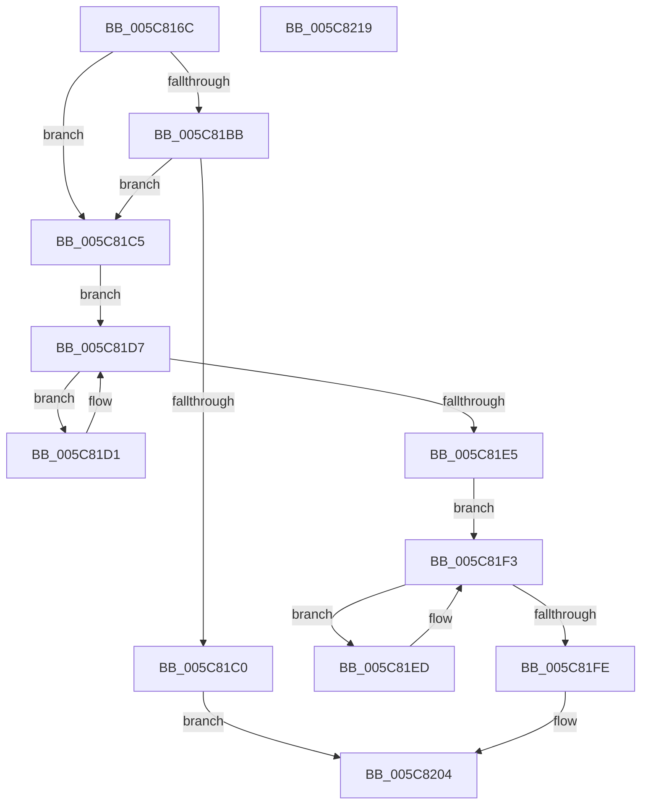

# KiGetCurrentKernelShadowStackBounds

- RVA: `0x005C816C`–`0x005C821A` (길이 `174` bytes)
- VA: `0x00000001405C816C`
- 실행 섹션: `.text`
- PDB 이름 있음: `예`; PDB Function 태그: `아니요`
- unwind 정보 RVA: `0x0005C954`
- 디코드: `50`개 명령, `174/174` bytes 표시
- 미해석 바이트: `0` (있으면 어셈블리에 `.byte`로 보존)

> 이 문서는 커널 이미지의 기계어와 PDB 기호를 분석해 생성했습니다. 4번과 5번은 함수 원형과 자료형을 바이너리 사용 방식에서 추정한 C 해석이며 원본 소스 복구 결과는 아닙니다.

## 1. Dependencies

- 직접 호출 지점: **2**; 고유 호출 대상: **1**
- 직접 호출자로 확인된 함수: **1**
- RIP 상대 이미지 참조: **0**

### Outgoing calls
- `0x005C81DC` → [MmIsAddressValidEx](../27/MmIsAddressValidEx_function_0027FDD0.md) (function, `0x0027FDD0`)
- `0x005C81F5` → [MmIsAddressValidEx](../27/MmIsAddressValidEx_function_0027FDD0.md) (function, `0x0027FDD0`)

### Direct callers
- [KiProcessControlProtectionFromKernelMode](../44/KiProcessControlProtectionFromKernelMode_function_00444B2C.md) at `0x00444B96`

### Static image references
- 디코드된 RIP-relative 메모리 참조가 없습니다.

## 2. Other-region calls and transfers

- 다른 실행 섹션으로 향하는 call: **0**
- 별도 외부 분기/꼬리 이동을 확인하지 못했습니다.

## 3. Assembly (complete function range)

```asm
005C816C  48 89 5C 24 08                  mov qword ptr [rsp + 8], rbx
005C8171  48 89 6C 24 10                  mov qword ptr [rsp + 0x10], rbp
005C8176  48 89 74 24 18                  mov qword ptr [rsp + 0x18], rsi
005C817B  57                              push rdi
005C817C  48 83 EC 20                     sub rsp, 0x20
005C8180  65 48 8B 04 25 88 01 00 00      mov rax, qword ptr gs:[0x188]
005C8189  33 DB                           xor ebx, ebx
005C818B  BD 00 10 00 00                  mov ebp, 0x1000
005C8190  48 8B F1                        mov rsi, rcx
005C8193  48 C7 C1 00 F0 FF FF            mov rcx, 0xfffffffffffff000
005C819A  F3 48 0F 1E CB                  rdsspq rbx
005C819F  48 8B 90 18 04 00 00            mov rdx, qword ptr [rax + 0x418]
005C81A6  48 8B 80 20 04 00 00            mov rax, qword ptr [rax + 0x420]
005C81AD  48 2B D5                        sub rdx, rbp
005C81B0  48 23 C1                        and rax, rcx
005C81B3  48 03 C5                        add rax, rbp
005C81B6  48 3B DA                        cmp rbx, rdx
005C81B9  73 0A                           jae 0x1405c81c5
005C81BB  48 3B D8                        cmp rbx, rax
005C81BE  72 05                           jb 0x1405c81c5
005C81C0  48 89 16                        mov qword ptr [rsi], rdx
005C81C3  EB 3F                           jmp 0x1405c8204
005C81C5  48 23 D9                        and rbx, rcx
005C81C8  48 8D BB 00 F0 FF FF            lea rdi, [rbx - 0x1000]
005C81CF  EB 06                           jmp 0x1405c81d7
005C81D1  48 8B DF                        mov rbx, rdi
005C81D4  48 2B FD                        sub rdi, rbp
005C81D7  33 D2                           xor edx, edx
005C81D9  48 8B CF                        mov rcx, rdi
005C81DC  E8 EF 7B CB FF                  call 0x14027fdd0
005C81E1  84 C0                           test al, al
005C81E3  75 EC                           jne 0x1405c81d1
005C81E5  48 8B FB                        mov rdi, rbx
005C81E8  48 8B CB                        mov rcx, rbx
005C81EB  EB 06                           jmp 0x1405c81f3
005C81ED  48 03 FD                        add rdi, rbp
005C81F0  48 8B CF                        mov rcx, rdi
005C81F3  33 D2                           xor edx, edx
005C81F5  E8 D6 7B CB FF                  call 0x14027fdd0
005C81FA  84 C0                           test al, al
005C81FC  75 EF                           jne 0x1405c81ed
005C81FE  48 89 3E                        mov qword ptr [rsi], rdi
005C8201  48 8B C3                        mov rax, rbx
005C8204  48 8B 5C 24 30                  mov rbx, qword ptr [rsp + 0x30]
005C8209  48 8B 6C 24 38                  mov rbp, qword ptr [rsp + 0x38]
005C820E  48 8B 74 24 40                  mov rsi, qword ptr [rsp + 0x40]
005C8213  48 83 C4 20                     add rsp, 0x20
005C8217  5F                              pop rdi
005C8218  C3                              ret
005C8219  CC                              int3
```

## 4. C-style interpretation (structured pseudocode)

```c
__int64 __fastcall KiGetCurrentKernelShadowStackBounds(__int64 a1)
{
    __int64 result;
    __int64 v_rbx;
    __int64 v_rdi;
    __int64 v_rsp;
    unsigned __int64 v_stack_p10;
    unsigned __int64 v_stack_p18;
    unsigned __int64 v_stack_p8;

    v_stack_p8 = v_rbx;
    v_stack_p10 = v_rbp;
    v_stack_p18 = v_rsi;
    v_rsp = (v_rsp) - (32);
    v_rbx = 0;
    a2 = (*(unsigned __int64 *)(*(unsigned __int64 *)(gs_base + (0 + 392)) + 1048)) - ((unsigned int)(0x1000ULL));
    result = (*(unsigned __int64 *)(*(unsigned __int64 *)(gs_base + (0 + 392)) + 1056)) & (0xFFFFFFFFFFFFF000ULL);
    result = (result) + ((unsigned int)(0x1000ULL));
    if (0 >= a2) goto loc_005C81C5;
    if (0 < result) goto loc_005C81C5;
    *(unsigned __int64 *)(a1) = a2;
    goto loc_005C8204;
loc_005C81C5:
    v_rbx = (v_rbx) & (0xFFFFFFFFFFFFF000ULL);
    goto loc_005C81D7;
loc_005C81D1:
    v_rdi = (v_rbx - 4096) - ((unsigned int)(0x1000ULL));
loc_005C81D7:
    a2 = 0;
    result = MmIsAddressValidEx(v_rdi, a2, a3, a4);
    if ((unsigned __int8)(result) != 0) goto loc_005C81D1;
    goto loc_005C81F3;
loc_005C81ED:
    v_rdi = (v_rbx - 4096) + ((unsigned int)(0x1000ULL));
loc_005C81F3:
    a2 = 0;
    result = MmIsAddressValidEx(v_rdi, a2, a3, a4);
    if ((unsigned __int8)(result) != 0) goto loc_005C81ED;
    *(unsigned __int64 *)(a1) = v_rdi;
loc_005C8204:
    v_rsp = (v_rsp) + (32);
    return v_rbx - 4096;
}
```

## 5. (Beta) C Style

```c
int64_t KiGetCurrentKernelShadowStackBounds(void *Arg1)
{
    uint8_t *arg1 = (uint8_t *)Arg1;

    int64_t result;
    int64_t local_rbx;
    int64_t local_rdi;
    int64_t local_rsp;
    uint64_t v_stack_p10;
    uint64_t v_stack_p18;
    uint64_t v_stack_p8;

    v_stack_p8 = local_rbx;
    v_stack_p10 = local_rbp;
    v_stack_p18 = local_rsi;
    local_rsp = (local_rsp) - (32);
    local_rbx = 0;
    a2 = (*(uint64_t *)(*(uint64_t *)(gs_base + (0 + 0x188)) + 0x418)) - ((uint32_t)(0x1000ULL));
    result = (*(uint64_t *)(*(uint64_t *)(gs_base + (0 + 0x188)) + 0x420)) & (0xFFFFFFFFFFFFF000ULL);
    result = (result) + ((uint32_t)(0x1000ULL));
    if (0 >= a2) goto loc_005C81C5;
    if (0 < result) goto loc_005C81C5;
    *(uint64_t *)(arg1) = a2;
    goto loc_005C8204;
loc_005C81C5:
    local_rbx = (local_rbx) & (0xFFFFFFFFFFFFF000ULL);
    goto loc_005C81D7;
loc_005C81D1:
    local_rdi = (local_rbx - 4096) - ((uint32_t)(0x1000ULL));
loc_005C81D7:
    a2 = 0;
    result = MmIsAddressValidEx(local_rdi, a2, a3, a4);
    if ((uint8_t)(result) != 0) goto loc_005C81D1;
    goto loc_005C81F3;
loc_005C81ED:
    local_rdi = (local_rbx - 4096) + ((uint32_t)(0x1000ULL));
loc_005C81F3:
    a2 = 0;
    result = MmIsAddressValidEx(local_rdi, a2, a3, a4);
    if ((uint8_t)(result) != 0) goto loc_005C81ED;
    *(uint64_t *)(arg1) = local_rdi;
loc_005C8204:
    local_rsp = (local_rsp) + (32);
    return local_rbx - 4096;
}
```

### 관측된 메모리 오프셋

구조체 형식이 확인되지 않은 접근은 인자 기준의 오프셋으로만 기록했습니다.

| 기준 인자 | 오프셋 표현 | 폭 (bit) | 접근 |
|---|---:|---:|---|
| `Arg1` | `+ 0x0` | `64` | `W` |

## 6. Execution-region graph

[열기: 2D/3D 그래프와 함수 탐색 컨트롤 패널](../../../control-panel.html?section=text&rva=0x005C816C&view=graph)

- 2D 그래프는 위에서 아래로 흐르고, 3D 그래프는 빈 공간을 드래그해 회전합니다. Shift+드래그는 이동, 휠은 확대·축소, 함수 노드 선택은 대상 보고서 이동입니다.

### Static fallback


