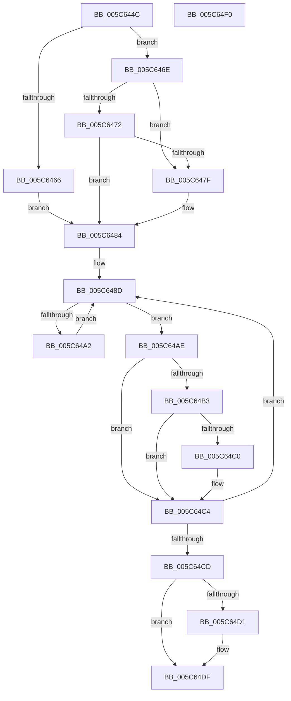

# KiGetNextTimer2ExpirationDueTime

- RVA: `0x005C644C`–`0x005C64F1` (길이 `165` bytes)
- VA: `0x00000001405C644C`
- 실행 섹션: `.text`
- PDB 이름 있음: `예`; PDB Function 태그: `아니요`
- unwind 정보 RVA: `0x0005CAAC`
- 디코드: `52`개 명령, `165/165` bytes 표시
- 미해석 바이트: `0` (있으면 어셈블리에 `.byte`로 보존)

> 이 문서는 커널 이미지의 기계어와 PDB 기호를 분석해 생성했습니다. 4번과 5번은 함수 원형과 자료형을 바이너리 사용 방식에서 추정한 C 해석이며 원본 소스 복구 결과는 아닙니다.

## 1. Dependencies

- 직접 호출 지점: **1**; 고유 호출 대상: **1**
- 직접 호출자로 확인된 함수: **1**
- RIP 상대 이미지 참조: **2**

### Outgoing calls
- `0x005C64D3` → [KiReadNextTimer2DueTimeForHrCollections](../44/KiReadNextTimer2DueTimeForHrCollections_function_0044F6C0.md) (function, `0x0044F6C0`)

### Direct callers
- [KiGetNextTimerExpirationDueTime](../5B/KiGetNextTimerExpirationDueTime_function_005BCF60.md) at `0x005BD0CB`

### Static image references
- `0x005C6472` → RVA `0x00EFAB79` (`.data`; read)
- `0x005C6491` → RVA `0x00F23330` (`.data`; read)

## 2. Other-region calls and transfers

- 다른 실행 섹션으로 향하는 call: **0**
- 별도 외부 분기/꼬리 이동을 확인하지 못했습니다.

## 3. Assembly (complete function range)

```asm
005C644C  48 89 5C 24 08                  mov qword ptr [rsp + 8], rbx
005C6451  57                              push rdi
005C6452  48 83 EC 20                     sub rsp, 0x20
005C6456  49 83 CA FF                     or r10, 0xffffffffffffffff
005C645A  32 DB                           xor bl, bl
005C645C  49 8B F8                        mov rdi, r8
005C645F  4D 8B DA                        mov r11, r10
005C6462  84 C9                           test cl, cl
005C6464  75 08                           jne 0x1405c646e
005C6466  B3 01                           mov bl, 1
005C6468  41 8D 4A 04                     lea ecx, [r10 + 4]
005C646C  EB 16                           jmp 0x1405c6484
005C646E  84 D2                           test dl, dl
005C6470  74 0D                           je 0x1405c647f
005C6472  38 1D 01 47 93 00               cmp byte ptr [rip + 0x934701], bl
005C6478  B9 06 00 00 00                  mov ecx, 6
005C647D  75 05                           jne 0x1405c6484
005C647F  B9 05 00 00 00                  mov ecx, 5
005C6484  4C 8B 44 24 50                  mov r8, qword ptr [rsp + 0x50]
005C6489  41 C6 00 00                     mov byte ptr [r8], 0
005C648D  48 8D 04 49                     lea rax, [rcx + rcx*2]
005C6491  48 8D 15 98 CE 95 00            lea rdx, [rip + 0x95ce98]
005C6498  48 8B 14 C2                     mov rdx, qword ptr [rdx + rax*8]
005C649C  48 83 F9 03                     cmp rcx, 3
005C64A0  75 0C                           jne 0x1405c64ae
005C64A2  49 3B D2                        cmp rdx, r10
005C64A5  48 FF C1                        inc rcx
005C64A8  4C 0F 42 D2                     cmovb r10, rdx
005C64AC  EB DF                           jmp 0x1405c648d
005C64AE  49 3B D3                        cmp rdx, r11
005C64B1  73 11                           jae 0x1405c64c4
005C64B3  48 8D 41 FB                     lea rax, [rcx - 5]
005C64B7  4C 8B DA                        mov r11, rdx
005C64BA  48 83 F8 01                     cmp rax, 1
005C64BE  77 04                           ja 0x1405c64c4
005C64C0  41 C6 00 01                     mov byte ptr [r8], 1
005C64C4  48 FF C1                        inc rcx
005C64C7  48 83 F9 07                     cmp rcx, 7
005C64CB  7C C0                           jl 0x1405c648d
005C64CD  84 DB                           test bl, bl
005C64CF  74 0E                           je 0x1405c64df
005C64D1  33 C9                           xor ecx, ecx
005C64D3  E8 E8 91 E8 FF                  call 0x14044f6c0
005C64D8  49 3B C2                        cmp rax, r10
005C64DB  4C 0F 42 D0                     cmovb r10, rax
005C64DF  48 8B 5C 24 30                  mov rbx, qword ptr [rsp + 0x30]
005C64E4  4C 89 17                        mov qword ptr [rdi], r10
005C64E7  4D 89 19                        mov qword ptr [r9], r11
005C64EA  48 83 C4 20                     add rsp, 0x20
005C64EE  5F                              pop rdi
005C64EF  C3                              ret
005C64F0  CC                              int3
```

## 4. C-style interpretation (structured pseudocode)

```c
__int64 __fastcall KiGetNextTimer2ExpirationDueTime(unsigned __int8 a1, unsigned __int8 a2, __int64 a3, __int64 a4, __int64 a5)
{
    __int64 result;
    __int64 v_r10;
    __int64 v_rbx;
    __int64 v_rsp;
    unsigned __int64 v_stack_p8;

    v_stack_p8 = v_rbx;
    v_rsp = (v_rsp) - (32);
    v_r10 = (v_r10) | (-1);
    v_rbx = 0;
    if (a1 != 0) goto loc_005C646E;
    goto loc_005C6484;
loc_005C646E:
    if (a2 == 0) goto loc_005C647F;
    if ((*(unsigned __int8 *)(v_rip + 9651969)) == 1) {
        a1 = 5;
    }
    *(unsigned __int8 *)(a5) = 0;
loc_005C648D:
    if (a1 != 3) goto loc_005C64AE;
    a1 = (a1) + 1;
    if ((*(unsigned __int64 *)(v_rip + 9817752 + a1 + a1 * 2 * 8)) < v_r10) { v_r10 = *(unsigned __int64 *)(v_rip + 9817752 + a1 + a1 * 2 * 8); }
    goto loc_005C648D;
loc_005C64AE:
    if ((*(unsigned __int64 *)(v_rip + 9817752 + a1 + a1 * 2 * 8)) >= v_r10) goto loc_005C64C4;
    if ((a1 - 5) <= 1) {
        *(unsigned __int8 *)(a5) = 1;
    }
    a1 = (a1) + 1;
    if (a1 < 7) goto loc_005C648D;
    result = a1 - 5;
    if (1 != 0) {
        a1 = 0;
        result = KiReadNextTimer2DueTimeForHrCollections(a1, *(unsigned __int64 *)(v_rip + 9817752 + a1 + a1 * 2 * 8), a5, a4);
        if (result < v_r10) { v_r10 = result; }
    }
    *(unsigned __int64 *)(a3) = v_r10;
    *(unsigned __int64 *)(a4) = *(unsigned __int64 *)(v_rip + 9817752 + a1 + a1 * 2 * 8);
    v_rsp = (v_rsp) + (32);
    return result;
}
```

## 5. (Beta) C Style

```c
int64_t KiGetNextTimer2ExpirationDueTime(uint8_t Arg1, uint8_t Arg2, void *Arg3, int64_t Arg4, void *Arg5)
{
    uint8_t *arg3 = (uint8_t *)Arg3;
    uint8_t *arg5 = (uint8_t *)Arg5;

    int64_t result;
    int64_t local_r10;
    int64_t local_rbx;
    int64_t local_rsp;
    uint64_t v_stack_p8;

    v_stack_p8 = local_rbx;
    local_rsp = (local_rsp) - (32);
    local_r10 = (local_r10) | (-1);
    local_rbx = 0;
    if (Arg1 != 0) goto loc_005C646E;
    goto loc_005C6484;
loc_005C646E:
    if (Arg2 == 0) goto loc_005C647F;
    if ((*(uint8_t *)(v_rip + 0x934701)) == 1) {
        Arg1 = 5;
    }
    *(uint8_t *)(arg5) = 0;
loc_005C648D:
    if (Arg1 != 3) goto loc_005C64AE;
    Arg1 = (Arg1) + 1;
    if ((*(uint64_t *)(v_rip + 0x95CE98 + Arg1 + Arg1 * 2 * 8)) < local_r10) { local_r10 = *(uint64_t *)(v_rip + 0x95CE98 + Arg1 + Arg1 * 2 * 8); }
    goto loc_005C648D;
loc_005C64AE:
    if ((*(uint64_t *)(v_rip + 0x95CE98 + Arg1 + Arg1 * 2 * 8)) >= local_r10) goto loc_005C64C4;
    if ((Arg1 - 5) <= 1) {
        *(uint8_t *)(arg5) = 1;
    }
    Arg1 = (Arg1) + 1;
    if (Arg1 < 7) goto loc_005C648D;
    result = Arg1 - 5;
    if (1 != 0) {
        Arg1 = 0;
        result = KiReadNextTimer2DueTimeForHrCollections(Arg1, *(uint64_t *)(v_rip + 0x95CE98 + Arg1 + Arg1 * 2 * 8), Arg5, Arg4);
        if (result < local_r10) { local_r10 = result; }
    }
    *(uint64_t *)(arg3) = local_r10;
    *(uint64_t *)(Arg4) = *(uint64_t *)(v_rip + 0x95CE98 + Arg1 + Arg1 * 2 * 8);
    local_rsp = (local_rsp) + (32);
    return result;
}
```

### 관측된 메모리 오프셋

구조체 형식이 확인되지 않은 접근은 인자 기준의 오프셋으로만 기록했습니다.

| 기준 인자 | 오프셋 표현 | 폭 (bit) | 접근 |
|---|---:|---:|---|
| `Arg3` | `+ 0x0` | `64` | `W` |
| `Arg5` | `+ 0x0` | `8` | `W` |

## 6. Execution-region graph

[열기: 2D/3D 그래프와 함수 탐색 컨트롤 패널](../../../control-panel.html?section=text&rva=0x005C644C&view=graph)

- 2D 그래프는 위에서 아래로 흐르고, 3D 그래프는 빈 공간을 드래그해 회전합니다. Shift+드래그는 이동, 휠은 확대·축소, 함수 노드 선택은 대상 보고서 이동입니다.

### Static fallback


