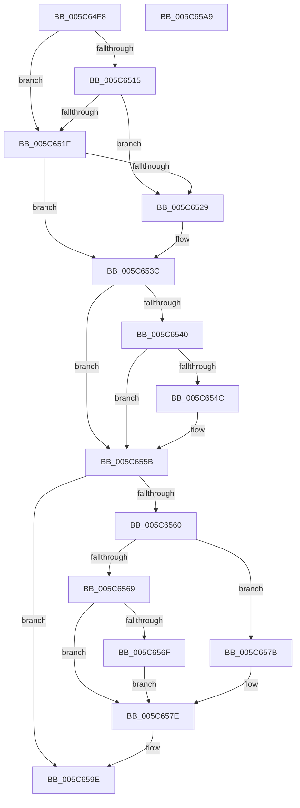

# KiGetPastDueIRTimerInfo

- RVA: `0x005C64F8`–`0x005C65AA` (길이 `178` bytes)
- VA: `0x00000001405C64F8`
- 실행 섹션: `.text`
- PDB 이름 있음: `예`; PDB Function 태그: `아니요`
- unwind 정보 RVA: `0x000950EC`
- 디코드: `52`개 명령, `178/178` bytes 표시
- 미해석 바이트: `0` (있으면 어셈블리에 `.byte`로 보존)

> 이 문서는 커널 이미지의 기계어와 PDB 기호를 분석해 생성했습니다. 4번과 5번은 함수 원형과 자료형을 바이너리 사용 방식에서 추정한 C 해석이며 원본 소스 복구 결과는 아닙니다.

## 1. Dependencies

- 직접 호출 지점: **0**; 고유 호출 대상: **0**
- 직접 호출자로 확인된 함수: **2**
- RIP 상대 이미지 참조: **5**

### Outgoing calls
- 직접 디코드된 call 명령이 없습니다.

### Direct callers
- [KeResumeClockTimerFromIdle](../5B/KeResumeClockTimerFromIdle_function_005BACC4.md) at `0x005BAE6D`
- [KiGetNextTimerExpirationDueTime](../5B/KiGetNextTimerExpirationDueTime_function_005BCF60.md) at `0x005BD10A`

### Static image references
- `0x005C6515` → RVA `0x00EFAB79` (`.data`; read)
- `0x005C6529` → RVA `0x00F233C0` (`.data`; read)
- `0x005C6530` → RVA `0x00F233B0` (`.data`; read)
- `0x005C6540` → RVA `0x00F233A8` (`.data`; read)
- `0x005C6551` → RVA `0x00F23398` (`.data`; read)

## 2. Other-region calls and transfers

- 다른 실행 섹션으로 향하는 call: **0**
- 별도 외부 분기/꼬리 이동을 확인하지 못했습니다.

## 3. Assembly (complete function range)

```asm
005C64F8  48 89 5C 24 08                  mov qword ptr [rsp + 8], rbx
005C64FD  48 89 7C 24 10                  mov qword ptr [rsp + 0x10], rdi
005C6502  33 C0                           xor eax, eax
005C6504  49 83 CA FF                     or r10, 0xffffffffffffffff
005C6508  48 8B F9                        mov rdi, rcx
005C650B  44 8B D8                        mov r11d, eax
005C650E  8D 58 17                        lea ebx, [rax + 0x17]
005C6511  84 D2                           test dl, dl
005C6513  74 0A                           je 0x1405c651f
005C6515  38 05 5E 46 93 00               cmp byte ptr [rip + 0x93465e], al
005C651B  8A D0                           mov dl, al
005C651D  75 0A                           jne 0x1405c6529
005C651F  38 05 54 46 93 00               cmp byte ptr [rip + 0x934654], al
005C6525  B2 01                           mov dl, 1
005C6527  74 13                           je 0x1405c653c
005C6529  4C 8B 15 90 CE 95 00            mov r10, qword ptr [rip + 0x95ce90]
005C6530  4C 8D 1D 79 CE 95 00            lea r11, [rip + 0x95ce79]
005C6537  BB 06 00 00 00                  mov ebx, 6
005C653C  84 D2                           test dl, dl
005C653E  74 1B                           je 0x1405c655b
005C6540  48 8B 0D 61 CE 95 00            mov rcx, qword ptr [rip + 0x95ce61]
005C6547  49 3B CA                        cmp rcx, r10
005C654A  73 0F                           jae 0x1405c655b
005C654C  BB 05 00 00 00                  mov ebx, 5
005C6551  4C 8D 1D 40 CE 95 00            lea r11, [rip + 0x95ce40]
005C6558  4C 8B D1                        mov r10, rcx
005C655B  49 3B FA                        cmp rdi, r10
005C655E  72 3E                           jb 0x1405c659e
005C6560  49 8B 4B 08                     mov rcx, qword ptr [r11 + 8]
005C6564  F6 C1 01                        test cl, 1
005C6567  74 12                           je 0x1405c657b
005C6569  48 83 F9 01                     cmp rcx, 1
005C656D  74 0F                           je 0x1405c657e
005C656F  49 8B C3                        mov rax, r11
005C6572  48 83 C8 01                     or rax, 1
005C6576  48 33 C1                        xor rax, rcx
005C6579  EB 03                           jmp 0x1405c657e
005C657B  48 8B C1                        mov rax, rcx
005C657E  83 FB 03                        cmp ebx, 3
005C6581  48 1B C9                        sbb rcx, rcx
005C6584  48 F7 D1                        not rcx
005C6587  83 E1 18                        and ecx, 0x18
005C658A  48 2B C1                        sub rax, rcx
005C658D  8A 48 EA                        mov cl, byte ptr [rax - 0x16]
005C6590  41 88 08                        mov byte ptr [r8], cl
005C6593  8A 48 EB                        mov cl, byte ptr [rax - 0x15]
005C6596  B8 01 00 00 00                  mov eax, 1
005C659B  41 88 09                        mov byte ptr [r9], cl
005C659E  48 8B 5C 24 08                  mov rbx, qword ptr [rsp + 8]
005C65A3  48 8B 7C 24 10                  mov rdi, qword ptr [rsp + 0x10]
005C65A8  C3                              ret
005C65A9  CC                              int3
```

## 4. C-style interpretation (structured pseudocode)

```c
__int64 __fastcall KiGetPastDueIRTimerInfo(__int64 a1, unsigned __int8 a2, __int64 a3, __int64 a4)
{
    __int64 result;
    __int64 v_r10;
    __int64 v_r11;
    __int64 v_rbx;
    unsigned __int64 v_stack_p10;
    unsigned __int64 v_stack_p8;

    v_stack_p8 = v_rbx;
    v_stack_p10 = v_rdi;
    result = 0;
    v_r10 = (v_r10) | (-1);
    if (a2 == 0) goto loc_005C651F;
    if ((*(unsigned __int8 *)(v_rip + 9651806)) != 0) goto loc_005C6529;
loc_005C651F:
    v_rbx = result + 23;
    v_r11 = 0;
    if ((*(unsigned __int8 *)(v_rip + 9651796)) != 0) {
        v_r10 = *(unsigned __int64 *)(v_rip + 9817744);
        v_r11 = v_rip + 9817721;
        v_rbx = 6;
    }
    if (1 == 0) goto loc_005C655B;
    if ((*(unsigned __int64 *)(v_rip + 9817697)) < v_r10) {
        v_rbx = 5;
        v_r11 = v_rip + 9817664;
        v_r10 = *(unsigned __int64 *)(v_rip + 9817697);
    }
    if (a1 < v_r10) goto loc_005C659E;
    if ((((unsigned __int8)(*(unsigned __int64 *)(v_r11 + 8))) & (1)) == 0) goto loc_005C657B;
    if ((*(unsigned __int64 *)(v_r11 + 8)) == 1) goto loc_005C657E;
    result = (v_r11) | (1);
    result = (result) ^ (*(unsigned __int64 *)(v_r11 + 8));
    goto loc_005C657E;
loc_005C657B:
loc_005C657E:
    a1 = ~(*(unsigned __int64 *)(v_r11 + 8));
    a1 = (unsigned int)((a1) & (24));
    result = (*(unsigned __int64 *)(v_r11 + 8)) - (a1);
    *(unsigned __int8 *)(a3) = (unsigned __int8)(*(unsigned __int8 *)(result - 22));
    *(unsigned __int8 *)(a4) = (unsigned __int8)(*(unsigned __int8 *)(result - 21));
loc_005C659E:
    return 1;
}
```

## 5. (Beta) C Style

```c
int64_t KiGetPastDueIRTimerInfo(int64_t Arg1, uint8_t Arg2, void *Arg3, void *Arg4)
{
    uint8_t *arg3 = (uint8_t *)Arg3;
    uint8_t *arg4 = (uint8_t *)Arg4;

    int64_t result;
    int64_t local_r10;
    int64_t local_r11;
    int64_t local_rbx;
    uint64_t v_stack_p10;
    uint64_t v_stack_p8;

    v_stack_p8 = local_rbx;
    v_stack_p10 = local_rdi;
    result = 0;
    local_r10 = (local_r10) | (-1);
    if (Arg2 == 0) goto loc_005C651F;
    if ((*(uint8_t *)(v_rip + 0x93465E)) != 0) goto loc_005C6529;
loc_005C651F:
    local_rbx = result + 23;
    local_r11 = 0;
    if ((*(uint8_t *)(v_rip + 0x934654)) != 0) {
        local_r10 = *(uint64_t *)(v_rip + 0x95CE90);
        local_r11 = v_rip + 9817721;
        local_rbx = 6;
    }
    if (1 == 0) goto loc_005C655B;
    if ((*(uint64_t *)(v_rip + 0x95CE61)) < local_r10) {
        local_rbx = 5;
        local_r11 = v_rip + 9817664;
        local_r10 = *(uint64_t *)(v_rip + 0x95CE61);
    }
    if (Arg1 < local_r10) goto loc_005C659E;
    if ((((uint8_t)(*(uint64_t *)(local_r11 + 0x8))) & (1)) == 0) goto loc_005C657B;
    if ((*(uint64_t *)(local_r11 + 0x8)) == 1) goto loc_005C657E;
    result = (local_r11) | (1);
    result = (result) ^ (*(uint64_t *)(local_r11 + 0x8));
    goto loc_005C657E;
loc_005C657B:
loc_005C657E:
    Arg1 = ~(*(uint64_t *)(local_r11 + 0x8));
    Arg1 = (uint32_t)((Arg1) & (24));
    result = (*(uint64_t *)(local_r11 + 0x8)) - (Arg1);
    *(uint8_t *)(arg3) = (uint8_t)(*(uint8_t *)(result - 0x16));
    *(uint8_t *)(arg4) = (uint8_t)(*(uint8_t *)(result - 0x15));
loc_005C659E:
    return 1;
}
```

### 관측된 메모리 오프셋

구조체 형식이 확인되지 않은 접근은 인자 기준의 오프셋으로만 기록했습니다.

| 기준 인자 | 오프셋 표현 | 폭 (bit) | 접근 |
|---|---:|---:|---|
| `Arg3` | `+ 0x0` | `8` | `W` |
| `Arg4` | `+ 0x0` | `8` | `W` |

## 6. Execution-region graph

[열기: 2D/3D 그래프와 함수 탐색 컨트롤 패널](../../../control-panel.html?section=text&rva=0x005C64F8&view=graph)

- 2D 그래프는 위에서 아래로 흐르고, 3D 그래프는 빈 공간을 드래그해 회전합니다. Shift+드래그는 이동, 휠은 확대·축소, 함수 노드 선택은 대상 보고서 이동입니다.

### Static fallback


