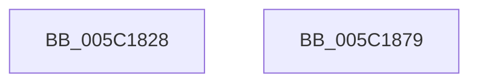

# KiGetProcessorInformation

- RVA: `0x005C1828`–`0x005C187A` (길이 `82` bytes)
- VA: `0x00000001405C1828`
- 실행 섹션: `.text`
- PDB 이름 있음: `예`; PDB Function 태그: `아니요`
- unwind 정보 RVA: `0x000B64AC`
- 디코드: `26`개 명령, `82/82` bytes 표시
- 미해석 바이트: `0` (있으면 어셈블리에 `.byte`로 보존)

> 이 문서는 커널 이미지의 기계어와 PDB 기호를 분석해 생성했습니다. 4번과 5번은 함수 원형과 자료형을 바이너리 사용 방식에서 추정한 C 해석이며 원본 소스 복구 결과는 아닙니다.

## 1. Dependencies

- 직접 호출 지점: **1**; 고유 호출 대상: **1**
- 직접 호출자로 확인된 함수: **1**
- RIP 상대 이미지 참조: **1**

### Outgoing calls
- `0x005C186E` → [_security_check_cookie](../6A/_security_check_cookie_function_006AC640.md) (function, `0x006AC640`)

### Direct callers
- [KiIntersectFeaturesWithPolicy](../../pagelk/B6/KiIntersectFeaturesWithPolicy_function_00B67324.md) at `0x00B673F8`

### Static image references
- `0x005C182E` → RVA `0x00E0A740` (`.data`; read)

## 2. Other-region calls and transfers

- 다른 실행 섹션으로 향하는 call: **0**
- 별도 외부 분기/꼬리 이동을 확인하지 못했습니다.

## 3. Assembly (complete function range)

```asm
005C1828  40 53                           push rbx
005C182A  48 83 EC 20                     sub rsp, 0x20
005C182E  48 8B 05 0B 8F 84 00            mov rax, qword ptr [rip + 0x848f0b]
005C1835  48 33 C4                        xor rax, rsp
005C1838  48 89 44 24 10                  mov qword ptr [rsp + 0x10], rax
005C183D  4C 8B D1                        mov r10, rcx
005C1840  33 C0                           xor eax, eax
005C1842  33 C9                           xor ecx, ecx
005C1844  4C 8B DA                        mov r11, rdx
005C1847  0F A2                           cpuid
005C1849  B8 01 00 00 00                  mov eax, 1
005C184E  41 89 4A 08                     mov dword ptr [r10 + 8], ecx
005C1852  33 C9                           xor ecx, ecx
005C1854  41 89 1A                        mov dword ptr [r10], ebx
005C1857  41 89 52 04                     mov dword ptr [r10 + 4], edx
005C185B  0F A2                           cpuid
005C185D  41 89 03                        mov dword ptr [r11], eax
005C1860  41 89 08                        mov dword ptr [r8], ecx
005C1863  41 89 11                        mov dword ptr [r9], edx
005C1866  48 8B 4C 24 10                  mov rcx, qword ptr [rsp + 0x10]
005C186B  48 33 CC                        xor rcx, rsp
005C186E  E8 CD AD 0E 00                  call 0x1406ac640
005C1873  48 83 C4 20                     add rsp, 0x20
005C1877  5B                              pop rbx
005C1878  C3                              ret
005C1879  CC                              int3
```

## 4. C-style interpretation (structured pseudocode)

```c
__int64 __fastcall KiGetProcessorInformation(__int64 a1, __int64 a2, __int64 a3, __int64 a4)
{
    __int64 result;
    __int64 v_rsp;
    unsigned __int64 v_stack_m18;

    v_rsp = (v_rsp) - (32);
    result = (*(unsigned __int64 *)(v_rip + 8687371)) ^ (v_rsp);
    v_stack_m18 = result;
    result = 0;
    a1 = 0;
    *(unsigned int *)(a1 + 8) = 0;
    a1 = 0;
    *(unsigned int *)(a1) = (unsigned int)(v_rbx);
    *(unsigned int *)(a1 + 4) = (unsigned int)(a2);
    *(unsigned int *)(a2) = 1;
    *(unsigned int *)(a3) = 0;
    *(unsigned int *)(a4) = (unsigned int)(a2);
    a1 = (v_stack_m18) ^ (v_rsp);
    result = _security_check_cookie(a1, a2, a3, a4);
    v_rsp = (v_rsp) + (32);
    return result;
}
```

## 5. (Beta) C Style

```c
int64_t KiGetProcessorInformation(void *Arg1, void *Arg2, void *Arg3, void *Arg4)
{
    uint8_t *arg1 = (uint8_t *)Arg1;
    uint8_t *arg2 = (uint8_t *)Arg2;
    uint8_t *arg3 = (uint8_t *)Arg3;
    uint8_t *arg4 = (uint8_t *)Arg4;

    int64_t result;
    int64_t local_rsp;
    uint64_t v_stack_m18;

    local_rsp = (local_rsp) - (32);
    result = (*(uint64_t *)(v_rip + 0x848F0B)) ^ (local_rsp);
    v_stack_m18 = result;
    result = 0;
    Arg1 = 0;
    *(uint32_t *)(arg1 + 0x8) = 0;
    Arg1 = 0;
    *(uint32_t *)(arg1) = (uint32_t)(local_rbx);
    *(uint32_t *)(arg1 + 0x4) = (uint32_t)(Arg2);
    *(uint32_t *)(arg2) = 1;
    *(uint32_t *)(arg3) = 0;
    *(uint32_t *)(arg4) = (uint32_t)(Arg2);
    Arg1 = (v_stack_m18) ^ (local_rsp);
    result = _security_check_cookie(Arg1, Arg2, Arg3, Arg4);
    local_rsp = (local_rsp) + (32);
    return result;
}
```

### 관측된 메모리 오프셋

구조체 형식이 확인되지 않은 접근은 인자 기준의 오프셋으로만 기록했습니다.

| 기준 인자 | 오프셋 표현 | 폭 (bit) | 접근 |
|---|---:|---:|---|
| `Arg1` | `+ 0x0` | `32` | `W` |
| `Arg1` | `+ 0x4` | `32` | `W` |
| `Arg1` | `+ 0x8` | `32` | `W` |
| `Arg2` | `+ 0x0` | `32` | `W` |
| `Arg3` | `+ 0x0` | `32` | `W` |
| `Arg4` | `+ 0x0` | `32` | `W` |

## 6. Execution-region graph

[열기: 2D/3D 그래프와 함수 탐색 컨트롤 패널](../../../control-panel.html?section=text&rva=0x005C1828&view=graph)

- 2D 그래프는 위에서 아래로 흐르고, 3D 그래프는 빈 공간을 드래그해 회전합니다. Shift+드래그는 이동, 휠은 확대·축소, 함수 노드 선택은 대상 보고서 이동입니다.

### Static fallback


