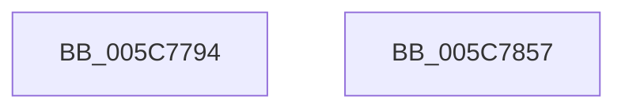

# KiGetRecoveryInformation

- RVA: `0x005C7794`–`0x005C7858` (길이 `196` bytes)
- VA: `0x00000001405C7794`
- 실행 섹션: `.text`
- PDB 이름 있음: `예`; PDB Function 태그: `아니요`
- unwind 정보 RVA: `0x0005CAAC`
- 디코드: `48`개 명령, `196/196` bytes 표시
- 미해석 바이트: `0` (있으면 어셈블리에 `.byte`로 보존)

> 이 문서는 커널 이미지의 기계어와 PDB 기호를 분석해 생성했습니다. 4번과 5번은 함수 원형과 자료형을 바이너리 사용 방식에서 추정한 C 해석이며 원본 소스 복구 결과는 아닙니다.

## 1. Dependencies

- 직접 호출 지점: **2**; 고유 호출 대상: **2**
- 직접 호출자로 확인된 함수: **1**
- RIP 상대 이미지 참조: **8**

### Outgoing calls
- `0x005C77B0` → [memset](../6C/memset_function_006C6C40.md) (function, `0x006C6C40`)
- `0x005C77C4` → [KeGetEffectiveIrql](../2F/KeGetEffectiveIrql_function_002F8030.md) (function, `0x002F8030`)

### Direct callers
- [KiAttemptBugcheckRecovery](KiAttemptBugcheckRecovery_function_005C6D24.md) at `0x005C6DD5`

### Static image references
- `0x005C77CC` → RVA `0x00E667E0` (`.data`; read)
- `0x005C77D7` → RVA `0x00F21FB0` (`.data`; read)
- `0x005C7813` → RVA `0x00F47580` (`.data`; read)
- `0x005C781C` → RVA `0x00F47588` (`.data`; read)
- `0x005C7827` → RVA `0x00F47590` (`.data`; read)
- `0x005C7832` → RVA `0x00F47598` (`.data`; read)
- `0x005C783D` → RVA `0x00F475A0` (`.data`; read)
- `0x005C7848` → RVA `0x00F10894` (`.data`; read)

## 2. Other-region calls and transfers

- 다른 실행 섹션으로 향하는 call: **0**
- 별도 외부 분기/꼬리 이동을 확인하지 못했습니다.

## 3. Assembly (complete function range)

```asm
005C7794  48 89 5C 24 08                  mov qword ptr [rsp + 8], rbx
005C7799  57                              push rdi
005C779A  48 83 EC 20                     sub rsp, 0x20
005C779E  65 48 8B 1C 25 20 00 00 00      mov rbx, qword ptr gs:[0x20]
005C77A7  33 D2                           xor edx, edx
005C77A9  48 8B F9                        mov rdi, rcx
005C77AC  44 8D 42 4C                     lea r8d, [rdx + 0x4c]
005C77B0  E8 8B F4 0F 00                  call 0x1406c6c40
005C77B5  C7 07 03 00 00 00               mov dword ptr [rdi], 3
005C77BB  8A 83 58 86 00 00               mov al, byte ptr [rbx + 0x8658]
005C77C1  88 47 05                        mov byte ptr [rdi + 5], al
005C77C4  E8 67 08 D3 FF                  call 0x1402f8030
005C77C9  88 47 06                        mov byte ptr [rdi + 6], al
005C77CC  48 8B 05 0D F0 89 00            mov rax, qword ptr [rip + 0x89f00d]
005C77D3  48 89 47 08                     mov qword ptr [rdi + 8], rax
005C77D7  8B 05 D3 A7 95 00               mov eax, dword ptr [rip + 0x95a7d3]
005C77DD  89 47 10                        mov dword ptr [rdi + 0x10], eax
005C77E0  80 BB A6 83 00 00 00            cmp byte ptr [rbx + 0x83a6], 0
005C77E7  0F 95 C0                        setne al
005C77EA  88 47 14                        mov byte ptr [rdi + 0x14], al
005C77ED  8A 43 20                        mov al, byte ptr [rbx + 0x20]
005C77F0  88 47 16                        mov byte ptr [rdi + 0x16], al
005C77F3  8A 83 BA 38 00 00               mov al, byte ptr [rbx + 0x38ba]
005C77F9  84 C0                           test al, al
005C77FB  8A 47 17                        mov al, byte ptr [rdi + 0x17]
005C77FE  0F 95 C1                        setne cl
005C7801  24 FE                           and al, 0xfe
005C7803  0A C1                           or al, cl
005C7805  88 47 17                        mov byte ptr [rdi + 0x17], al
005C7808  8B 43 24                        mov eax, dword ptr [rbx + 0x24]
005C780B  48 8B 5C 24 30                  mov rbx, qword ptr [rsp + 0x30]
005C7810  89 47 20                        mov dword ptr [rdi + 0x20], eax
005C7813  8B 05 67 FD 97 00               mov eax, dword ptr [rip + 0x97fd67]
005C7819  89 47 24                        mov dword ptr [rdi + 0x24], eax
005C781C  48 8B 05 65 FD 97 00            mov rax, qword ptr [rip + 0x97fd65]
005C7823  48 89 47 28                     mov qword ptr [rdi + 0x28], rax
005C7827  48 8B 05 62 FD 97 00            mov rax, qword ptr [rip + 0x97fd62]
005C782E  48 89 47 30                     mov qword ptr [rdi + 0x30], rax
005C7832  48 8B 05 5F FD 97 00            mov rax, qword ptr [rip + 0x97fd5f]
005C7839  48 89 47 38                     mov qword ptr [rdi + 0x38], rax
005C783D  48 8B 05 5C FD 97 00            mov rax, qword ptr [rip + 0x97fd5c]
005C7844  48 89 47 40                     mov qword ptr [rdi + 0x40], rax
005C7848  8B 05 46 90 94 00               mov eax, dword ptr [rip + 0x949046]
005C784E  89 47 48                        mov dword ptr [rdi + 0x48], eax
005C7851  48 83 C4 20                     add rsp, 0x20
005C7855  5F                              pop rdi
005C7856  C3                              ret
005C7857  CC                              int3
```

## 4. C-style interpretation (structured pseudocode)

```c
__int64 __fastcall KiGetRecoveryInformation(__int64 a1, int a2)
{
    __int64 result;
    __int64 v_rsp;
    unsigned __int64 v_stack_p8;

    v_stack_p8 = v_rbx;
    v_rsp = (v_rsp) - (32);
    a2 = 0;
    result = memset(a1, a2, a2 + 76, a4);
    *(unsigned int *)(a1) = 3;
    *(unsigned __int8 *)(a1 + 5) = (unsigned __int8)(*(unsigned __int8 *)(*(unsigned __int64 *)(gs_base + (0 + 32)) + 34392));
    result = KeGetEffectiveIrql(a1, a2, a2 + 76, a4);
    *(unsigned __int8 *)(a1 + 6) = (unsigned __int8)(result);
    *(unsigned __int64 *)(a1 + 8) = *(unsigned __int64 *)(v_rip + 9039885);
    *(unsigned int *)(a1 + 16) = (unsigned int)((unsigned int)(*(unsigned int *)(v_rip + 9807827)));
    result = ((*(unsigned __int8 *)(*(unsigned __int64 *)(gs_base + (0 + 32)) + 33702)) != 0) ? 1 : 0;
    *(unsigned __int8 *)(a1 + 20) = (unsigned __int8)(result);
    *(unsigned __int8 *)(a1 + 22) = (unsigned __int8)(*(unsigned __int8 *)(*(unsigned __int64 *)(gs_base + (0 + 32)) + 32));
    a1 = ((unsigned __int8)(*(unsigned __int8 *)(*(unsigned __int64 *)(gs_base + (0 + 32)) + 14522)) != 0) ? 1 : 0;
    result = (unsigned __int8)((*(unsigned __int8 *)(a1 + 23)) & (254));
    result = (unsigned __int8)((result) | ((unsigned __int8)(a1)));
    *(unsigned __int8 *)(a1 + 23) = (unsigned __int8)(result);
    *(unsigned int *)(a1 + 32) = (unsigned int)((unsigned int)(*(unsigned int *)(*(unsigned __int64 *)(gs_base + (0 + 32)) + 36)));
    *(unsigned int *)(a1 + 36) = (unsigned int)((unsigned int)(*(unsigned int *)(v_rip + 9960807)));
    *(unsigned __int64 *)(a1 + 40) = *(unsigned __int64 *)(v_rip + 9960805);
    *(unsigned __int64 *)(a1 + 48) = *(unsigned __int64 *)(v_rip + 9960802);
    *(unsigned __int64 *)(a1 + 56) = *(unsigned __int64 *)(v_rip + 9960799);
    *(unsigned __int64 *)(a1 + 64) = *(unsigned __int64 *)(v_rip + 9960796);
    *(unsigned int *)(a1 + 72) = (unsigned int)((unsigned int)(*(unsigned int *)(v_rip + 9736262)));
    v_rsp = (v_rsp) + (32);
    return (unsigned int)(*(unsigned int *)(v_rip + 9736262));
}
```

## 5. (Beta) C Style

```c
int64_t KiGetRecoveryInformation(void *Arg1, int32_t Arg2)
{
    uint8_t *arg1 = (uint8_t *)Arg1;

    int64_t result;
    int64_t local_rsp;
    uint64_t v_stack_p8;

    v_stack_p8 = local_rbx;
    local_rsp = (local_rsp) - (32);
    Arg2 = 0;
    result = memset(Arg1, Arg2, Arg2 + 76, a4);
    *(uint32_t *)(arg1) = 3;
    *(uint8_t *)(arg1 + 0x5) = (uint8_t)(*(uint8_t *)(*(uint64_t *)(gs_base + (0 + 0x20)) + 0x8658));
    result = KeGetEffectiveIrql(Arg1, Arg2, Arg2 + 76, a4);
    *(uint8_t *)(arg1 + 0x6) = (uint8_t)(result);
    *(uint64_t *)(arg1 + 0x8) = *(uint64_t *)(v_rip + 0x89F00D);
    *(uint32_t *)(arg1 + 0x10) = (uint32_t)((uint32_t)(*(uint32_t *)(v_rip + 0x95A7D3)));
    result = ((*(uint8_t *)(*(uint64_t *)(gs_base + (0 + 0x20)) + 0x83A6)) != 0) ? 1 : 0;
    *(uint8_t *)(arg1 + 0x14) = (uint8_t)(result);
    *(uint8_t *)(arg1 + 0x16) = (uint8_t)(*(uint8_t *)(*(uint64_t *)(gs_base + (0 + 0x20)) + 0x20));
    Arg1 = ((uint8_t)(*(uint8_t *)(*(uint64_t *)(gs_base + (0 + 0x20)) + 0x38BA)) != 0) ? 1 : 0;
    result = (uint8_t)((*(uint8_t *)(arg1 + 0x17)) & (254));
    result = (uint8_t)((result) | ((uint8_t)(Arg1)));
    *(uint8_t *)(arg1 + 0x17) = (uint8_t)(result);
    *(uint32_t *)(arg1 + 0x20) = (uint32_t)((uint32_t)(*(uint32_t *)(*(uint64_t *)(gs_base + (0 + 0x20)) + 0x24)));
    *(uint32_t *)(arg1 + 0x24) = (uint32_t)((uint32_t)(*(uint32_t *)(v_rip + 0x97FD67)));
    *(uint64_t *)(arg1 + 0x28) = *(uint64_t *)(v_rip + 0x97FD65);
    *(uint64_t *)(arg1 + 0x30) = *(uint64_t *)(v_rip + 0x97FD62);
    *(uint64_t *)(arg1 + 0x38) = *(uint64_t *)(v_rip + 0x97FD5F);
    *(uint64_t *)(arg1 + 0x40) = *(uint64_t *)(v_rip + 0x97FD5C);
    *(uint32_t *)(arg1 + 0x48) = (uint32_t)((uint32_t)(*(uint32_t *)(v_rip + 0x949046)));
    local_rsp = (local_rsp) + (32);
    return (uint32_t)(*(uint32_t *)(v_rip + 0x949046));
}
```

### 관측된 메모리 오프셋

구조체 형식이 확인되지 않은 접근은 인자 기준의 오프셋으로만 기록했습니다.

| 기준 인자 | 오프셋 표현 | 폭 (bit) | 접근 |
|---|---:|---:|---|
| `Arg1` | `+ 0x0` | `32` | `W` |
| `Arg1` | `+ 0x5` | `8` | `W` |
| `Arg1` | `+ 0x6` | `8` | `W` |
| `Arg1` | `+ 0x8` | `64` | `W` |
| `Arg1` | `+ 0x10` | `32` | `W` |
| `Arg1` | `+ 0x14` | `8` | `W` |
| `Arg1` | `+ 0x16` | `8` | `W` |
| `Arg1` | `+ 0x17` | `8` | `R` |
| `Arg1` | `+ 0x17` | `8` | `W` |
| `Arg1` | `+ 0x20` | `32` | `W` |
| `Arg1` | `+ 0x24` | `32` | `W` |
| `Arg1` | `+ 0x28` | `64` | `W` |
| `Arg1` | `+ 0x30` | `64` | `W` |
| `Arg1` | `+ 0x38` | `64` | `W` |
| `Arg1` | `+ 0x40` | `64` | `W` |
| `Arg1` | `+ 0x48` | `32` | `W` |

## 6. Execution-region graph

[열기: 2D/3D 그래프와 함수 탐색 컨트롤 패널](../../../control-panel.html?section=text&rva=0x005C7794&view=graph)

- 2D 그래프는 위에서 아래로 흐르고, 3D 그래프는 빈 공간을 드래그해 회전합니다. Shift+드래그는 이동, 휠은 확대·축소, 함수 노드 선택은 대상 보고서 이동입니다.

### Static fallback


