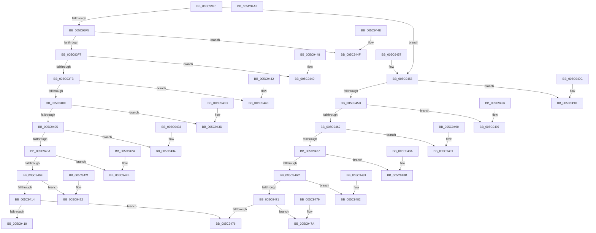

# KiGetTrapFrameRegister

- RVA: `0x005C93F0`–`0x005C94A3` (길이 `179` bytes)
- VA: `0x00000001405C93F0`
- 실행 섹션: `.text`
- PDB 이름 있음: `예`; PDB Function 태그: `아니요`
- unwind 정보 RVA: `0x000DB714`
- 디코드: `74`개 명령, `179/179` bytes 표시
- 미해석 바이트: `0` (있으면 어셈블리에 `.byte`로 보존)

> 이 문서는 커널 이미지의 기계어와 PDB 기호를 분석해 생성했습니다. 4번과 5번은 함수 원형과 자료형을 바이너리 사용 방식에서 추정한 C 해석이며 원본 소스 복구 결과는 아닙니다.

## 1. Dependencies

- 직접 호출 지점: **0**; 고유 호출 대상: **0**
- 직접 호출자로 확인된 함수: **0**
- RIP 상대 이미지 참조: **0**

### Outgoing calls
- 직접 디코드된 call 명령이 없습니다.

### Direct callers
- 이 함수 시작 RVA로 연결되는 직접 call은 확인되지 않았습니다. 간접 호출은 완전히 역산할 수 없습니다.

### Static image references
- 디코드된 RIP-relative 메모리 참조가 없습니다.

## 2. Other-region calls and transfers

- 다른 실행 섹션으로 향하는 call: **0**
- 별도 외부 분기/꼬리 이동을 확인하지 못했습니다.

## 3. Assembly (complete function range)

```asm
005C93F0  83 FA 07                        cmp edx, 7
005C93F3  7F 63                           jg 0x1405c9458
005C93F5  74 58                           je 0x1405c944f
005C93F7  85 D2                           test edx, edx
005C93F9  74 4E                           je 0x1405c9449
005C93FB  83 EA 01                        sub edx, 1
005C93FE  74 43                           je 0x1405c9443
005C9400  83 EA 01                        sub edx, 1
005C9403  74 38                           je 0x1405c943d
005C9405  83 EA 01                        sub edx, 1
005C9408  74 2A                           je 0x1405c9434
005C940A  83 EA 01                        sub edx, 1
005C940D  74 1C                           je 0x1405c942b
005C940F  83 EA 01                        sub edx, 1
005C9412  74 0E                           je 0x1405c9422
005C9414  83 FA 01                        cmp edx, 1
005C9417  75 5D                           jne 0x1405c9476
005C9419  48 8B 81 50 01 00 00            mov rax, qword ptr [rcx + 0x150]
005C9420  C3                              ret
005C9421  CC                              int3
005C9422  48 8B 81 58 01 00 00            mov rax, qword ptr [rcx + 0x158]
005C9429  C3                              ret
005C942A  CC                              int3
005C942B  48 8B 81 80 01 00 00            mov rax, qword ptr [rcx + 0x180]
005C9432  C3                              ret
005C9433  CC                              int3
005C9434  48 8B 81 40 01 00 00            mov rax, qword ptr [rcx + 0x140]
005C943B  C3                              ret
005C943C  CC                              int3
005C943D  48 8B 41 40                     mov rax, qword ptr [rcx + 0x40]
005C9441  C3                              ret
005C9442  CC                              int3
005C9443  48 8B 41 38                     mov rax, qword ptr [rcx + 0x38]
005C9447  C3                              ret
005C9448  CC                              int3
005C9449  48 8B 41 30                     mov rax, qword ptr [rcx + 0x30]
005C944D  C3                              ret
005C944E  CC                              int3
005C944F  48 8B 81 48 01 00 00            mov rax, qword ptr [rcx + 0x148]
005C9456  C3                              ret
005C9457  CC                              int3
005C9458  83 EA 08                        sub edx, 8
005C945B  74 40                           je 0x1405c949d
005C945D  83 EA 01                        sub edx, 1
005C9460  74 35                           je 0x1405c9497
005C9462  83 EA 01                        sub edx, 1
005C9465  74 2A                           je 0x1405c9491
005C9467  83 EA 01                        sub edx, 1
005C946A  74 1F                           je 0x1405c948b
005C946C  83 EA 05                        sub edx, 5
005C946F  74 11                           je 0x1405c9482
005C9471  83 FA 01                        cmp edx, 1
005C9474  74 04                           je 0x1405c947a
005C9476  33 C0                           xor eax, eax
005C9478  C3                              ret
005C9479  CC                              int3
005C947A  8B 81 78 01 00 00               mov eax, dword ptr [rcx + 0x178]
005C9480  C3                              ret
005C9481  CC                              int3
005C9482  48 8B 81 68 01 00 00            mov rax, qword ptr [rcx + 0x168]
005C9489  C3                              ret
005C948A  CC                              int3
005C948B  48 8B 41 60                     mov rax, qword ptr [rcx + 0x60]
005C948F  C3                              ret
005C9490  CC                              int3
005C9491  48 8B 41 58                     mov rax, qword ptr [rcx + 0x58]
005C9495  C3                              ret
005C9496  CC                              int3
005C9497  48 8B 41 50                     mov rax, qword ptr [rcx + 0x50]
005C949B  C3                              ret
005C949C  CC                              int3
005C949D  48 8B 41 48                     mov rax, qword ptr [rcx + 0x48]
005C94A1  C3                              ret
005C94A2  CC                              int3
```

## 4. C-style interpretation (structured pseudocode)

```c
__int64 __fastcall KiGetTrapFrameRegister(__int64 a1, int a2)
{
    __int64 result;

    if (a2 > 7) goto loc_005C9458;
    if (a2 == 7) goto loc_005C944F;
    if (a2 == 0) goto loc_005C9449;
    a2 = (unsigned int)((a2) - (1));
    if (condition_is_equal) goto loc_005C9443;
    a2 = (unsigned int)((a2) - (1));
    if (condition_is_equal) goto loc_005C943D;
    a2 = (unsigned int)((a2) - (1));
    if (condition_is_equal) goto loc_005C9434;
    a2 = (unsigned int)((a2) - (1));
    if (condition_is_equal) goto loc_005C942B;
    a2 = (unsigned int)((a2) - (1));
    if (condition_is_equal) goto loc_005C9422;
    if (a2 != 1) goto loc_005C9476;
    return *(unsigned __int64 *)(a1 + 336);
loc_005C9422:
    return *(unsigned __int64 *)(a1 + 344);
loc_005C942B:
    return *(unsigned __int64 *)(a1 + 384);
loc_005C9434:
    return *(unsigned __int64 *)(a1 + 320);
loc_005C943D:
    return *(unsigned __int64 *)(a1 + 64);
loc_005C9443:
    return *(unsigned __int64 *)(a1 + 56);
loc_005C9449:
    return *(unsigned __int64 *)(a1 + 48);
loc_005C944F:
    return *(unsigned __int64 *)(a1 + 328);
loc_005C9458:
    a2 = (unsigned int)((a2) - (8));
    if (condition_is_equal) goto loc_005C949D;
    a2 = (unsigned int)((a2) - (1));
    if (condition_is_equal) goto loc_005C9497;
    a2 = (unsigned int)((a2) - (1));
    if (condition_is_equal) goto loc_005C9491;
    a2 = (unsigned int)((a2) - (1));
    if (condition_is_equal) goto loc_005C948B;
    a2 = (unsigned int)((a2) - (5));
    if (condition_is_equal) goto loc_005C9482;
    if (a2 == 1) goto loc_005C947A;
loc_005C9476:
    result = 0;
    return result;
loc_005C947A:
    return (unsigned int)(*(unsigned int *)(a1 + 376));
loc_005C9482:
    return *(unsigned __int64 *)(a1 + 360);
loc_005C948B:
    return *(unsigned __int64 *)(a1 + 96);
loc_005C9491:
    return *(unsigned __int64 *)(a1 + 88);
loc_005C9497:
    return *(unsigned __int64 *)(a1 + 80);
loc_005C949D:
    return *(unsigned __int64 *)(a1 + 72);
}
```

## 5. (Beta) C Style

```c
int64_t KiGetTrapFrameRegister(void *Arg1, int32_t Arg2)
{
    uint8_t *arg1 = (uint8_t *)Arg1;

    int64_t result;

    if (Arg2 > 7) goto loc_005C9458;
    if (Arg2 == 7) goto loc_005C944F;
    if (Arg2 == 0) goto loc_005C9449;
    Arg2 = (uint32_t)((Arg2) - (1));
    if (condition_is_equal) goto loc_005C9443;
    Arg2 = (uint32_t)((Arg2) - (1));
    if (condition_is_equal) goto loc_005C943D;
    Arg2 = (uint32_t)((Arg2) - (1));
    if (condition_is_equal) goto loc_005C9434;
    Arg2 = (uint32_t)((Arg2) - (1));
    if (condition_is_equal) goto loc_005C942B;
    Arg2 = (uint32_t)((Arg2) - (1));
    if (condition_is_equal) goto loc_005C9422;
    if (Arg2 != 1) goto loc_005C9476;
    return *(uint64_t *)(arg1 + 0x150);
loc_005C9422:
    return *(uint64_t *)(arg1 + 0x158);
loc_005C942B:
    return *(uint64_t *)(arg1 + 0x180);
loc_005C9434:
    return *(uint64_t *)(arg1 + 0x140);
loc_005C943D:
    return *(uint64_t *)(arg1 + 0x40);
loc_005C9443:
    return *(uint64_t *)(arg1 + 0x38);
loc_005C9449:
    return *(uint64_t *)(arg1 + 0x30);
loc_005C944F:
    return *(uint64_t *)(arg1 + 0x148);
loc_005C9458:
    Arg2 = (uint32_t)((Arg2) - (8));
    if (condition_is_equal) goto loc_005C949D;
    Arg2 = (uint32_t)((Arg2) - (1));
    if (condition_is_equal) goto loc_005C9497;
    Arg2 = (uint32_t)((Arg2) - (1));
    if (condition_is_equal) goto loc_005C9491;
    Arg2 = (uint32_t)((Arg2) - (1));
    if (condition_is_equal) goto loc_005C948B;
    Arg2 = (uint32_t)((Arg2) - (5));
    if (condition_is_equal) goto loc_005C9482;
    if (Arg2 == 1) goto loc_005C947A;
loc_005C9476:
    result = 0;
    return result;
loc_005C947A:
    return (uint32_t)(*(uint32_t *)(arg1 + 0x178));
loc_005C9482:
    return *(uint64_t *)(arg1 + 0x168);
loc_005C948B:
    return *(uint64_t *)(arg1 + 0x60);
loc_005C9491:
    return *(uint64_t *)(arg1 + 0x58);
loc_005C9497:
    return *(uint64_t *)(arg1 + 0x50);
loc_005C949D:
    return *(uint64_t *)(arg1 + 0x48);
}
```

### 관측된 메모리 오프셋

구조체 형식이 확인되지 않은 접근은 인자 기준의 오프셋으로만 기록했습니다.

| 기준 인자 | 오프셋 표현 | 폭 (bit) | 접근 |
|---|---:|---:|---|
| `Arg1` | `+ 0x30` | `64` | `R` |
| `Arg1` | `+ 0x38` | `64` | `R` |
| `Arg1` | `+ 0x40` | `64` | `R` |
| `Arg1` | `+ 0x48` | `64` | `R` |
| `Arg1` | `+ 0x50` | `64` | `R` |
| `Arg1` | `+ 0x58` | `64` | `R` |
| `Arg1` | `+ 0x60` | `64` | `R` |
| `Arg1` | `+ 0x140` | `64` | `R` |
| `Arg1` | `+ 0x148` | `64` | `R` |
| `Arg1` | `+ 0x150` | `64` | `R` |
| `Arg1` | `+ 0x158` | `64` | `R` |
| `Arg1` | `+ 0x168` | `64` | `R` |
| `Arg1` | `+ 0x178` | `32` | `R` |
| `Arg1` | `+ 0x180` | `64` | `R` |

## 6. Execution-region graph

[열기: 2D/3D 그래프와 함수 탐색 컨트롤 패널](../../../control-panel.html?section=text&rva=0x005C93F0&view=graph)

- 2D 그래프는 위에서 아래로 흐르고, 3D 그래프는 빈 공간을 드래그해 회전합니다. Shift+드래그는 이동, 휠은 확대·축소, 함수 노드 선택은 대상 보고서 이동입니다.

### Static fallback


