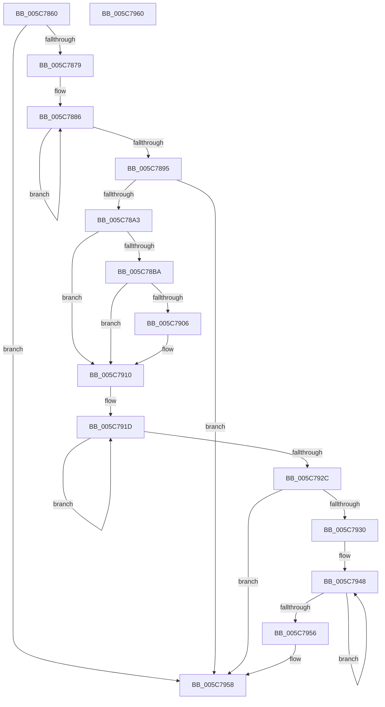

# KiHandleMultipleBugchecksDuringRecovery

- RVA: `0x005C7860`–`0x005C7961` (길이 `257` bytes)
- VA: `0x00000001405C7860`
- 실행 섹션: `.text`
- PDB 이름 있음: `예`; PDB Function 태그: `아니요`
- unwind 정보 RVA: `0x00064C80`
- 디코드: `67`개 명령, `257/257` bytes 표시
- 미해석 바이트: `0` (있으면 어셈블리에 `.byte`로 보존)

> 이 문서는 커널 이미지의 기계어와 PDB 기호를 분석해 생성했습니다. 4번과 5번은 함수 원형과 자료형을 바이너리 사용 방식에서 추정한 C 해석이며 원본 소스 복구 결과는 아닙니다.

## 1. Dependencies

- 직접 호출 지점: **3**; 고유 호출 대상: **3**
- 직접 호출자로 확인된 함수: **1**
- RIP 상대 이미지 참조: **4**

### Outgoing calls
- `0x005C78F3` → [IoSaveBugCheckRecoveryStatus](../59/IoSaveBugCheckRecoveryStatus_function_00592EEC.md) (function, `0x00592EEC`)
- `0x005C78FD` → [KiSetBugCheckRecoveryProgressFlag](KiSetBugCheckRecoveryProgressFlag_function_005C7C48.md) (function, `0x005C7C48`)
- `0x005C790B` → [KiRecordRecoveryFailure](KiRecordRecoveryFailure_function_005C7AB8.md) (function, `0x005C7AB8`)

### Direct callers
- [KeBugCheck2](../5B/KeBugCheck2_function_005B27D0.md) at `0x005B333B`

### Static image references
- `0x005C7866` → RVA `0x00F1090C` (`.data`; read)
- `0x005C7879` → RVA `0x00F109F0` (`.data`; read)
- `0x005C78BA` → RVA `0x00F10904` (`.data`; read)
- `0x005C7939` → RVA `0x00F4754C` (`.data`; read)

## 2. Other-region calls and transfers

- 다른 실행 섹션으로 향하는 call: **0**
- 별도 외부 분기/꼬리 이동을 확인하지 못했습니다.

## 3. Assembly (complete function range)

```asm
005C7860  40 53                           push rbx
005C7862  48 83 EC 30                     sub rsp, 0x30
005C7866  8B 05 A0 90 94 00               mov eax, dword ptr [rip + 0x9490a0]
005C786C  33 DB                           xor ebx, ebx
005C786E  44 8B C1                        mov r8d, ecx
005C7871  85 C0                           test eax, eax
005C7873  0F 8E DF 00 00 00               jle 0x1405c7958
005C7879  0F 0D 0D 70 91 94 00            prefetchw byte ptr [rip + 0x949170]
005C7880  8B 05 6A 91 94 00               mov eax, dword ptr [rip + 0x94916a]
005C7886  8B D0                           mov edx, eax
005C7888  83 CA 10                        or edx, 0x10
005C788B  F0 0F B1 15 5D 91 94 00         lock cmpxchg dword ptr [rip + 0x94915d], edx
005C7893  75 F1                           jne 0x1405c7886
005C7895  8B C8                           mov ecx, eax
005C7897  80 E1 11                        and cl, 0x11
005C789A  80 F9 01                        cmp cl, 1
005C789D  0F 85 B5 00 00 00               jne 0x1405c7958
005C78A3  65 8B 14 25 A4 01 00 00         mov edx, dword ptr gs:[0x1a4]
005C78AB  41 8B C8                        mov ecx, r8d
005C78AE  C1 E9 04                        shr ecx, 4
005C78B1  3B CA                           cmp ecx, edx
005C78B3  0F 94 C1                        sete cl
005C78B6  A8 02                           test al, 2
005C78B8  74 56                           je 0x1405c7910
005C78BA  39 15 44 90 94 00               cmp dword ptr [rip + 0x949044], edx
005C78C0  0F 94 C0                        sete al
005C78C3  41 C1 E8 02                     shr r8d, 2
005C78C7  33 D2                           xor edx, edx
005C78C9  41 83 E0 03                     and r8d, 3
005C78CD  48 89 54 24 20                  mov qword ptr [rsp + 0x20], rdx
005C78D2  41 FE C0                        inc r8b
005C78D5  88 4C 24 24                     mov byte ptr [rsp + 0x24], cl
005C78D9  48 8D 4C 24 20                  lea rcx, [rsp + 0x20]
005C78DE  44 88 44 24 25                  mov byte ptr [rsp + 0x25], r8b
005C78E3  89 54 24 28                     mov dword ptr [rsp + 0x28], edx
005C78E7  C7 44 24 20 03 00 00 00         mov dword ptr [rsp + 0x20], 3
005C78EF  88 44 24 26                     mov byte ptr [rsp + 0x26], al
005C78F3  E8 F4 B5 FC FF                  call 0x140592eec
005C78F8  B9 00 00 80 00                  mov ecx, 0x800000
005C78FD  E8 46 03 00 00                  call 0x1405c7c48
005C7902  85 C0                           test eax, eax
005C7904  79 0A                           jns 0x1405c7910
005C7906  B9 05 00 00 00                  mov ecx, 5
005C790B  E8 A8 01 00 00                  call 0x1405c7ab8
005C7910  0F 0D 0D D9 90 94 00            prefetchw byte ptr [rip + 0x9490d9]
005C7917  8B 05 D3 90 94 00               mov eax, dword ptr [rip + 0x9490d3]
005C791D  8B C8                           mov ecx, eax
005C791F  83 C9 08                        or ecx, 8
005C7922  F0 0F B1 0D C6 90 94 00         lock cmpxchg dword ptr [rip + 0x9490c6], ecx
005C792A  75 F1                           jne 0x1405c791d
005C792C  A8 08                           test al, 8
005C792E  75 28                           jne 0x1405c7958
005C7930  65 48 8B 14 25 20 00 00 00      mov rdx, qword ptr gs:[0x20]
005C7939  8B 05 0D FC 97 00               mov eax, dword ptr [rip + 0x97fc0d]
005C793F  8B 52 24                        mov edx, dword ptr [rdx + 0x24]
005C7942  C1 E2 04                        shl edx, 4
005C7945  83 CA 03                        or edx, 3
005C7948  8B C8                           mov ecx, eax
005C794A  F0 0F B1 15 FA FB 97 00         lock cmpxchg dword ptr [rip + 0x97fbfa], edx
005C7952  3B C1                           cmp eax, ecx
005C7954  75 F2                           jne 0x1405c7948
005C7956  B3 01                           mov bl, 1
005C7958  8A C3                           mov al, bl
005C795A  48 83 C4 30                     add rsp, 0x30
005C795E  5B                              pop rbx
005C795F  C3                              ret
005C7960  CC                              int3
```

## 4. C-style interpretation (structured pseudocode)

```c
__int64 __fastcall KiHandleMultipleBugchecksDuringRecovery(int a1)
{
    __int64 result;
    __int64 v_rbx;
    __int64 v_rsp;
    unsigned int v_stack_m10;
    unsigned __int8 v_stack_m12;
    unsigned __int8 v_stack_m13;
    unsigned __int8 v_stack_m14;
    unsigned __int64 v_stack_m18;

    v_rsp = (v_rsp) - (48);
    v_rbx = 0;
    if (condition_is_less_or_equal) goto loc_005C7958;
loc_005C7886:
    a2 = (unsigned int)(((unsigned int)((unsigned int)((unsigned int)(*(unsigned int *)(v_rip + 9736554))))) | (16));
    if (condition_is_not_equal) goto loc_005C7886;
    a1 = (unsigned __int8)(((unsigned int)((unsigned int)((unsigned int)(*(unsigned int *)(v_rip + 9736554))))) & (17));
    if (((unsigned __int8)(a1)) != 1) goto loc_005C7958;
    a1 = (unsigned int)(((unsigned int)((unsigned int)((unsigned int)(a1)))) >> (4));
    a1 = (a1 == ((unsigned int)((unsigned int)(*(unsigned int *)(gs_base + (0 + 420)))))) ? 1 : 0;
    if ((((unsigned __int8)((unsigned int)(*(unsigned int *)(v_rip + 9736554)))) & (2)) == 0) goto loc_005C7910;
    result = ((*(unsigned int *)(v_rip + 9736260)) == ((unsigned int)((unsigned int)(*(unsigned int *)(gs_base + (0 + 420)))))) ? 1 : 0;
    a3 = (unsigned int)(((unsigned int)(a1)) >> (2));
    a2 = 0;
    a3 = (unsigned int)((a3) & (3));
    v_stack_m18 = 0;
    a3 = (unsigned __int8)((a3) + 1);
    v_stack_m14 = (unsigned __int8)(a1);
    v_stack_m13 = (unsigned __int8)(a3);
    v_stack_m10 = 0;
    v_stack_m18 = 3;
    v_stack_m12 = (unsigned __int8)(result);
    result = IoSaveBugCheckRecoveryStatus(v_stack_m18, a2, a3, a4);
    result = KiSetBugCheckRecoveryProgressFlag((unsigned int)(0x800000ULL), a2, a3, a4);
    if (sign_flag) {
        a1 = 5;
        result = KiRecordRecoveryFailure(a1, a2, a3, a4);
    }
loc_005C791D:
    a1 = (unsigned int)(((unsigned int)((unsigned int)((unsigned int)(*(unsigned int *)(v_rip + 9736403))))) | (8));
    if (condition_is_not_equal) goto loc_005C791D;
    if ((((unsigned __int8)((unsigned int)(*(unsigned int *)(v_rip + 9736403)))) & (8)) != 0) goto loc_005C7958;
    a2 = (unsigned int)(((unsigned int)(*(unsigned int *)(*(unsigned __int64 *)(gs_base + (0 + 32)) + 36))) << (4));
    a2 = (unsigned int)((a2) | (3));
loc_005C7948:
    if (((unsigned int)((unsigned int)(*(unsigned int *)(v_rip + 9960461)))) != ((unsigned int)((unsigned int)((unsigned int)((unsigned int)(*(unsigned int *)(v_rip + 9960461))))))) goto loc_005C7948;
loc_005C7958:
    v_rsp = (v_rsp) + (48);
    return 1;
}
```

## 5. (Beta) C Style

```c
int64_t KiHandleMultipleBugchecksDuringRecovery(int32_t Arg1)
{
    int64_t result;
    int64_t local_rbx;
    int64_t local_rsp;
    uint32_t v_stack_m10;
    uint8_t v_stack_m12;
    uint8_t v_stack_m13;
    uint8_t v_stack_m14;
    uint64_t v_stack_m18;

    local_rsp = (local_rsp) - (48);
    local_rbx = 0;
    if (condition_is_less_or_equal) goto loc_005C7958;
loc_005C7886:
    a2 = (uint32_t)(((uint32_t)((uint32_t)((uint32_t)(*(uint32_t *)(v_rip + 0x94916A))))) | (16));
    if (condition_is_not_equal) goto loc_005C7886;
    Arg1 = (uint8_t)(((uint32_t)((uint32_t)((uint32_t)(*(uint32_t *)(v_rip + 0x94916A))))) & (17));
    if (((uint8_t)(Arg1)) != 1) goto loc_005C7958;
    Arg1 = (uint32_t)(((uint32_t)((uint32_t)((uint32_t)(Arg1)))) >> (4));
    Arg1 = (Arg1 == ((uint32_t)((uint32_t)(*(uint32_t *)(gs_base + (0 + 0x1A4)))))) ? 1 : 0;
    if ((((uint8_t)((uint32_t)(*(uint32_t *)(v_rip + 0x94916A)))) & (2)) == 0) goto loc_005C7910;
    result = ((*(uint32_t *)(v_rip + 0x949044)) == ((uint32_t)((uint32_t)(*(uint32_t *)(gs_base + (0 + 0x1A4)))))) ? 1 : 0;
    a3 = (uint32_t)(((uint32_t)(Arg1)) >> (2));
    a2 = 0;
    a3 = (uint32_t)((a3) & (3));
    v_stack_m18 = 0;
    a3 = (uint8_t)((a3) + 1);
    v_stack_m14 = (uint8_t)(Arg1);
    v_stack_m13 = (uint8_t)(a3);
    v_stack_m10 = 0;
    v_stack_m18 = 3;
    v_stack_m12 = (uint8_t)(result);
    result = IoSaveBugCheckRecoveryStatus(v_stack_m18, a2, a3, a4);
    result = KiSetBugCheckRecoveryProgressFlag((uint32_t)(0x800000ULL), a2, a3, a4);
    if (sign_flag) {
        Arg1 = 5;
        result = KiRecordRecoveryFailure(Arg1, a2, a3, a4);
    }
loc_005C791D:
    Arg1 = (uint32_t)(((uint32_t)((uint32_t)((uint32_t)(*(uint32_t *)(v_rip + 0x9490D3))))) | (8));
    if (condition_is_not_equal) goto loc_005C791D;
    if ((((uint8_t)((uint32_t)(*(uint32_t *)(v_rip + 0x9490D3)))) & (8)) != 0) goto loc_005C7958;
    a2 = (uint32_t)(((uint32_t)(*(uint32_t *)(*(uint64_t *)(gs_base + (0 + 0x20)) + 0x24))) << (4));
    a2 = (uint32_t)((a2) | (3));
loc_005C7948:
    if (((uint32_t)((uint32_t)(*(uint32_t *)(v_rip + 0x97FC0D)))) != ((uint32_t)((uint32_t)((uint32_t)((uint32_t)(*(uint32_t *)(v_rip + 0x97FC0D))))))) goto loc_005C7948;
loc_005C7958:
    local_rsp = (local_rsp) + (48);
    return 1;
}
```

## 6. Execution-region graph

[열기: 2D/3D 그래프와 함수 탐색 컨트롤 패널](../../../control-panel.html?section=text&rva=0x005C7860&view=graph)

- 2D 그래프는 위에서 아래로 흐르고, 3D 그래프는 빈 공간을 드래그해 회전합니다. Shift+드래그는 이동, 휠은 확대·축소, 함수 노드 선택은 대상 보고서 이동입니다.

### Static fallback


